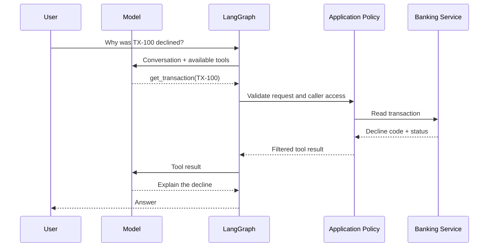
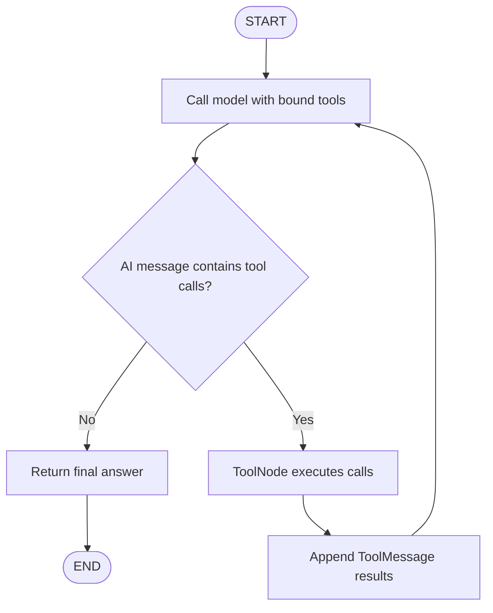
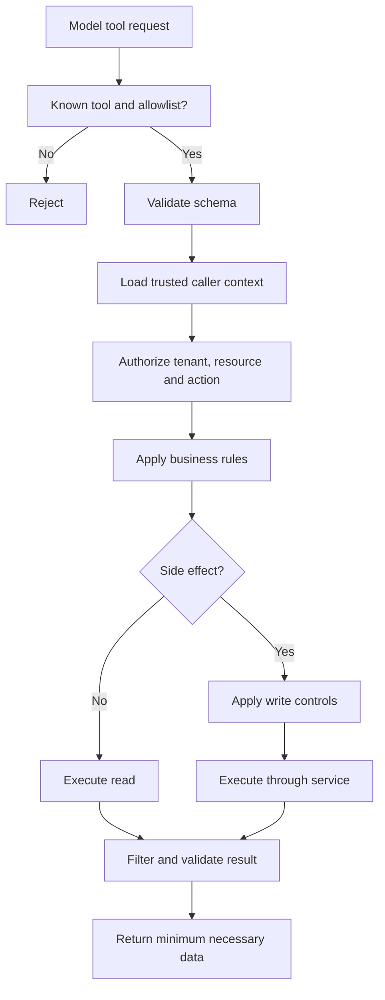
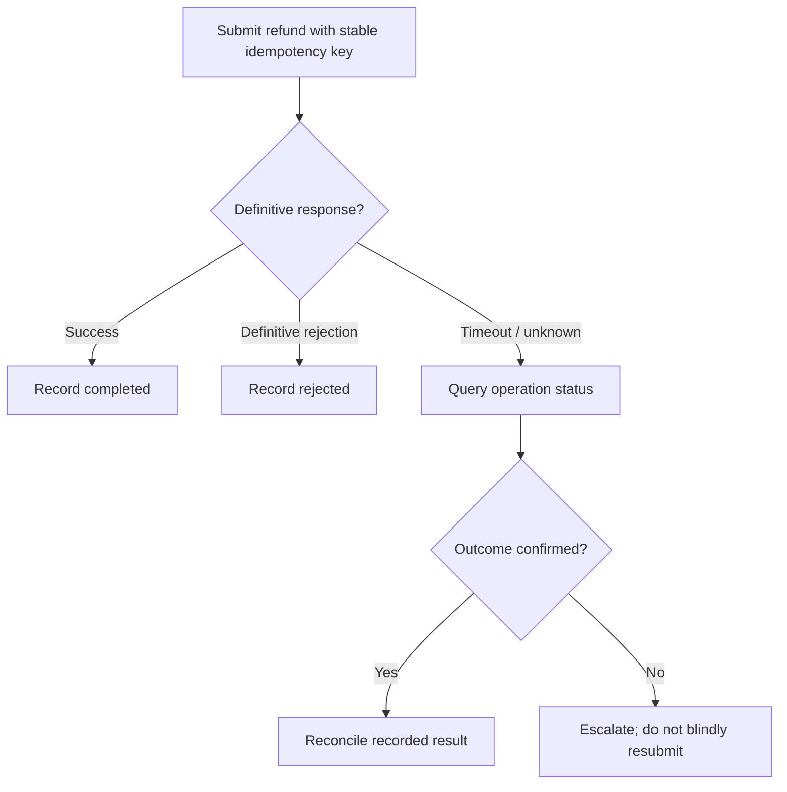
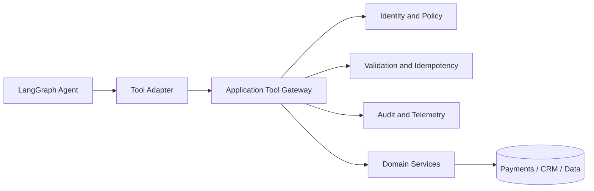

# 22 — LangGraph Tool Execution

> **The model can ask to run a tool. It cannot grant itself permission to run one.**

Imagine a customer asking a banking assistant: “Why was my payment declined?” The assistant may need to look up a transaction, retrieve a policy and explain the result. If the customer then asks for a refund, the stakes change: a response from the model is no longer enough. A real operation is about to happen.

This chapter follows one tool request from model output to controlled execution. The focus is the LangChain/LangGraph implementation and the engineering boundary around it—not a general tour of graph routing or human approval.

## 1. A tool call is a request, not an execution

A model does not reach into your database or invoke your payment API directly. It returns a structured tool request: a tool name and arguments. Your application decides whether that request is valid and allowed, executes the implementation, and sends the result back to the model.



Keep the responsibilities distinct:

- **Model:** selects a capability and proposes arguments.
- **LangGraph:** orchestrates the model/tool cycle and carries messages through graph state.
- **Tool:** implements one bounded operation.
- **Application services:** supply trusted identity, enforce policy and call enterprise systems.
- **Enterprise service:** remains the authority for business data and side effects.

“Tool calling” and “function calling” are often used for this same pattern. The important distinction is between *requesting* a function and *executing* it.

## 2. Design a tool the model can use correctly

A tool is more than a Python function with a clever name. Its description and schema are part of the interface the model uses to choose and parameterize it. Vague descriptions invite poor tool selection; loose schemas make validation harder.

For example, `get_transaction` should retrieve a transaction. It should not also decide refund eligibility, approve the refund and issue the payment. Keep the capability narrow, then compose capabilities in the workflow that owns the business process.

```python
from pydantic import BaseModel, Field
from langchain_core.tools import tool

class TransactionLookup(BaseModel):
    transaction_id: str = Field(
        description="Transaction reference, for example TX-100"
    )

@tool(args_schema=TransactionLookup)
def get_transaction(transaction_id: str) -> dict:
    """Retrieve the status and decline reason for a transaction."""
    record = transaction_service.get_by_id(transaction_id)

    if record is None:
        return {"status": "not_found", "transaction_id": transaction_id}

    return {
        "status": "found",
        "transaction_id": record.id,
        "payment_status": record.status,
        "decline_reason": record.decline_reason,
    }
```

A production contract should make these details explicit:

| Contract element | What to define |
|---|---|
| Identity | Stable tool name and clear description |
| Inputs | Typed schema, required fields and constraints |
| Outputs | Predictable structure and status semantics |
| Access | Required permission and resource scope |
| Operations | Read-only or side-effecting; timeout and idempotency expectations |
| Ownership | Service owner and compatible version |

The schema constrains the shape of the request. It does not prove that a transaction belongs to the caller or that a requested operation is permitted. That is application logic.

## 3. The LangGraph tool loop

The common graph pattern has two main nodes: one asks the model what to do next; the other executes the tool calls the model requested. A conditional route sends tool calls to the tool node, or ends the graph when the model has a normal response.



```python
from langchain_core.messages import HumanMessage
from langgraph.graph import StateGraph, START, END, MessagesState
from langgraph.prebuilt import ToolNode, tools_condition

# `model` is a configured chat model that supports tool calling.
tools = [get_transaction]
model_with_tools = model.bind_tools(tools)

def call_model(state: MessagesState):
    response = model_with_tools.invoke(state["messages"])
    return {"messages": [response]}

builder = StateGraph(MessagesState)
builder.add_node("agent", call_model)
builder.add_node("tools", ToolNode(tools))
builder.add_edge(START, "agent")
builder.add_conditional_edges(
    "agent",
    tools_condition,
    {"tools": "tools", END: END},
)
builder.add_edge("tools", "agent")

app = builder.compile()
result = app.invoke({
    "messages": [HumanMessage(content="Check transaction TX-100")]
})
print(result["messages"][-1].content)
```

`bind_tools()` makes the tool definitions available to the model. It does not execute them. `ToolNode` is the prebuilt LangGraph node that dispatches calls from the latest AI message and returns tool results as messages. `tools_condition` checks whether that message contains tool calls and routes accordingly. The node is named `tools` here to match the route key.

A tool result is not the final answer. The model receives it, interprets it and may answer or request another capability. Keep the number of turns bounded; Chapter 20 covers graph-loop design. Importantly, `ToolNode` is a dispatcher—not an enterprise policy gateway. Put authorization in the tool implementation, a controlled wrapper or an appropriate middleware layer.

## 4. When you need manual control

`ToolNode` is a good default for a standard tool loop. Sometimes the application needs to inspect every proposed call before execution—for example, to apply a custom allowlist, reject a business rule, or choose a different implementation. That is where manual tool calling is useful.

LangChain represents the model's proposal in `AIMessage.tool_calls`. Each entry contains a tool name, arguments and a unique ID. After execution, a `ToolMessage` returns the result with the same `tool_call_id`. That ID matters when a model requests more than one tool: every result must be matched to its originating request.

```python
from langchain_core.messages import HumanMessage

# Tools are already defined and bound to the model.
tool_map = {tool.name: tool for tool in tools}
messages = [HumanMessage(content="Check transaction TX-100")]
response = model_with_tools.invoke(messages)
messages.append(response)

for call in response.tool_calls:
    name = call["name"]
    args = call["args"]

    # Reject unknown capabilities before invoking anything.
    if name not in tool_map:
        raise ValueError(f"Tool is not allowed: {name}")

    # Validate the proposed arguments against the contract.
    validated = TransactionLookup.model_validate(args)

    # `principal` comes from trusted application context—not the model.
    authorize(principal, permission="payment.read", resource=args["transaction_id"])

    tool_call = {
        **call,
        "args": validated.model_dump(),
    }
    tool_message = tool_map[name].invoke(tool_call)
    messages.append(tool_message)

final_response = model_with_tools.invoke(messages)
print(final_response.content)
```

This example illustrates the control points; `authorize`, `principal` and the service implementation belong to your application. In current LangChain tool APIs, invoking a tool with a tool-call object can return a `ToolMessage` carrying the matching ID. If you invoke a tool with only an argument dictionary, you receive its raw result and must construct the corresponding message yourself before sending the conversation back to the model.

**Do not confuse tool binding with permission.** A model may be shown a tool that the current user is not allowed to use. The application must still enforce authorization immediately before execution. Never accept a user ID, tenant ID, role or permission supplied in model-generated arguments as proof of identity.

## 5. Put a policy boundary in front of sensitive tools

A harmless read and a financial write should not have the same execution path. A model-generated request such as `refund_payment(transaction_id="TX-100", amount=5000)` still needs independent checks.



For a multi-tenant system, verify both permission and resource ownership. A caller may have `payment.read` but still have no access to another customer's transaction. Use least privilege: expose only the capabilities needed for the current task. If policy requires a human decision, use Chapter 21’s interrupt-and-resume pattern rather than rebuilding approval mechanics here.

Tool output also needs care. A search result, document or ticket description can contain misleading instructions or sensitive data. Treat returned content as data, not as trusted instructions. Validate the result, remove secrets and unnecessary personal information, and pass only what the model needs. For code execution, file access or browser automation, add isolation and resource/network limits appropriate to the capability.

## 6. Side effects need stronger guarantees

Read tools can usually be repeated safely. Write tools cannot. Consider a refund request that reaches the payment service, succeeds, but loses its response on the way back. The agent sees a timeout—but the refund may already have happened.



Use an idempotency key tied to the business operation, not a newly generated key for every retry. The downstream service should recognize a duplicate key and return the original outcome. If the outcome is unknown, reconcile against the service before attempting the write again.

A LangGraph checkpoint records graph state; it does not create a distributed transaction with a payment provider. Keep the business operation's idempotency and reconciliation guarantees in the application/service layer. Chapter 25 will cover broader production reliability patterns; this chapter focuses on why they matter specifically at the tool boundary.

## 7. Keep the tool layer reusable

As the number of agents grows, avoid letting every graph call every internal API directly. Put shared capabilities behind application services or a tool gateway. A registry can describe which tools exist, who owns them, their schemas, versions, permissions and risk levels.



This keeps LangGraph responsible for orchestration—not the system of record—and lets APIs, scheduled jobs or other agent frameworks reuse the same capability.

## Key takeaways

- A tool call is a structured request from the model; trusted code performs the operation.
- Tool names, descriptions and schemas are part of the model-facing contract.
- `bind_tools()` exposes capabilities; `ToolNode` executes them in a graph.
- Manual invocation gives the application a chance to inspect, validate and authorize each call.
- `AIMessage.tool_calls` and `ToolMessage.tool_call_id` keep requests and results correlated.
- Authorization must use trusted application identity, never model-supplied claims.
- Side-effecting tools need idempotency and reconciliation—not blind retries.

## Practical exercise

Extend the support agent with a `request_refund` tool. Require a valid transaction, verify tenant ownership, enforce a maximum refundable amount and add an idempotency key. Test an unknown tool name, malformed arguments, an unauthorized tenant and a timeout after the payment service may have completed the refund. For each test, specify what the model sees and what the application records.

## Interview questions

1. What is the difference between binding a tool and executing it?
2. When would you choose `ToolNode` over manual invocation?
3. Why does `ToolMessage` need the matching `tool_call_id`?
4. Why is a valid tool schema not sufficient authorization?
5. How would you handle a timeout after a side-effecting tool call?

## References

- [LangGraph Quickstart](https://docs.langchain.com/oss/python/langgraph/quickstart)
- [LangGraph `ToolNode`](https://reference.langchain.com/python/langgraph.prebuilt/tool_node/ToolNode)
- [LangGraph `tools_condition`](https://reference.langchain.com/python/langgraph.prebuilt/tool_node/tools_condition)
- [LangChain tools](https://docs.langchain.com/oss/python/langchain/tools)

---

## 🧭 Chapter Navigation

⬅️ **Previous:** [21. LangGraph Human-in-the-Loop](21-langgraph-human-in-the-loop.md)

📚 **Part VIII Index:** [AI Engineering Frameworks & Tooling](index.md)

➡️ **Next:** [23. LangGraph Agent Workflows](23-langgraph-agent-workflows.md)

---

> **Enterprise AI Engineering Handbook**
>
> *Building Production-Grade Enterprise AI Systems — One Chapter at a Time.*