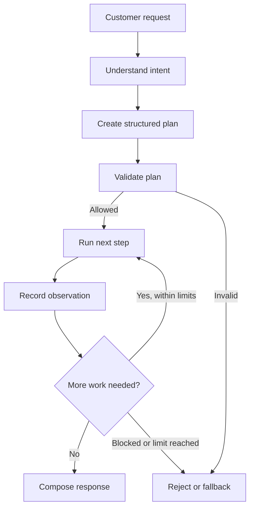
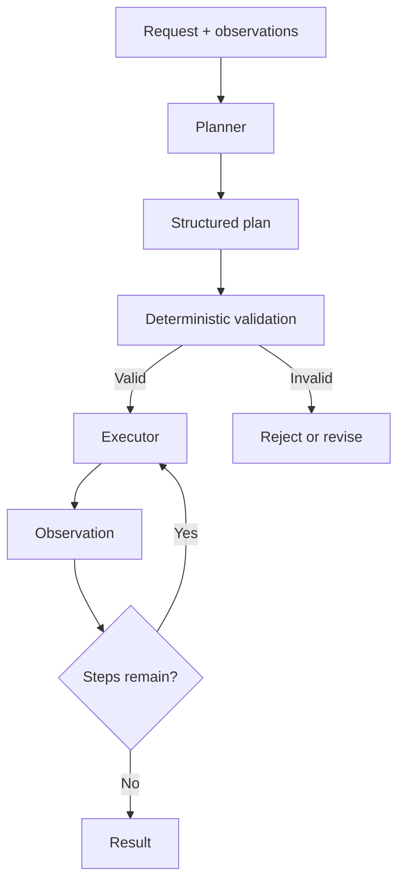
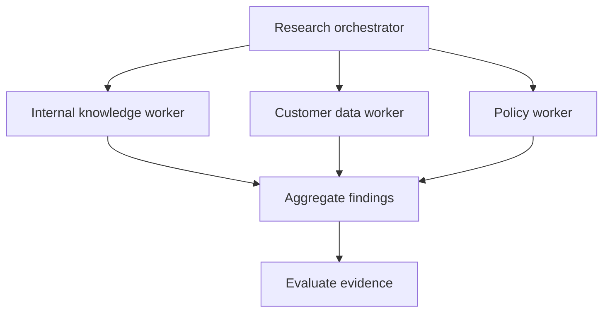
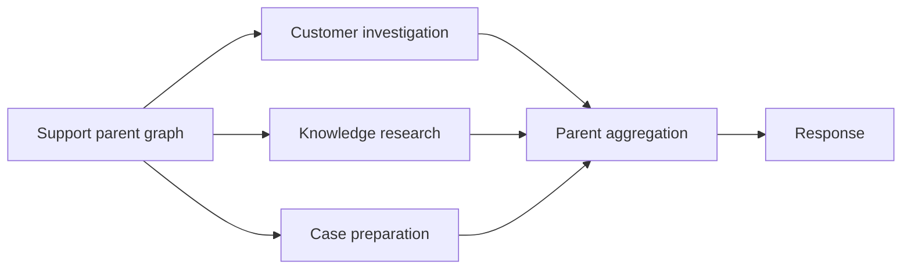

# 23 — LangGraph Agent Workflows

> A model can suggest the next step. Your workflow decides whether that step is valid, where it runs, and when the job is finished.

## Why workflows matter

Imagine a customer writes: *“I was charged twice for my last order. Can you check what happened and help me get the duplicate charge reversed?”*

A basic chatbot might produce a plausible explanation. A useful enterprise agent has more work to do:

1. Identify the customer and the relevant order.
2. Retrieve transaction and policy information.
3. Decide whether the evidence is sufficient.
4. Prepare the appropriate next action.
5. Route sensitive operations through the required controls.
6. Explain the outcome—or say what remains unresolved.

That is a workflow problem. LangGraph lets us model the process as connected steps, shared state, and explicit decisions. The model contributes interpretation and planning; application code controls execution.



## 1. Workflow, agent, or hybrid?

A deterministic workflow follows a path chosen by application logic:

```text
Receive → Validate → Retrieve → Transform → Store
```

An agentic workflow allows a model to influence the next permitted step:

```text
Request → Decide → Retrieve / Investigate / Prepare an action
                     ↑                         |
                     └──── Observe and reassess ┘
```

The presence of an LLM alone does not make a workflow agentic. The important distinction is whether model output influences runtime decisions.

For enterprise systems, use a hybrid: model-backed nodes interpret and propose; deterministic nodes validate, enforce business rules, and control routing and budgets. External operations remain behind application services. Let the model recommend; let trusted code decide what is allowed.

## 2. Treat state as the workflow contract

Nodes should communicate through a deliberately designed state schema—not by passing arbitrary prompt fragments around. The course material emphasizes that state field names and types form a contract between workers. That contract makes the graph easier to compose, test, and debug.

For the support example, the state might contain:

```python
from typing import TypedDict

class SupportState(TypedDict):
    request: str
    plan: list[str]
    step_index: int
    observations: list[str]
    status: str
    response: str
```

Keep state purposeful: store what later nodes need, define field ownership, and decide whether updates replace, append, or merge. Checkpoint persistence is covered in Chapters 19 and 24.

## 3. Planner-executor: decide separately from doing

A planner converts a request into proposed steps. An executor performs one validated step at a time. Separating them makes it possible to inspect and reject a plan before it reaches a capability.



The following example uses a structured output schema and a small graph. The model can propose only the named actions; the validator still checks the plan before execution.

```python
from typing import Literal
from typing_extensions import TypedDict
from pydantic import BaseModel, Field
from langchain_core.prompts import ChatPromptTemplate
from langgraph.graph import StateGraph, START, END

# `llm` is a configured chat model supplied by the application.
class Plan(BaseModel):
    steps: list[Literal[
        "lookup_customer", "find_order", "check_refund_policy"
    ]] = Field(max_length=3)

prompt = ChatPromptTemplate.from_messages([
    ("system", "Create the smallest useful investigation plan. "
                "Return only allowed actions in dependency order."),
    ("human", "Request: {request}"),
])
planner = prompt | llm.with_structured_output(Plan)

class State(TypedDict):
    request: str
    plan: list[str]
    step_index: int
    observations: list[str]
    status: str
    response: str

ALLOWED = {"lookup_customer", "find_order", "check_refund_policy"}
MAX_STEPS = 3

# Application wiring supplies these service functions. Each calls a
# domain service; this is not an unrestricted model-selected API call.
capabilities = {
    "lookup_customer": lookup_customer,
    "find_order": find_order,
    "check_refund_policy": check_refund_policy,
}

def create_plan(state: State):
    proposed = planner.invoke({"request": state["request"]})
    return {"plan": proposed.steps, "step_index": 0,
            "observations": [], "status": "proposed"}

def validate_plan(state: State):
    valid = (0 < len(state["plan"]) <= MAX_STEPS
             and set(state["plan"]).issubset(ALLOWED))
    return {"status": "ready" if valid else "rejected"}

def execute_next(state: State):
    action = state["plan"][state["step_index"]]
    result = capabilities[action](state["request"])
    return {
        "observations": state["observations"] + [str(result)],
        "step_index": state["step_index"] + 1,
    }

def route_plan(state: State):
    return "execute" if state["status"] == "ready" else "fallback"

def route_progress(state: State):
    return "execute" if state["step_index"] < len(state["plan"]) else "finish"

def finish(state: State):
    return {"response": summarize_findings(state["observations"])}

def fallback(state: State):
    return {"response": "I could not safely create a valid investigation plan."}

builder = StateGraph(State)
builder.add_node("plan", create_plan)
builder.add_node("validate", validate_plan)
builder.add_node("execute", execute_next)
builder.add_node("finish", finish)
builder.add_node("fallback", fallback)
builder.add_edge(START, "plan")
builder.add_edge("plan", "validate")
builder.add_conditional_edges("validate", route_plan,
                              {"execute": "execute", "fallback": "fallback"})
builder.add_conditional_edges("execute", route_progress,
                              {"execute": "execute", "finish": "finish"})
builder.add_edge("finish", END)
builder.add_edge("fallback", END)

graph = builder.compile()

result = graph.invoke({
    "request": "Check whether my last order has a duplicate charge.",
    "plan": [], "step_index": 0, "observations": [],
    "status": "new", "response": "",
})
```

This teaching skeleton assumes a configured model, service functions, and summarizer dependencies. Production code must validate each step, enforce authorization inside the service boundary, classify failures, and apply runtime and cost limits. An allowed action name is not user authorization; detailed tool execution belongs to Chapter 22.

## 4. Choose the right coordination pattern

These patterns solve different problems; combine them deliberately, not interchangeably.

| Pattern | What coordinates the work? | Use it when |
|---|---|---|
| Sequential / prompt chain | Fixed graph order | Each step depends on the previous output |
| Router | A classification or routing decision | One of several specialist paths should handle the request |
| Planner-executor | A plan plus an execution loop | A task needs multiple ordered actions |
| Orchestrator-worker | A coordinator delegates focused tasks | Work can be decomposed into independently owned subtasks |
| Parallel fan-out / fan-in | Multiple branches run before aggregation | Independent evidence can be gathered concurrently |
| Evaluator-optimizer | An evaluator sends output back for revision | A result needs bounded quality improvement |

### Router: choose a known destination

A router selects among application-defined destinations such as `billing`, `technical_support`, or `general_support`; ambiguous intents need a fallback. Conditional-edge mechanics are covered in Chapter 20.

### Orchestrator-worker: delegate focused work

An orchestrator decomposes a task, dispatches focused subtasks, and combines results. A worker may be a function or an agent; adding more LLMs does not automatically improve the design.



### Parallel fan-out / fan-in: do independent work together

Concurrent reads can reduce latency when sources are independent. Define how aggregation handles missing branches, conflicts, duplicates, provenance, and timeouts. Parallel writes need much stronger consistency and duplicate-execution controls.

### Evaluator-optimizer: improve with a stopping rule

An evaluator checks explicit criteria and routes weak output for revision. Use deterministic validators for required fields, identifiers, and policy constraints; reserve model evaluation for qualitative criteria. Set a small retry limit: a model grading its own work is no substitute for evidence or tests. Reflection as an agent-reasoning concept belongs in Part VI; this section covers workflow wiring only.

## 5. Compose large workflows from smaller ones

As a graph grows, avoid turning the parent graph into a diagram of every internal implementation detail. Use subgraphs to encapsulate cohesive capabilities such as customer investigation, document research, or case preparation.



A useful subgraph has one business responsibility, a small input/output contract, defined failure behavior, independent tests, and explicit state-sharing rules. Pass only the context it needs.

This is framework-level composition. Broader supervisor hierarchies, agent-to-agent collaboration, and swarm coordination belong in Part VII's multi-agent architecture chapters.

## 6. Keep workflows bounded and observable

A workflow that can loop must also know when to stop. Set limits for plan length, execution steps, parallel branches, wall-clock time, model calls, and cost. Define what happens when a limit is reached: return a partial result, use a fallback, or escalate through an established process.

Measure task completion, evidence-based correctness, policy compliance, branch failures, retries, model/capability calls, latency, tokens, and cost. Trace runs with a correlation ID, workflow version, node transitions, timings, and outcomes; redact sensitive payloads.

Checkpointing, interrupt/resume, tool retries, unknown outcomes, and idempotency belong in Chapters 19, 21, 22, and 24. Broader production patterns belong in Chapter 25.

## Production design checklist

- [ ] Validate structured model output before execution.
- [ ] Keep node, worker, and subgraph responsibilities focused.
- [ ] Define routing destinations, parallel merge rules, and fallback paths.
- [ ] Bound evaluation loops, concurrency, runtime, and cost.
- [ ] Trace and test important success and failure paths.

## Key takeaways

- Combine model decisions with explicit application control; state is the contract between nodes.
- Structured plans are inspectable proposals, not permission to act.
- Planner-executor, routing, orchestrator-worker, parallel fan-out/fan-in, and evaluator-optimizer solve different coordination problems.
- Subgraphs should reflect business capabilities; every loop needs limits and a fallback.

## Interview questions

1. How does an agent workflow differ from a deterministic workflow?
2. Why separate planning from execution?
3. When would you choose a router, planner-executor, or orchestrator-worker?
4. How do you handle partial failure in parallel branches?
5. What makes a good subgraph boundary?
6. How do you bound an evaluator loop?

## Practical exercise

Build a customer-support workflow that classifies a request, creates a structured investigation plan, validates it, and executes approved read-only investigation steps. Add a router for billing versus general support, parallelize independent customer and policy lookups, aggregate the findings, and produce a response. Test an invalid plan, an unknown intent, one failed parallel branch, conflicting source data, and an exhausted execution limit.

## Transcript coverage and scope

The available source is the *Agentic Frameworks and Design Patterns for Effective AI Systems* cheat sheet, not a full verbatim lecture transcript. It covers structured outputs, state contracts, worker nodes, `StateGraph` construction, graph visualization, orchestrator-worker, and reflection. The chapter retains the core workflow material and adds routing, parallel execution, bounded evaluation, and enterprise composition. Notebook graph rendering is omitted as developer convenience rather than a workflow pattern.

| Course material | Treatment in this chapter |
|---|---|
| Structured output with Pydantic and an LLM | Included in planner example |
| Typed workflow state | Included as the node contract |
| Worker nodes returning state updates | Included in executor and coordination discussion |
| `StateGraph`, nodes, edges, compile and invoke | Demonstrated in the planner-executor graph |
| Orchestrator-worker | Included with diagram and boundary guidance |
| Reflection / evaluator loop | Included as bounded evaluator-optimizer pattern |
| Graph visualization in Jupyter | Omitted; optional developer tooling |

The roadmap places workflow-pattern architecture in Part VII and framework implementation in Part VIII. This chapter stays with LangGraph implementation; conceptual multi-agent, supervisor, durable-execution, and protocol material remains in Part VII.

## Chapter navigation

⬅️ **Previous:** [22. LangGraph Tool Execution](22-langgraph-tool-execution.md)

📚 **Part VIII Index:** [AI Engineering Frameworks & Tooling](index.md)

➡️ **Next:** [24. LangGraph Memory And Persistence](24-langgraph-memory-and-persistence.md)

---

**Enterprise AI Engineering Handbook** — *Building Production-Grade Enterprise AI Systems — One Chapter at a Time.*
