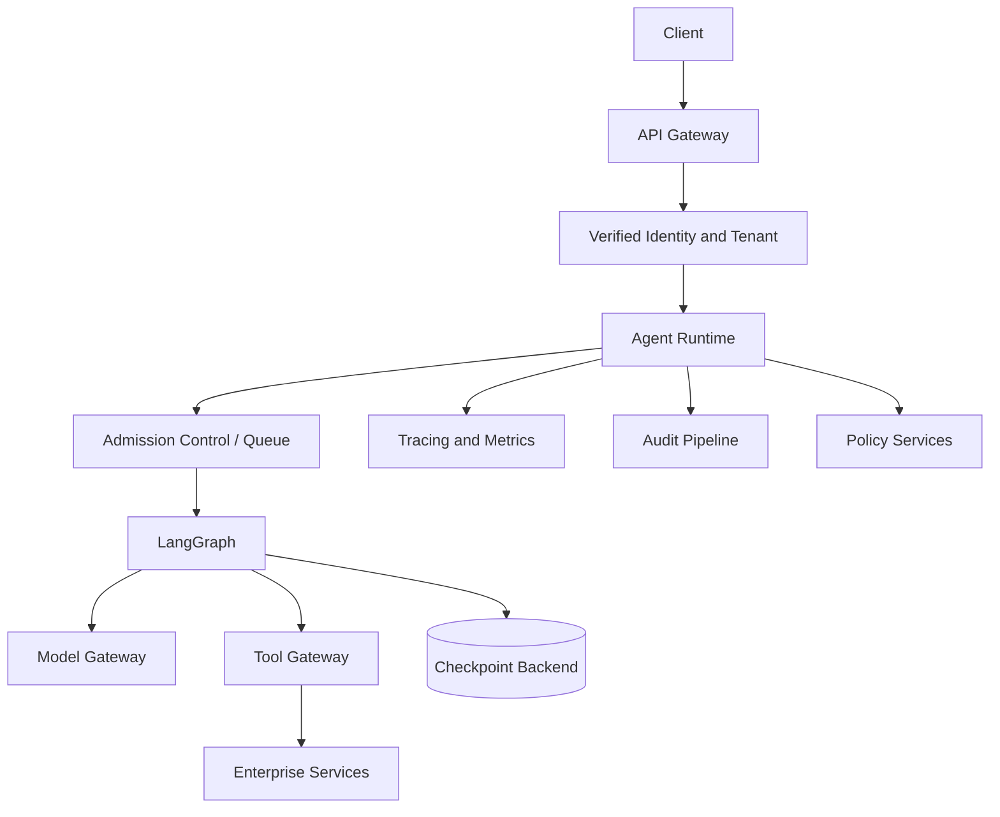
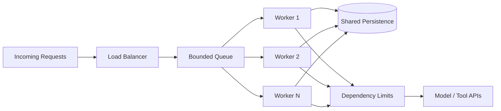
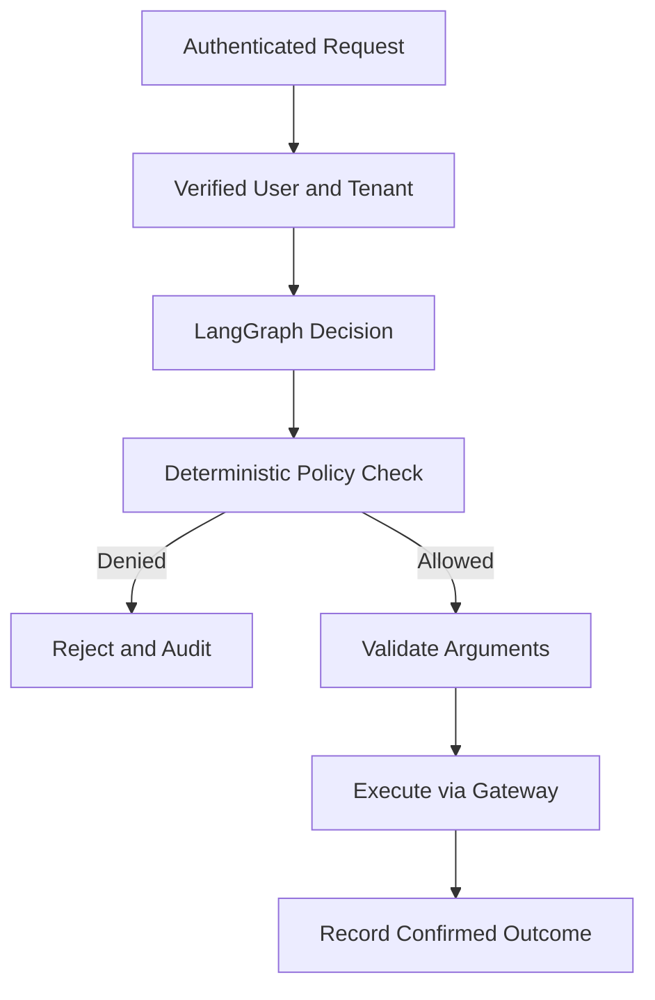
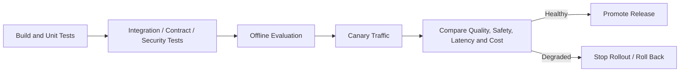

# 25 — LangGraph Production Patterns

> The demo worked perfectly. Then Monday morning arrived: traffic tripled, the payment provider slowed down, and support asked why one customer had received two refund notifications.
>
> That is the moment a graph becomes a production system.

We will use a support agent that investigates a charge and may request a refund. Earlier chapters explain its nodes and tools; this chapter covers the operating environment around them.

## 1. A graph is one component of the service

A prototype is `Request → Graph → Model / Tools → Response`. Production adds identity, workload control, policy, persistence, dependency gateways and telemetry.



Keep the boundary simple: LangGraph coordinates; the runtime owns lifecycle, concurrency and budgets; gateways mediate external calls; policy services authorize; persistence and telemetry support operations. The graph should not become a second API gateway, identity provider or policy engine.

## 2. Scale the workload, not just the workers

Imagine 800 support requests arrive at once. Adding workers increases potential throughput—but also model, retrieval and tool traffic. If the payment service handles only 20 concurrent requests, 50 workers can overwhelm it.

Use replaceable workers: a restart must not destroy the only copy of execution state. Keep durable state external. Chapter 19 explains checkpoints; Chapter 24 covers LangGraph checkpointers and stores.



With **LangSmith Agent Server**, API servers accept requests and manage runs while queue workers execute graphs; the two pools can scale independently. In a self-managed runtime, you own the queue, persistence and worker operations. The LangGraph library defines the workflow; the server/runtime provides the production execution service. <https://docs.langchain.com/langsmith/agent-server>

Use three controls together:

1. **Admission control:** cap active executions globally, per tenant and per sensitive dependency.
2. **Backpressure:** queue within a defined limit; reject or defer work when the queue is full or too old.
3. **Dependency-aware scaling:** scale using queue depth, end-to-end latency and downstream saturation—not CPU utilization alone.

Separate API capacity from execution capacity. For long-running work, return an execution ID and expose status through polling or subscription; keep short, bounded interactions synchronous.

## 3. Expect partial failure

The graph can be healthy while a model provider throttles, a database slows down or an API fails. Treat each dependency as fallible.

Use timeouts, classified retries, exponential backoff with jitter, circuit breakers, bulkheads and explicit fallbacks. A timeout bounds waiting; a retry handles transient failure; a circuit breaker stops calls to an unhealthy dependency; a bulkhead protects shared capacity.

LangGraph provides node-level retry and timeout policies. The example below is a focused implementation pattern, not a complete application. `customer_api` is an application adapter supplied by dependency injection. The timeout applies to an individual asynchronous node attempt—not the entire graph run.

```python
from typing import TypedDict

from langgraph.graph import END, START, StateGraph
from langgraph.types import RetryPolicy, TimeoutPolicy


class SupportState(TypedDict):
    customer_id: str
    customer: dict | None
    status: str


def make_lookup_node(customer_api):
    async def lookup_customer(state: SupportState) -> dict:
        customer = await customer_api.lookup(state["customer_id"])
        return {"customer": customer, "status": "customer_loaded"}
    return lookup_customer


def build_response(state: SupportState) -> dict:
    return {"status": "ready" if state["customer"] else "not_found"}


builder = StateGraph(SupportState)
lookup_customer = make_lookup_node(customer_api)  # injected adapter
builder.add_node(
    "lookup_customer",
    lookup_customer,
    retry_policy=RetryPolicy(
        max_attempts=3,  # includes the first attempt
        initial_interval=1.0,
        backoff_factor=2.0,
        max_interval=8.0,
        jitter=True,
        retry_on=(ConnectionError, TimeoutError),
    ),
    timeout=TimeoutPolicy(run_timeout=15),
)
builder.add_node("build_response", build_response)
builder.add_edge(START, "lookup_customer")
builder.add_edge("lookup_customer", "build_response")
builder.add_edge("build_response", END)

graph = builder.compile()
```

Match `retry_on` to the exceptions raised by your HTTP/database client. Node timeouts require Python `langgraph>=1.2` and async nodes; cancellation is cooperative, so blocking synchronous work must not block the event loop. After retries are exhausted, fail clearly, use a safe fallback or route to recovery. Never retry authorization or business-rule failures as network glitches. <https://docs.langchain.com/oss/python/langgraph/fault-tolerance>

**A timeout is not proof that a side effect failed.** If a refund request reached the payment provider but its response was lost, the outcome is unknown. The runtime must coordinate with the application's reconciliation path before deciding what happens next. Chapter 22 owns tool contracts, idempotency and detailed unknown-outcome handling; this chapter owns the service-level failure policy.

## 4. Put a budget around every run

Repeated model calls, tools, retrieval, retries and loops can burn resources. “The model should stop when it has enough information” is not a budget strategy.

| Limit | Runtime control |
|---|---|
| Duration | End-to-end deadline for the run |
| Graph work | Maximum steps or iterations |
| Tools | Per-run and per-tool call ceilings |
| Tokens | Input and output token limits |
| Spend | Cost ceiling per execution and tenant |
| Concurrency | Maximum active runs per tenant |
| Queue | Maximum queue depth and waiting age |

Enforce limits in trusted runtime or gateway code. When reached, stop safely, return a marked partial result or escalate. Do not silently switch models if tool support, context capacity, output behavior or safety changes.

Track **cost per successfully completed task**, segmented by task and workflow version. Cost per request can look healthy while task success falls.

For distributed workers, budget reservation must be atomic. A process-local dictionary cannot enforce a tenant-wide limit across workers. Reserve estimated spend in a shared store before dispatch and record actual usage afterward:

```python
async def dispatch_tool(budget_store, execution_id, tool, args, estimate):
    reserved = await budget_store.reserve(execution_id, estimate)
    if not reserved:
        raise BudgetExceeded("Execution budget exhausted")
    result, actual_cost_usd = await tool_gateway.execute(tool, args)
    await budget_store.record_actual(execution_id, actual_cost_usd)
    return result
```

`budget_store` must implement an atomic reservation; this is an interface sketch, not an in-memory implementation.

## 5. Security must not depend on model obedience

The model may propose a refund; it must not authorize one. Resolve identity in trusted middleware, pass verified context to the runtime and enforce authorization again at the capability boundary.



Apply tenant-scoped access, least-privilege identities, external secret management, data minimization, encryption, retention and risk classes for read, write, financial and destructive actions. Chapter 21 covers approval mechanics.

A `tenant_id` field in graph state is not tenant isolation. Every database query, memory lookup and downstream request must enforce the boundary. Never trust a tenant identifier supplied only by the model or copied from untrusted user text. Treat retrieved documents and tool output as data, not instructions that can override system policy.

## 6. Make the execution explainable

If support asks, “Why did the agent attempt this refund?”, a final-answer log is not enough. Operators need the execution path without unnecessary sensitive data.

Correlate request, run and trace IDs. Record protected tenant identity, workflow and state versions, node/model/tool names, retries, duration, outcome, token usage and estimated cost.

Monitor at least:

- Task success and failure rates.
- p50, p95 and p99 end-to-end latency.
- Queue depth and oldest waiting request.
- Node, model and tool error rates; retry frequency.
- Token usage and cost per successful task.
- Human escalation and policy-denial rates.

Trace the API request through graph nodes, models and downstream services. Keep **telemetry** (diagnosis) separate from **audit** (who acted, which policy applied, what capability ran and the confirmed outcome). Redact prompts, arguments and records unless retention is justified and access-controlled.

Evaluate with curated regression datasets before release; compare task success, safety, latency and cost, then turn confirmed failures into tests. LLM judges may help triage quality, but are not security controls or final authorities for regulated decisions.

## 7. Release graphs as versioned software

A prompt, model, tool schema or route change can alter behavior. Version the execution contract, not just the Python package:

- Graph and application code.
- Prompt and model configuration.
- Tool schemas and policy rules.
- State schema and migration logic.
- Evaluation dataset and release metadata.

Separate development, test, staging and production. Run unit, integration, contract, security and graph-path tests, then promote with canary or shadow traffic.



Plan rollback for in-flight runs: finish on the creating version, migrate through an explicit compatibility step or safely restart. Never assume new code can interpret every old checkpoint. Chapters 19 and 24 cover state and persistence; this chapter owns release compatibility.

## 8. Run the service: SLOs, incidents and recovery

Define SLOs for eligible-task success, p95 latency, queue age and critical dependency availability. Set targets from measured workload and business impact.

An incident runbook should answer four questions:

1. **Detect:** Which alert, SLO burn or customer symptom signals trouble?
2. **Contain:** Should traffic be throttled, a tool disabled or a circuit opened?
3. **Recover:** Should executions resume, reconcile, restart or be escalated?
4. **Learn:** Which test, dashboard or policy should change after the incident?

Recovery covers more than checkpoints: include execution records, memory, audit data, secrets, configuration and workflow artifacts. Define RPO and RTO, back up relevant stores and test restoration. An untested backup is only an assumption.

## 9. Production readiness review

Before launch, verify: external durable state; workload and dependency limits; classified retry and recovery behavior; trusted identity and tenant enforcement; per-run budgets; correlated traces and audit events; versioned graph, prompt, tool and state contracts; safe canary and rollback for in-flight runs; and a tested restore procedure.

## Key takeaways

Production LangGraph engineering is not about making the graph bigger. It is about building a controlled operating environment around it. Keep workers replaceable, protect downstream capacity, classify failures before retrying, enforce security outside the model, bound autonomy, make executions explainable and release changes gradually. Failures will happen. The engineering goal is to make them contained, understandable and recoverable.

## References

- [LangGraph fault tolerance](https://docs.langchain.com/oss/python/langgraph/fault-tolerance)
- [LangGraph persistence](https://docs.langchain.com/oss/python/langgraph/persistence)
- [LangSmith Agent Server](https://docs.langchain.com/langsmith/agent-server)
- [LangSmith evaluation](https://docs.langchain.com/langsmith/evaluation)

---

## 🧭 Chapter Navigation

⬅️ **Previous:** [24. LangGraph Memory and Persistence](24-langgraph-memory-and-persistence.md)

📚 **Part VIII Index:** [AI Engineering Frameworks & Tooling](index.md)

➡️ **Next:** [26. LangGraph Limitations and Trade-offs](26-langgraph-limitations-and-tradeoffs.md)

---

> **Enterprise AI Engineering Handbook**
>
> *Building Production-Grade Enterprise AI Systems — One Chapter at a Time.*