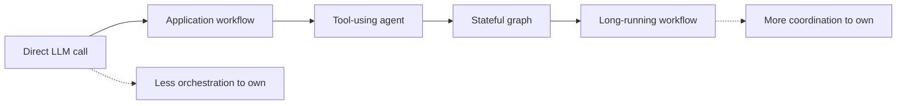
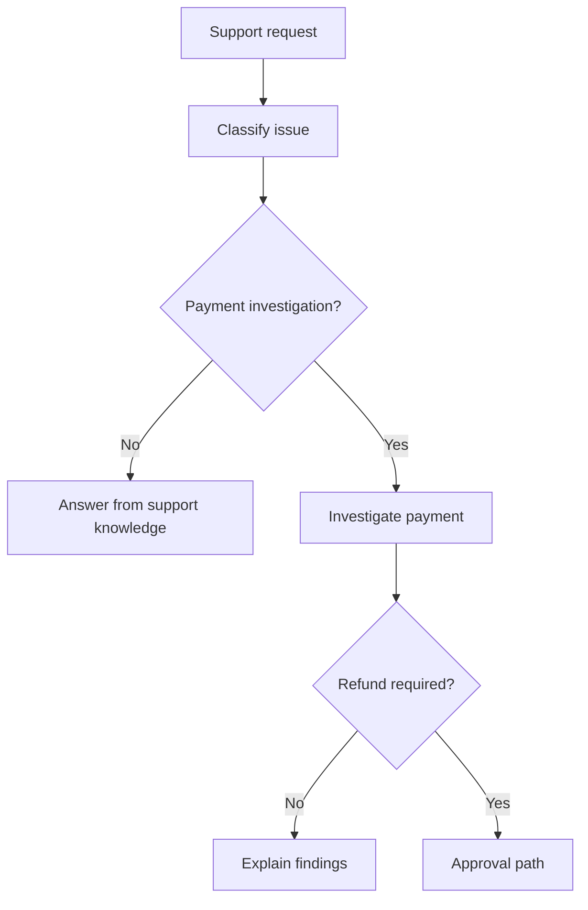
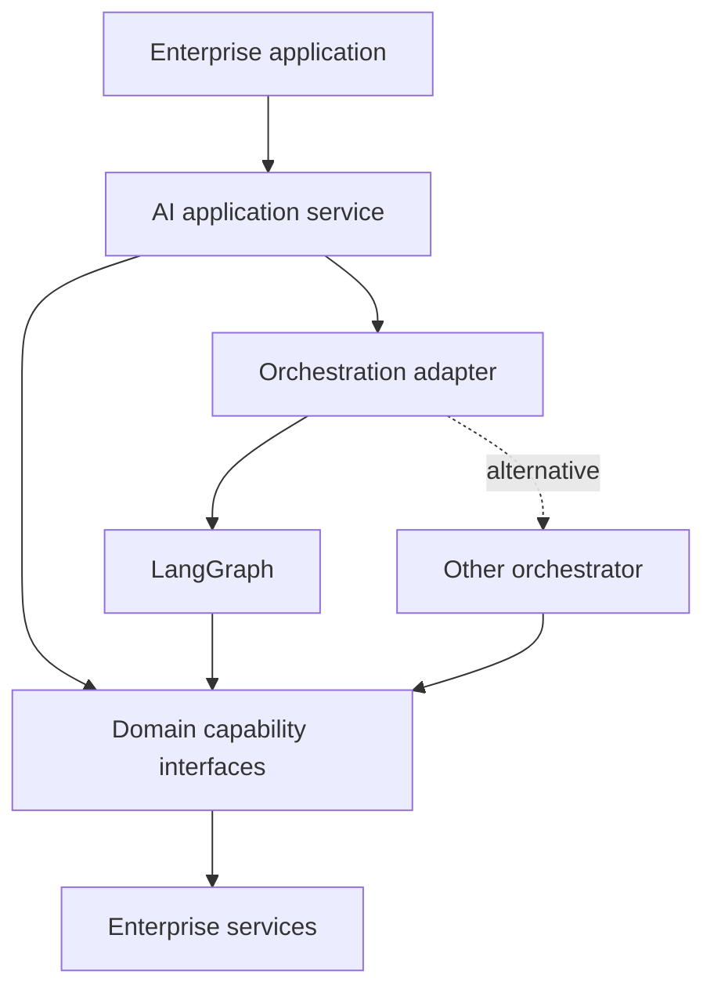
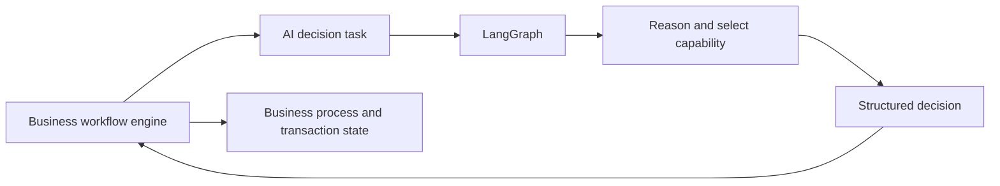
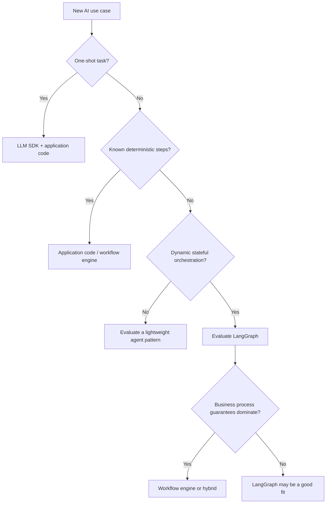

# 26 — LangGraph Limitations and Trade-offs

A framework can be powerful and still be the wrong choice.

Imagine a team building a customer-support assistant. Version one answers questions using a retrieval pipeline. A direct LLM call and a few application functions do the job. Six months later, the product must investigate disputed payments, call several enterprise systems, request approval before a refund, wait for a reviewer and continue afterwards.

The problem has changed. The question is no longer *“Can we build this with LangGraph?”* It is *“Does LangGraph make this complexity easier to manage than the alternatives?”*

That is the purpose of this chapter. We are not going to rebuild graphs, tools or checkpointing—that work is covered earlier in this sequence. We are going to evaluate the price of those capabilities and decide when they are worth paying.

## What you should be able to decide

- When LangGraph adds meaningful value—and when it is unnecessary.
- How graph, state and persistence choices affect maintainability.
- Why agent workflows can increase latency, cost and behavioral variability.
- How to reduce framework coupling without building needless abstractions.
- When to choose application code, LangGraph, a workflow engine or a hybrid.

## 1. The real trade-off: control versus ownership

LangGraph makes workflow execution explicit. Developers model state, nodes, edges, routing and execution boundaries. That is useful when a workflow branches, loops, pauses or needs to resume with context.

But explicit control does not make complexity disappear. It changes where the complexity lives. The team now owns the graph design, state contracts, model behavior, integrations and the lifecycle of the workflow.



Think of LangGraph as a tool for managing workflow complexity—not a shortcut around it. If a few ordinary functions express the process clearly, a graph may add more concepts than value.

## 2. When LangGraph is overkill

A summarizer, classifier, extractor or one-shot RAG endpoint often has a straightforward path:

```text
Request → Application logic → LLM / Retriever → Response
```

Introducing graph state, persistence and an agent runtime may increase the number of moving parts without improving the outcome.

LangGraph becomes more compelling when the workflow genuinely needs several of these capabilities:

- Runtime decisions that change the next step.
- Iteration, planning or validation loops.
- Multiple tools or branches that must be coordinated.
- Explicit state shared across workflow steps.
- Interruptions and resumable execution.
- A workflow whose structure is easier to understand as a graph than as ordinary functions.

Do not turn this into a feature-counting exercise. One tool call does not automatically require an agent graph. One approval step does not automatically require durable orchestration. A fixed approval process may be simpler in application code or an existing workflow platform.

The right test is whether the graph makes the process easier to understand, change and verify.

## 3. Graph complexity and state coupling

A graph can start with five clean nodes and slowly become a maze. Each new requirement adds a condition, a branch or an exception path. Eventually, changing one route breaks another route that nobody remembered was connected.

Shared state can make this worse. If many nodes read and update the same large state object, fields become implicit contracts between parts of the workflow.



The diagram is still readable because each decision has a clear purpose. In a real system, preserve that clarity by keeping node responsibilities narrow, defining who owns each state field and grouping only genuinely cohesive workflows into subgraphs.

Graph state should describe the execution—not become the customer database, document store, audit system and business system of record. Chapter 19 covers state and checkpointing fundamentals; Chapter 24 covers LangGraph persistence and memory mechanics.

## 4. Persistence is useful, but not free

Checkpointing helps workflows survive interruptions and continue later. The trade-off appears over time: persisted state must be stored, serialized, retained, protected and kept compatible with the code that will resume it.

Consider a workflow waiting for human approval while a new application version is deployed. The new graph may expect a different state shape or route. Can it safely continue an older execution? Or must that execution remain on the previous version, be migrated, expire or restart?

That is a workflow-lifecycle decision—not just a database decision.

Keep the boundary clear: Chapter 24 explains checkpointers, threads and stores; Chapter 25 covers production release and recovery practices. This chapter focuses on the architectural consequence: durable workflows create compatibility obligations between persisted executions and evolving code.

## 5. Agent flexibility has a latency and cost bill

A direct LLM request might make one model call. An agent can make several model calls, retrieve documents, invoke tools, validate results and try again. One user request can therefore trigger many backend operations.

For sequential steps, latency is roughly additive:

\[
T_{\text{total}} \approx \sum T_{\text{model}} + \sum T_{\text{tool}} + T_{\text{orchestration}}
\]

Parallel branches can reduce wall-clock time, but only when tasks are independent. They also introduce coordination, partial-failure and downstream-capacity concerns. Parallelism is not a free speed button.

Cost should be estimated per completed task, not merely per incoming API request. This small example makes the calculation explicit:

```python
from dataclasses import dataclass

@dataclass(frozen=True)
class RunUsage:
    input_tokens: int
    output_tokens: int
    tool_calls: int

def estimate_cost(
    usage: RunUsage,
    input_price_per_million: float,
    output_price_per_million: float,
    average_tool_cost: float,
) -> float:
    model_cost = (
        usage.input_tokens * input_price_per_million
        + usage.output_tokens * output_price_per_million
    ) / 1_000_000

    return model_cost + usage.tool_calls * average_tool_cost

usage = RunUsage(input_tokens=6_000, output_tokens=1_200, tool_calls=4)

estimate = estimate_cost(
    usage,
    input_price_per_million=2.00,
    output_price_per_million=8.00,
    average_tool_cost=0.001,
)

print(f"Estimated task cost: ${estimate:.4f}")
```

The prices are illustrative, not current provider rates. Real estimates must account for the selected model, cached tokens, tool pricing and retries. The important point is that an agent's execution path—and therefore its cost—can vary.

That variability also affects testing. The same request may lead to a different tool choice or number of steps after a model, prompt or tool-description change. Test expected behavior, permitted actions and task outcomes; do not rely only on exact response-text comparisons.

## 6. Framework convenience can become framework coupling

LangGraph can speed up implementation, but business logic becomes harder to move when it depends directly on framework-specific state types, node signatures, routing and persistence semantics.

The answer is not to wrap every LangGraph function in three layers of abstraction. Protect the parts that matter: business capabilities and domain rules should have contracts that do not depend on the orchestration framework.



For example, payment retrieval and refund approval are business capabilities. LangGraph may decide when to call them, but it should not own payment rules.

```python
from typing import Protocol

class PaymentService(Protocol):
    async def get_payment(self, payment_id: str) -> dict: ...
    async def request_refund(self, payment_id: str, amount: int) -> str: ...

# Graph nodes call this contract.
# The payment rules remain in the application/domain service.
```

This boundary reduces the blast radius of a framework change; it does not make migration effortless. Graph definitions, execution semantics and persisted state may still need deliberate migration.

## 7. LangGraph is not a business workflow engine

AI orchestration and business-process orchestration overlap, but they solve different primary problems.

LangGraph is attractive when the system needs model-led decisions, tool selection, iterative reasoning and stateful AI execution. A dedicated workflow engine may be a better fit when the dominant requirements are deterministic business-process execution, durable timers, compensation, transaction coordination or strict process guarantees.

A hybrid is often the more honest architecture:



The business workflow owns the process and authoritative business state. LangGraph performs a bounded AI task and returns a decision. Neither component is forced to become something it was not designed to be.

## 8. More tools, memory and autonomy mean more choices to govern

A graph does not automatically provide authorization, tenant isolation, privacy controls or prompt-injection protection. Those controls must be enforced at trusted application and capability boundaries.

A very large tool catalogue can also make selection harder: more descriptions consume context, similar tools create ambiguity and more capabilities create more possible failure paths. Expose only the tools relevant to the current task and enforce permissions outside model-generated decisions.

Memory has its own trade-off. Stale or incorrect information can influence future decisions, while retained data creates privacy and lifecycle obligations. More stored context is not automatically better context.

These are architectural reminders, not a second security or memory tutorial. See the individual-agent security material, Chapter 22 for tool execution boundaries and Chapter 24 for persistence and memory.

## 9. Choose the smallest architecture that meets the requirements

| Application shape | Sensible starting point | Why |
|---|---|---|
| One-shot summarization or extraction | LLM SDK + application code | Little orchestration to manage |
| Fixed sequence of known steps | Application code or workflow engine | Explicit graph routing may add little |
| Simple RAG question answering | Retriever + LLM application | A graph is optional |
| Dynamic tool-using workflow | Evaluate LangGraph | Routing and iteration may justify it |
| Stateful workflow with interruptions | Evaluate LangGraph | Explicit execution state can help |
| Deterministic, long-running business process | Workflow engine | Process guarantees dominate |
| Business process with bounded AI decisions | Hybrid | Each component owns a clear responsibility |

This is a decision aid, not a universal ranking. Workflow engines can call LLMs, and LangGraph can execute deterministic steps. Choose according to required guarantees, team skills and the operating model—not framework popularity.

## 10. Make the adoption decision explicit

Before adopting LangGraph, write a short Architecture Decision Record (ADR). Keep it practical:

1. **Problem:** What workflow complexity are we trying to manage?
2. **Requirements:** Do we actually need dynamic routing, loops, shared state or resumability?
3. **Alternatives:** Could an SDK, application code or an existing workflow engine solve it?
4. **Trade-offs:** What extra development, persistence and ownership costs are acceptable?
5. **Boundaries:** Which domain capabilities and business rules must remain framework-independent?
6. **Exit path:** If the orchestrator changes, what must migrate—graph definitions, state, execution history or all three?



The decision is not “Can LangGraph do this?” It is “Does LangGraph solve enough of this problem to justify the complexity we will own?”

## Key takeaways

- LangGraph trades explicit orchestration control for additional concepts and ownership.
- Simple LLM tasks rarely need a graph by default.
- Complex graphs and broad shared state can become difficult to maintain.
- Persistence creates compatibility and lifecycle obligations.
- Agent loops and tools can multiply latency and cost per request.
- Model-driven execution needs behavioral evaluation, not only exact-output tests.
- Framework boundaries reduce coupling but do not eliminate migration work.
- Workflow engines may better fit deterministic business-process guarantees; hybrid designs can combine both.
- Security, authorization, tenant isolation and data governance remain application responsibilities.
- Choose the smallest architecture that meets the actual requirements.

## Quick revision

- **Simple and fixed:** LLM SDK or application code.
- **Dynamic and stateful AI orchestration:** evaluate LangGraph.
- **Deterministic and long-running business process:** evaluate a workflow engine.
- **Business process with bounded AI decisions:** consider a hybrid.

## Interview questions

1. What is the main architectural trade-off of LangGraph?
2. When would an LLM SDK be preferable to LangGraph?
3. How can graph complexity and shared state create coupling?
4. What compatibility concerns arise when persisted workflows meet new graph versions?
5. Why can one agent request create unpredictable latency and cost?
6. How would you reduce framework coupling without overengineering?
7. When would you choose a workflow engine over LangGraph?
8. How would you design a hybrid workflow-engine and LangGraph architecture?
9. Why does adding more tools not always improve an agent?
10. What should an ADR capture before adopting LangGraph?

## Practical exercise

Evaluate three applications:

- **A — Document summarization:** one model call, no persistent workflow.
- **B — Customer-support investigation:** dynamic tool selection, several steps and an approval branch.
- **C — Banking transaction process:** deterministic business rules, timers, audit requirements and financial side effects; AI is used only to interpret an exception.

For each, compare an LLM SDK, application code, LangGraph, a workflow engine and a hybrid. Record the guarantees required, complexity introduced, ownership implications and reason for your choice. Defend the simplest design that meets the requirements.

## References and further reading

- [LangGraph documentation](https://docs.langchain.com/oss/python/langgraph/overview)
- [LangGraph persistence](https://docs.langchain.com/oss/python/langgraph/persistence)
- [LangGraph fault tolerance](https://docs.langchain.com/oss/python/langgraph/fault-tolerance)
- [LangSmith Agent Server](https://docs.langchain.com/langsmith/agent-server)

LangGraph APIs and runtime capabilities evolve. Verify version-specific behavior against the documentation for the version deployed.

---

## 🧭 Chapter Navigation

⬅️ **Previous:** [25. LangGraph Production Patterns](25-langgraph-production-patterns.md)

📚 **Part VIII Index:** [AI Engineering Frameworks & Tooling](index.md)


---

> **Enterprise AI Engineering Handbook**
>
> *Building Production-Grade Enterprise AI Systems — One Chapter at a Time.*