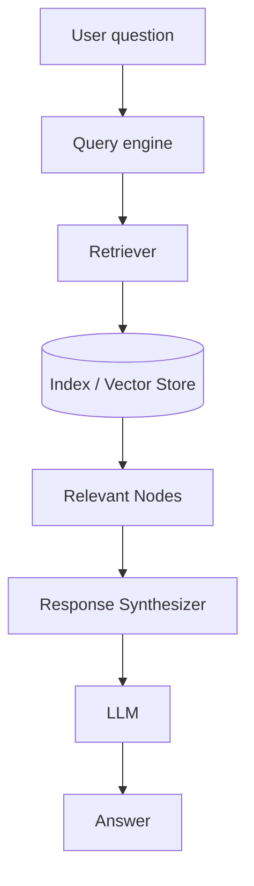
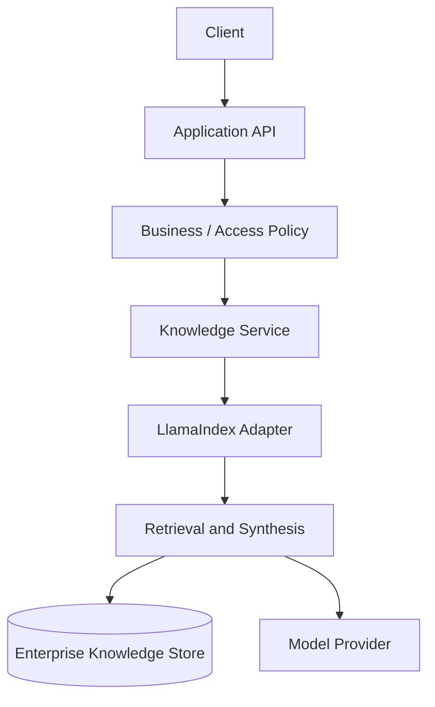

# 01 — LlamaIndex Fundamentals

> Connect enterprise knowledge to LLM applications with LlamaIndex's data-centric architecture.

## Overview

An LLM can explain a general concept. Ask it what changed in your company's travel policy last Tuesday, and it needs access to your internal data.

**LlamaIndex is a framework for context augmentation:** loading external information, organizing it, retrieving relevant pieces and making them available to an LLM. Typical use cases include enterprise knowledge assistants, document question answering, search, data extraction and RAG.


The framework supplies reusable components. It does not replace the application API, authorization model, data governance or business logic around them.

## 1. The core mental model

Think of LlamaIndex as a data-to-context pipeline:

1. **Load** information from files, databases, APIs or cloud storage.
2. **Transform** it into manageable units and enrich it with metadata.
3. **Index** those units for efficient lookup.
4. **Retrieve** relevant information for a query.
5. **Synthesize** a response using the retrieved context.

The detailed ingestion process belongs in [Chapter 02](02-llamaindex-data-and-document-ingestion.md); index and retrieval strategies are covered in [Chapter 03](03-llamaindex-indexes-and-retrieval.md).

## 2. Core building blocks

| Component | Responsibility |
|---|---|
| Reader / connector | Loads information from a source |
| `Document` | Represents source content and metadata |
| `Node` | Smaller, retrievable unit of content |
| Transformation | Parses, splits or enriches content |
| Index | Organizes Nodes for a retrieval strategy |
| Retriever | Finds relevant Nodes for a query |
| Query engine | Coordinates retrieval and response generation |
| Response synthesizer | Constructs an answer from retrieved Nodes |

A `Document` is the source-level container. A `Node` is usually a smaller segment created from it. Nodes can carry metadata and relationships, such as source references or links to parent content.

```python
from llama_index.core import Document

policy = Document(
    text="Employees may carry forward up to five leave days.",
    metadata={
        "source": "leave-policy.md",
        "department": "people",
        "country": "IN",
        "version": "3",
    },
)
```

Metadata makes content more useful later. For example, `country="IN"` can scope a policy search. It is not, by itself, an authorization mechanism.

## 3. Index, retriever and query engine

These components are related, but not interchangeable.

- An **index** organizes content in a form suited to a search strategy.
- A **retriever** returns candidate Nodes for a query.
- A **query engine** provides a higher-level question-answering interface, typically coordinating retrieval and response synthesis.



For retrieval-only use cases, call the retriever and inspect its results. For question answering, a query engine is convenient because it coordinates more of the RAG path.

## 4. A minimal application

```python
from llama_index.core import SimpleDirectoryReader, VectorStoreIndex

documents = SimpleDirectoryReader("data").load_data()
index = VectorStoreIndex.from_documents(documents)

query_engine = index.as_query_engine()
response = query_engine.query(
    "What does the leave policy say about carry-forward?"
)
print(response)
```

This is a useful starting point, not a production deployment. It uses default configuration and in-memory storage. Real applications should choose their embedding model, vector store, persistence, metadata strategy and access controls deliberately.

## 5. Where LlamaIndex fits beside other frameworks

LlamaIndex and LangChain overlap, especially around RAG. The useful distinction is one of emphasis: LlamaIndex puts data ingestion, indexing and retrieval at the centre; LangChain offers a broader set of composable model, prompt, tool and agent components.

That is a starting point, not a rule that says one framework must own the whole application. If you combine them, give each a clear responsibility and keep framework-specific objects behind application services. The adoption trade-offs are compared in [Chapter 08](08-llamaindex-limitations-and-tradeoffs.md); the LangChain module covers its own components in detail.

## 6. Enterprise architecture boundary



The application remains responsible for identity, authorization, tenant resolution, request validation and business decisions. LlamaIndex provides data and retrieval capabilities inside that boundary.

## Key takeaways

- LlamaIndex connects external knowledge to LLM applications through context augmentation.
- Documents represent source material; Nodes are smaller units used by retrieval.
- Indexes organize content, retrievers find candidates, and query engines coordinate question answering.
- A successful prototype is not automatically a secure or production-ready service.

## Further reading

- [LlamaIndex documentation](https://docs.llamaindex.ai/)
- [Chapter 02 — Data and Document Ingestion](02-llamaindex-data-and-document-ingestion.md)
- [Chapter 03 — Indexes and Retrieval](03-llamaindex-indexes-and-retrieval.md)

## Chapter navigation

⬅️ **Previous:** [08—LangChain Limitations & Trade-offs](../langchain/08-langchain-limitations-and-tradeoffs.md)

📚 **Part:**  [AI Engineering Frameworks & Tooling](../index.md)

➡️ **Next:**  [02—LlamaIndex Data and Document Ingestion](02-llamaindex-data-and-document-ingestion.md)

---

> **Enterprise AI Engineering Handbook**
>
> *Building Production-Grade Enterprise AI Systems — One Chapter at a Time.*
