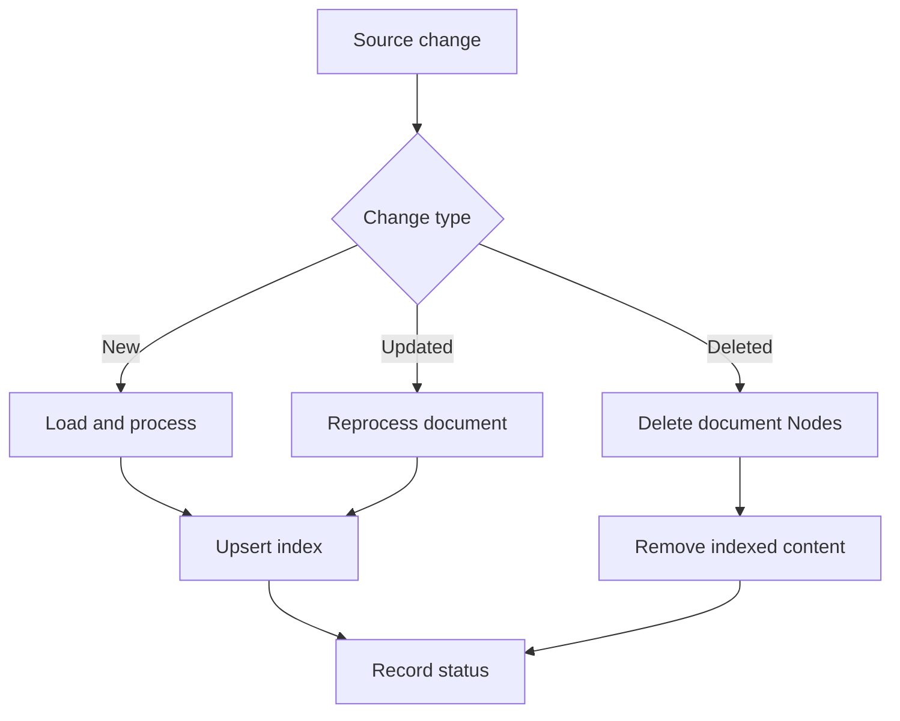

# 02 — LlamaIndex Data and Document Ingestion

> Good retrieval starts long before the user submits a query. It starts with the quality of the data you ingest.

## Overview

Enterprise information arrives as PDFs, Word files, Markdown, HTML, CSV, JSON, database records, cloud objects and API responses. These sources are inconsistent: a PDF may contain tables, a policy may have several versions, and a web page may change without warning.

An ingestion pipeline turns source material into consistent, traceable content that can be indexed.


This chapter owns the ingestion lifecycle. Index and retrieval strategies are covered in [Chapter 03](03-llamaindex-indexes-and-retrieval.md).

## 1. Readers and Documents

LlamaIndex readers convert supported sources into `Document` objects. `SimpleDirectoryReader` is convenient for local files; integrations provide connectors for additional systems.

```python
from llama_index.core import SimpleDirectoryReader

documents = SimpleDirectoryReader(
    input_dir="data",
    recursive=True,
).load_data()

print(f"Loaded {len(documents)} documents")
```

A `Document` contains text plus metadata and source identity. Treat metadata as part of the data contract, not optional decoration.

```python
from llama_index.core import Document

doc = Document(
    text="Expense claims must be submitted within 30 days.",
    metadata={
        "document_id": "FIN-042",
        "source": "expense-policy.pdf",
        "department": "finance",
        "country": "IN",
        "version": "4",
    },
)
```

## 2. Parsing is not chunking

**Parsing** extracts meaningful content from a source format. **Chunking** divides that extracted content into retrievable units.

A parser may need to preserve table rows, headings, page numbers or reading order. If extraction scrambles a table, splitting it into perfect chunks will not repair the meaning. Validate extraction quality before tuning chunk size.

## 3. Chunking and Nodes

A Node is a smaller unit of content created from a document. Smaller chunks can improve retrieval precision, but overly small chunks may lose context. Large chunks preserve context but can introduce irrelevant text and consume more tokens.

LlamaIndex provides `SentenceSplitter` for sentence-aware splitting.

```python
from llama_index.core.node_parser import SentenceSplitter

splitter = SentenceSplitter(
    chunk_size=512,
    chunk_overlap=64,
)
nodes = splitter.get_nodes_from_documents(documents)
print(f"Created {len(nodes)} nodes")
```

These values are starting points, not universal defaults. Tune them against representative questions and retrieval results.

| Strategy | Useful when | Watch out for |
|---|---|---|
| Fixed / sentence-aware | General prose and policies | Chunk size still needs evaluation |
| Semantic | Topic boundaries matter | More processing and configuration |
| Hierarchical | Need small retrieval units with larger parent context | More relationships to maintain |

Overlap can preserve continuity across boundaries, but excessive overlap duplicates content and increases index size.

## 4. Transformations and metadata

An ingestion pipeline can chain transformations such as parsing, splitting, metadata extraction and embedding.

```python
from llama_index.core.ingestion import IngestionPipeline
from llama_index.core.node_parser import SentenceSplitter

pipeline = IngestionPipeline(
    transformations=[
        SentenceSplitter(chunk_size=512, chunk_overlap=64),
    ]
)
nodes = pipeline.run(documents=documents)
```

Useful metadata includes stable document ID and source URI, tenant or access classification, document type and version, effective date, last-modified timestamp, and page or section identifier.

Metadata supports filtering, lineage, citations and lifecycle operations. A metadata filter must never be treated as the sole security boundary; enforce authorization before returning content.

## 5. Incremental ingestion and document lifecycle

Rebuilding an entire index whenever one file changes is wasteful. Production ingestion should detect changes and process only affected documents.



A robust lifecycle defines:

1. **Identity:** how a source document and its Nodes are identified.
2. **Change detection:** timestamp, checksum, source version or event.
3. **Upsert behavior:** replace stale Nodes rather than append duplicates.
4. **Deletion:** remove indexed content when the source is deleted or access is revoked.
5. **Versioning:** distinguish current content from historical versions where required.
6. **Idempotency:** rerunning the same event must not create duplicates.

## 6. Reliability at scale

For large collections, process bounded batches and apply backpressure so ingestion does not overwhelm source systems, embedding providers or vector stores.

Track documents discovered, processed, skipped and failed; parsing and embedding failures; processing duration and throughput; last successful sync and data freshness; duplicate detection and deletion completion.

Retry transient failures with bounded backoff. Do not retry malformed files indefinitely; quarantine them for inspection.

## Key takeaways

- Connectors load source material; parsing extracts it; chunking creates retrievable Nodes.
- Chunk size and overlap are retrieval-quality decisions, not cosmetic settings.
- Metadata provides context and lineage, while authorization remains an application responsibility.
- Incremental upserts, deletions, idempotency and freshness monitoring matter for live enterprise data.

## Further reading

- [LlamaIndex documentation](https://docs.llamaindex.ai/)
- [Chapter 01 — Fundamentals](01-llamaindex-fundamentals.md)
- [Chapter 03 — Indexes and Retrieval](03-llamaindex-indexes-and-retrieval.md)

## Chapter navigation

⬅️ **Previous:** [01—LlamaIndex Fundamentals](01-llamaindex-fundamentals.md)

📚 **Part:** [AI Engineering Frameworks & Tooling](../index.md)

➡️ **Next:** [03—LlamaIndex Indexes and Retrieval](03-llamaindex-indexes-and-retrieval.md)


---

> **Enterprise AI Engineering Handbook**
>
> *Building Production-Grade Enterprise AI Systems — One Chapter at a Time.*
