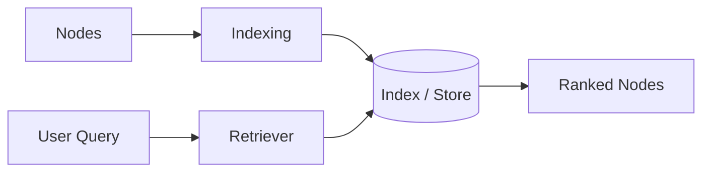
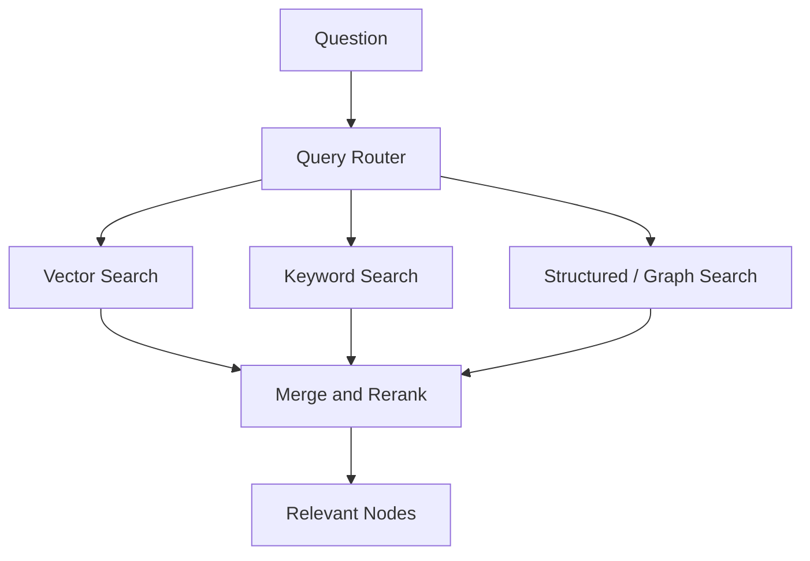

# 03 — LlamaIndex Indexes and Retrieval

> An index makes knowledge searchable. A retriever decides what evidence deserves a place in the answer.

## Overview

After documents have been parsed and converted into Nodes, the system needs a way to find relevant content efficiently. Indexing organizes the Nodes; retrieval searches that organization for candidates.



## 1. Indexing versus retrieval

- **Indexing** is the preparation path: Nodes are represented and stored for later search.
- **Retrieval** is the query path: a request is matched against the index and candidate Nodes are returned.

For vector retrieval, an embedding model represents text as vectors. At query time, the query is embedded using a compatible model and compared with stored vectors.

## 2. VectorStoreIndex

`VectorStoreIndex` is a common choice for semantic search and RAG.

```python
from llama_index.core import VectorStoreIndex, SimpleDirectoryReader

documents = SimpleDirectoryReader("data").load_data()
index = VectorStoreIndex.from_documents(documents)

retriever = index.as_retriever(similarity_top_k=5)
nodes = retriever.retrieve("How many leave days can be carried forward?")

for item in nodes:
    print(item.score, item.node.text[:160])
```

This compact example uses defaults. For production, explicitly configure the embedding model and persistent vector store, and keep their versions compatible.

## 3. Choosing an index strategy

| Strategy | Typical use | Main trade-off |
|---|---|---|
| `VectorStoreIndex` | Semantic similarity over text | Depends on embedding quality |
| `SummaryIndex` | Summarization over a collection | May require broad context processing |
| Tree-based | Hierarchical summaries and navigation | More structure to build and maintain |
| Keyword-oriented | Exact terms, IDs and domain vocabulary | Less effective for paraphrases |
| Graph / property graph | Entity relationships and multi-hop questions | Requires reliable entity and relation extraction |

Choose from query patterns, data shape, latency and quality requirements—not from a feature list.

## 4. Similarity, Top-K and thresholds

A retriever often returns the top K candidates according to a similarity or distance measure.

- **Small K:** less noise and lower token use, but may miss evidence.
- **Large K:** broader recall, but may add irrelevant or duplicate context.
- **Similarity threshold:** can reject weak matches, but an overly strict threshold may return nothing.

Precision asks, “How many retrieved results are relevant?” Recall asks, “How much of the relevant evidence did we retrieve?” Tune against representative queries rather than guessing a universal K.

## 5. Metadata filtering and security

Filters narrow the search space using fields such as document type, department, country or version. In an implementation, translate trusted application context into the vector store's supported metadata-filter type.

Never accept tenant IDs or access scopes directly from an untrusted prompt. Filtering is useful for scoping; authorization must be enforced by the application and data layer.

## 6. Beyond vector similarity

Enterprise search often benefits from combining multiple retrieval signals.

- **Keyword search** finds exact names, codes and policy identifiers.
- **Vector search** finds semantically similar language.
- **Hybrid retrieval** combines both, often followed by rank fusion or reranking.
- **Graph retrieval** can follow explicit relationships between entities.
- **Query routing** sends different question types to the most appropriate index or retriever.



A question such as “What is the leave policy?” may suit semantic search. “Find policy FIN-042 version 4” benefits from exact matching and metadata.

## 7. Post-processing and retrieval evaluation

Raw candidates are not necessarily ready for generation. A retrieval pipeline may remove duplicates, apply trusted filters, rerank candidates, compress passages, or expand a small child match to its parent context.

Evaluate retrieval independently from answer generation. Maintain queries with expected source documents or relevant passages, then measure precision, recall, ranking quality and empty-result behavior. If retrieval is wrong, changing the prompt will not fix the evidence.

## 8. Index lifecycle

Indexes are deployable data assets. Version the embedding model, chunking configuration, metadata schema and index build. For a major re-index, build a new version, validate it, switch traffic and retain a rollback path.

## Key takeaways

- Indexes organize Nodes; retrievers search them.
- Vector search is useful, but exact, hybrid and graph retrieval solve different problems.
- Top-K, thresholds, filters and reranking should be tuned against real queries.
- Retrieval quality must be measured separately from generation quality.

## Further reading

- [LlamaIndex documentation](https://docs.llamaindex.ai/)
- [Chapter 02 — Data and Document Ingestion](02-llamaindex-data-and-document-ingestion.md)
- [Chapter 04 — RAG Pipelines](04-llamaindex-rag-pipelines.md)

## Chapter navigation

⬅️ **Previous:** [02—Data and Document Ingestion](02-llamaindex-data-and-document-ingestion.md)

📚 **Part:** [AI Engineering Frameworks & Tooling](../index.md)

➡️ **Next:** [04—RAG Pipelines](04-llamaindex-rag-pipelines.md)

---

> **Enterprise AI Engineering Handbook**
>
> *Building Production-Grade Enterprise AI Systems — One Chapter at a Time.*
