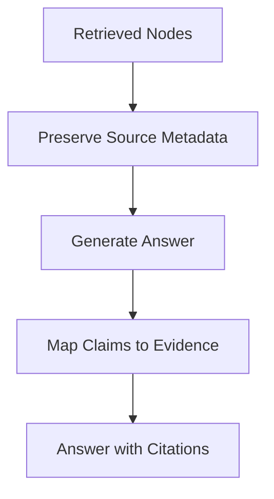
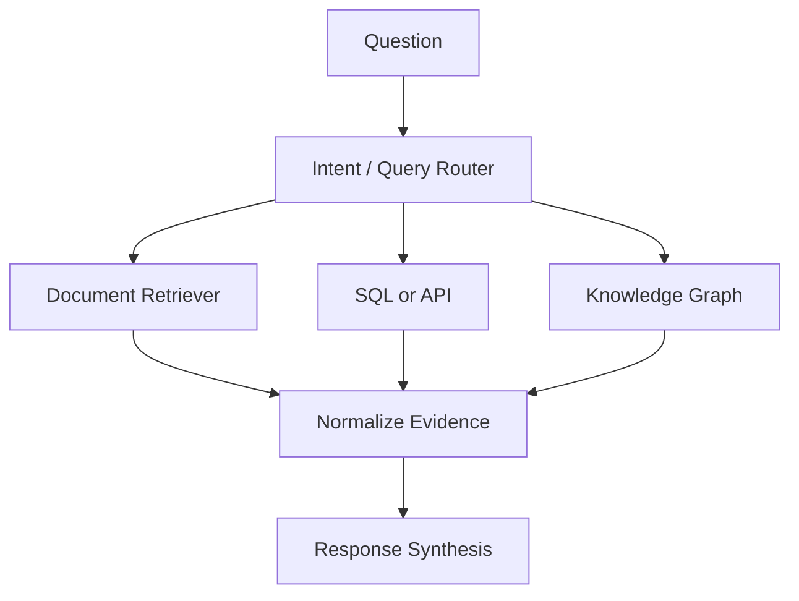

# 04 — LlamaIndex RAG Pipelines

> Retrieval finds evidence. RAG turns that evidence into an answer that can be checked.

## Overview

Retrieval-Augmented Generation (RAG) combines search over external knowledge with LLM generation. The application retrieves relevant source material and supplies it as context rather than relying only on the model's learned parameters.


Ingestion and index-building are covered in Chapters [10](02-llamaindex-data-and-document-ingestion.md) and [11](03-llamaindex-indexes-and-retrieval.md). This chapter focuses on the online question-answering path.

## 1. A basic LlamaIndex RAG application

```python
from llama_index.core import SimpleDirectoryReader, VectorStoreIndex

documents = SimpleDirectoryReader("data").load_data()
index = VectorStoreIndex.from_documents(documents)

query_engine = index.as_query_engine(similarity_top_k=4)
response = query_engine.query(
    "What is the expense submission deadline?"
)
print(response)
```

The query engine hides several steps: query embedding, retrieval, context assembly, prompt construction, LLM invocation and response synthesis. That convenience is useful, but inspect intermediate retrieval results when debugging quality.

## 2. Retriever versus query engine

| Component | Use it when |
|---|---|
| Retriever | You need candidate Nodes and want to control the next steps |
| Query engine | You want a higher-level question-answering interface combining retrieval and synthesis |

```python
retriever = index.as_retriever(similarity_top_k=4)
nodes = retriever.retrieve("What is the expense deadline?")

for result in nodes:
    print(result.score, result.node.text)
```

Testing retrieval separately helps isolate whether a bad answer came from missing evidence or poor generation.

## 3. Context construction

Retrieved Nodes become the context for the LLM. Context construction is more than concatenating every result. Consider relevance, ranking, duplicates, source version, token budget and conflicting evidence.

Too little context can omit an important condition. Too much can bury the answer and increase latency and cost.

## 4. Response synthesis

The response synthesizer combines the question and retrieved Nodes to produce a response. Different approaches suit different workloads.

| Approach | Idea | Trade-off |
|---|---|---|
| Compact | Combine retrieved text into a compact context | Simple, subject to context limits |
| Refine | Generate an answer and iteratively refine it with more Nodes | Can incorporate more evidence, but may require multiple calls |
| Tree-based | Summarize groups of Nodes and combine summaries | Useful for broad collections, with more synthesis complexity |

Available response modes and exact names can vary by LlamaIndex version. Select based on answer quality, token budget and latency.

## 5. Prompting for grounded answers

```text
Answer using only the supplied context.
If the context does not contain the answer, say so.

Question:
{question}

Context:
{context}

Cite the relevant source references.
```

This instruction reduces unsupported answers, but is not a guarantee. Validate important claims against retrieved sources and provide a no-answer path when evidence is insufficient.

## 6. Citations and source attribution

A useful enterprise answer should let the reader trace a claim to its source. Preserve source metadata through ingestion and retrieval: document ID, title, version, page or section, and source URI where available.



Do not fabricate citations from filenames or infer page numbers that were not captured. If the source cannot support a claim, state the limitation.

## 7. Improving a basic RAG pipeline

Use advanced retrieval techniques only when evaluation shows a real problem.

- **Query transformation:** rewrite or expand a question when wording differs from source vocabulary.
- **Multi-query retrieval:** search using several formulations and merge candidates.
- **Hybrid retrieval:** combine semantic and exact keyword matching.
- **Reranking:** reorder candidates using a stronger relevance model.
- **Contextual compression:** retain only passages that contribute to the answer.
- **Parent-child retrieval:** search small chunks but return broader parent context.
- **Structured retrieval:** route numerical or transactional questions to databases or SQL rather than treating every source as prose.

These techniques solve different failure modes; they are not a checklist to enable all at once.

## 8. Multi-source and structured-data RAG

Not every enterprise question is a document question. “What does the policy say?” may use document retrieval. “How many open claims are overdue?” should usually query an authorized operational data source.



Keep permissions, query validation and business rules in the application boundary. An LLM-generated SQL statement or API request must not bypass those controls.

## Key takeaways

- RAG is an online pipeline: retrieve evidence, build context, synthesize and validate an answer.
- A query engine is convenient; a retriever gives more control and makes debugging easier.
- Response synthesis affects latency, cost and how evidence is combined.
- Citations require preserved source metadata and genuine evidence mapping.
- Advanced RAG techniques should solve measured retrieval problems.

## Further reading

- [LlamaIndex documentation](https://docs.llamaindex.ai/)
- [Chapter 03 — Indexes and Retrieval](03-llamaindex-indexes-and-retrieval.md)
- [Chapter 07 — Production Patterns](07-llamaindex-production-patterns.md)

## Chapter navigation

⬅️ **Previous:** [03—Indexes and Retrieval](03-llamaindex-indexes-and-retrieval.md)

📚 **Part:** [AI Engineering Frameworks & Tooling](../index.md)

➡️ **Next:** [05—Agents and Tools](05-llamaindex-agents-and-tools.md)
---

> **Enterprise AI Engineering Handbook**
>
> *Building Production-Grade Enterprise AI Systems — One Chapter at a Time.*
