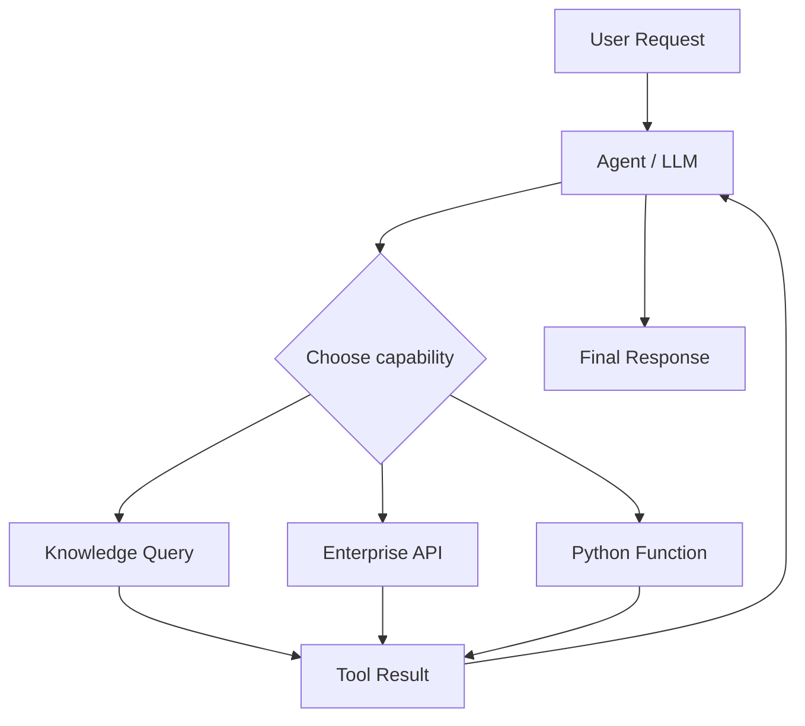
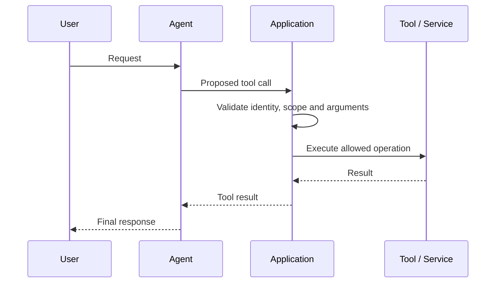

# 05 — LlamaIndex Agents and Tools

> A RAG system finds information. An agent can decide which capability to use next.

## Overview

A conventional RAG application follows a known path: retrieve relevant content and generate an answer. An agent adds a decision loop. It can choose among tools, inspect their results and decide whether another action is needed.



## 1. What is a tool?

A tool is a capability exposed through a defined interface. It typically has a name, description, input schema, execution function and result.

Examples: `search_policy(question)`, `get_customer(customer_id)`, `calculate_invoice_total(items)` and `create_support_ticket(summary)`.

The model proposes a structured tool call. The application validates and executes it. The model does not receive unrestricted access to application code or databases.

## 2. Function tools

A Python function can represent a narrow application capability. Keep its inputs explicit and validate them before sensitive operations.

```python
def calculate_tax(amount: float, rate: float) -> float:
    if amount < 0 or not 0 <= rate <= 1:
        raise ValueError("Invalid amount or tax rate")
    return round(amount * rate, 2)
```

LlamaIndex provides wrappers such as `FunctionTool` to expose functions to supported agent interfaces. A typical wrapper looks like this:

```python
from llama_index.core.tools import FunctionTool

def lookup_policy(policy_id: str) -> str:
    # The service performs its own authorization check.
    return policy_service.lookup(policy_id)

policy_tool = FunctionTool.from_defaults(
    fn=lookup_policy,
    name="lookup_policy",
    description="Find a policy using its exact policy identifier.",
)
```

This is the tool definition, not the authorization boundary. The service still validates the caller and decides whether the requested record can be returned. Exact agent and tool APIs vary by release and integration; pin the version used by the application and follow its matching API reference.

A good tool description should answer: what does it do, when should the agent use it, and what does it return?

## 3. Query engines as tools

A retrieval capability can be exposed to an agent so it can consult enterprise knowledge when needed.

```text
Agent
  ├── Policy search tool → RAG query engine
  ├── Customer lookup tool → Customer API
  └── Calculator tool → Deterministic function
```

Use a query-engine tool when the agent must decide whether a knowledge question requires retrieval. If every request is a policy question, a direct RAG pipeline may be simpler and more predictable.

## 4. The agent loop

1. Receive the request and available tool descriptions.
2. Select a tool or decide to answer directly.
3. Produce structured arguments.
4. Let the application validate and execute the call.
5. Return the tool result to the agent.
6. Continue until completion or an execution limit is reached.



The application—not the model—owns execution authority.

## 5. Read tools versus write tools

| Tool type | Example | Control |
|---|---|---|
| Read-only | Search a policy, fetch account summary | Enforce user and tenant scope |
| Reversible write | Create a draft ticket | Validate and record operation |
| High-impact write | Transfer funds, approve a claim, change access | Strong authorization and human approval |

A model choosing a tool is not proof that the user is authorized. Check permissions at execution time, not only when the agent starts.

## 6. Design bounded tools

Prefer narrow tools over broad tools such as `run_sql(query)` or `call_any_api(url, body)`. Narrow contracts reduce ambiguity and make authorization easier.

```python
def get_invoice_status(invoice_id: str, tenant_id: str):
    # Verify invoice ownership in the application service.
    return invoice_service.get_status(
        invoice_id=invoice_id,
        tenant_id=tenant_id,
    )
```

In real applications, derive `tenant_id` from trusted authentication context rather than trusting a value generated by the model.

## 7. Control the operating envelope

Set explicit limits for maximum tool calls and execution time, allowed tools per user/task, input validation and output-size limits, rate limits and cost budgets, human approval for sensitive actions, and audit records for tool name, caller and outcome.

Treat tool output as untrusted data. A retrieved document or API response may contain malicious instructions; it must not override system policy or expand the agent's permissions.

## 8. When an agent is the wrong abstraction

Use a direct function or workflow when the sequence is known in advance.

| Requirement | Better starting point |
|---|---|
| Fixed sequence of steps | Workflow (Chapter 06) |
| Search and answer from documents | RAG pipeline (Chapter 04) |
| Choose among tools dynamically | Agent |
| Deterministic calculation or update | Application service / function |

## Key takeaways

- Tools expose capabilities; agents decide when to use them.
- Tool calls are proposals. The application validates and executes them.
- Keep tools narrow, typed, authorized and observable.
- Use agents only when dynamic selection adds value over a fixed workflow.

## Further reading

- [LlamaIndex documentation](https://docs.llamaindex.ai/)
- [Chapter 04 — RAG Pipelines](04-llamaindex-rag-pipelines.md)
- [Chapter 06 — Workflows](06-llamaindex-workflows.md)

## Chapter navigation

⬅️ **Previous:** [04—RAG Pipelines](04-llamaindex-rag-pipelines.md)

📚 **Part:** [AI Engineering Frameworks & Tooling](../index.md)

➡️ **Next:** [06—Workflows](06-llamaindex-workflows.md)
---


> **Enterprise AI Engineering Handbook**
>
> *Building Production-Grade Enterprise AI Systems — One Chapter at a Time.*
