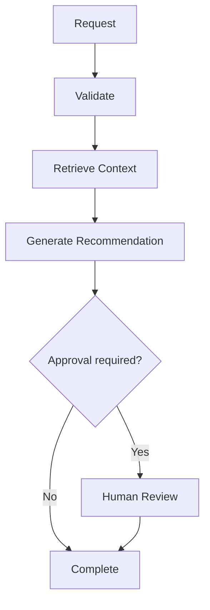
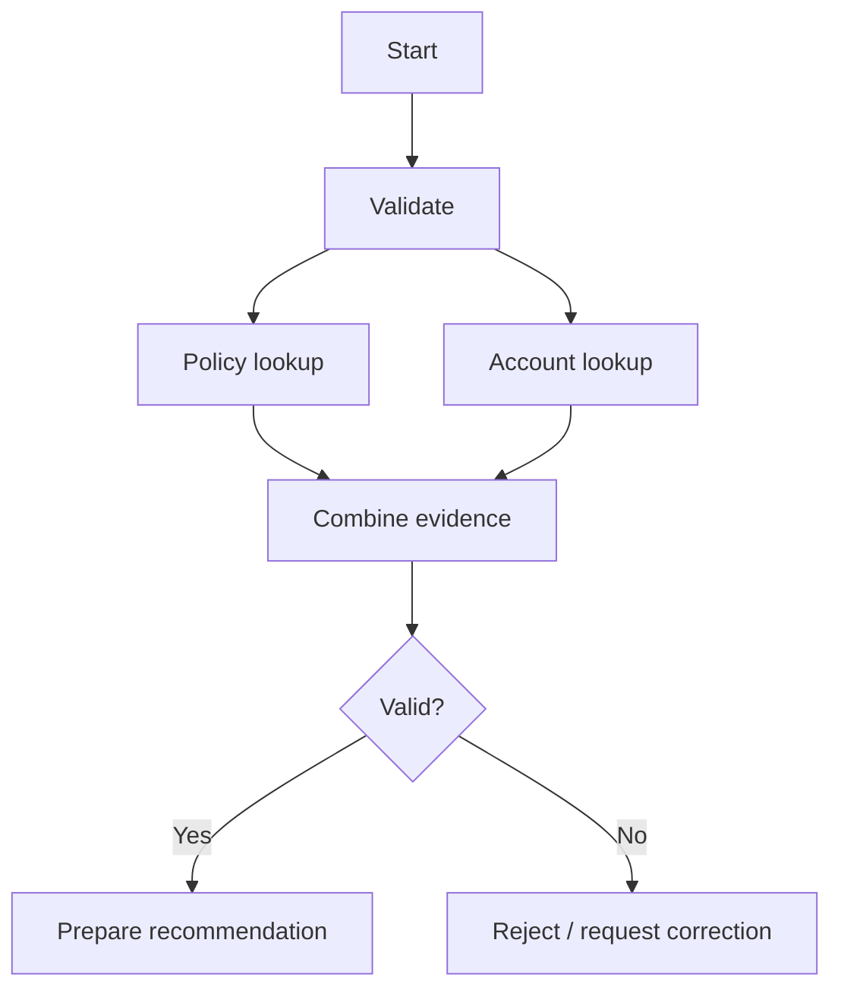

# 06 — LlamaIndex Workflows

> When the process must be predictable, make the process explicit instead of hiding it inside a prompt.

## Overview

Enterprise requests often involve more than a model call. A claim-review flow may validate input, retrieve policy, draft a recommendation, request approval and then update a business system.

LlamaIndex Workflows provide an event-driven way to model such multi-step execution.



## 1. Workflow versus agent

A workflow defines the execution structure. An agent dynamically chooses actions.

| Workflow | Agent |
|---|---|
| Application defines steps and transitions | Model chooses among available actions |
| Strong fit for fixed business processes | Useful when the next action is uncertain |
| Easier to reason about approval paths | Flexible, but less predictable |

They can be combined: a workflow can call an agent for a bounded decision, then resume deterministic processing.

## 2. Core concepts

- **Workflow:** owns the overall execution.
- **Step:** a unit of work with defined inputs and outputs.
- **Event:** carries data from one step to another.
- **State:** holds information that multiple steps need during a run.
- **Start / stop events:** represent workflow entry and completion.

Keep steps focused. `validate_request`, `retrieve_policy` and `draft_recommendation` are easier to test than one `process_everything` step.

## 3. A minimal workflow

The following illustrates the step/event structure. Confirm imports and decorator behavior against the installed LlamaIndex version.

```python
from llama_index.core.workflow import (
    Workflow, StartEvent, StopEvent, step
)

class ReviewWorkflow(Workflow):

    @step
    async def review(self, ev: StartEvent) -> StopEvent:
        request = ev.get("request")
        if not request:
            return StopEvent(result={
                "status": "rejected",
                "reason": "Missing request",
            })

        return StopEvent(result={
            "status": "ready_for_review",
            "request": request,
        })
```

A workflow is typically run asynchronously:

```python
workflow = ReviewWorkflow(timeout=60, verbose=False)
result = await workflow.run(request="Review claim CLM-104")
```

This demonstrates orchestration structure; production logic should call application services rather than place business rules in prompts.

## 4. Events, branching and parallel work

Events make hand-offs explicit. They can carry a query, retrieved context, validation outcome or tool result.

A workflow can branch when a condition is met. Independent tasks can run in parallel—for example, checking policy and retrieving account status—then merge their results before a decision.



Parallelize only independent work. If one step depends on another's output, keep that dependency explicit.

## 5. State and persistence

Events communicate between steps; workflow state holds data that must remain available across steps. Keep state minimal and intentional.

For long-running workflows, define what happens if a process restarts. Persist the state needed to resume safely, and avoid storing secrets or unnecessary personal data in workflow state.

A workflow ID or business correlation ID should link execution to the originating request and audit trail.

## 6. Reliability: retries, timeouts and idempotency

Retries are appropriate for transient failures such as temporary network errors. They are not a cure for invalid input or permanent business-rule failures.

- Use bounded retries with backoff.
- Set timeouts on external calls.
- Classify retryable and non-retryable errors.
- Make side-effecting steps idempotent.
- Record outcomes before resuming after interruption.

Retrying `get_policy()` is usually safe. Retrying `submit_payment()` without an idempotency key may create a duplicate payment.

## 7. Human approval

A human approval step is useful before high-impact actions. The workflow should pause with a clear review payload, preserve its state, and resume only after an authenticated approval or rejection event.

Do not treat a model-generated statement such as “approved” as an approval event. Approval must come from an authorized human or trusted business system.

## 8. Combining workflows with RAG and agents

```text
Workflow
  ├── Retrieve policy (RAG)
  ├── Gather account data (API)
  ├── Ask bounded agent to classify
  ├── Apply business rules
  ├── Request approval if needed
  └── Execute approved action
```

The workflow owns process control; RAG supplies evidence; the agent provides bounded dynamic selection; application services enforce business rules.

## Key takeaways

- Workflows make multi-step AI execution explicit and observable.
- Steps do the work; events carry information; state preserves what the run needs.
- Branching and parallelism should reflect real dependencies.
- Retries, persistence and idempotency matter when workflows have side effects.
- Human approval must be an authenticated business event.

## Further reading

- [LlamaIndex documentation](https://docs.llamaindex.ai/)
- [Chapter 05 — Agents and Tools](05-llamaindex-agents-and-tools.md)
- [Chapter 07 — Production Patterns](07-llamaindex-production-patterns.md)\n- [LangChain agents](../langchain/06-langchain-agents.md)\n- [LangChain production patterns](../langchain/07-langchain-production-patterns.md)

## Chapter navigation

⬅️ **Previous:** [05—Agents and Tools](05-llamaindex-agents-and-tools.md)

📚 **Part:** [AI Engineering Frameworks & Tooling](../index.md)

➡️ **Next:** [07—Production Patterns](07-llamaindex-production-patterns.md)

---

> **Enterprise AI Engineering Handbook**
>
> *Building Production-Grade Enterprise AI Systems — One Chapter at a Time.*
