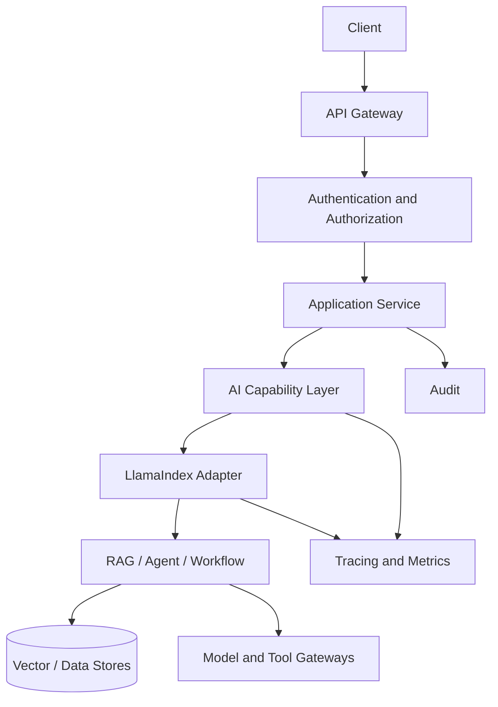
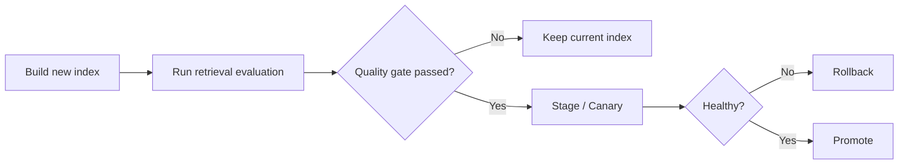

# 07 — LlamaIndex Production Patterns

> A working demo proves that a pipeline can run. Production engineering proves it can run safely, repeatedly and at scale.

## Overview

A prototype may load documents, build an index and return an answer. An enterprise service must additionally handle identity, authorization, tenant isolation, failures, data freshness, evaluation, cost and deployment.

LlamaIndex should be one capability inside a larger application architecture—not the architecture itself.

## 1. Reference architecture



Keep controllers and business services independent of LlamaIndex-specific types. Expose capabilities such as `KnowledgeService.answer()` or `WorkflowService.start()` and translate to framework objects inside adapters.

## 2. Security and tenant isolation

Security must be enforced before data reaches the model.

1. Authenticate the caller.
2. Resolve tenant and user permissions from trusted identity context.
3. Apply authorization constraints to retrieval and data access.
4. Re-check permission before sensitive tool execution.
5. Record access and side effects for audit.

Metadata filters can help scope retrieval, but are not a complete authorization system. Enforce isolation in the application and storage layer. Shared caches must include tenant and permission context in their keys.

## 3. Reliability patterns

External dependencies fail: model providers rate-limit, vector stores become unavailable and enterprise APIs time out.

| Pattern | Purpose |
|---|---|
| Timeout | Prevent a dependency from holding a request indefinitely |
| Bounded retry | Recover from transient failures |
| Circuit breaker | Stop repeatedly calling an unhealthy dependency |
| Bulkhead | Prevent one workload from exhausting all resources |
| Fallback | Degrade safely when an optional dependency fails |
| Idempotency key | Prevent duplicate side effects on retry |

Do not retry validation errors or authorization failures. For write operations, design idempotency at the business-service boundary, not only in the workflow wrapper.

## 4. Caching and performance

Cache only when the result is safe to reuse.

- Cache embeddings for unchanged content.
- Cache retrieval results when index version and access scope match.
- Cache generated answers only when freshness, tenant and permission constraints allow it.
- Invalidate or version cache entries when source documents or indexes change.

Measure the end-to-end latency budget by stage: API, retrieval, reranking, model call, tool call and validation. Optimize the actual bottleneck rather than assuming the framework is responsible.

## 5. Observability

A useful trace should connect one user request to its retrieval and generation steps. Capture request and correlation IDs, index/embedding/model versions, retrieved Node IDs and source references, retrieval score and candidate count, model latency/token usage/cost, tool calls and workflow transitions, and final status.

Avoid logging secrets, raw sensitive documents or unnecessary personal data. Redact or sample content according to the organization's data policy.

A small request context makes it easier to correlate logs and traces without passing identity decisions through prompts:

```python
from dataclasses import dataclass

@dataclass(frozen=True)
class AIRequestContext:
    request_id: str
    tenant_id: str
    user_id: str
    index_version: str

def trace_attributes(ctx: AIRequestContext) -> dict:
    return {
        "request.id": ctx.request_id,
        "tenant.id": ctx.tenant_id,
        "user.id": ctx.user_id,
        "index.version": ctx.index_version,
    }
```

Create this context from authenticated application state. Do not populate it from user-supplied prompt text, and do not add sensitive document content to trace attributes.

## 6. Evaluation and regression testing

A fluent answer is not necessarily a correct answer. Evaluate retrieval and generation separately.

| Layer | Example checks |
|---|---|
| Ingestion | Parsing success, metadata completeness, freshness |
| Retrieval | Relevant source found, precision/recall, ranking |
| Generation | Groundedness, answer correctness, citation support |
| Agent / workflow | Correct tool choice, safe action, expected transitions |
| Service | Latency, availability, cost and authorization |

Maintain a representative evaluation dataset and run it when prompts, models, embeddings, chunking or indexes change. Use deterministic tests for application rules and controlled evaluation for model behavior.

## 7. Index and deployment lifecycle

Treat indexes and model configuration as versioned deployment artifacts.



Use staged rollout or blue-green deployment for material changes. Keep a known-good index and configuration available for rollback. Pin dependencies and validate upgrades before production rollout.

## 8. Scale by separating workloads

Ingestion and online queries have different resource profiles. Ingestion is often batch- and embedding-intensive; query serving is latency-sensitive. Run them as separate workloads where scale or isolation requires it.

Apply bounded concurrency, queue backpressure, rate limits and per-tenant usage budgets. Scale stateless API workers horizontally while treating vector storage, workflow state and caches as separate stateful services.

## Production readiness checklist

- [ ] Framework-specific objects are isolated behind adapters.
- [ ] Authentication, authorization and tenant isolation are enforced.
- [ ] Ingestion supports updates, deletion and freshness tracking.
- [ ] External calls have timeouts and bounded retries.
- [ ] Side effects are idempotent and audited.
- [ ] Retrieval and generation have independent quality tests.
- [ ] Traces capture model, index and tool versions.
- [ ] Cache keys respect tenant and permission boundaries.
- [ ] Indexes and dependencies have staged rollout and rollback plans.
- [ ] Cost, latency and usage are monitored.

## Key takeaways

- Production readiness is an application and platform concern, not a framework feature.
- Keep LlamaIndex behind capability-oriented interfaces.
- Enforce authorization outside prompts and before sensitive data or actions.
- Measure retrieval, generation and service quality independently.
- Version and evaluate indexes, models and configuration before rollout.

## Further reading

- [LlamaIndex documentation](https://docs.llamaindex.ai/)
- [Chapter 04 — RAG Pipelines](04-llamaindex-rag-pipelines.md)
- [Chapter 06 — Workflows](06-llamaindex-workflows.md)\n- [LangChain production patterns](../langchain/07-langchain-production-patterns.md)

## Chapter navigation

⬅️ **Previous:** [06—Workflows](06-llamaindex-workflows.md)

📚 **Part:** [AI Engineering Frameworks & Tooling](../index.md)

➡️ **Next:** [08—Limitations and Trade-offs](08-llamaindex-limitations-and-tradeoffs.md)

---

> **Enterprise AI Engineering Handbook**
>
> *Building Production-Grade Enterprise AI Systems — One Chapter at a Time.*
