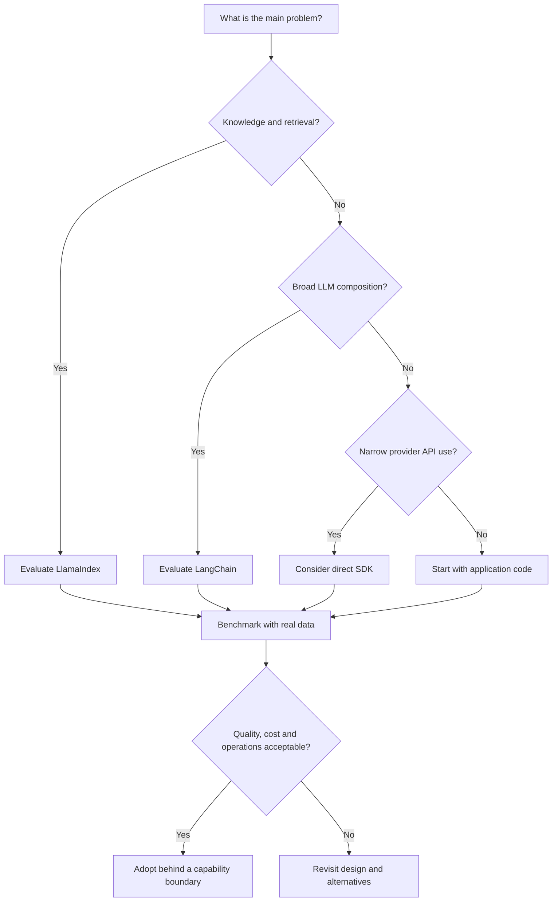

# 08 — LlamaIndex Limitations and Trade-offs

> The right framework is not the one with the most features. It is the one that removes the right complexity without hiding the complexity you still need to own.

## Overview

LlamaIndex offers useful abstractions for data ingestion, indexing, retrieval, RAG, agents and workflows. Those abstractions can accelerate development, but they introduce dependencies, configuration choices and operational responsibilities.

Evaluate the framework against the system you need to build—not against a feature checklist.

## 1. Abstraction versus control

A high-level query engine can reduce boilerplate:

```python
response = query_engine.query("What is the policy?")
```

But when results are wrong, the developer may need to inspect query transformation, retrieval, ranking, context construction and synthesis separately.

```text
Higher-level API
  + Faster initial development
  - Less visible internal control

Lower-level components
  + Explicit behavior and tuning
  - More code and responsibility
```

Use the highest abstraction that still exposes the controls required by the application.

## 2. Framework coupling and lock-in

Coupling grows when framework-specific objects leak into controllers, domain services, API contracts and persistence models.

```text
Application
    ↓
Knowledge Port
    ↓
LlamaIndex Adapter
    ↓
Retriever / Query Engine
```

This does not make migration free. Prompts, Node structures, retrieval behavior and stored indexes may still be framework- or provider-specific. The goal is to contain the migration surface, not pretend it does not exist.

## 3. Retrieval is not automatically solved

A framework can provide a retriever; it cannot guarantee that the right evidence will be found. Quality depends on source quality and parsing accuracy, chunk boundaries and metadata, embedding model and index configuration, query formulation and retrieval strategy, reranking and context selection, data freshness and access scope.

A poor answer may originate upstream of the LLM. Diagnose retrieval before endlessly rewriting prompts.

## 4. Data engineering remains your responsibility

LlamaIndex does not remove the need to manage source permissions, document versions, duplicate records, deletion, lineage, parsing errors or freshness. A connector can load data successfully while still producing incomplete or misleading content.

Treat ingestion as a data pipeline with ownership, quality checks and lifecycle management.

## 5. Performance and operational overhead

Framework layers can add object conversion, callbacks, event handling and tracing overhead. In many RAG applications, however, model latency, vector search, network calls and external tools dominate.

Measure the full request path before optimizing. Also account for dependency size, integration compatibility, cold starts and upgrade maintenance.

## 6. Agents and workflows add different risks

Agents provide flexibility but may choose the wrong tool, repeat calls, generate invalid arguments or take an action that should have required approval.

Workflows provide explicit control but require careful design of state, transitions, retries, persistence and version changes.

Do not use an agent for a fixed business process simply because the framework makes one easy to create. Use deterministic application logic for deterministic rules.

## 7. Provider and index compatibility

Changing an LLM provider may be relatively straightforward; changing embedding models can require re-embedding and rebuilding indexes. A new model can change vector dimensions or semantic behavior.

Version and test LlamaIndex and integration packages, LLM and embedding models, chunking and transformation configuration, index schema and vector-store configuration, and prompts and synthesis settings. Avoid uncontrolled upgrades in production.

## 8. When is LlamaIndex a strong fit?

| Situation | Assessment |
|---|---|
| Document-heavy knowledge assistant | Strong fit |
| Enterprise search over heterogeneous content | Strong fit |
| RAG with custom ingestion and retrieval | Strong fit |
| Data extraction and document understanding | Strong fit |
| Simple one-off LLM call | May be unnecessary |
| Fixed business workflow with no retrieval | Workflow or application code may be simpler |
| Highly specialized retrieval stack | Compare framework components with direct implementation |

## 9. LlamaIndex, LangChain or direct SDK?

| Option | Consider when |
|---|---|
| LlamaIndex | Ingestion, indexing, retrieval and knowledge-centric workflows are central |
| LangChain | You need broad composition of model, prompt, tool and application components |
| Direct provider SDK | The application is narrow and you want minimal abstraction and direct control |
| Combined approach | Each framework owns a distinct capability and the integration boundary is explicit |

Avoid adopting multiple frameworks for overlapping responsibilities. Every additional abstraction adds dependencies, upgrade work, debugging paths and operational knowledge.

## 10. A practical adoption decision

Before committing, run a focused proof of concept using representative data and queries.



1. Can it ingest the real source formats correctly?
2. Does retrieval find the expected evidence?
3. Can the application enforce tenant and document access?
4. Are latency and cost within budget?
5. Can the team debug and operate the pipeline?
6. Are upgrades and index rebuilds manageable?
7. Does the framework reduce enough engineering effort to justify its abstractions?

Record the decision, alternatives, assumptions and migration risks in an architecture decision record.

## Key takeaways

- Abstraction saves code but can hide behavior and increase coupling.
- LlamaIndex does not guarantee data quality, retrieval accuracy or secure access.
- Agents and workflows introduce different complexity; choose deliberately.
- Embedding and index changes can require data migration, not just a package upgrade.
- Adopt the framework incrementally and validate it against real enterprise requirements.

## Further reading

- [LlamaIndex documentation](https://docs.llamaindex.ai/)
- [Chapter 01 — Fundamentals](01-llamaindex-fundamentals.md)
- [AI Engineering Frameworks & Tooling](../index.md)

## Chapter navigation

⬅️ **Previous:**  [07—Production Patterns](07-llamaindex-production-patterns.md)

📚 **Part:** [Agentic AI: Multi-Agent Systems Architecture, Orchestration, Collaboration](../index.md)

➡️ **Next:** [01—LangGraph Fundamentals](../langgraph/01-langgraph-fundamentals.md)

---

> **Enterprise AI Engineering Handbook**
>
> *Building Production-Grade Enterprise AI Systems — One Chapter at a Time.*
