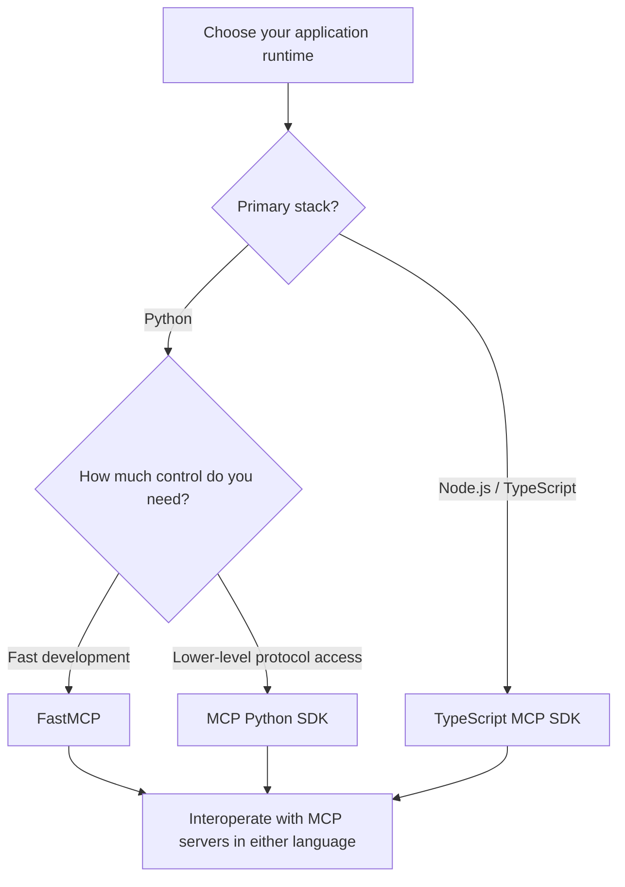
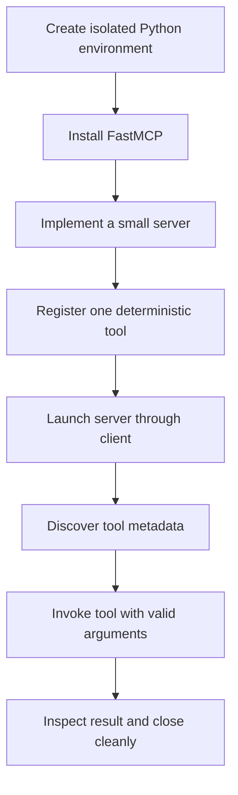

# 27. MCP Engineering Fundamentals

## 1. Your first MCP integration should be small

An MCP integration does not need to begin with an autonomous agent, a collection of services, or a complicated workflow. Start with one server, one client and one useful capability. Make that connection reliable before adding more moving parts.

This chapter establishes the engineering foundations for the MCP section:

- Understand the Python and TypeScript SDK landscape.
- Prepare a clean Python development environment.
- Create a minimal FastMCP server.
- Connect a client, discover a tool and invoke it.
- Know which implementation details belong in the next chapters.

The protocol architecture itself is covered in the MCP architecture section. We will use that foundation here rather than repeat its host/client/server model or JSON-RPC message lifecycle.

### Where this chapter fits

| Chapter | Responsibility |
|---|---|
| **27 — MCP Engineering Fundamentals** | SDK choices, workspace setup and the first client-server interaction |
| **28 — Building MCP Servers** | Server design, tools, resources, prompts and server configuration |
| **29 — Building MCP Clients** | Client implementation, transports, sessions and connection lifecycle |
| **30 onward** | Multi-server integration, advanced capabilities, RAG/framework integration, security, testing and enterprise architecture |

The distinction matters: this chapter introduces the development loop; later chapters make each side of that loop production-ready.

## 2. Choosing an MCP SDK

The two main SDK ecosystems are **Python** and **TypeScript**. They implement the same protocol, so the language used by a client does not have to match the language used by a server.

| Dimension | Python SDK | TypeScript SDK |
|---|---|---|
| Runtime model | AsyncIO and asynchronous Python | Node.js and event-driven I/O |
| Strengths | Strong STDIO support, FastMCP integration and convenient use alongside data-science tools such as Jupyter | Native fit for Node.js services, HTTP-based applications and web-framework integration |
| Natural fit | Python AI services, automation, data workloads and local integrations | JavaScript/TypeScript backends, web applications and developer tooling |
| Interoperability | Can connect to a TypeScript server | Can connect to a Python server |

Choose the SDK that fits the application you are building and the runtime your team already operates. Interoperability means you do not need to rewrite a working service simply because another component uses a different language.



### Official SDK and FastMCP: what is the difference?

In Python, two closely related options appear in practical MCP development:

- **The MCP Python SDK (`mcp`)** provides lower-level protocol building blocks, including client sessions and transport helpers.
- **FastMCP (`fastmcp`)** offers a more concise programming model for creating servers and clients. Decorators make it straightforward to expose Python functions as MCP capabilities.

FastMCP reduces boilerplate for common development tasks. The lower-level SDK gives direct access to session and transport primitives. They are related, but their imports and APIs are not interchangeable. Keep each project consistent with the package and API version it has installed.

## 3. Set up a clean Python workspace

A virtual environment keeps project dependencies separate from the rest of your machine. It also makes it easier to reproduce the same setup on another developer's laptop or in CI.

Create a project and virtual environment:

```bash
mkdir mcp-starter
cd mcp-starter

python -m venv .venv

# Windows PowerShell
.venv\Scripts\Activate.ps1

# macOS / Linux
source .venv/bin/activate
```

For the FastMCP examples in this chapter, install the package:

```bash
python -m pip install fastmcp
python -m pip freeze > requirements.txt
```

If you choose to work directly with the lower-level Python SDK, install `mcp` in that environment as well. Avoid installing packages globally or mixing examples from different SDKs in the same file.

A small starter layout is enough:

```text
mcp-starter/
├── .venv/
├── requirements.txt
├── server.py
├── client.py
└── README.md
```

**A practical note about Jupyter:** notebooks are useful for experiments, but a server launched by a client as a separate STDIO process should live in a normal Python script. Keeping `server.py` separate makes the process boundary explicit and avoids notebook-kernel lifecycle surprises.

## 4. Build a minimal server

FastMCP lets you start with an ordinary Python function and expose it through a decorator. The function remains familiar Python; the MCP layer makes it discoverable and callable by a compatible client.

Create `server.py`:

```python
from fastmcp import FastMCP

mcp = FastMCP("starter-calculator")

@mcp.tool()
def add(a: int, b: int) -> int:
    """Add two integers and return the total."""
    return a + b

if __name__ == "__main__":
    mcp.run()
```

A few details are doing useful work here:

- `FastMCP(...)` gives the server an identifiable name.
- `@mcp.tool()` registers the function as a callable tool.
- Type hints describe the expected input and output types.
- The docstring gives the capability a human-readable description.
- The main guard allows the file to be run as a process without starting the server merely because it was imported.

That is enough for a first integration. Keep the server deliberately boring: a deterministic `add` function is easier to debug than a tool that also calls a database, an LLM and three external APIs.

> **Scope boundary:** tools, resources, prompts, URI templates and server configuration deserve their own design discussion. Chapter 28 covers those server-side concerns in depth; this example only establishes the smallest working server shape.

## 5. Connect a client and call the tool

Now create `client.py`. The client starts the server process, discovers the available tools and invokes `add`.

```python
import asyncio
import sys
from pathlib import Path

from fastmcp import Client
from fastmcp.client.transports import StdioTransport

server_file = Path(__file__).with_name("server.py")
transport = StdioTransport(
    command=sys.executable,
    args=[str(server_file)],
)
client = Client(transport)

async def main():
    async with client:
        tools = await client.list_tools()
        print("Discovered:", [tool.name for tool in tools])

        result = await client.call_tool(
            "add",
            {"a": 4, "b": 5},
        )
        print("Tool result:", result)

if __name__ == "__main__":
    asyncio.run(main())
```

Run it from the activated environment:

```bash
python client.py
```

The important sequence is simple:

1. **Connect** — enter the client's asynchronous context manager.
2. **Discover** — call `list_tools()` to inspect names and metadata.
3. **Invoke** — call `call_tool()` with the selected tool name and its arguments.
4. **Close** — leave the context manager so the connection and child process are cleaned up.

The response is an MCP tool result object, not necessarily a bare Python integer. Inspect its content according to the client API version you are using rather than assuming every server returns the same Python shape.

### The development loop at a glance



This small loop gives you a repeatable baseline. If it fails, you have only a handful of places to investigate: the environment, server startup, transport configuration, tool registration or client invocation.

## 6. A first look at the two transports

The client and server need a transport to exchange messages. At this stage, the key distinction is where the server runs:

| | STDIO | Streamable HTTP |
|---|---|---|
| Server location | Local child process | Independently running service |
| Connection | Standard input and output streams | HTTP endpoint |
| Useful starting point | Local development and command-line integrations | Remote services and applications connecting over a network |
| Lifecycle | Commonly tied to the client process that starts it | Managed independently of an individual client process |

For the example in this chapter, STDIO keeps everything local: the client launches `server.py` and communicates with it through standard streams. A remote service is a different deployment shape and is typically accessed over Streamable HTTP.

One operational detail is easy to overlook: with STDIO, standard output is part of the communication channel. Do not write casual `print()` debugging messages from the server to stdout; they can interfere with protocol messages. Send diagnostic logging to stderr instead.

Transport configuration, session management, reconnect behaviour and multi-transport clients are client-engineering topics. They are covered in Chapter 29 rather than expanded here.

## 7. A short implementation checklist

Before building a larger integration, confirm the basics:

- [ ] The virtual environment activates and dependencies install successfully.
- [ ] The server starts from its own Python file.
- [ ] The client can establish and close the connection.
- [ ] `list_tools()` returns the expected tool name and description.
- [ ] The arguments passed to `call_tool()` match the tool's declared inputs.
- [ ] The returned result contains the expected value.
- [ ] Server diagnostics do not pollute STDIO protocol output.

When the connection behaves unexpectedly, MCP Inspector can help visualise message flow and inspect the server's exposed capabilities. It is a debugging aid, not a substitute for validating your own client and server behaviour.

## 8. Key takeaways

- Python and TypeScript MCP implementations can interoperate; select the SDK based on the runtime and engineering ecosystem.
- The lower-level Python SDK exposes protocol building blocks, while FastMCP offers a concise development interface.
- A virtual environment and a separate server script make local development easier to reproduce and debug.
- A basic client-server loop is connect, discover, invoke and close.
- STDIO is a useful local starting point; Streamable HTTP fits independently hosted services.
- Keep the first implementation small. Add server capabilities, advanced client behaviour and production controls in the chapters dedicated to those concerns.

## 9. Check your understanding

1. Why can a Python client communicate with a TypeScript MCP server?
2. When would you choose FastMCP instead of working directly with the lower-level Python SDK?
3. What does `list_tools()` tell the client before it invokes a tool?
4. Why should server diagnostics avoid writing to stdout when using STDIO?
5. What responsibility does the client's asynchronous context manager help manage?

**Practical build:** create the calculator server, connect to it through STDIO and invoke `add(4, 5)`. Then change the tool to accept a third integer and update the client call. Confirm that discovery still reports the tool and that the returned result changes as expected.

---

## 🧭 Chapter Navigation

⬅️ **Previous:** [26. LangGraph Limitations and Trade-offs](26-langgraph-limitations-and-tradeoffs.md)

📚 **Part:** [AI Engineering Frameworks & Tooling](index.md)

➡️ **Next:** [28. Building MCP Servers](28-building-mcp-servers.md)

---

> **Enterprise AI Engineering Handbook**
>
> *Building Production-Grade Enterprise AI Systems — One Chapter at a Time.*

---
