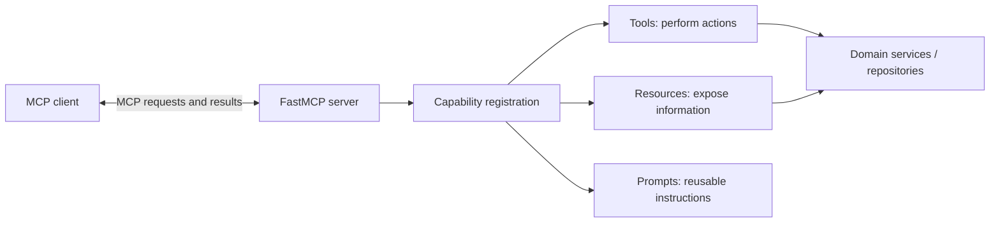
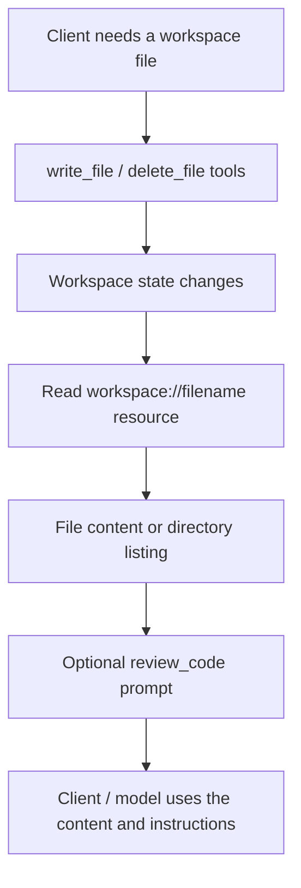

# 28. Building MCP Servers

A useful MCP server is not a dumping ground for every function in an application. It is a clean front door to a small set of capabilities: actions a client can request, information it can read, and reusable instructions it can offer.

Think of it as an adapter around your existing system. Your business logic stays in services and repositories; the MCP server gives selected parts of that system a discoverable, standard interface.

This chapter uses the standalone `fastmcp` package and builds on the development setup from Chapter 27. The focus is server-side implementation—not client connection management, which belongs in Chapter 29.

## 1. MCP server architecture: a capability boundary

A server registers capabilities, validates incoming arguments, delegates work to application code and returns results. It should not need to own your entire business domain.



The three primitives are related, but they are not interchangeable:

| Primitive | What it provides | Example |
|---|---|---|
| **Tool** | An operation that can perform work | Search documents, calculate a value, create a ticket |
| **Resource** | Readable information identified by a URI | A policy, a document or a configuration record |
| **Prompt** | A reusable instruction template | A structured document-review request |

A quick design test: does the caller need the server to *do something*? Use a tool. Does it need to *read a known piece of information*? Consider a resource. Does it need a *repeatable way to frame a task*? Use a prompt.

## 2. Create the Python server

Use the virtual environment prepared in Chapter 27 and install FastMCP:

```bash
python -m pip install fastmcp
```

The practical implementation below gives the server a clear name and concise instructions. These describe its purpose and help clients understand when its capabilities may be relevant; they are useful metadata, not an authorization policy.

## 3. Expose tools: make actions discoverable

A tool wraps an operation. FastMCP uses the function signature and type hints to describe its inputs, while the function name and docstring help explain its purpose. The practical server below exposes separate file-creation and file-deletion tools.

Give each tool one responsibility, validate its arguments and return a predictable result. Good tool design is less about clever code and more about making the operation hard to misunderstand.

For enterprise systems, validate inputs at the boundary and enforce identity-based permissions in the underlying service. A descriptive tool name does not prevent unauthorized access. Keep destructive operations separate and explicit rather than hiding them inside a broad “manage” tool.

For longer operations, a FastMCP handler can also receive a `Context` object. It gives the server access to session-level capabilities such as logging, progress reporting and user elicitation. Use logging and progress updates when they help a caller understand a slow operation; keep interactive elicitation for cases where the server genuinely needs missing information or clarification. The deeper elicitation patterns belong in Chapter 31.

## 4. Expose resources: give information a stable address

A resource makes information available through a URI. It is generally read-oriented: the client can request the content, but reading it should not secretly change business state. The practical example exposes a workspace file and a directory listing.

In the complete example, `workspace://{filename}` is a **resource template**. A request for `workspace://design.md` maps the URI segment to the `filename` function argument. The same pattern can represent many files without registering a separate fixed URI for each one.

Choose URI schemes that communicate ownership and purpose, such as `docs://`, `company://` or `catalogue://`. If retrieving information requires a complex search, an external operation or user-specific decision, a tool may be the better interface. A URI is an address—not a security boundary—so the server must still check whether the caller may read the underlying data.

## 5. Define prompts: package repeatable instructions

Prompts are reusable templates that a client can present or retrieve with arguments. They guide a task; they do not execute the task themselves. The example defines a code-review prompt with a configurable focus.

Keep arguments explicit and the returned instructions focused. If the task needs document content, let the client retrieve the relevant resource and include that content in its workflow. Avoid turning a prompt handler into an unbounded data-access mechanism.

## 6. Server configuration: choose how it runs

Server configuration covers its identity, instructions, runtime settings and transport. The registered tools, resources and prompts do not need to change just because the server is launched differently.

The complete server example uses STDIO as its local entry point. A client typically launches it as a child process and exchanges messages through standard input and output. Keep stdout reserved for protocol traffic. Send diagnostics to stderr or a configured logger; stray `print()` output can break the connection.

**Streamable HTTP — network service**

```python
if __name__ == "__main__":
    mcp.run(
        transport="http",
        host="127.0.0.1",
        port=8000,
    )
```

This starts an independently running HTTP server. Binding to `127.0.0.1` is suitable for local development. A remote deployment needs an intentional network boundary, authentication, authorization and TLS protection. Do not expose a development server directly to the public internet.

Keep ports, endpoints and credentials outside committed source code. Use protected environment configuration or a secrets manager for sensitive values. Detailed security controls and deployment patterns are covered in Chapter 34; client-side transport and session handling are covered in Chapter 29.

## 7. Build a practical document server

Now bring the pieces together. This small workspace server can create and delete files, expose file contents and a directory listing, and prepare a reusable code-review prompt. It uses a dedicated `workspace` directory so the example has a clear filesystem boundary.

```python
from pathlib import Path
from fastmcp import FastMCP

BASE_DIR = Path(__file__).parent / "workspace"
BASE_DIR.mkdir(exist_ok=True)

mcp = FastMCP(
    name="workspace-server",
    instructions="Create, inspect and manage files inside the workspace directory.",
)

def resolve_workspace_path(relative_path: str) -> Path:
    """Resolve a path and reject anything outside the workspace."""
    root = BASE_DIR.resolve()
    candidate = (root / relative_path).resolve()
    if not candidate.is_relative_to(root):
        raise ValueError("Path is outside the workspace")
    return candidate

@mcp.tool()
def write_file(relative_path: str, content: str) -> str:
    """Create or replace a text file inside the workspace."""
    path = resolve_workspace_path(relative_path)
    path.parent.mkdir(parents=True, exist_ok=True)
    path.write_text(content, encoding="utf-8")
    return f"Saved {relative_path}"

@mcp.tool()
def delete_file(relative_path: str) -> str:
    """Delete a file inside the workspace; directories are not allowed."""
    path = resolve_workspace_path(relative_path)
    if not path.is_file():
        raise ValueError("File does not exist or is not a regular file")
    path.unlink()
    return f"Deleted {relative_path}"

@mcp.resource("workspace://{filename}")
def read_file(filename: str) -> str:
    """Read a text file from the workspace."""
    path = resolve_workspace_path(filename)
    if not path.is_file():
        raise ValueError("File not found")
    return path.read_text(encoding="utf-8")

@mcp.resource("workspace://catalogue")
def list_workspace() -> dict[str, list[dict[str, str]]]:
    """List files and directories at the workspace root."""
    items = [
        {"name": item.name, "type": "directory" if item.is_dir() else "file"}
        for item in sorted(BASE_DIR.iterdir())
    ]
    return {"items": items}

@mcp.prompt()
def review_code(filename: str, focus: str = "correctness") -> str:
    """Prepare a focused code-review prompt for a workspace file."""
    path = resolve_workspace_path(filename)
    if not path.is_file():
        raise ValueError("File not found")
    code = path.read_text(encoding="utf-8")
    return f"""Review {filename} with emphasis on {focus}.

Code:
{code}

Identify defects, unclear logic, missing tests and practical improvements.
Separate confirmed issues from suggestions."""

if __name__ == "__main__":
    mcp.run(transport="stdio")
```

The design keeps responsibilities separate:

- `write_file` and `delete_file` perform explicit workspace operations.
- `read_file` and `list_workspace` expose read-only information.
- `review_code` prepares instructions for a review; it does not execute a model call.

The path helper resolves every requested path and rejects attempts to escape the workspace. This is an important baseline, not a complete security model. A real service must also authenticate callers, authorize each operation, audit changes and consider approval for destructive actions. Chapter 34 develops those controls. The server remains independent of the model or agent that consumes its capabilities.



### Smoke-test the server in memory

FastMCP can connect a client directly to the server object in the same process. This is useful for a quick check before starting a subprocess or HTTP service.

```python
import asyncio
from fastmcp import Client
from server import mcp

async def main():
    async with Client(mcp) as client:
        tools = await client.list_tools()
        names = {tool.name for tool in tools}
        assert {"write_file", "delete_file"}.issubset(names)

        await client.call_tool(
            "write_file",
            {"relative_path": "smoke-test.txt", "content": "MCP works"},
        )
        content = await client.read_resource("workspace://smoke-test.txt")
        assert content is not None

        await client.call_tool(
            "delete_file",
            {"relative_path": "smoke-test.txt"},
        )

if __name__ == "__main__":
    asyncio.run(main())
```

This is a smoke test, not a complete quality gate. Add tests for path traversal attempts, missing files, permission failures, filesystem errors and unexpected dependency failures. Chapter 35 covers the broader testing and observability strategy.

## 8. Server design checklist

Before sharing a server with another team, ask:

- [ ] Does every tool have a clear name, description, typed inputs and bounded behaviour?
- [ ] Do resources expose read-oriented data through stable URIs or templates?
- [ ] Do prompts provide instructions without hiding side effects?
- [ ] Are validation and authorization enforced in server-side code?
- [ ] Are secrets and environment-specific values kept out of source control?
- [ ] Is STDIO stdout reserved for protocol messages?
- [ ] Is an HTTP deployment protected by appropriate network and identity controls?
- [ ] Do smoke tests cover both valid and invalid requests?

A server with three well-designed capabilities is often more useful than one with thirty vaguely named tools. Start with a clear contract, keep the business logic behind it, and expand only when a real use case demands it.

## Key takeaways

- FastMCP turns typed Python functions into discoverable MCP capabilities.
- Tools perform operations, resources expose information, and prompts provide reusable instructions.
- URI templates map resource identifiers to function parameters.
- STDIO suits local process integration; Streamable HTTP supports network-accessible services.
- Keep domain logic separate from the MCP adapter and enforce permissions in server-side code.

## Review questions

1. When should an operation be exposed as a tool rather than a resource?
2. How does a resource template map a URI parameter to a function argument?
3. Why must an STDIO server keep diagnostic output off stdout?
4. How does a prompt differ from a tool invocation?
5. Which security checks must be enforced outside the tool description?

---

## 🧭 Chapter Navigation

⬅️ **Previous:** [27. MCP Engineering Fundamentals](27-mcp-engineering-fundamentals-optimised.md)

📚 **Part:** [AI Engineering Frameworks & Tooling](index.md)

➡️ **Next:** [29. Building MCP Clients](29-building-mcp-clients.md)

---

> **Enterprise AI Engineering Handbook**
>
> *Building Production-Grade Enterprise AI Systems — One Chapter at a Time.*

---
