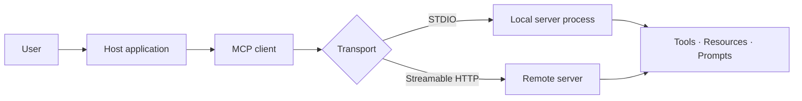
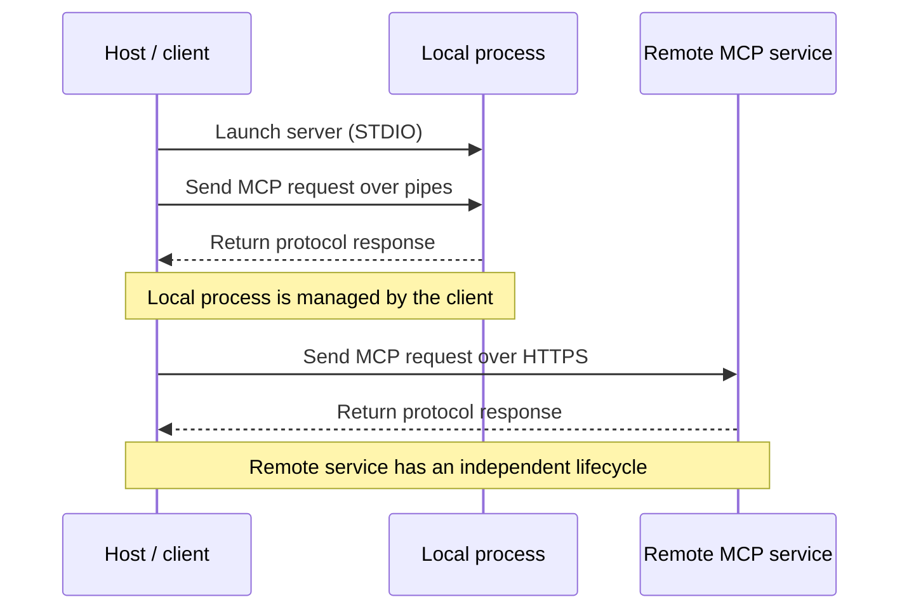
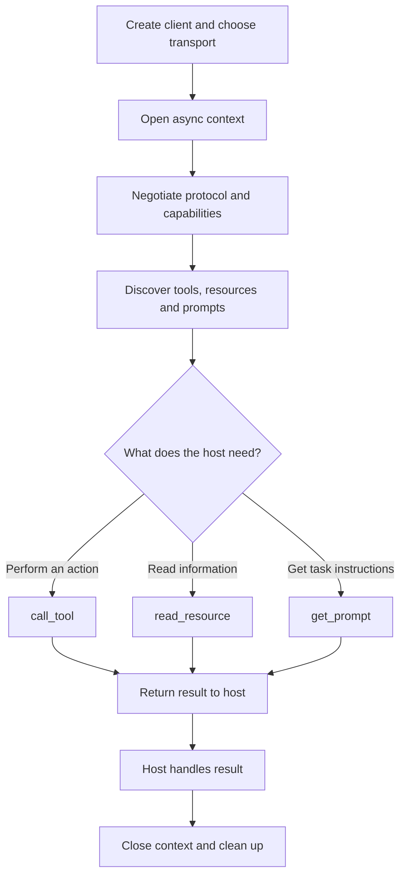

# 29. Building MCP Clients

An MCP server can expose useful capabilities, but those capabilities are only valuable when an application can connect to them and use them safely. That is the client's job.

A client opens a connection, negotiates the protocol supported by the server, discovers its capabilities and sends requests. The host application decides what to do with the results. Keeping those responsibilities separate makes integrations easier to test and evolve.

We'll build a Python client with FastMCP and connect it to the workspace server from Chapter 28. The same application-level operations will work over two transports: STDIO for a local process and Streamable HTTP for a remote service.

## 1. MCP client architecture: one connection, one server

The host is the application the user interacts with—a chatbot, IDE assistant or internal AI service. It manages the user experience and application workflow. An MCP client runs inside that host and communicates with one MCP server.



A useful rule is **one client connection per server**. The host can own several clients, but each manages its own connection. Combining capabilities and routing across servers belong in Chapter 30.

## 2. Initialize the client and manage its lifecycle

FastMCP provides a high-level `Client` class. It manages the transport, protocol negotiation and connection cleanup. The simplest safe pattern is an asynchronous context manager:

```python
from fastmcp import Client

client = Client("http://localhost:8000/mcp")

async with client:
    print(client.server_info)
    print(client.server_capabilities)
    tools = await client.list_tools()
```

Entering the context opens the connection and negotiates the protocol and capabilities. Exiting closes the transport and releases resources, including when an exception occurs.

Protocol revisions do not all initialize in exactly the same way. Older MCP connections use the familiar `initialize` request, server response and `initialized` notification. Newer revisions can use a discovery-based negotiation flow. FastMCP handles this compatibility negotiation automatically in its default mode; application code should normally use the negotiated client rather than manually recreate the handshake.

If you work directly with the lower-level MCP Python SDK, you manage transport streams and a `ClientSession` yourself. That is a valid alternative, but it is a different abstraction. This chapter keeps its implementation examples consistently at the FastMCP client level.

## 3. Connect to a local server with STDIO

STDIO is useful when the host should launch a server on the same machine—for example, a local filesystem, Git or developer-tool integration. The client starts the server as a subprocess and exchanges protocol messages through its standard input and output streams.

The following client launches `server.py`, the workspace server from Chapter 28:

```python
import asyncio
import sys
from pathlib import Path

from fastmcp import Client
from fastmcp.client.transports import StdioTransport

project_dir = Path(__file__).parent
transport = StdioTransport(
    command=sys.executable,
    args=["server.py"],
    cwd=str(project_dir),
    env={"LOG_LEVEL": "INFO"},
)
client = Client(transport)

async def main() -> None:
    async with client:
        tools = await client.list_tools()
        for tool in tools:
            print(f"{tool.name}: {tool.description}")


if __name__ == "__main__":
    asyncio.run(main())
```

`StdioTransport` makes the executable, arguments, working directory and environment explicit. Do not assume every shell variable reaches the child process; pass only what the server needs and keep credentials out of source code.

The server's stdout is the protocol channel. Send diagnostics to stderr or a logger. Closing the client also cleans up the local subprocess.

## 4. Connect to a remote server with Streamable HTTP

When the server runs independently as a network service, use Streamable HTTP. The client connects to the server's MCP endpoint rather than starting a process. This is the natural choice when the host and server run on different machines or are deployed separately.

```python
import asyncio
import os

from fastmcp import Client
from fastmcp.client.transports import StreamableHttpTransport

transport = StreamableHttpTransport(
    url="https://mcp.example.com/mcp",
    headers={
        "Authorization": f"Bearer {os.environ['MCP_ACCESS_TOKEN']}"
    },
)
client = Client(transport)

async def main() -> None:
    async with client:
        tools = await client.list_tools()
        print([tool.name for tool in tools])


if __name__ == "__main__":
    asyncio.run(main())
```

Use the MCP endpoint (for example, `/mcp`), not the website homepage. The bearer token comes from an environment variable; the server must still validate it and authorize each operation.

Streamable HTTP is the preferred transport for new remote integrations. Server-Sent Events (SSE) may still be required for older servers, but it is a legacy transport and should not be the default for a new implementation. Detailed authentication, authorization and deployment controls belong in Chapter 34.

### STDIO or Streamable HTTP?

| Consideration | STDIO | Streamable HTTP |
|---|---|---|
| Server location | Local subprocess | Independently running service |
| Connection setup | Client launches executable | Client connects to MCP URL |
| Configuration | Command, arguments, working directory, environment | Endpoint, headers and network settings |
| Typical use | Desktop tools, local files, developer utilities | Shared services, remote APIs, deployed platforms |
| Lifecycle | Usually tied to client process | Server runs independently |



The transport changes how messages travel, not what the host is asking the server to do. Once connected, the same discovery and invocation methods can be used.

## 5. Discover and invoke tools

Do not hard-code assumptions about a server's available operations. Discover them first. `list_tools()` returns metadata such as each tool's name, description and input schema. The host can use that information to decide which operation is relevant and what arguments it requires.

```python
tools = await client.list_tools()

for tool in tools:
    print(tool.name, tool.description)

result = await client.call_tool(
    "write_file",
    {
        "relative_path": "architecture.md",
        "content": "# MCP Client Integration",
    },
    raise_on_error=False,
)

if result.is_error:
    print("The server reported a tool error")
else:
    print(result.data)
```

Discovery is not authorization. A tool appearing in the list means the server advertises it; it does not mean the current user is allowed to perform every operation. The host should apply its own interaction and approval rules, while the server must enforce permissions at the operation boundary.

Treat results as structured data. FastMCP exposes convenient result data, while MCP content can contain different block types. Do not assume every tool returns a plain string or that every failure arrives as a Python exception. Handle error results and unexpected output shapes explicitly.

## 6. Read resources and retrieve prompts

Tools, resources and prompts serve different purposes, so clients use different methods to consume them:

- **Tools** perform operations: `list_tools()` and `call_tool()`.
- **Resources** expose data at a URI: `list_resources()` and `read_resource()`.
- **Prompts** return reusable message templates: `list_prompts()` and `get_prompt()`.

The workspace server from Chapter 28 exposes file content through a resource template. A client can inspect the fixed resources and templates, then read a specific file using its URI:

```python
resources = await client.list_resources()
for resource in resources:
    print(resource.name, resource.uri)

content = await client.read_resource("workspace://client-note.txt")
for item in content:
    if hasattr(item, "text"):
        print(item.text)
```

A resource template lets the server expose a family of related URIs without registering a separate fixed resource for every file. The client must use a URI that matches the server's template and handle the returned content type; resources may contain text or binary data.

Prompts are retrieved by name, with values for any declared arguments:

```python
prompts = await client.list_prompts()
for prompt in prompts:
    print(prompt.name, prompt.description)

review = await client.get_prompt(
    "review_code",
    {
        "filename": "client-note.txt",
        "focus": "security and correctness",
    },
)

for message in review.messages:
    print(message)
```

Retrieving a prompt does not execute the task. It returns messages for the host or model to use. Likewise, reading a resource does not modify it. The host decides how to present resource content, when to use a prompt and whether an operation requires a tool call.

## 7. A reliable client execution flow

The client interaction is straightforward, but each step has a responsibility:



The host remains responsible for user intent, workflow decisions and presentation. The client is the protocol adapter, not the agent planner or authorization system.

## 8. Client validation checklist

Before relying on a client integration, verify the basics:

- [ ] The client connects and negotiates a protocol version supported by the server.
- [ ] The expected tools, resources, resource templates and prompts can be discovered.
- [ ] Tool arguments and prompt arguments match the advertised schemas.
- [ ] Valid calls return the expected content and structured data.
- [ ] Unknown capabilities, tool errors, timeouts and dropped connections are handled cleanly.
- [ ] STDIO process configuration is explicit and stdout is not polluted with application logs.
- [ ] HTTP uses the correct MCP endpoint, validates TLS and supplies credentials securely.
- [ ] The client context closes cleanly after both successful and failed operations.

Use MCP Inspector or the SDK's testing support when you need to inspect protocol exchanges and diagnose a connection. A full testing, debugging and observability strategy is covered in Chapter 35.

A good MCP client is predictable: it connects, discovers capabilities, invokes the right operation and cleans up. Chapter 30 extends this single-server pattern to multiple MCP connections.

## Key takeaways

- An MCP client connects a host application to one MCP server; the host owns the broader workflow.
- FastMCP's asynchronous context manager handles connection setup, protocol negotiation and cleanup.
- STDIO launches a local server process; Streamable HTTP connects to a remote MCP endpoint.
- `list_tools()` and `call_tool()` discover and invoke operations.
- `read_resource()` retrieves URI-addressed data, while `get_prompt()` returns reusable messages.
- Discovery does not grant permission; authorization must be enforced at the appropriate boundaries.

## Review questions

1. What responsibility belongs to the host, and what belongs to an MCP client?
2. When would you choose STDIO instead of Streamable HTTP?
3. Why should client connections use an asynchronous context manager?
4. What does tool discovery tell the host before it invokes an operation?
5. How does reading a resource differ from retrieving a prompt?

---

## 🧭 Chapter Navigation

⬅️ **Previous:** [28. Building MCP Servers](28-building-mcp-servers.md)

📚 **Part:** [AI Engineering Frameworks & Tooling](index.md)

➡️ **Next:** [30. MCP Multi-Server Integration](30-mcp-multi-server-integration.md)

---

> **Enterprise AI Engineering Handbook**
>
> *Building Production-Grade Enterprise AI Systems — One Chapter at a Time.*

---
