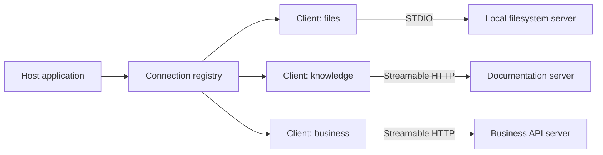
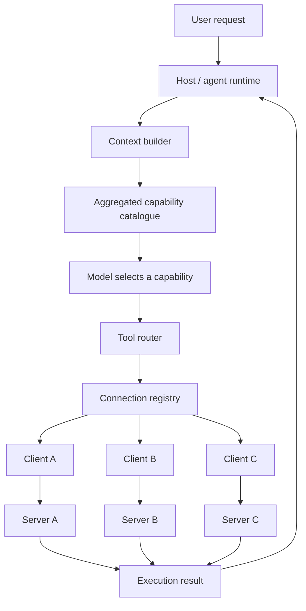
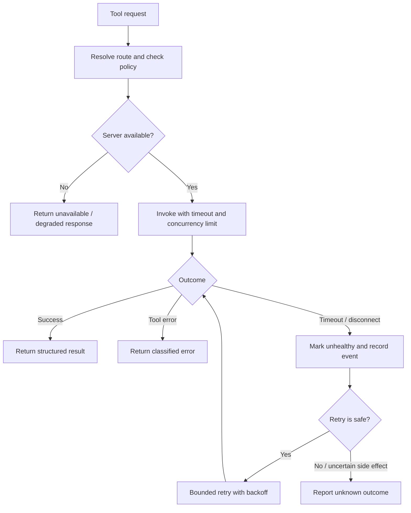

# 30. MCP Multi-Server Integration

One server gives an assistant access to a filesystem. Another searches engineering documentation. A third talks to a business API. The interesting part is not connecting each one in isolation; it is making them feel like one coherent capability layer without losing track of which server owns what.

That is the job of a **multi-server MCP host**. It manages a separate client connection for each server, builds a combined view of their capabilities and routes each operation to the correct connection. The host coordinates the work. The servers remain independent.

## 1. From one server to many

An MCP client connection belongs to one server. If an application needs three servers, its host manages three client instances—not one client pointed at three endpoints. Those clients can use different transports: STDIO for a local process and Streamable HTTP for remote services.



A host can mix local and remote servers. The example below creates two clients with different transports; the connection manager in Section 4 will own their lifecycles.

```python
import sys
from fastmcp import Client
from fastmcp.client.transports import StdioTransport, StreamableHttpTransport

clients = {
    "files": Client(StdioTransport(
        command=sys.executable,
        args=["filesystem_server.py"],
    )),
    "docs": Client(StreamableHttpTransport(
        url="https://docs.example.com/mcp",
    )),
}
```

There is no universal MCP limit on the number of servers. The practical ceiling comes from process and socket counts, memory, server capacity, request volume and the amount of capability metadata exposed to the model. Add integrations because they solve a real task, not because the architecture allows an impressive number of connections.

## 2. The multi-server host: one coordinator, clear responsibilities

A maintainable host separates five responsibilities:

- **Connection registry** — maps a stable server ID to its client, transport configuration and health state.
- **Capability catalogue** — records the tools, resources and prompts discovered from each server.
- **Router** — maps a host-visible capability name back to its owning server and original MCP name.
- **Execution layer** — applies caller policy, argument validation, timeouts and concurrency limits.
- **Context builder** — selects only the relevant, permitted capabilities for the current model request.



The host should not silently rewrite a server's behaviour. It may create a host-level alias for a tool, but the original server name, argument contract and result must remain traceable. Also, discovery is not authorization: a capability appearing in a catalogue does not mean every user may invoke it.

## 3. Aggregate capabilities without losing their origin

Imagine the documentation server and CRM server both expose a tool named `search`. A flat list containing two entries called `search` is ambiguous. Which server should receive the model's call?

Give each exposed capability a namespaced host alias, such as `docs__search` and `crm__search`. Store a route from that alias to the server ID and the original tool name. The alias exists only inside the host; it does not rename the remote MCP tool.

```python
from dataclasses import dataclass

@dataclass(frozen=True)
class DiscoveredTool:
    name: str
    description: str
    input_schema: dict

@dataclass(frozen=True)
class ToolRoute:
    server_id: str
    remote_name: str


def aggregate_tools(discovered: dict[str, list[DiscoveredTool]]):
    catalogue, routes = {}, {}
    for server_id, tools in discovered.items():
        for tool in tools:
            alias = f"{server_id}__{tool.name}"
            catalogue[alias] = {
                "description": tool.description,
                "input_schema": tool.input_schema,
            }
            routes[alias] = ToolRoute(server_id, tool.name)
    return catalogue, routes
```

`DiscoveredTool` is the host's normalized metadata shape. A small adapter should convert each SDK's tool objects into it. This keeps routing independent of SDK-specific field names and makes it straightforward to unit-test.

The same ownership rule applies to resources and prompts. Preserve the server ID alongside each resource URI or prompt name; do not assume names or URIs are globally unique across servers.

Once the host has a route, dispatch is deliberately boring:

```python
async def dispatch_tool(alias, arguments, clients, routes):
    route = routes.get(alias)
    if route is None:
        raise ValueError(f"Unknown tool: {alias}")

    client = clients[route.server_id]
    return await client.call_tool(
        route.remote_name,
        arguments,
        raise_on_error=False,
    )
```

Before dispatching, validate the caller's permissions and the arguments against the discovered schema. After dispatch, inspect the result's error status before passing it to the model. Never treat a model-generated alias as an authorization decision.

## 4. Manage client lifecycles centrally

A host may open several connections during startup. If the fourth server fails to connect, the first three still need orderly cleanup—or, if the application supports degraded operation, they may remain available while the failed server is marked unavailable.

`AsyncExitStack` provides a clean way to own multiple asynchronous client contexts. This example deliberately supports partial availability:

```python
from contextlib import AsyncExitStack

class MCPConnectionManager:
    def __init__(self, clients):
        self.clients = clients
        self.stack = AsyncExitStack()
        self.available = {}
        self.failures = {}

    async def __aenter__(self):
        for server_id, client in self.clients.items():
            try:
                await self.stack.enter_async_context(client)
                self.available[server_id] = client
            except Exception as exc:
                self.failures[server_id] = str(exc)
        return self

    async def __aexit__(self, exc_type, exc, tb):
        await self.stack.aclose()
```

This assumes the supplied clients support asynchronous context management. The manager closes every successfully entered context when the host exits. In production, classify startup failures: a missing identity provider may be fatal, while an optional documentation server may simply reduce available capabilities. Avoid swallowing failures without recording server health and making degraded status visible.

## 5. Reuse connections; pool only when needed

Creating a new transport for every tool call adds latency and resource churn. The normal starting point is **one managed, reusable client connection per configured server**. That is connection reuse—not necessarily a connection pool.

A pool becomes useful when a server or transport cannot handle the required concurrency on one session, when workloads need isolation, or when the SDK explicitly recommends multiple sessions. Pooling adds complexity: each connection needs lifecycle ownership, a maximum size, acquisition timeouts and health checks. Do not create extra clients just because you can.

Even with one reusable client, the host can apply backpressure with a per-server semaphore:

```python
import asyncio

limits = {
    "docs": asyncio.Semaphore(8),
    "crm": asyncio.Semaphore(3),
}

async def call_with_limit(server_id, operation):
    async with limits[server_id]:
        return await operation()
```

The values are examples, not defaults. Set them from measured server capacity and confirm that the selected SDK and transport support concurrent use of a shared client. If they do not, serialize calls or maintain separately managed sessions. A semaphore limits pressure; it does not turn one connection into a pool.

## 6. Cache capability metadata, not everything

Repeatedly discovering the same tool list can add startup latency and unnecessary work. Cache relatively stable metadata: server identity, tool descriptions, input schemas, resources and prompts. Keep the cache separate for each server so one server's refresh does not invalidate every integration.

A useful cache entry includes the server ID, discovery time, expiry and—where available—a metadata version. Refresh it when the connection is recreated, the server signals a capability change, or the time-to-live expires. If change notifications are unavailable, use a bounded TTL and an explicit refresh operation.

There is another important filter: the model rarely needs every tool from every server on every turn. Select relevant capabilities after applying user permissions and server health checks. This keeps the model context focused and reduces the chance of selecting an unrelated operation.

**Capability caching is not conversation memory.** A capability cache remembers what a server offers. Conversation memory preserves interaction state across turns. They have different lifetimes and privacy rules. Avoid caching user-specific resource contents or sensitive tool results unless tenant isolation, data policy and freshness requirements explicitly permit it.

## 7. Design for partial failure

A multi-server host should not behave like a row of dominoes. If the documentation service is down, a filesystem capability may still be useful. Treat each server as an independent failure boundary and expose partial availability clearly.

| Failure | Sensible host behaviour |
|---|---|
| One server fails at startup | Mark it unavailable; continue only if remaining capabilities are sufficient |
| Request times out | Stop waiting, classify the failure and record the server and operation |
| Connection drops | Mark unhealthy; reconnect with bounded backoff |
| Tool returns an error | Preserve the failure; never present it as successful data |
| Catalogue is stale | Refresh that server's metadata and rebuild affected routes |
| Server is overloaded | Apply concurrency limits and backpressure; avoid retry storms |

Retries need special care. A read-only lookup may be safe to retry. A tool that creates an order, sends an email or deletes a file may have completed even if its response was lost. Use idempotency keys or operation-status checks when the server supports them. Otherwise, report an **unknown outcome** and require reconciliation rather than blindly repeating a side effect.



Record the server ID, host alias, operation, duration, outcome and correlation ID. Keep credentials and sensitive arguments out of logs. Detailed security controls and operational telemetry are addressed in Chapters 34 and 35.

## Key takeaways

- A host manages one client connection per MCP server; local STDIO and remote Streamable HTTP servers can coexist.
- Aggregate capabilities with namespaced aliases and preserve each capability's server identity.
- Centralize connection ownership and make partial availability an explicit decision.
- Reuse connections by default. Add a bounded pool only when measured concurrency or isolation requirements justify it.
- Cache capability metadata with expiry and refresh rules; keep it separate from conversation memory and sensitive data.
- Isolate failures, apply backpressure and retry side effects only when their outcome is known to be safe.

## Review questions

1. Why does a host create a separate client instance for each MCP server?
2. How do namespaced aliases prevent ambiguous tool routing?
3. What should happen if one optional server fails while the others connect successfully?
4. When is connection reuse enough, and when would a pool be justified?
5. What belongs in a capability cache, and how should stale metadata be refreshed?
6. Why is retrying a timed-out write operation more dangerous than retrying a read?

---

## 🧭 Chapter Navigation

⬅️ **Previous:** [29. Building MCP Clients](29-building-mcp-clients.md)

📚 **Part:** [AI Engineering Frameworks & Tooling](index.md)

➡️ **Next:** [31. Advanced MCP Capabilities](31-advanced-mcp-capabilities.md)

---

> **Enterprise AI Engineering Handbook**
>
> *Building Production-Grade Enterprise AI Systems — One Chapter at a Time.*

---
