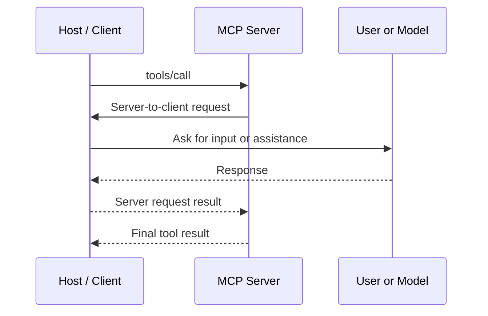
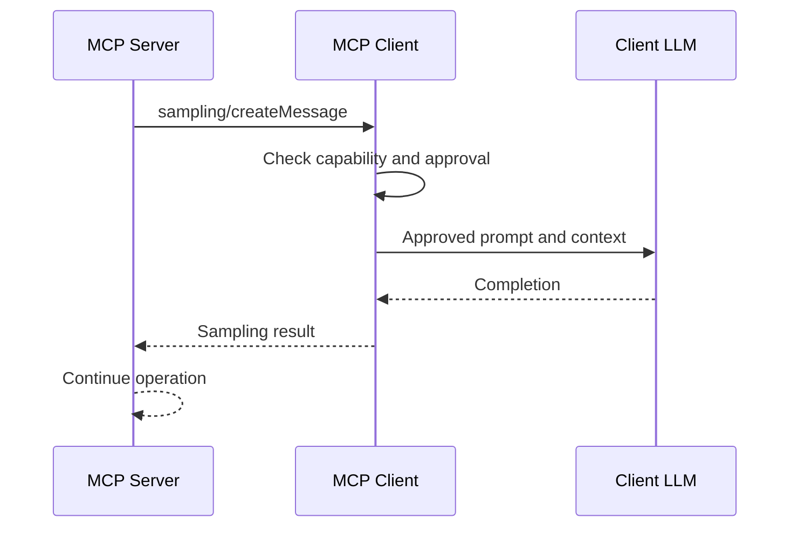
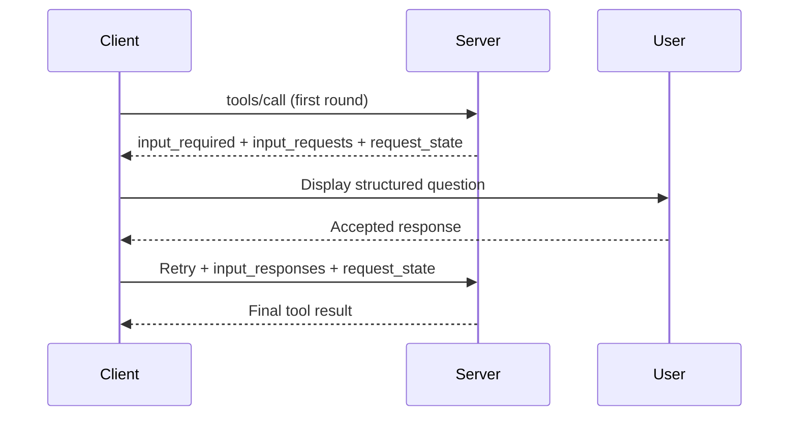

# 31. Advanced MCP Capabilities

A tool call sounds simple: the client sends a request, the server does the work and returns a result. But what if the server reaches step three and discovers it needs the user's approval? Or a deployment region? Or a little help from a language model?

That is where advanced MCP interactions come in. They let a server request additional input or assistance instead of failing halfway through a workflow.

There is an important version boundary. Earlier MCP versions supported a live, bidirectional client-server session. The `2026-07-28` specification introduces a stateless request model and **Multi-Round-Trip Requests (MRTR)**. It also deprecates legacy Sampling and Roots. This chapter explains both models so that existing integrations remain understandable while new designs follow the modern direction.

## 1. From tool calls to interactive workflows

MCP messages use JSON-RPC concepts:

- **Request:** asks the other side to perform an operation and expects a response.
- **Response:** returns a result or an error for a request.
- **Notification:** communicates an event without expecting a response.

In the classic protocol, a client normally initiates a tool call. While processing it, a server could also send a request back to the client—for example, to ask a user a question or request model assistance. The client handled that request and returned the answer before the original operation completed.



This is the classic, connection-oriented interaction pattern. The modern protocol keeps the workflow interactive but changes how the extra round trip is represented.

## 2. Sampling: borrowing the client's model

**Sampling** historically allowed a server to ask the client to run an LLM completion. The server could request reasoning without owning model-provider credentials or maintaining its own model integration.

Imagine a code-analysis server that has collected several findings. It wants the model to group them into likely root causes. In the legacy flow:

1. The server sends `sampling/createMessage`, including messages and generation preferences such as maximum tokens.
2. The client checks whether it declared sampling support.
3. The client applies its approval and data-sharing policy.
4. If permitted, the client invokes its configured model.
5. The completion travels back to the server, which continues its work.



Sampling was useful, but it also raised important questions: what context may the server send to the model, who approves the request, and who pays for the inference?

**Current direction:** Sampling is deprecated as a standalone capability in MCP `2026-07-28`. New servers should normally integrate directly with their chosen model provider. The old request shape remains relevant to compatibility and can appear as an embedded input request in MRTR, but new designs should not depend on the legacy callback channel.

## 3. Roots: sharing workspace context

**Roots** historically let a client tell a server which filesystem locations were relevant to a task. For example:

```text
file:///workspaces/payments-service
```

A server could use the declared root to understand which project the user intended to work with. Clients could also support dynamic updates: when the root list changed, the client sent `notifications/roots/list_changed`; a server that supported the notification could request the updated list.

Roots were useful context, not a security boundary. A server still had to canonicalize paths, resolve symbolic links, reject traversal and enforce filesystem permissions independently.

**Current direction:** Roots and `notifications/roots/list_changed` are deprecated in MCP `2026-07-28`. For new integrations, pass permitted paths explicitly through tool arguments, resource URIs or server configuration. This makes the scope of an operation visible in its contract rather than relying on a separate roots capability.

## 4. Elicitation: ask the user, not the model

Sometimes a server needs information that should come directly from a person: a deployment target, a reason for a change or confirmation before a consequential action.

**Elicitation** lets a server request structured user input through the client. The request includes a message and a schema describing the expected response. For example:

```json
{
  "message": "Which region should host the database?",
  "requestedSchema": {
    "type": "object",
    "properties": {
      "region": {
        "type": "string",
        "enum": ["eu-west-1", "eu-central-1", "us-east-1"]
      }
    },
    "required": ["region"]
  }
}
```

The client presents a suitable UI, validates the response and returns an outcome: accept, decline or cancel. The server must handle each outcome explicitly. A declined request is not a valid answer, and cancellation must never be interpreted as approval.

Elicitation is useful for missing workflow information, explicit confirmation, compliance acknowledgements and structured choices that should not be guessed by a model.

Unlike Sampling and Roots, elicitation remains a supported capability. In the modern protocol, however, the interaction is carried through MRTR rather than a standalone server-to-client request.

## 5. Server-initiated requests become Multi-Round-Trip Requests

The `2026-07-28` protocol revision removes the standalone server-to-client JSON-RPC request channel. Instead of calling back to the client while a tool is running, the server returns an `InputRequiredResult` when it needs more input.

The result contains:

- `input_requests`: named requests the client must fulfil, such as an elicitation request.
- `request_state`: opaque state that the client echoes unchanged when it retries the original operation.

The client gathers the required response and re-issues the original request with `input_responses` and `request_state`. The server then continues and returns its normal result. The same pattern can be used by tool, prompt and resource handlers.



A low-level Python server handler illustrates the pattern. It asks for a region on the first call, then consumes the response on the retry:

```python
from mcp.server import Server, ServerRequestContext
from mcp.types import (
    CallToolRequestParams, CallToolResult, ElicitRequest,
    ElicitRequestFormParams, ElicitResult, InputRequiredResult,
    ListToolsResult, PaginatedRequestParams, TextContent, Tool,
)

ASK_REGION = ElicitRequest(
    params=ElicitRequestFormParams(
        message="Which region should host the database?",
        requested_schema={
            "type": "object",
            "properties": {"region": {"type": "string"}},
            "required": ["region"],
        },
    )
)

async def list_tools(
    ctx: ServerRequestContext,
    params: PaginatedRequestParams | None,
) -> ListToolsResult:
    return ListToolsResult(tools=[
        Tool(
            name="provision",
            description="Provision a database in a selected region.",
            input_schema={
                "type": "object",
                "properties": {"name": {"type": "string"}},
                "required": ["name"],
            },
        )
    ])

async def call_tool(
    ctx: ServerRequestContext,
    params: CallToolRequestParams,
) -> CallToolResult | InputRequiredResult:
    answer = (params.input_responses or {}).get("region")

    if not isinstance(answer, ElicitResult):
        return InputRequiredResult(
            input_requests={"region": ASK_REGION},
            request_state="provision-v1",
        )

    if answer.action != "accept" or not answer.content:
        return CallToolResult(content=[
            TextContent(type="text", text="Provisioning cancelled.")
        ])

    region = answer.content.get("region")
    if region not in {"eu-west-1", "eu-central-1", "us-east-1"}:
        return CallToolResult(content=[
            TextContent(type="text", text="Invalid region.")
        ])

    name = (params.arguments or {})["name"]
    return CallToolResult(content=[
        TextContent(type="text", text=f"Provisioned {name} in {region}.")
    ])

server = Server("Provisioner", on_list_tools=list_tools, on_call_tool=call_tool)
```

The example uses the low-level Python SDK server API. In production, protect and validate `request_state`, bind it to the user and operation, keep secrets out of it, bound the number of rounds and make side effects idempotent. SDK clients can automate the retry loop when the appropriate callbacks are configured; the application still owns the user experience and approval policy.

## 6. Capability negotiation: agree on what is supported

Capability negotiation prevents either side from assuming that an optional feature exists.

In the classic protocol lifecycle, the client sends an `initialize` request with its protocol version and client capabilities. The server responds with its version and capabilities, and the client completes initialization. A client should only use optional features the peer has declared.

The modern `2026-07-28` lifecycle is stateless: the classic `initialize` / `initialized` handshake is removed. Protocol version, client information and capabilities travel with each request; clients can use `server/discover` to inspect server capabilities before relying on them.

| Concern | Classic protocol (`2025-11-25` and earlier) | Modern protocol (`2026-07-28`) |
|---|---|---|
| Lifecycle | Initialize handshake | Stateless requests |
| Capability exchange | During initialization | Carried with requests |
| Discovery | Initialize response | Optional `server/discover` |
| Server-to-client interaction | In-flight request on a live connection | `InputRequiredResult` and client retry |
| Roots and Sampling | Supported capabilities | Deprecated; retained for compatibility |

A capability indicates feature support, not authorization. It does not grant access to a file, approve a payment or authorize a destructive operation.

## 7. Engineering rules for advanced interactions

| Concern | Engineering rule |
|---|---|
| Optional feature | Detect support and provide a fallback |
| User input | Validate the schema and handle decline/cancel |
| Model assistance | Control prompt, context sharing, cost and approval |
| Workspace paths | Enforce access on the server; never trust roots alone |
| Multi-round retries | Bound rounds and request duration |
| Request state | Treat it as opaque, untrusted and potentially sensitive |
| Side effects | Use idempotency and reconcile uncertain outcomes |
| Protocol versions | Test classic and modern behaviour separately |

The key design principle is simple: **the server may ask, but the client remains in control of what it shares and what the user approves.** Keep requests understandable, make refusals safe and ensure a repeated round cannot accidentally repeat a side effect.

## Key takeaways

- Legacy MCP supported server-to-client requests such as Sampling, Roots and Elicitation over an active connection.
- Sampling and Roots are deprecated in `2026-07-28`; prefer direct model-provider integration and explicit path parameters or configuration.
- Roots describe workspace context; they are not an access-control mechanism.
- Elicitation provides schema-driven user input and remains supported.
- MRTR replaces the standalone server-to-client request channel with `InputRequiredResult`, client responses and a retry of the original operation.
- The classic handshake and modern stateless lifecycle negotiate capabilities differently.
- Capability support is not the same as user authorization.

## Review questions

1. What problem did Sampling solve, and what should new servers use instead?
2. Why must a server not treat Roots as its only filesystem security control?
3. How does Elicitation differ from asking a model to infer missing information?
4. What do `input_requests`, `input_responses` and `request_state` do in MRTR?
5. How does capability discovery differ between classic and modern protocol versions?
6. Why must a server handle a declined elicitation separately from an accepted response?

---

## 🧭 Chapter Navigation

⬅️ **Previous:** [30. MCP Multi-Server Integration](30-mcp-multi-server-integration.md)

📚 **Part:** [AI Engineering Frameworks & Tooling](index.md)

➡️ **Next:** [32. MCP Integration with RAG Systems](32-mcp-integration-with-rag-systems.md)

---

> **Enterprise AI Engineering Handbook**
>
> *Building Production-Grade Enterprise AI Systems — One Chapter at a Time.*

---
