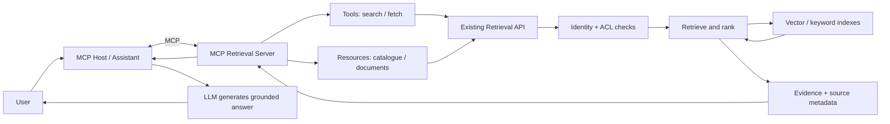
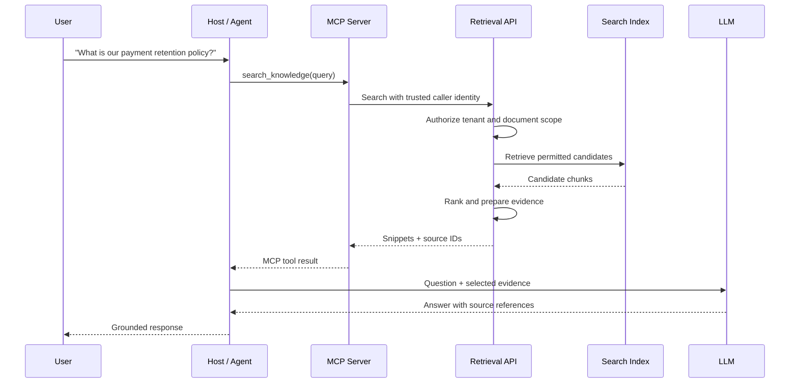
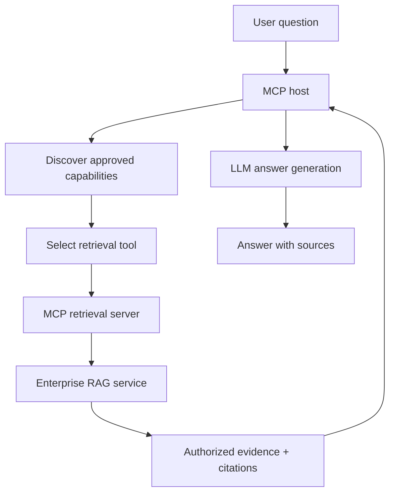

# 32. MCP Integration with RAG Systems

Your company has 100,000 documents. They are parsed, chunked, embedded and indexed. The retrieval pipeline works. Now a second team wants the same knowledge in an AI assistant, and a third wants it in an IDE. Do you build another retriever for each—or expose the capability once?

That is the useful role of MCP here. **RAG finds evidence; MCP makes that retrieval capability discoverable and reusable.** MCP does not replace your knowledge platform, vector database or retrieval strategy. It gives applications a standard interface to capabilities those systems already provide. MCP is not training data and does not automatically prevent hallucinations; grounding depends on retrieving relevant, permitted evidence and using it correctly.

## 1. The architecture: keep the boundary thin

Think in three layers:

- **Knowledge platform:** ingestion, parsing, chunking, embeddings, indexes, retrieval, ranking, access policies and source metadata.
- **MCP retrieval server:** exposes selected search and document-reading operations. It translates MCP requests into calls to the knowledge platform.
- **Host application:** discovers capabilities, chooses when to call them, supplies the user's question and uses the returned evidence to construct an answer.



The MCP server is an adapter, not a second RAG platform. Keep chunking, embeddings, hybrid search, reranking and context construction in the knowledge layer. Otherwise, applications can develop competing definitions of “relevant”.

## 2. Expose retrieval as MCP tools

A tool is the right interface when the client needs an operation to be performed—especially a search whose arguments are supplied at request time.

| Tool | Responsibility |
|---|---|
| `search_knowledge` | Search an approved knowledge domain and return ranked evidence snippets |
| `search_policies` | Optional domain-specific search when policy access or behaviour differs |
| `answer_with_sources` | Optional call to an existing service that already performs retrieval and answer generation |

Prefer a small, task-oriented contract such as `search_knowledge(query, limit, category)`. Avoid exposing database mechanics such as collection names, raw vector filters or embedding parameters to the model. Those are implementation details, not useful business capabilities.

Return enough to verify evidence: chunk and document IDs, title, canonical source, concise snippet and—if meaningful—a score with documented semantics. Do not return entire documents for a simple search.

## 3. Expose knowledge as MCP resources

Resources suit known, read-oriented information that a host may choose to attach or read as context. For example:

- `knowledge://catalog` describes available knowledge domains.
- `knowledge://documents/{document_id}` identifies a document that the user or host already has reason to fetch.

Return a resource URI with each search hit. The host can inspect snippets first, then read a selected source if it needs more context.

A search is an active operation, so expose it as a tool. A known document is read-oriented content, so a resource may fit. Resources are not permissions: authorize every read. A complex or remote fetch may be better represented as a tool.

## 4. Keep vector stores behind an adapter

The MCP contract should not depend on Chroma response objects. Put a retrieval-service interface between MCP and the index, then implement it with Chroma, FAISS, Pinecone, Azure AI Search or another backend.

```mermaid
flowchart TD
    M["MCP capability"] --> I["Retrieval service contract"]
    I --> A{ "Backend adapter" }
    A --> C["Chroma"]
    A --> F["FAISS"]
    A --> P["Pinecone"]
    A --> Z["Azure AI Search"]
    C --> N["Normalized evidence"]
    F --> N
    P --> N
    Z --> N
    N --> M
```

Adapters need not expose identical features. Normalize results into a stable evidence model, but preserve backend-specific capabilities behind the service boundary. Never treat raw distance values from different stores as directly comparable relevance scores.

## 5. Build a FastMCP retrieval server

This example assumes an existing retrieval service backed by a Chroma collection populated during ingestion. The service owns embedding configuration, tenant filtering, document ACLs, result normalization and source ordering. Its identity and retrieval functions are application-specific; they must resolve the authenticated caller, not trust model-supplied tenant IDs.

A compact Chroma adapter illustrates the database-facing operation. The collection must have an embedding function configured if you use `query_texts`:

```python
def chroma_search(collection, query, tenant_id, allowed_ids, limit):
    if not allowed_ids:
        return []

    result = collection.query(
        query_texts=[query],
        n_results=limit,
        where={"$and": [
            {"tenant_id": tenant_id},
            {"document_id": {"$in": allowed_ids}},
        ]},
        include=["documents", "metadatas", "distances"],
    )

    return [
        {
            "chunk_id": chunk_id,
            "document_id": metadata["document_id"],
            "title": metadata.get("title", "Untitled"),
            "source": metadata.get("source", ""),
            "snippet": text[:1200],
            "distance": distance,
            "resource_uri": f"knowledge://documents/{metadata['document_id']}",
        }
        for chunk_id, text, metadata, distance in zip(
            result["ids"][0],
            result["documents"][0] or [],
            result["metadatas"][0] or [],
            result["distances"][0] or [],
        )
    ]
```

The MCP layer then stays small. `knowledge_service` represents your application service; its `search` and `read_document` methods call the adapter and enforce the caller's access policy.

```python
from fastmcp import FastMCP
from app.identity import current_principal
from app.retrieval import knowledge_service

mcp = FastMCP("Enterprise Knowledge")


@mcp.tool
def search_knowledge(
    query: str,
    limit: int = 5,
    category: str | None = None,
) -> list[dict]:
    """Search permitted enterprise knowledge and return source-backed snippets."""
    if not query.strip():
        raise ValueError("query must not be empty")
    if not 1 <= limit <= 10:
        raise ValueError("limit must be between 1 and 10")
    return knowledge_service.search(
        query=query,
        principal=current_principal(),
        limit=limit,
        category=category,
    )


@mcp.resource("knowledge://catalog")
def knowledge_catalog() -> str:
    """Describe the knowledge domains available through this server."""
    return "Policies, product documentation, engineering standards and runbooks."


@mcp.resource("knowledge://documents/{document_id}")
def read_document(document_id: str) -> str:
    """Read a document only after checking the caller's access."""
    return knowledge_service.read_document(
        document_id=document_id,
        principal=current_principal(),
        max_chars=20000,
    )


if __name__ == "__main__":
    mcp.run(transport="stdio")
```

FastMCP derives tool schemas from type hints and exposes the resource template URI. Synchronous handlers are suitable for synchronous libraries; FastMCP dispatches sync tools through a worker thread. The application service should still set timeouts, bound document reads and record audit events. The example is an integration pattern, not a complete identity provider or authorization implementation.

## 6. Connect it to an enterprise RAG platform

For a mature platform, the MCP server should normally call an existing retrieval API rather than query the vector database directly. That API can centralize identity propagation, document ACLs, metadata filters, hybrid retrieval, reranking, citations and evaluation hooks.



Authorization must happen before evidence is returned to the host. Filtering unauthorized content after retrieval—or asking the model to ignore it—is not access control. Keep the identity chain explicit: the MCP server must know which trusted principal it is acting for, and the retrieval service must validate that identity rather than trust model-generated arguments. The broader MCP authentication and authorization design belongs in Chapter 34; this chapter focuses on preserving the RAG platform's document permissions across the integration.

## 7. Choose the right retrieval capability

More tools do not automatically make a better server. Ten nearly identical search tools can make selection harder.

| Requirement | Suitable capability |
|---|---|
| Search across a common, permission-filtered corpus | `search_knowledge` |
| Search a domain with distinct permissions or retrieval rules | `search_policies` or another domain tool |
| Read a known, authorized document | `knowledge://documents/{document_id}` |
| Reuse an existing end-to-end grounded-answer service | `answer_with_sources` |

Use separate tools only when their data boundaries, authorization, owners or behaviour genuinely differ. Otherwise, prefer one search tool with a few validated filters. Describe each capability clearly: which corpus it searches, what it returns and when it should be used.

This is **MCP capability design**, not retriever selection. Query rewriting, hybrid search, router retrievers, reranking and Agentic RAG remain retrieval-engineering concerns in the Advanced RAG section.

## 8. Assemble the MCP-based RAG application

There are two common patterns:

1. **Retrieval-first:** MCP exposes search and document fetch. The host owns prompt construction, context assembly and model generation. This is flexible when different applications need different answer behaviour.
2. **RAG-service:** MCP exposes a higher-level `answer_with_sources` tool that delegates to an existing service responsible for retrieval and generation. This is useful when the organisation wants one governed answer pipeline, prompt policy and evaluation path.

Choose the boundary that matches where orchestration already lives. Avoid maintaining competing implementations of the same retrieval and answer logic.



The important outcome is not that the LLM can see a vector database. It is that multiple AI applications can reuse a governed knowledge capability without each one rebuilding the retrieval stack.

## Key takeaways

- MCP exposes existing retrieval capabilities; it does not replace RAG ingestion, indexing or ranking.
- Use tools for active searches and resources for known, read-oriented knowledge items.
- Keep vector-store-specific logic behind a retrieval-service contract.
- Return bounded evidence with stable source identifiers and citations.
- Enforce tenant and document permissions before evidence reaches the host or model.
- Choose retrieval-first or RAG-service exposure based on where orchestration and governance already belong.

## Review questions

1. Why should an MCP retrieval server usually remain a thin adapter?
2. When is a search operation better exposed as a tool than as a resource?
3. Why should the MCP contract avoid exposing Chroma-specific response structures?
4. Where should tenant and document-level authorization be enforced?
5. When would `answer_with_sources` be preferable to separate search and fetch operations?
6. How is MCP capability design different from selecting a retrieval algorithm?

---

## 🧭 Chapter Navigation

⬅️ **Previous:** [31. Advanced MCP Capabilities](31-advanced-mcp-capabilities.md)

📚 **Part:** [AI Engineering Frameworks & Tooling](index.md)

➡️ **Next:** [33. MCP Integration with AI Frameworks](33-mcp-integration-with-ai-frameworks.md)

---

> **Enterprise AI Engineering Handbook**
>
> *Building Production-Grade Enterprise AI Systems — One Chapter at a Time.*

---
