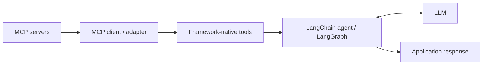
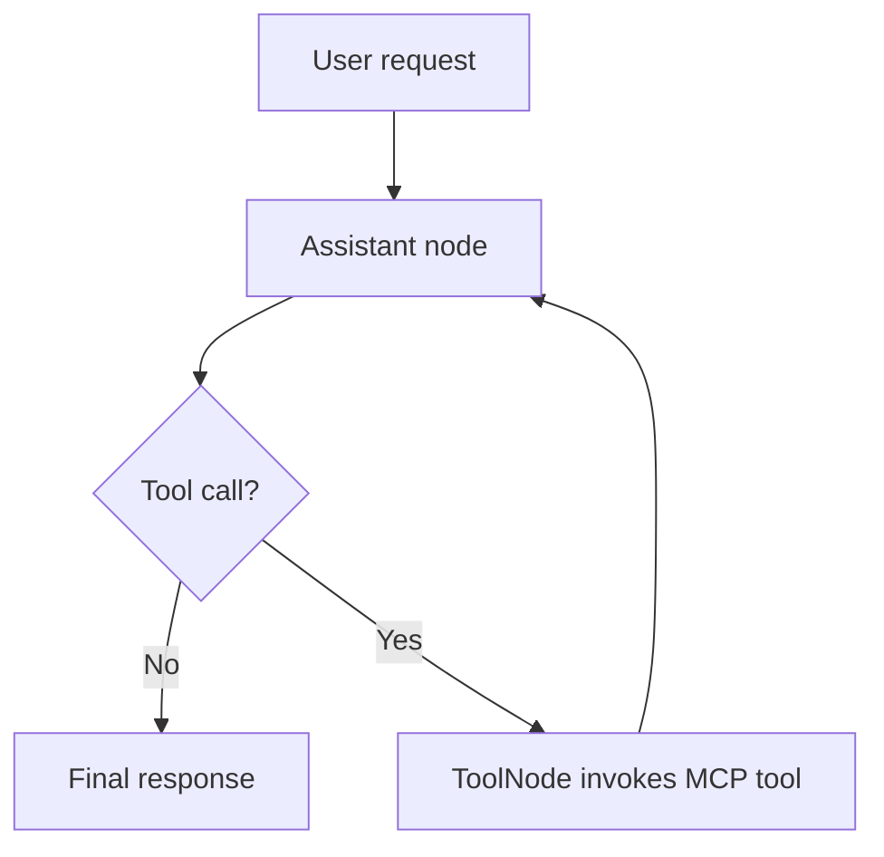
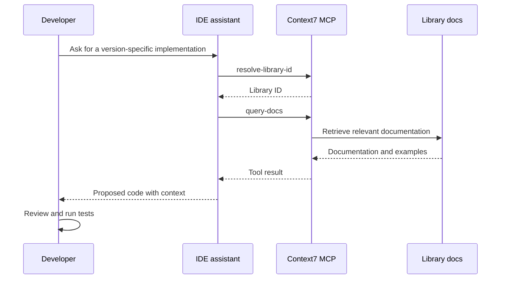

# 33. MCP Integration with AI Frameworks

Your agent can reason beautifully and still get stuck at the edge of your application. It needs a way to search documentation, inspect a service or call an internal capability. You could write a custom integration for every framework—or let MCP provide the common connection contract.

That is the useful division of labour: **MCP connects capabilities; the framework decides when and why to use them.** An adapter makes the two speak the same language. It does not replace the agent, its state or its workflow design.

## 1. The integration boundary

Keep four responsibilities separate:

- **MCP server:** publishes tools, resources or prompts and performs the requested operation.
- **MCP client/adapter:** connects, discovers capabilities and translates supported MCP tools into framework-native tools.
- **AI framework:** handles model calls, tool selection, state and orchestration.
- **Application:** supplies business context, user identity, policy and the user experience.



The framework should not care whether a server runs as a local process or behind a remote HTTP endpoint. That is the adapter's concern. The application still owns decisions such as which tools a user may access.

## 2. LangChain MCP integration

LangChain agents already work with tools that expose a name, description, input schema and execution function. MCP servers publish tool definitions too. The adapter bridges the formats, so discovered MCP tools can be passed to an agent alongside tools written directly in LangChain.

For current Python projects, install the MCP extra:

```bash
pip install "langchain[mcp]>=1.4.0" langchain-openai
```

A compact remote-server example:

```python
import asyncio
from langchain.agents import create_agent
from langchain.mcp import MCPAdapter

async def main():
    async with MCPAdapter("https://mcp.context7.com/mcp") as adapter:
        tools = await adapter.list_tools()
        agent = create_agent(
            model="openai:gpt-4.1",  # replace with your configured model
            tools=tools,
            system_prompt="Use documentation tools for version-sensitive API questions.",
        )
        result = await agent.ainvoke({
            "messages": [{
                "role": "user",
                "content": "Find the current LangGraph checkpointing API.",
            }]
        })
        print(result["messages"][-1].content)

if __name__ == "__main__":
    asyncio.run(main())
```

The sequence is straightforward: discover the server's tool catalogue, pass the resulting tools to the agent, let the model request a tool when appropriate, then return the tool result to the model. The adapter handles the MCP call; LangChain handles the agent loop.

`langchain.mcp` is a newer, beta namespace. Pin compatible versions and test upgrades before deployment. The older `langchain-mcp-adapters` package remains relevant to existing applications; its `MultiServerMCPClient` and `get_tools()` pattern should not be mixed casually with the newer `MCPAdapter` API. For new compatible projects, prefer the integrated `langchain[mcp]` path and consult the migration guidance when upgrading.

## 3. LangGraph MCP integration

A LangChain agent is often enough for a straightforward tool loop. Choose LangGraph when the workflow needs explicit routing, checkpoints, approval steps or specialised nodes. MCP tools can be executed by a regular `ToolNode`; the graph remains responsible for the path the application follows.

```python
import asyncio
from langchain.mcp import MCPAdapter
from langchain_openai import ChatOpenAI
from langchain_core.messages import HumanMessage
from langgraph.graph import StateGraph, MessagesState, START
from langgraph.prebuilt import ToolNode, tools_condition

async def main():
    async with MCPAdapter("https://mcp.context7.com/mcp") as adapter:
        tools = await adapter.list_tools()
        model = ChatOpenAI(model="gpt-5.4").bind_tools(tools)

        async def assistant(state: MessagesState):
            reply = await model.ainvoke(state["messages"])
            return {"messages": [reply]}

        graph = StateGraph(MessagesState)
        graph.add_node("assistant", assistant)
        graph.add_node("tools", ToolNode(tools))
        graph.add_edge(START, "assistant")
        graph.add_conditional_edges("assistant", tools_condition)
        graph.add_edge("tools", "assistant")
        app = graph.compile()

        result = await app.ainvoke({
            "messages": [HumanMessage(
                content="Look up the current LangGraph checkpointing approach."
            )]
        })
        print(result["messages"][-1].content)

if __name__ == "__main__":
    asyncio.run(main())
```



Notice the node is named `tools`: the standard `tools_condition` routes to that label. In a larger graph, insert validation or human approval before sensitive tool execution. State design, checkpointing and human-in-the-loop mechanics are covered in the LangGraph chapters; this chapter focuses on the MCP connection point.

## 4. Adapters and other agent frameworks

An adapter is an interoperability layer, not a second agent framework. It converts the protocol's advertised capabilities into the tool abstraction expected by the framework. The same MCP server can therefore be reused by different hosts, provided each host has a compatible MCP client or adapter.

| Application pattern | Integration choice |
|---|---|
| Simple conversational agent | Load MCP tools into the agent's tool list |
| Explicit workflow | Execute MCP tools from selected graph nodes |
| Multi-agent application | Give each agent only the tools relevant to its role |
| Custom orchestration | Use an MCP client directly and call capabilities from application code |

Do not confuse *discoverable* with *appropriate*. A coding agent may need documentation and repository search; a release agent may need deployment status but not production write access. Keep tool sets small, names clear and server-side authorization authoritative. Multi-server aggregation and routing are handled in Chapter 30; the concern here is how a framework consumes the tools once they are available.

Frameworks outside LangChain follow the same broad pattern, but their adapters, lifecycle and tool schemas differ. Use the framework's supported MCP integration rather than assuming a LangChain tool object can be passed unchanged into another ecosystem. Also verify feature coverage: tool adaptation does not automatically mean that resources, prompts, elicitation or every other MCP capability is exposed as a framework-native abstraction.

## 5. Context7: documentation at the point of coding

A familiar example is [Context7](https://context7.com/), an MCP server that lets an assistant retrieve library documentation and code examples while it is working. Instead of trusting a model's memory of an API, the assistant can consult documentation for the relevant library and version.

Its two core tools form a simple lookup sequence:

1. `resolve-library-id` identifies the Context7 library ID from a library name and a focused task.
2. `query-docs` retrieves documentation for that ID and a specific question.

For example, resolve `LangGraph` to its library ID, then query that ID for checkpoint persistence. If the ID is already known, skip resolution. Keep queries narrow—“configure Postgres checkpoint storage” is more useful than “explain LangGraph”. The tool names above are the current names; older client examples may show `ResolveLibraryID` and `GetLibraryDocs`.

The hosted endpoint is `https://mcp.context7.com/mcp`. Remote OAuth uses Context7's `/mcp/oauth` endpoint; API-key authentication uses the documented bearer-header configuration. Check the current Context7 client guide for the authentication mode and limits applicable to your setup.

## 6. Developer tool integration: Cursor and Windsurf

An AI coding editor is an MCP host too. Its assistant can discover tools and call them during a coding task. Context7 supplies documentation; other servers might expose repository search, issue tracking, databases or observability data. The workflow is the same even though the host's configuration format differs.

### Cursor

Cursor supports project-level `.cursor/mcp.json` and user-level `~/.cursor/mcp.json`. A remote Context7 configuration can use environment-variable interpolation for the API key:

```json
{
  "mcpServers": {
    "context7": {
      "url": "https://mcp.context7.com/mcp",
      "headers": {
        "Authorization": "Bearer ${env:CONTEXT7_API_KEY}"
      }
    }
  }
}
```

You can also add a local STDIO server with `command`, `args` and `env`. Configure or enable the server from Cursor's MCP settings, then confirm that its tools appear in the available-tools list.

### Windsurf / Cascade

For a local STDIO connection in legacy Windsurf Cascade, the configuration can launch Context7 with Node.js:

```json
{
  "mcpServers": {
    "context7": {
      "command": "npx",
      "args": ["-y", "@upstash/context7-mcp"],
      "env": {
        "CONTEXT7_API_KEY": "${env:CONTEXT7_API_KEY}"
      }
    }
  }
}
```

Legacy Cascade builds may use `serverUrl` rather than Cursor's `url` field for a remote endpoint. Windsurf's agent and configuration surfaces have changed across product releases. Open the MCP configuration from the installed application's settings instead of assuming an old file path or field name applies to every version. Keep credentials out of committed project files and use the supported secret or environment-variable mechanism for that client.



This is a useful feedback loop, not an automatic correctness guarantee. Documentation can be incomplete, version selection can be wrong, and generated code can still fail. Review the source links, check the dependency version and run the project's tests.

## Key takeaways

- MCP standardizes capability access; adapters translate MCP tools into framework-native tools.
- LangChain agents consume discovered tools directly; LangGraph places them inside explicit workflow nodes.
- `MCPAdapter` is the newer integrated Python API; the standalone adapter package remains relevant to legacy projects.
- Context7 demonstrates on-demand documentation retrieval through `resolve-library-id` and `query-docs`.
- Cursor and Windsurf are MCP hosts, but their configuration formats and release-specific settings are not interchangeable.

## Review questions

1. Which responsibilities belong to MCP, the adapter, the framework and the application?
2. How does a LangGraph `ToolNode` execute an MCP tool call?
3. What is the migration distinction between `MCPAdapter` and `MultiServerMCPClient`?
4. Why does Context7 resolve a library ID before querying its documentation?
5. Why should IDE-generated code still be reviewed and tested?

## References and further reading

- [LangChain MCP integration](https://docs.langchain.com/oss/python/langchain/mcp)
- [LangChain MCP migration guide](https://docs.langchain.com/oss/python/migrate/langchain-mcp-adapters)
- [Context7 MCP client configuration](https://context7.com/docs/resources/all-clients)
- [Cursor MCP documentation](https://cursor.com/docs/mcp)
- [Windsurf Cascade MCP documentation](https://docs.windsurf.com/windsurf/cascade/mcp)

---

## 🧭 Chapter Navigation

⬅️ **Previous:** [32. MCP Integration with RAG Systems](32-mcp-integration-with-rag-systems.md)

📚 **Part:** [AI Engineering Frameworks & Tooling](index.md)

➡️ **Next:** [34. MCP Security & Production Engineering](34-mcp-security-production-engineering.md)

---

> **Enterprise AI Engineering Handbook**
>
> *Building Production-Grade Enterprise AI Systems — One Chapter at a Time.*

---
