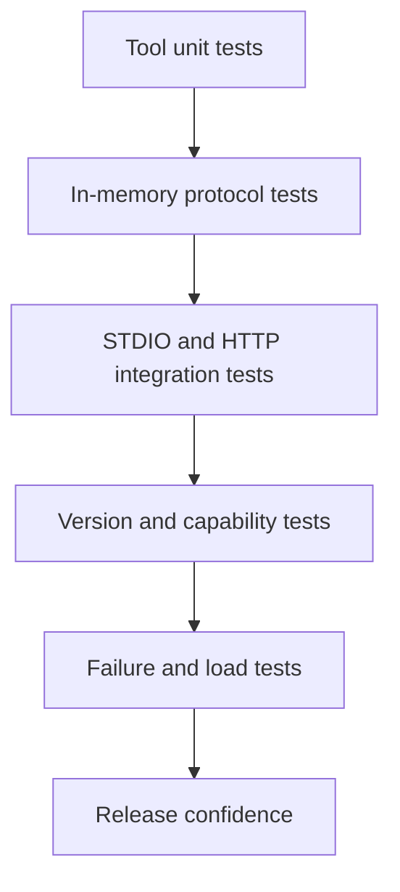
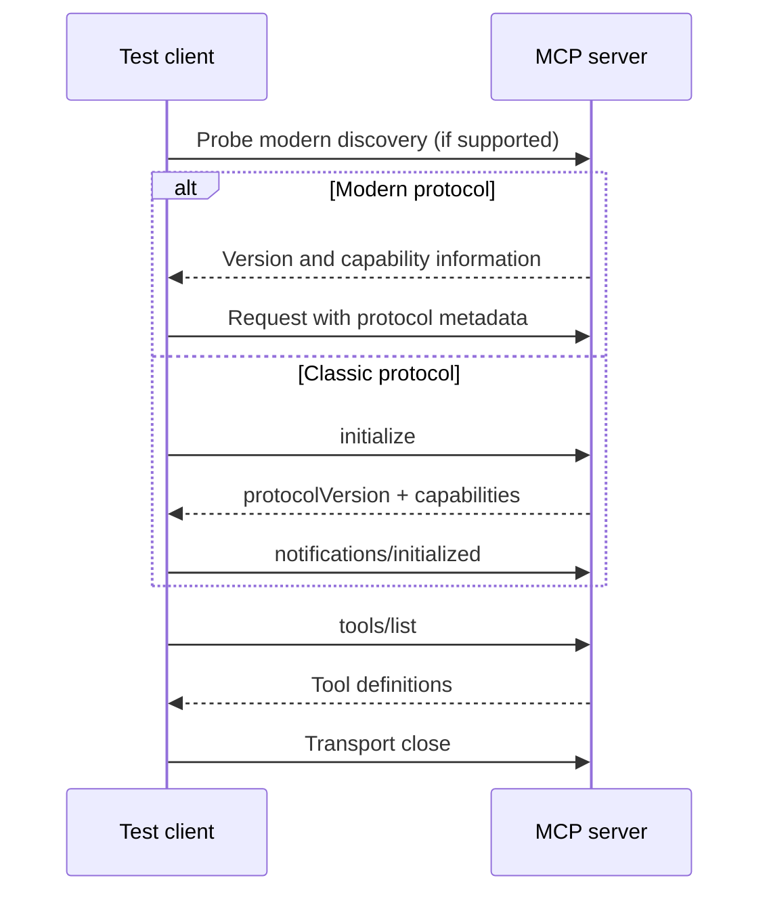
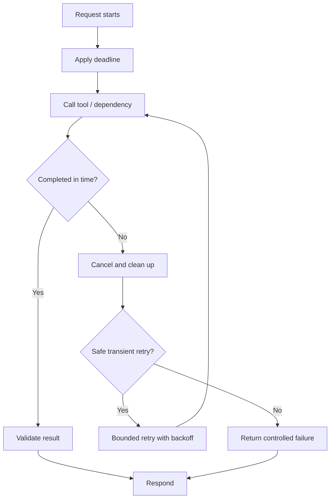
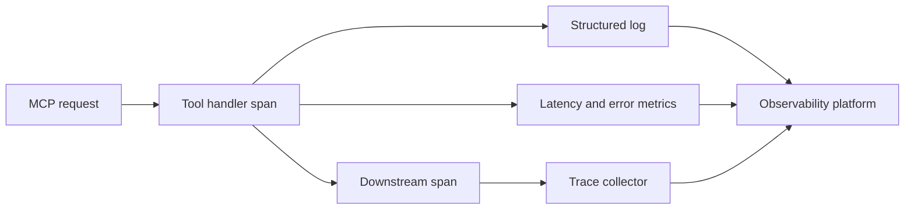

# 35. MCP Testing, Debugging & Observability

Your MCP server works locally. The tool appears in the client, the happy-path call returns the expected answer, and the demo looks great. Then production introduces a different client, a slow downstream API and a network proxy. Suddenly, the same tool fails in three different ways—and nobody knows which layer to blame.

That is why an MCP server needs more than a startup check. We need to prove that its protocol contract, transports and failure behaviour remain predictable when conditions are less than perfect.

## 1. Start with a testing strategy

Test each layer independently, then test the complete path. This makes failures easier to locate: a business-rule defect should not look like a JSON-RPC defect, and a broken HTTP proxy should not be blamed on the tool handler.

| Test layer | What to verify | Typical technique |
|---|---|---|
| Tool logic | Validation, business rules, permissions | Unit tests on service functions |
| MCP protocol | Discovery, schemas, results, errors | In-memory MCP client |
| Transport | Framing, process and HTTP behaviour | STDIO subprocess and HTTP integration tests |
| Compatibility | Protocol eras, versions, capabilities | Inspector and compatibility matrix |
| Resilience | Timeouts, cancellation, restarts, load | Fault injection and operational tests |



The principle is simple: test business logic without MCP, then test that MCP exposes it correctly.

## 2. MCP Inspector: see what the client sees

The [MCP Inspector](https://github.com/modelcontextprotocol/inspector) is a protocol workbench. Its browser UI is useful for exploring a server interactively; its CLI and terminal UI are better suited to repeatable checks. It can connect to supported transports, discover tools, resources and prompts, invoke tools, and expose the results and errors returned by the server.

Launch the browser Inspector (requires a compatible Node.js version; current documentation specifies Node 22.19 or newer):

```bash
npx @modelcontextprotocol/inspector
```

To launch a local STDIO server directly:

```bash
npx @modelcontextprotocol/inspector uv run python server.py
```

For a repeatable CLI smoke test, list the server's tools:

```bash
npx @modelcontextprotocol/inspector --cli uv run python server.py --method tools/list
```

For a remote Streamable HTTP server:

```bash
npx @modelcontextprotocol/inspector --cli \
  https://localhost:8000/mcp --transport http --method tools/list
```

Use Inspector to investigate questions such as: Did the server connect? Which protocol path was selected? What capabilities were advertised? Does the input schema match the handler? What happens with valid and invalid arguments?

Inspector helps you explore and reproduce a problem. Automated tests should assert expected behaviour, and production telemetry should tell you when the same problem happens again. Pin tool versions in CI rather than silently fetching a changing version on every build.

## 3. Lifecycle and compatibility testing

There are two protocol eras to account for. In the classic lifecycle, the client sends `initialize`, receives the server's protocol version and capabilities, then sends `notifications/initialized`. The connection proceeds to normal operations and is eventually closed by the transport/client lifecycle.

MCP `2026-07-28` removes the protocol-level initialize handshake and session model. Requests carry protocol metadata, and clients may use `server/discover` to inspect server capabilities. Discovery is optional; a client need not call it before every operation.



Build a compatibility matrix for the protocol eras and SDK versions you actually support. Test successful negotiation, unsupported versions, missing optional capabilities, disconnects during a request, repeated connect/close cycles and clean process termination. Do not write a test that assumes every current server must receive `initialize` first.

## 4. JSON-RPC and error-contract tests

MCP messages use JSON-RPC 2.0. Validate the wire contract, not merely whether a Python function returned a value.

| Message | Required check |
|---|---|
| Request | Has `jsonrpc: "2.0"`, method and request ID |
| Notification | Has no request ID and receives no response |
| Response | Correlates to the request ID and contains result or error |
| Error | Contains a numeric code and a useful, safe message |

Test malformed JSON, invalid request shapes, unknown methods, invalid parameters, duplicate or mismatched IDs, and unexpected server failures. Common JSON-RPC codes include `-32700` (parse error), `-32600` (invalid request), `-32601` (method not found), `-32602` (invalid params) and `-32603` (internal error).

Keep protocol errors separate from tool-level errors. A tool can complete its MCP call correctly while returning a business failure such as “account is closed.” In the Python SDK, tool failures are represented in the tool result, commonly with `is_error=True`; unexpected failures outside the tool body may be sanitized as internal errors. Test what the client receives, not just the exception raised inside the server.

## 5. Automated protocol tests with Python

The official Python SDK supports an in-memory client: pass the server object directly to `Client`. This exercises the MCP client/server contract without opening a port or launching a subprocess. It is fast enough for a normal unit-test suite.

Assume `server.py` exports `mcp` and a tool named `search`:

```python
import pytest
from mcp import Client
from server import mcp

@pytest.mark.anyio
async def test_search_contract():
    async with Client(mcp, raise_exceptions=True) as client:
        tools = await client.list_tools()
        search = next(t for t in tools if t.name == "search")
        assert "query" in search.input_schema.get("properties", {})

        result = await client.call_tool(
            "search", {"query": "payment retention"}
        )
        assert not result.is_error
        assert result.structured_content is not None
```

Add tests for missing fields, invalid values, empty results, dependency errors and authorization denials. `raise_exceptions=True` is useful for surfacing unexpected failures in in-process tests; it is not a production configuration switch. Pin the SDK version because its APIs evolve.

Run the suite with:

```bash
pytest -q
```

## 6. Test the real transports

An in-memory test cannot prove that STDIO framing or HTTP deployment works. Run at least one integration test for every transport you ship.

| Area | STDIO | Streamable HTTP |
|---|---|---|
| Startup | Command, arguments, working directory, environment | Bind address, route, readiness |
| Message path | Newline-delimited JSON on stdin/stdout | HTTP methods, headers, content types, streaming |
| Diagnostics | stderr only; stdout is protocol data | Server logs and HTTP diagnostics |
| Failure | Process exit, broken pipe, orphan process | Disconnects, proxy timeouts, interrupted streams |
| Cleanup | Child process exits | Request tasks and streams close |

A stray `print()` to STDOUT can corrupt a STDIO session. Send diagnostic output to STDERR. For HTTP, test through the same ingress or reverse proxy used in production: local tests alone may miss buffering, header rewriting or idle-timeout behaviour. Test legacy SSE only if you explicitly support older integrations; Streamable HTTP is the current HTTP transport.

## 7. Timeouts, cancellation and recovery

A timeout is not one setting. Separate connection, request, tool-execution and downstream-service budgets. Give the overall request a deadline, leaving enough time to cancel work and return a controlled error.



Test slow dependencies, abrupt disconnects, cancellation, repeated timeouts and recovery after a dependency becomes healthy. Verify that timed-out work does not continue indefinitely in the background. Retry only transient failures and only when the operation is safe to repeat. A timeout after a payment or write may leave the outcome unknown; use idempotency keys or reconciliation rather than blindly issuing the operation again.

## 8. Capability detection and graceful degradation

A capability declaration is a contract. Test that clients do not call optional methods that the server has not advertised, and that missing capabilities produce a clear fallback rather than a crash. Test tools, resources and prompts independently; include pagination and list-change notifications only when your implementation supports them.

In classic MCP, capabilities are exchanged during initialization. In `2026-07-28`, clients can use `server/discover`, while request metadata carries protocol and client information. Verify actual negotiated behaviour instead of inferring protocol support from a package version.

## 9. Logging, metrics and traces

When a tool fails, the useful question is not just “Did it error?” It is “Which request failed, where did the time go, and what happened next?” Correlate the MCP request with the handler and downstream calls.

A structured event might look like this:

```json
{
  "event": "mcp.tool.completed",
  "trace_id": "7f3a...",
  "server": "support-tools",
  "method": "tools/call",
  "tool": "search_customer",
  "duration_ms": 184,
  "outcome": "success"
}
```

Capture request/trace ID, server identity, protocol version, transport, method/tool name, duration, outcome, normalized error category, dependency, retry count and timeout/cancellation outcome. Avoid logging unrestricted arguments. Redact credentials, tokens, personal data and sensitive business content.

Useful metrics include request rate, error rate, latency percentiles, active requests, tool-level failures, timeouts and process restarts. Trace the path from MCP request through the handler to downstream services. Do not treat user-supplied correlation IDs as authenticated identity.



Use MCP logging notifications where supported for client-visible diagnostics, but keep application logs and platform telemetry as the operational record. In the modern protocol, logging preferences are carried through request metadata rather than relying on the older `logging/setLevel` interaction. Detailed enterprise observability platforms and governance are outside this chapter.

## Key takeaways

- Use a test pyramid: tool logic, in-memory protocol, real transports, compatibility and resilience.
- Inspector accelerates exploration; CI assertions prove repeatable behaviour.
- Test classic initialization and modern stateless discovery as distinct protocol eras.
- Distinguish JSON-RPC errors from tool-level business failures.
- Validate STDIO and Streamable HTTP independently, including teardown.
- Bound timeouts, cancellation and retries; protect side effects from duplication.
- Correlated logs, metrics and traces make production failures diagnosable.

## Review questions

1. Why is an in-memory test insufficient to validate STDIO or HTTP?
2. How does lifecycle testing differ between classic MCP and `2026-07-28`?
3. What separates a JSON-RPC error from a tool result with `is_error=True`?
4. Why can retrying after a timeout duplicate a side effect?
5. Which fields help connect an MCP tool failure to a downstream service trace?

## References and further reading

- [MCP Inspector](https://github.com/modelcontextprotocol/inspector)
- [MCP Inspector CLI documentation](https://github.com/modelcontextprotocol/inspector/blob/main/clients/cli/README.md)
- [MCP Python SDK — Testing](https://py.sdk.modelcontextprotocol.io/get-started/testing/)
- [MCP Python SDK — Client](https://py.sdk.modelcontextprotocol.io/client/)
- [MCP `2026-07-28` specification announcement](https://blog.modelcontextprotocol.io/posts/2026-07-28/)
- [JSON-RPC 2.0 Specification](https://www.jsonrpc.org/specification)

---

## 🧭 Chapter Navigation

⬅️ **Previous:** [34. MCP Security & Production Engineering](34-mcp-security-production-engineering.md)

📚 **Part:** [AI Engineering Frameworks & Tooling](index.md)

➡️ **Next:** [36. Enterprise MCP Architecture & Design Patterns](36-enterprise-mcp-architecture-design-patterns.md)

---

> **Enterprise AI Engineering Handbook**
>
> *Building Production-Grade Enterprise AI Systems — One Chapter at a Time.*

---
