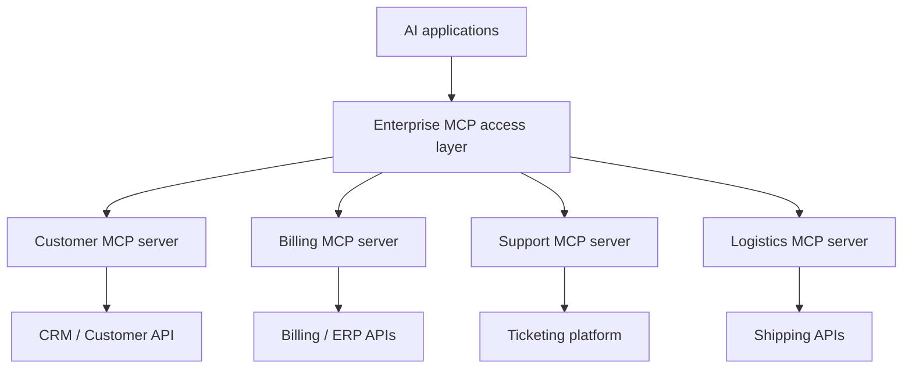
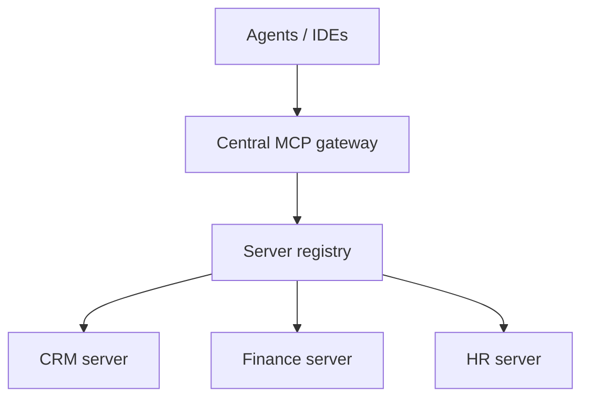
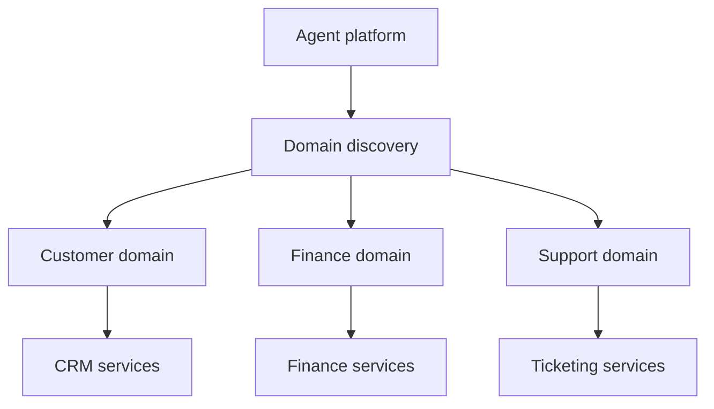
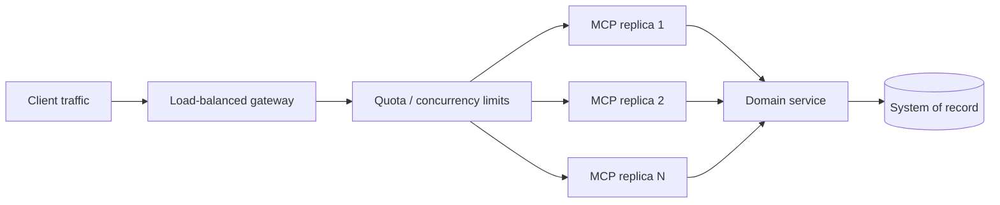
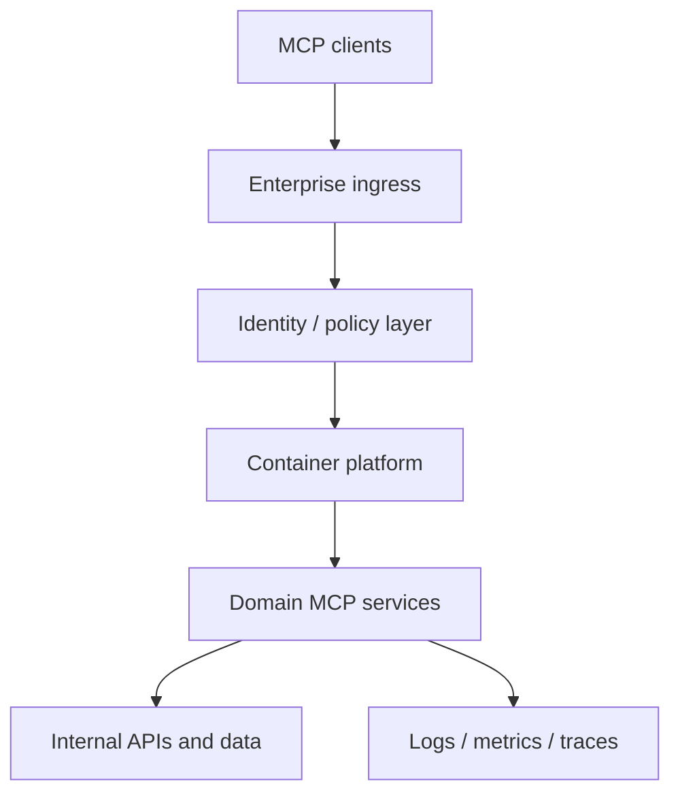

# 36. Enterprise MCP Architecture & Design Patterns

One team exposes CRM tools through MCP. Another publishes billing capabilities. A third connects the support platform. The first few integrations are easy. Then the inventory grows: duplicate tools appear, teams disagree about ownership, clients connect to different endpoints, and nobody knows which server is approved for production.

**MCP solved the connection contract. It did not solve the enterprise architecture.**

MCP standardizes how AI applications discover and invoke capabilities. Enterprises still need to decide where servers belong, who owns them, how clients reach them, and how the platform scales without creating a new integration maze.

This chapter addresses those platform-level decisions—not server/client implementation, multi-server client routing, OAuth mechanics or observability instrumentation.

## 1. From MCP servers to an enterprise platform

Think of MCP servers as capability boundaries around enterprise domains, not as replacements for systems of record.

A support agent might need a customer profile, invoice status, shipment tracking and ticket history. Those capabilities can live behind separate domain servers, each owned by the team responsible for the underlying business system.



Keep the responsibilities clear:

- Systems of record own authoritative data and transactions.
- Domain services enforce business rules.
- MCP servers expose selected capabilities through a standard protocol.
- An enterprise access layer applies shared discovery and routing controls where justified.
- AI applications select capabilities and manage the user-facing workflow.

Expose business operations such as `get_invoice_status`, not raw database operations. A stable business capability is easier to govern than a tool that mirrors an internal table.

## 2. Centralized, distributed or hybrid?

There is no universal topology. Choose based on domain ownership, network boundaries, data residency, latency and operational maturity.

### Centralized: one managed entry point

A central platform fronts approved backend servers. Clients use a common endpoint or managed catalogue.



**Why choose it:** consistent client configuration, shared policy enforcement and a consolidated inventory.

**What can go wrong:** the gateway becomes a bottleneck or a large failure domain. A central team can also slow delivery if every domain change requires its approval.

Use it when common access controls and a shared network boundary matter more than domain autonomy.

### Distributed: domain-owned endpoints

Each domain deploys and operates its own MCP servers near the systems and data it owns. Clients or regional access layers reach approved endpoints.



**Why choose it:** domain autonomy, data locality, independent releases and smaller failure domains.

**What can go wrong:** endpoint sprawl, inconsistent policies and uneven operational maturity.

Use it when domains have distinct owners, regulatory boundaries or release cycles.

### Hybrid: central standards, federated execution

This is often the practical enterprise choice. Centralize identity standards, server inventory, baseline policies and lifecycle rules. Let domain teams build, release and operate their own servers.

The control plane can be centralized while the data plane remains distributed. That avoids forcing every business request through one application cluster.

| Decision | Centralized | Distributed |
|---|---|---|
| Client entry point | Common gateway | Domain endpoints |
| Ownership | Platform-led | Domain-led |
| Policy consistency | Easier to standardize | Needs federation |
| Failure impact | Potentially broader | Usually more isolated |
| Best fit | Shared enterprise boundary | Strong domain autonomy |

## 3. The MCP gateway pattern

An MCP gateway sits between clients and backend MCP servers. It can provide a stable entry point while applying shared routing and platform controls.

A gateway may handle:

- Approved server and tool discovery.
- Mapping tool names to known backend servers.
- Authentication integration and policy enforcement.
- Tenant quotas, rate limits and concurrency controls.
- Version and lifecycle checks for registered servers.
- Network egress restrictions and request correlation.

A gateway is an **architectural pattern, not a mandatory MCP component**. A small application with two local servers may not need one. Introduce it when the number of consumers, servers or shared controls justifies the additional hop and operational responsibility.

A safe routing decision should use an approved registry—not arbitrary tool names supplied by a caller.

```python
from dataclasses import dataclass

@dataclass(frozen=True)
class ToolRoute:
    server: str
    permission: str

ROUTES = {
    "customer.get_profile": ToolRoute(
        server="customer-service",
        permission="customer.read",
    ),
    "billing.get_invoice": ToolRoute(
        server="billing-service",
        permission="invoice.read",
    ),
}

def resolve_route(tool_name, principal, registry):
    route = ROUTES.get(tool_name)
    if route is None:
        raise ValueError("Tool is not registered")

    if not principal.has_permission(route.permission):
        raise PermissionError("Access denied")

    backend = registry.get_healthy_server(route.server)
    if backend is None:
        raise RuntimeError("Backend unavailable")

    return backend
```

This is illustrative routing logic, not a complete MCP proxy. Token validation, authorization enforcement and credential isolation remain part of the security design in Chapter 34.

## 4. Domain-oriented multi-server design

Chapter 30 explains how a client connects to multiple servers, aggregates capabilities and routes calls. The enterprise design question is different: **where should capability ownership live?**

| Domain server | Example tools | Likely owner |
|---|---|---|
| Customer | Profile lookup, account status | CRM team |
| Billing | Invoice lookup, payment status | Finance platform |
| Support | Ticket creation, case history | Support systems |
| Logistics | Shipment tracking | Supply-chain team |

Avoid both extremes: one giant server mirroring every enterprise API, and one tiny server for every endpoint. The former becomes difficult to release and govern; the latter creates unnecessary discovery and operational overhead.

A domain server can combine internal APIs behind a task-oriented capability such as `prepare_replacement_order`. Keep cross-domain workflows in an application orchestration layer rather than making one domain server the hidden owner of everybody else's business rules.

## 5. Enterprise integration patterns

Three patterns cover many enterprise integrations:

- **API facade:** expose a stable MCP tool over REST, SOAP, GraphQL or an existing Java service while hiding legacy API details.
- **Domain capability:** combine related operations behind a task-oriented interface, reducing the low-level coordination expected from an agent.
- **Read / retrieval server:** return relevant, permission-filtered enterprise data rather than large raw datasets. Chapter 32 covers MCP-based RAG implementation.

These patterns also fit common enterprise use cases: CRM and ticketing integration, report generation, workflow automation, DevOps pipelines, infrastructure operations and security workflows.

Keep tool contracts narrow and typed. Bound response sizes, return stable identifiers and preserve provenance so applications can explain where important facts originated.

## 6. Scalability and reliability

Adding replicas is not a complete scaling strategy. Find the actual bottleneck: gateway throughput, database pools, downstream API quotas, network latency or expensive business operations.

The `2026-07-28` MCP revision removes protocol-level sessions from Streamable HTTP. Requests can be routed across healthy replicas without protocol session affinity. But **stateless transport does not mean stateless business logic**. A multi-step workflow may still need an explicit application handle, durable state or an idempotency key. <https://modelcontextprotocol.io/specification/2026-07-28/basic/transports/streamable-http>



Design for the whole dependency chain:

- Bound concurrency at gateway, tenant and backend levels.
- Set deadlines across downstream calls.
- Use queues for genuinely long-running work.
- Apply circuit breakers or load shedding when dependencies fail.
- Cache only when freshness and authorization scope are understood.
- Make side-effecting operations idempotent or provide reconciliation.
- Run redundant gateway instances and avoid hidden single points of failure.

Be careful with retries. A timeout after a write may mean the operation succeeded but its response was lost. Reconcile the operation status before repeating it.

## 7. Security and governance as platform capabilities

Chapter 34 covers security implementation. Here, the concern is consistency across the server fleet.

Maintain an enterprise inventory containing:

- Business owner and operational contact.
- Purpose, domain and approved consumers.
- Endpoint, transport and supported protocol versions.
- Tool catalogue and data classification.
- Authentication model and required permissions.
- Deployment environment and lifecycle status.
- Version, support status and retirement date.

Define an onboarding path that includes design review, permission review, test evidence, operational ownership and rollback planning. Establish versioning and deprecation windows so clients can migrate before tools or schemas are retired.

Governance should not mean that every tool waits for a central committee. Set platform standards centrally, delegate implementation to domain owners and automate compliance checks.

## 8. Deployment and operational choices



Choose hosting based on workload and operational needs:

- **STDIO:** local, client-managed processes such as developer tools.
- **Streamable HTTP:** remote services shared by clients and hosted behind web infrastructure.
- **Containers / Kubernetes:** independent scaling, rollout control, resource limits and service discovery.
- **Serverless:** bounded request/response workloads where cold starts, execution limits and networking are acceptable.

Separate development, staging and production registries. Use managed secrets, health checks, controlled rollouts and rollback plans. For Streamable HTTP, ensure ingress and load balancers support the protocol's request and streaming behaviour; validate compatibility across clients, gateways and servers before migration.

## Key takeaways

- MCP standardizes capability access; enterprise architecture organizes ownership and operations.
- Centralized, distributed and hybrid topologies solve different organizational problems.
- A gateway is optional infrastructure, not a protocol requirement.
- Domain-oriented servers are easier to own than a monolith or a server per endpoint.
- Scale the dependency chain, not just MCP replicas.
- Stateless transport still requires explicit application-state and idempotency design.
- Centralize baseline governance while federating domain implementation.

## Review questions

1. When is a central MCP gateway worth the additional hop?
2. What belongs in the central control plane versus a domain team's ownership?
3. Why are task-oriented tools preferable to exposing raw database operations?
4. How does stateless Streamable HTTP change load-balancing assumptions?
5. What should an enterprise MCP server inventory contain?

## References and further reading

- [MCP Specification — Architecture](https://modelcontextprotocol.io/specification/2026-07-28/architecture)
- [MCP Specification — Streamable HTTP](https://modelcontextprotocol.io/specification/2026-07-28/basic/transports/streamable-http)
- [MCP 2026-07-28 release notes](https://blog.modelcontextprotocol.io/posts/2026-07-28/)
- [AWS Architecture Blog — MCP stateless deployments](https://aws.amazon.com/blogs/architecture/mcp-went-stateless-is-your-aws-mcp-server-deployment-well-architected/)

---

## 🧭 Chapter Navigation

⬅️ **Previous:** [35. MCP Testing, Debugging & Observability](35-mcp-testing-debugging-observability.md)

📚 **Part:** [AI Engineering Frameworks & Tooling](index.md)

➡️ **Next:** [37. CrewAI Architecture & Core Concepts](37-crewai-architecture-core-concepts.md)

---

> **Enterprise AI Engineering Handbook**
>
> *Building Production-Grade Enterprise AI Systems — One Chapter at a Time.*

---
