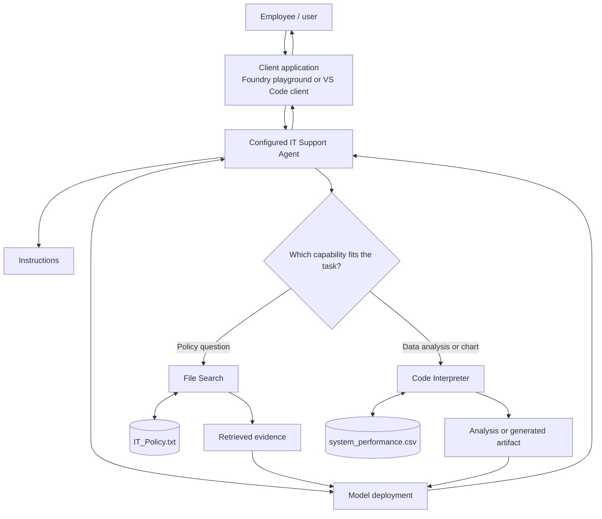

# Anatomy of an Azure AI Agent

## 1. Purpose and scope

An AI agent is more than a chat interface around a model. It combines a model with instructions, configured capabilities, and an execution flow that can use results from those capabilities to answer a task.

This chapter follows the Microsoft Learn exercise **Develop AI agents with Microsoft Foundry and Visual Studio Code**. It uses one example—a Contoso IT Support Agent—to connect the architecture to a working implementation.

By the end, you should be able to:

- Explain the main building blocks of a single agent and their responsibilities.
- Configure an agent with instructions, File Search, and Code Interpreter.
- Trace a request through the agent and validate the resulting answer or artifact.
- Call the saved agent from a Python client in Visual Studio Code.
- Distinguish saving an agent in a project from publishing an Agent Application.
- Explain the identity and permission boundaries described in the lab.

**Scope boundary:** this is an introduction to a single agent. Custom function tools, MCP, Foundry IQ, workflow orchestration, code-first agent frameworks, multi-agent systems, A2A, and Microsoft 365 publication are treated in later chapters. Here, those topics are not implemented in depth.

## 2. The anatomy: core building blocks

The source exercise configures an IT Support Agent with a model, instructions, File Search, and Code Interpreter. The following view combines those demonstrated elements with the application and security boundaries needed to understand the complete request path.



The diagram is a conceptual view, not a claim that every request calls every component or follows one identical internal sequence. The agent may use different capabilities depending on the request.

### The agentic loop

A tool-enabled agent commonly follows this loop:

1. The model interprets the user's request in the context of the agent's instructions.
2. The model either responds directly or requests a configured tool action.
3. The agent runtime dispatches the requested tool; the tool executes and returns a result.
4. The model uses that result to decide whether another step is needed or whether it can produce the final response.
5. The client presents the response and any available artifacts.

The model can request a tool call, but the runtime/tool integration executes it. Instructions alone do not grant access to a file, execute code, or authorize an external action. The loop can finish after a direct response or continue through one or more tool steps.

| Component | Responsibility in this exercise | Important boundary |
|---|---|---|
| **Model deployment** | Interprets the request and generates a response or determines that a configured tool is useful. | A model response alone does not provide access to arbitrary systems or data. |
| **Instructions** | Define the agent's role, expected behavior, and response boundaries. | Instructions do not implement a capability or enforce authorization by themselves. |
| **File Search** | Retrieves relevant evidence from the attached IT policy document. | The response should be checked against the actual source material. |
| **Code Interpreter** | Analyzes the supplied performance CSV and can generate a chart. | Conclusions should be supported by the supplied data and generated results. |
| **Agent execution flow** | Connects model reasoning, configured tool use, tool results, and the final response. | A task may need no tool, one tool, or multiple steps. |
| **Client application** | Sends requests to the agent and presents text or generated artifacts to the user. | The client may have responsibilities for authentication, conversation handling, and file output. |
| **Identity and access controls** | Govern who can invoke a published application and what resources its identity can access. | Caller permissions and the agent's downstream permissions are separate checks. |

The agent's **instructions** and **capabilities** should be treated separately. The lab instructions say to collect information when creating tickets, but this exercise does not configure a ticket-creation tool. The instruction expresses intended behavior; it does not make ticket creation possible.

## 3. Build the example agent in Microsoft Foundry

### 3.1 Prerequisites and sample data

The exercise assumes access to an Azure subscription and a Microsoft Foundry project with a usable model deployment. The developer workflow also uses Visual Studio Code, Git, Python, and Azure sign-in.

The source lab was tested with Python 3.13.12 and notes that some dependencies did not support Python 3.14 at that time. This is version-sensitive; check the current lab requirements before selecting a runtime.

Use the official lab repository:

- [MicrosoftLearning/mslearn-ai-agents](https://github.com/MicrosoftLearning/mslearn-ai-agents)
- Lab folder: `Labfiles/01-build-agent-portal-and-vscode/Python`
- [IT_Policy.txt](https://raw.githubusercontent.com/MicrosoftLearning/mslearn-ai-agents/main/Labfiles/01-build-agent-portal-and-vscode/IT_Policy.txt)
- [system_performance.csv](https://raw.githubusercontent.com/MicrosoftLearning/mslearn-ai-agents/main/Labfiles/01-build-agent-portal-and-vscode/system_performance.csv)

The policy file is a sample covering topics such as password resets, software requests, and hardware troubleshooting. The CSV contains simulated system metrics. Neither file represents a live company's policies or production telemetry.

### 3.2 Create and configure the agent

Before starting, confirm that your Azure subscription and access allow you to use Microsoft Foundry, that you have selected or created the intended Foundry resource/project, and that a compatible model deployment is available to the project. The precise resource and model setup screens depend on the current Foundry experience and your organization's Azure configuration; the transcript does not establish one universally correct model deployment or parameter set.

In Microsoft Foundry, select the project and create an agent named `it-support-agent`. Choose a model deployment available in that project, then add the following instructions from the lab:

```text
You are an IT Support Agent for Contoso Corporation.
You help employees with technical issues and IT policy questions.

Guidelines:
- Always be professional and helpful
- Use the IT policy documentation to answer questions accurately
- If you don't know the answer, admit it and suggest contacting IT support directly
- When creating tickets, collect all necessary information before proceeding
```

Add **File Search** and attach `IT_Policy.txt`. Wait for indexing to finish. Add **Code Interpreter** and attach `system_performance.csv`. Save the agent.

Portal labels can change between product versions, so use the equivalent controls in the current Foundry experience if the transcript's UI differs.

Before testing, record the configuration you actually used:

- Project and agent name/version.
- Selected model deployment.
- Exact instruction text or revision.
- File Search attachment and indexing status.
- Code Interpreter attachment.
- Temperature and Top P if you changed them.

The source discusses model parameters but does not establish a universally correct value for this example. Record your actual settings and evaluate behavior with repeatable tests rather than assuming one setting is always best.

## 4. Trace the request flow

The agent's behavior should be tested against the task it is asked to perform.

### Example A: policy question

Prompt:

> What's the policy for password resets?

Expected flow:

1. The client sends the prompt to the configured agent.
2. The agent uses File Search to retrieve relevant policy evidence.
3. The model uses the retrieved evidence to formulate an answer.
4. The client presents the response.

Validate the answer against `IT_Policy.txt`; do not judge only by whether the response sounds confident.

### Example B: data analysis

Prompt:

> Can you analyze the system performance data and tell me if there are any concerning trends?

Expected flow:

1. The request reaches the agent through the client.
2. Code Interpreter analyzes the attached CSV.
3. The analysis result is used to prepare the response.
4. The client presents the findings.

For a visualization request, Code Interpreter can also generate a chart. Check the actual output and file handling rather than assuming that a chart was created just because the agent describes one.

## 5. Validate the agent with repeatable tests

The transcript demonstrates these four core tests. Run them first and record your observed results.

| ID | Prompt from the lab | What to verify |
|---|---|---|
| T01 | `What's the policy for password resets?` | File Search is used and the response matches the policy source. |
| T02 | `How do I request new software?` | The answer is grounded in the software-request policy. |
| T03 | `Can you analyze the system performance data and tell me if there are any concerning trends?` | Code Interpreter analyzes the CSV and the claims are supported by its output. |
| T04 | `Create a chart showing CPU usage over time from the performance data` | A chart is generated from the supplied data and the output can be accessed. |

The following are **additional practice checks**, not tests shown as executed in the transcript:

- Ask about a policy that is absent from the uploaded file and check whether the agent acknowledges the evidence gap.
- Ask a follow-up question and verify that the response uses the intended conversation context.
- Make and save a small configuration change, reopen the agent, and repeat T01 to check that you are testing the saved version.

The VS Code demonstration also includes a question about the policy for reporting a lost or stolen device. Use it as an additional grounding check.

Record each run:

```text
Agent name/version:
Date and environment:
Test ID and prompt:
Expected tool / behavior:
Observed response:
Source evidence or output inspected:
Pass / fail:
Issue and next change:
Retest result:
```

When a test fails, check the selected agent version, instructions, attached file, indexing status, and tool configuration. Change one factor at a time where practical so that the cause of a regression remains understandable.

## 6. Work with the agent from Visual Studio Code

The transcript uses the Microsoft Foundry extension/toolkit in VS Code. Names and commands can vary by release; some transcript UI labels may refer to AI Toolkit. Install the current Microsoft extension, sign in to Azure, select the intended project, refresh its resources, and open the agent in the available builder or playground.

One practical lesson from the walkthrough is to save intended changes to Foundry before reopening and testing the agent. Otherwise, you may be testing a previously saved configuration rather than the one you just edited.

The transcript's lost-or-stolen-device check is especially useful here: the observed answer used web search when the intended behavior was to use the policy document through File Search. The presenter saved the agent, reopened the latest version, and reran the same prompt to verify the behavior. Treat this as a configuration-validation lesson—not as proof that every unexpected answer is caused by version selection. Check the active version, tool configuration, attached/indexed source, and observed tool behavior, then rerun the same prompt after a change.

### 6.1 Python client responsibilities

The lab's Python client uses:

- `PROJECT_ENDPOINT` to identify the Foundry project.
- `AGENT_NAME` to select the saved agent.
- `DefaultAzureCredential` for Azure authentication.
- `AIProjectClient` from the Azure AI Projects SDK to connect to the project.
- The associated OpenAI client and Responses API flow used by the lab.
- A conversation identifier to associate turns in the interactive client.
- File-handling logic that saves generated charts and other outputs under `agent_outputs`.

This illustrates a useful separation: Foundry stores the agent configuration, while the client application invokes the selected agent and handles the user-facing interaction and output files. The client code in the lab retrieves the configured agent and sends a request through the Responses API; the exact SDK calls can change, so use the current lab source as the executable reference.

The following is a **shape-of-the-integration sketch**, not a drop-in replacement for the lab script. SDK constructor names and response handling should be checked against the package versions installed for your environment:

```python
import os
from azure.identity import DefaultAzureCredential
from azure.ai.projects import AIProjectClient

project = AIProjectClient(
    endpoint=os.environ["PROJECT_ENDPOINT"],
    credential=DefaultAzureCredential(),
)

agent = project.agents.get(agent_name=os.environ["AGENT_NAME"])

# The lab then uses the associated OpenAI client / Responses API
# with the selected agent and the user's prompt.
# Follow the repository's current agent_with_functions.py for
# the exact client wiring, response handling, and output saving.
```

The lab's client also handles generated artifacts. For example, a chart produced during a Code Interpreter request is not merely descriptive text: the client code can save the returned file to `agent_outputs`. Verify that the expected file exists and opens, and do not assume that every response contains a downloadable artifact.

From the lab's Python folder, the transcript's Windows PowerShell setup is:

```powershell
python -m venv labenv
.\labenv\Scripts\Activate.ps1
pip install -r requirements.txt
az login
python agent_with_functions.py
```

Create `.env` from `.env.example` and set the values for your own project:

```dotenv
PROJECT_ENDPOINT=<your_project_endpoint>
AGENT_NAME=it-support-agent
```

Do not copy another person's endpoint or commit credentials and access tokens to source control. Verify that generated artifacts appear under `agent_outputs` and correspond to the request you made.

## 7. Saving, publishing, and identity boundaries

### 7.1 Saving in a project is not the same as publishing

**Saving the agent** records its configuration in the Foundry project so it can be reopened, tested, and iterated on by appropriately authorized project users. In the lab workflow, save the latest configuration before closing or switching contexts, then reopen the agent and rerun the same validation prompt.

**Publishing as an Agent Application**, in the flow shown in the transcript, is a separate step that creates a managed application with an invocation endpoint and its own access boundary. It is not synonymous with saving the agent, and a saved agent is not automatically evidence of a published, externally invokable application. An external client can invoke the published application without every caller needing access to the full development project.

Therefore, a successful save is not proof that an externally callable application has been published or that a caller can access it. Product labels, endpoint routes, and API behavior are version-sensitive; verify the current documentation when implementing an integration.

### 7.2 Caller identity versus agent identity

The transcript describes two distinct authorization boundaries for its Agent Application flow:

1. **Caller-to-application access.** The caller authenticates using Microsoft Entra ID. The transcript identifies the Azure AI User role on the Agent Application resource as the required caller role and states that API-key authentication is not supported for that particular flow.
2. **Agent-to-resource access.** Publishing creates a separate Entra agent identity. Permissions assigned to a project identity do not automatically transfer to this published identity. If the published agent needs to access a downstream Azure resource, the published agent identity must have the required permissions there.

These requirements are specific to the flow and product version described in the source; check the current product documentation before relying on them in production.

A useful troubleshooting split is:

- If invocation returns `403 Forbidden`, check the caller's authentication, role assignment, endpoint, and target application.
- If invocation succeeds but the agent cannot access a downstream resource, inspect the published agent identity's permissions on that resource.

Do not collapse these into one generic “agent permissions” problem. The caller and the running agent are different principals with different access needs.

### 7.3 Conversation state

For the published Agent Application flow described in the transcript, the endpoint uses a stateless Responses API pattern. A multi-turn client must manage and provide the conversation history or state required by that API flow. This is a scoped observation about the published endpoint described in the source; do not generalize it to every Foundry playground, agent runtime, or client pattern. Publishing an endpoint does not, by itself, mean that an application has durable conversational memory.

## 8. Architecture review

Use these prompts to check your understanding of the design.

1. **A policy answer sounds plausible but is not supported by the policy file.** What should you inspect?  
   Check that the intended agent/version is active, File Search is configured, the file is attached and indexed, and the response used the retrieved evidence.

2. **The agent describes a chart, but no chart is available.** What should you verify?  
   Check Code Interpreter configuration and invocation, then inspect whether the chart was actually generated and whether the client saved or surfaced the artifact.

3. **The project playground works, but the published application returns `403`.** What is the first distinction to make?  
   Separate caller authorization to invoke the Agent Application from the agent's own downstream resource permissions. For an invocation-level `403`, start with caller authentication, role assignment, and endpoint selection.

4. **The published agent can be invoked but cannot read a downstream Azure resource.** Whose access should you inspect?  
   Inspect the published agent identity and its permissions on the target resource.

5. **The instructions say to create an IT ticket, but no ticket tool is configured.** Can the agent create one reliably?  
   No. Instructions describe expected behavior; an implemented capability and appropriate authorization are needed to perform the action.

6. **Why should a multi-turn client not assume that a published endpoint retains conversation history?**  
   The source's described endpoint uses a stateless Responses API pattern, so the client must manage the conversation state/history required by that API.

## 9. Completion checklist

- [ ] Created the Foundry project and `it-support-agent`.
- [ ] Recorded the selected model and agent instructions.
- [ ] Attached and indexed `IT_Policy.txt` for File Search.
- [ ] Attached `system_performance.csv` to Code Interpreter.
- [ ] Ran T01–T04 and recorded actual results.
- [ ] Completed the additional grounding and saved-version checks.
- [ ] Tested the agent in VS Code.
- [ ] Ran the Python client with the correct project endpoint and Azure sign-in.
- [ ] Verified the generated output under `agent_outputs`.
- [ ] Explained the difference between saving and publishing.
- [ ] Distinguished caller authorization from the published agent identity's downstream permissions.
- [ ] Explained the client's conversation-state responsibility for the described stateless API flow.

## 10. Source alignment and references

This chapter is grounded in the supplied transcript **Develop AI agents with Microsoft Foundry and Visual Studio Code**, including its single-agent overview, IT Support Agent configuration, File Search and Code Interpreter setup, playground tests, VS Code client, publication flow, and identity guidance.

T01–T04 are the core tests demonstrated by the source. The additional practice checks and architecture review questions are learning exercises; they are not claims that the transcript ran those tests. SDK methods, extension names, role requirements, endpoint behavior, and preview features may change. Verify current product documentation before using the flow in a production system.

- [Develop AI agents with Microsoft Foundry and Visual Studio Code — Microsoft Learn](https://learn.microsoft.com/en-us/training/modules/develop-ai-agents-azure-vs-code/)
- [MicrosoftLearning/mslearn-ai-agents — lab repository](https://github.com/MicrosoftLearning/mslearn-ai-agents)
- [Sample IT policy file](https://raw.githubusercontent.com/MicrosoftLearning/mslearn-ai-agents/main/Labfiles/01-build-agent-portal-and-vscode/IT_Policy.txt)
- [Sample system performance CSV](https://raw.githubusercontent.com/MicrosoftLearning/mslearn-ai-agents/main/Labfiles/01-build-agent-portal-and-vscode/system_performance.csv)

> **Enterprise AI Engineering Handbook**
>
> *Building Production-Grade Enterprise AI Systems — One Chapter at a Time.*
