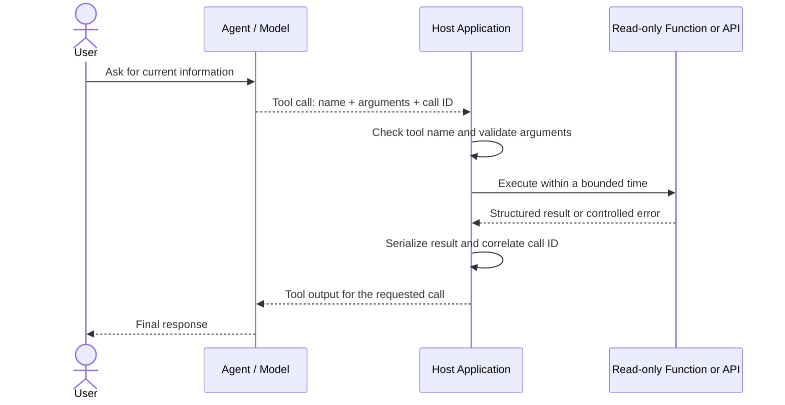

# 02. Integrating Custom Tools into AI Agents

## 1. Purpose and learning objectives

A language model can explain a business process, but it cannot query your inventory database, retrieve current weather, calculate a value from authoritative data, or call a business API unless the application exposes a suitable capability. **Custom tools connect an agent's reasoning to operations that application code or external services can perform.**

In this chapter, we follow the custom-tool concepts and integration options in the supplied Microsoft Learn material, *Integrate custom tools into your agent*. We use its `recent_snowfall` function as a small example, then add explicit reliability practices so the execution path is easier to validate and test.

By the end, you should be able to:

- Explain the difference between a tool definition and its implementation.
- Trace a tool call from model request through dispatch and back to the model.
- Define a tool using JSON Schema and validate arguments in application code.
- Return a predictable, structured result and handle expected failures safely.
- Apply timeouts and test success, validation, and failure paths.
- Explain when client-side functions, Azure Functions, or OpenAPI tools may fit.

**Scope:** the primary implementation is one read-only custom function. Azure Functions and OpenAPI are covered as integration options. The source transcript's broader astronomy example includes multiple tools and a report-writing side effect; it is summarized later as a source exercise rather than used as the main implementation.

## 2. The custom-tool lifecycle

A tool typically has two parts:

1. **Definition:** the name, description, and parameter schema provided to the model.
2. **Implementation:** application code or a service that performs the operation when the application receives a tool-call request.

The model can request a tool call; it does not automatically execute a local Python function. In a client-side function-calling flow, the host application interprets the request, validates it, dispatches to an approved implementation, and returns the result.



For a hosted integration, such as a configured Azure Function or OpenAPI tool, some invocation work may be managed by the platform. The exact flow depends on the selected integration and current SDK/API contract.

**Core rule:** the model proposes a capability and its arguments. The application and the system that owns the data remain responsible for validation, authorization, execution, and failure handling.

## 3. Choose an integration approach

The source material introduces four options:

| Option | Execution model | Typical fit |
|---|---|---|
| Client-side function calling | The host application dispatches to local application code | Small application-specific operations and direct control of the tool loop |
| Azure Functions | Logic runs in an Azure-hosted function | Server-side compute or work that should not run in the client process |
| OpenAPI specification tool | An API is described through an OpenAPI contract | Existing HTTP/REST capabilities with a maintained API description |
| Azure Logic Apps | A low-code workflow connects services and actions | Workflow-oriented integration with less custom code |

The main code path in this chapter uses **client-side function calling** because it makes the dispatch and validation responsibilities visible. The other approaches are summarized in Section 9.

## 4. Define the read-only function and result contract

The transcript demonstrates this simple snowfall function using sample data:

```python
import json

def recent_snowfall(location: str) -> str:
    """Fetch recent snowfall totals for a location."""
    mock_snow_data = {
        "Seattle": "0 inches",
        "Denver": "2 inches",
    }
    snow = mock_snow_data.get(location, "Data not available.")
    return json.dumps({
        "location": location,
        "snowfall": snow,
    })
```

This example is useful for learning the function shape, but it has limitations for an application contract: it returns an untyped JSON string, treats an unknown location as a normal-looking result, and performs no runtime validation. The following implementation is an **engineering refinement** of the sample, not code demonstrated verbatim in the transcript.

### 4.1 Define explicit input and output types

This example remains read-only and uses a fixed sample dataset so the behavior is deterministic and easy to test.

```python
from dataclasses import asdict, dataclass
from typing import Literal

@dataclass(frozen=True)
class SnowfallInput:
    location: str

@dataclass(frozen=True)
class SnowfallResult:
    location: str
    snowfall: str
    source: Literal["sample-data"] = "sample-data"

SNOW_DATA: dict[str, str] = {
    "Seattle": "0 inches",
    "Denver": "2 inches",
}

class ToolInputError(ValueError):
    """The requested tool arguments are invalid."""

class ToolExecutionError(RuntimeError):
    """The tool could not complete the requested operation."""

def recent_snowfall(location: str) -> SnowfallResult:
    """Return sample recent snowfall for a supported city."""
    normalized = location.strip()

    if not normalized:
        raise ToolInputError("location must not be empty")

    snowfall = SNOW_DATA.get(normalized)
    if snowfall is None:
        raise ToolInputError("unsupported location")

    return SnowfallResult(
        location=normalized,
        snowfall=snowfall,
    )
```

The dataclasses make the expected input and output shapes explicit. Type annotations improve readability and static analysis, but **they do not validate untrusted runtime data by themselves**. The dispatcher still needs to validate the decoded arguments.

This sample only recognizes Seattle and Denver. In a real system, replace the sample dictionary with an approved data source and define the supported location format and freshness expectations.

## 5. Describe the tool with JSON Schema

The transcript demonstrates a `FunctionTool` definition with a name, description, required parameters, `additionalProperties: False`, and `strict=True`. The following schema shows the same contract in a standalone form:

```python
SNOWFALL_TOOL_SCHEMA = {
    "type": "object",
    "properties": {
        "location": {
            "type": "string",
            "description": "City name to check recent snowfall for.",
        }
    },
    "required": ["location"],
    "additionalProperties": False,
}
```

A corresponding tool definition in the SDK pattern shown in the source is conceptually:

```python
function_tool = FunctionTool(
    name="recent_snowfall",
    description="Get recent snowfall totals for a supported location.",
    parameters=SNOWFALL_TOOL_SCHEMA,
    strict=True,
)
```

Use the exact import path and constructor supported by the version of the Foundry SDK installed in your project; SDK APIs evolve.

Important contract properties:

- **Name:** maps to one known implementation.
- **Description:** tells the model what the function does and when to use it.
- **Parameter types:** describe the shape of the arguments.
- **Required fields:** identify mandatory inputs.
- **`additionalProperties: False`:** disallows extra keys in the schema.
- **Strict mode:** requests conformance to the supported strict schema behavior.

Schema constraints help shape model-generated calls. They do not replace validation at the execution boundary, and they do not prove that a request is authorized or meaningful for the business.

## 6. Validate, dispatch, and return structured output

The dispatcher is the control point between the model's requested tool call and application execution. It should only call explicitly registered functions.

The next example includes runtime validation, a typed result, a bounded execution time, safe error categories, and JSON serialization. These are additional engineering practices layered onto the basic dispatch pattern.

```python
import json
from concurrent.futures import ThreadPoolExecutor, TimeoutError as FutureTimeout

TOOL_TIMEOUT_SECONDS = 2.0

def validate_snowfall_arguments(arguments: object) -> SnowfallInput:
    if not isinstance(arguments, dict):
        raise ToolInputError("arguments must be a JSON object")

    if set(arguments) != {"location"}:
        raise ToolInputError("expected only the 'location' field")

    location = arguments["location"]
    if not isinstance(location, str):
        raise ToolInputError("'location' must be a string")

    location = location.strip()
    if not location:
        raise ToolInputError("'location' must not be empty")
    if len(location) > 100:
        raise ToolInputError("'location' is too long")

    return SnowfallInput(location=location)

def _execute_snowfall(args: SnowfallInput) -> SnowfallResult:
    return recent_snowfall(args.location)

def dispatch_tool(name: str, arguments_json: str) -> str:
    """Execute one allow-listed read-only tool and return a JSON payload."""
    if name != "recent_snowfall":
        return json.dumps({
            "ok": False,
            "error": {"code": "unknown_tool", "message": "Tool is not available."},
        })

    try:
        raw_arguments = json.loads(arguments_json)
        args = validate_snowfall_arguments(raw_arguments)

        # This example uses a worker to demonstrate a bounded wait.
        # See the timeout note below before adapting this pattern to production.
        with ThreadPoolExecutor(max_workers=1) as executor:
            future = executor.submit(_execute_snowfall, args)
            result = future.result(timeout=TOOL_TIMEOUT_SECONDS)

        return json.dumps({
            "ok": True,
            "result": asdict(result),
        })

    except json.JSONDecodeError:
        return json.dumps({
            "ok": False,
            "error": {"code": "invalid_json", "message": "Tool arguments must be valid JSON."},
        })
    except ToolInputError:
        return json.dumps({
            "ok": False,
            "error": {"code": "invalid_arguments", "message": "Tool arguments are invalid."},
        })
    except FutureTimeout:
        return json.dumps({
            "ok": False,
            "error": {"code": "timeout", "message": "The tool exceeded its time limit."},
        })
    except Exception:
        # Log the detailed exception internally with a correlation ID.
        # Do not return stack traces or secrets to the model.
        return json.dumps({
            "ok": False,
            "error": {"code": "tool_failed", "message": "The tool could not complete the request."},
        })
```

### Important timeout implementation note

The code above illustrates a bounded wait and a controlled timeout response, but a Python thread timeout **does not forcibly stop the underlying work**. Also, exiting a `ThreadPoolExecutor` context can wait for a running task to finish. For genuinely blocking or untrusted work, use a client with native connect/read deadlines, a cancellable async operation where supported, or an isolated worker/process with an enforceable deadline. Configure timeouts at the downstream HTTP/database client as well as at the request boundary.

For a local dictionary lookup, the timeout machinery is unnecessary; it is included here to show where timeout policy belongs. Keep production code as simple as the operation allows.

### 6.1 Why return a structured result?

A stable envelope separates successful results from failures:

```json
{
  "ok": true,
  "result": {
    "location": "Denver",
    "snowfall": "2 inches",
    "source": "sample-data"
  }
}
```

A controlled failure uses a stable error code:

```json
{
  "ok": false,
  "error": {
    "code": "invalid_arguments",
    "message": "Tool arguments are invalid."
  }
}
```

The model can use a concise error result to explain that the request could not be completed or ask the user for corrected information. Detailed diagnostics should remain in application logs, not in the tool output.

For production systems, consider a validated response model, versioned result contract, explicit units, source timestamps, and a distinction between “no data found” and “the source is unavailable.”

## 7. Return outputs to the correct tool calls

The transcript's client-side example uses the Foundry Python SDK and an OpenAI client obtained from the project client. Its flow is:

1. Create the project client and agent with tool definitions.
2. Create or continue the conversation and send the user's message.
3. Inspect the response and check for a failed status.
4. Identify returned `function_call` items.
5. Read each function name and its JSON arguments.
6. Execute the corresponding local function.
7. Create a function-call output paired with that call's ID.
8. Submit the outputs through the SDK's expected response/conversation flow.
9. Read the next response and display the final text.

The transcript notes that the model can request multiple functions in one turn. Your dispatcher should therefore process every requested call, not assume there will only be one. Pair each result with the **exact tool-call ID** supplied by the response. Incorrect call/output association can lead to errors such as “No tool output found for function call.”

A version-neutral pseudocode sketch:

```python
for call in response.function_calls:
    output = dispatch_tool(
        name=call.name,
        arguments_json=call.arguments,
    )
    tool_outputs.append({
        "tool_call_id": call.id,
        "output": output,
    })

# Submit tool_outputs using the current SDK/API's required format,
# then read the model's follow-up response.
```

This is intentionally pseudocode: use the current SDK's actual response item types and method signatures. Do not copy a made-up wrapper or assume SDK signatures are stable across versions.

## 8. Test the tool boundary

The source transcript demonstrates a working dispatch flow, but it does not provide a comprehensive automated test suite for validation, timeouts, and downstream failures. The following tests are **additional engineering guidance** for making the tool behavior repeatable.

Assuming the implementation is saved in `custom_tools.py`, a small `pytest` suite can test the deterministic core and dispatcher contract.

```python
import json
import pytest

from custom_tools import (
    ToolInputError,
    dispatch_tool,
    recent_snowfall,
    validate_snowfall_arguments,
)

def test_supported_location_returns_typed_result():
    result = recent_snowfall("Denver")
    assert result.location == "Denver"
    assert result.snowfall == "2 inches"

@pytest.mark.parametrize("arguments", [
    None,
    [],
    {},
    {"location": 42},
    {"location": "   "},
    {"location": "Denver", "extra": True},
])
def test_invalid_arguments_are_rejected(arguments):
    with pytest.raises(ToolInputError):
        validate_snowfall_arguments(arguments)

def test_dispatch_returns_json_success_envelope():
    output = json.loads(
        dispatch_tool("recent_snowfall", '{"location": "Seattle"}')
    )
    assert output["ok"] is True
    assert output["result"]["location"] == "Seattle"
    assert output["result"]["snowfall"] == "0 inches"

def test_unknown_tool_is_rejected():
    output = json.loads(dispatch_tool("delete_everything", "{}"))
    assert output["ok"] is False
    assert output["error"]["code"] == "unknown_tool"

def test_malformed_json_is_a_controlled_error():
    output = json.loads(dispatch_tool("recent_snowfall", "{"))
    assert output["ok"] is False
    assert output["error"]["code"] == "invalid_json"
```

Run the tests with:

```bash
python -m pip install pytest
python -m pytest -q
```

### Additional tests for real integrations

When replacing the sample function with an API or database call, add tests for:

- **Timeout:** simulate a slow downstream call and assert that the application returns the expected timeout category.
- **Dependency failure:** simulate connection errors, HTTP 5xx responses, or malformed downstream data.
- **Output contract:** assert required fields, types, units, and JSON serializability.
- **Call correlation:** test that every requested function call receives an output associated with its own call ID, including a turn with multiple calls.
- **Authorization:** verify that the tool cannot access resources beyond the current user's permissions.
- **Retry behavior:** ensure retries are bounded and are only used where safe. Read-only calls are usually simpler to retry than operations with side effects.

Prefer unit tests for the function and dispatcher, then integration tests for the API/Foundry boundary. Do not rely only on an LLM-generated answer as proof that a tool behaved correctly.

## 9. Azure Functions and OpenAPI options

The main implementation above uses client-side dispatch to make execution responsibilities visible. The source transcript also introduces these hosted integration approaches.

### 9.1 Azure Functions

Azure Functions can host logic outside the client process. The supplied material demonstrates a queue-based example with input and output storage queue bindings, illustrating how a function can receive work and emit a result. This is useful when server-side compute or an independently hosted execution boundary is appropriate.

Before adopting this pattern, decide who owns authentication, input validation, timeout policy, retries, observability, and the response contract. Confirm the exact binding and agent integration requirements in the current Azure Functions and Foundry documentation.

### 9.2 OpenAPI specification tools

OpenAPI provides a machine-readable description of an HTTP API's operations and parameters. It is a natural option when the capability already exists as a REST API and the API contract is maintained.

**Source consistency note:** the transcript's explanatory text refers to OpenAPI 3.0 support, while its displayed sample specification declares `openapi: 3.1.0`. Treat this as a discrepancy in the supplied learning material rather than assuming that the example has been validated against every current platform constraint. Check the current Foundry documentation for supported specification versions, authentication configuration, and schema limitations before deploying.

An OpenAPI document describes how to call an API; it does not replace the API's own authorization, validation, rate limits, or business rules.

### 9.3 Azure Logic Apps

The source describes Logic Apps as a low-code sibling to Azure Functions that can connect services and orchestrate workflows, potentially through an HTTP endpoint. Use a workflow-first approach when integration and orchestration are more important than implementing the logic in code.

These approaches can coexist. Select the smallest integration that fits the capability and its operational ownership.

## 10. Production design checklist

Before connecting a custom tool to a real system, review the following.

- [ ] **Narrow capability:** each tool does one clearly described task.
- [ ] **Allow-listed dispatch:** unknown tool names cannot execute arbitrary code.
- [ ] **Runtime validation:** required fields, types, lengths, ranges, and allowed values are checked.
- [ ] **Authorization:** permissions are enforced by the application and the system that owns the data.
- [ ] **Typed contract:** successful results and expected errors have predictable, documented shapes.
- [ ] **Bounded execution:** downstream calls have appropriate timeouts and bounded retries.
- [ ] **Safe errors:** tool outputs do not expose credentials, stack traces, or sensitive internals.
- [ ] **Call correlation:** every tool result is paired with the correct call ID.
- [ ] **Observability:** tool name, duration, outcome, and correlation ID are logged without unnecessary sensitive data.
- [ ] **Automated tests:** success, malformed arguments, unknown tools, timeouts, dependency failures, and output shape are tested.
- [ ] **Read/write separation:** consequential actions use narrowly scoped permissions and confirmation where appropriate.
- [ ] **Output hygiene:** downstream content is treated as data, not as trusted instructions to override application policy.

For this chapter's read-only example, the authorization and side-effect risks are limited. They become much more important when tools create tickets, modify records, spend money, send messages, or otherwise change external state.

## 11. Source exercise: astronomy assistant

The source learning exercise builds an astronomy assistant with three local function tools:

- `next_visible_event(location)` retrieves the next sample astronomical event for a location.
- `calculate_observation_cost(telescope_tier, hours, priority)` calculates telescope rental cost.
- `generate_observation_report(...)` writes an observation report file.

The combined prompt asks for the next visible event from South America and the cost of five hours of premium telescope time at normal priority. This can lead to multiple tool calls in one turn. A follow-up request for a report for Bellows College exercises the report-generation function.

This exercise is valuable for understanding multiple calls and tool-output correlation. However, `generate_observation_report` writes a file, so the full exercise is **not read-only**. Treat report generation as a separate side-effecting capability: validate all fields, choose an approved output location, restrict file access, and test the write behavior before exposing it to an agent.

The source material's setup references the Microsoft learning repository:
[MicrosoftLearning/mslearn-ai-agents](https://github.com/MicrosoftLearning/mslearn-ai-agents)

It identifies the lab folder as `Labfiles/02-agent-custom-tools/Python`, and notes that the SDK and dependencies can evolve. The transcript states that the lab was tested with Python 3.13.12 and that Python 3.14 was unsupported by its dependencies at the time the material was written. Check the repository's current requirements before creating a new environment.

## 12. Knowledge check

1. **Does the model directly execute a local function?**  
   No. In client-side function calling, it requests a tool call; the host application validates and executes it.

2. **Why validate arguments after parsing JSON?**  
   JSON parsing only confirms that the input is syntactically valid JSON. The application must still verify the expected object shape, types, and domain constraints.

3. **Why use a typed result and stable JSON envelope?**  
   They make the output predictable for the host, the model, and tests, and distinguish success from controlled failure.

4. **Why is a timeout not enough if the underlying work continues?**  
   A timeout response does not necessarily cancel the task. Use downstream deadlines or an execution boundary that can enforce cancellation.

5. **Why must tool outputs include the matching call ID?**  
   The API needs to associate each result with the tool call that requested it, particularly when multiple calls occur in one turn.

6. **When is an OpenAPI tool a good fit?**  
   When the capability is already exposed through an HTTP API with an accurate, supported OpenAPI contract.

7. **Does a valid schema guarantee that an operation is safe?**  
   No. Schema validation does not establish authorization, user intent, business correctness, or permission to change external state.

## 13. Completion criteria

You have completed this chapter when you can:

- Explain the distinction between a tool definition and its implementation.
- Define a function tool with JSON Schema.
- Validate arguments at runtime and dispatch only to approved functions.
- Return a predictable structured result or controlled error.
- Explain where timeouts, retries, logging, and authorization belong.
- Write tests for success, invalid input, unknown tools, and failure paths.
- Describe the role of call IDs in a multi-tool turn.
- Compare client-side function calling, Azure Functions, OpenAPI, and Logic Apps.

## Source alignment and version notes

This chapter is grounded in the supplied Microsoft Learn material, **“Integrate custom tools into your agent.”** Source-demonstrated elements include the custom-function-calling lifecycle, the `recent_snowfall` example and its tool schema, client-side dispatch, Azure Functions, OpenAPI and Logic Apps options, and the astronomy assistant exercise. Runtime validation, typed dataclasses, a structured error envelope, timeout discussion, pytest examples, and the production checklist are added engineering guidance; they are not presented as features implemented by the source lab.

Microsoft Foundry SDK APIs, portal labels, tool support, and integration constraints can change. Verify current SDK method signatures, OpenAPI version support, authentication options, and Azure resource configuration against current documentation before production use.

Further reading:

- [Microsoft Foundry documentation](https://learn.microsoft.com/azure/ai-foundry/)
- [Azure Functions documentation](https://learn.microsoft.com/azure/azure-functions/)
- [OpenAPI Specification](https://spec.openapis.org/oas/v3.0.0)
- [Microsoft learning repository used by the source exercise](https://github.com/MicrosoftLearning/mslearn-ai-agents)

> **Enterprise AI Engineering Handbook**
>
> *Building Production-Grade Enterprise AI Systems — One Chapter at a Time.*
