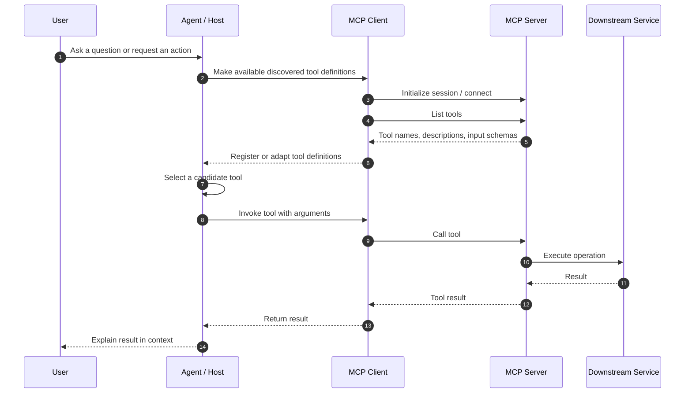

# 03. Integrating Agents with MCP Servers

## 1. Purpose and scope

Model Context Protocol (MCP) gives an agent a standard way to discover and invoke tools exposed by an MCP server. Instead of manually describing every external function inside an agent application, a client can retrieve a server's tool catalog and adapt the available tool definitions to the agent runtime.

This chapter follows the supplied *Integrate MCP Tools with Azure AI Agents* transcript and lab. Its core is the two integration paths demonstrated by the source—not a general survey of every MCP capability. It covers:

- MCP's client-server boundary and the tool catalog.
- Dynamic tool discovery and invocation.
- Two integration paths demonstrated in the source: a remote MCP tool handled by Microsoft Foundry, and a locally launched MCP server connected through a client session and function wrappers.
- Authentication to Foundry and credentials/headers required at the MCP boundary.
- Tool allow-listing, approval requests, and the difference between asking for approval and automatically approving.
- A retail inventory example that exposes inventory and weekly-sales tools.

This is an MCP integration chapter, not a general introduction to custom functions, RAG, workflows, or agent-to-agent communication. The previous chapter's general custom-tool validation and test design remains relevant, but this chapter concentrates on the additional MCP protocol and connection boundaries.

## 2. Learning objectives

After this chapter, you should be able to:

1. Explain the responsibilities of an MCP server, MCP client, and agent.
2. Trace tool discovery from a server catalog to tools usable by an agent.
3. Distinguish remote MCP integration managed by Foundry from a client-managed MCP session.
4. Connect to a remote server with `MCPTool`, configure headers, and handle an approval request.
5. Create a small FastMCP server and discover/call its tools through `ClientSession`.
6. Identify which security controls belong at the agent, MCP client, MCP server, and downstream service boundaries.

## 3. MCP architecture

### 3.1 Main components

| Component | Responsibility | Important boundary |
|---|---|---|
| **MCP server** | Publishes a catalog of tools, descriptions, and input definitions; handles tool execution. | It is the authority for what it exposes, but must still enforce its own authorization and input rules. |
| **MCP client** | Establishes a session, discovers tools, and invokes a selected tool. | It controls how a server is connected to and how returned tools are adapted to the host application. |
| **Agent runtime** | Uses the available tool descriptions to decide whether a tool is relevant to a user request. | Model-selected intent is not an authorization decision. |
| **Host application / Foundry** | Creates the agent, manages the conversation, routes tool calls, and handles approval responses where configured. | It should enforce policy rather than blindly trusting model output. |
| **Downstream API or system** | Performs the actual operation, such as reading inventory or querying documentation. | Authorization, business rules, and audit logging should be enforced here as well. |

MCP standardizes tool discovery and invocation; it does not automatically make a tool safe, authorize a user, or guarantee that the server's output is trustworthy.

### 3.2 End-to-end flow



The diagram shows the logical sequence. Implementations can differ in which component performs each step. In the Foundry-managed remote MCP path, Foundry handles the MCP tool invocation and the host application handles any approval requests. In the client-managed path, application code explicitly lists tools, wraps them, dispatches function calls, and sends results back to the model.

### 3.3 Why dynamic discovery matters

The source emphasizes four benefits:

- **Scalability:** add or update server-side tools without manually duplicating every tool definition in each agent.
- **Modularity:** keep the agent focused on task reasoning while the server owns tool implementation.
- **Maintainability:** centralize tool descriptions and implementation.
- **Flexibility:** connect agents to different servers and tool catalogs as needed.

Discovery is not the same as permission. A server may advertise a tool, but the host should expose only the subset appropriate for the agent and user, and the server must still enforce access at invocation time.

## 4. Two integration models in the source

The transcript demonstrates two distinct patterns. Choose deliberately; they are alternatives, not steps that must always be combined.

| Decision | Foundry-managed remote MCP tool | Client-managed MCP session |
|---|---|---|
| Typical server location in source | Remote HTTP endpoint, such as the Microsoft Learn MCP endpoint | Local server process launched by the client using stdio in the lab |
| Discovery and invocation | Foundry's MCP tool integration manages the remote MCP interaction | Application uses `session.list_tools()` and `session.call_tool()` |
| Tool registration | Add an `MCPTool` to the agent definition | Convert discovered MCP tools into function-tool definitions and wrappers |
| Approval | MCP approval requests are returned to the host for handling | Lab has a simplified auto-approval path for function calls; approval is not inherently provided by MCP client wrapping |
| Best fit | Remote MCP server supported by the Foundry integration | Custom host/runtime logic, local development, or an integration that needs explicit client-side control |
| Main engineering concern | Correct server URL, headers, allowed tools, approval policy, and service-side access | Correct schema mapping, dispatch, lifecycle management, errors, and result conversion |

**Important source distinction:** the source's remote example uses an `MCPTool` object and an approval-response loop. The local example explicitly starts a process, creates `ClientSession`, calls `list_tools()`, creates wrappers around `call_tool()`, and dispatches function calls. Do not imply that the local wrapper pattern is required when Foundry directly manages a remote MCP tool.

## 5. Path A — connect to a remote MCP server through Foundry

### 5.1 Configuration concepts

The source's remote example uses:

- A unique `server_label` such as `api-specs`.
- A `server_url`, demonstrated with `https://learn.microsoft.com/api/mcp`.
- `require_approval="always"` to require a decision before invocation.
- `DefaultAzureCredential` for the application's access to the Foundry project.
- A Foundry project client and OpenAI-compatible client to create the agent and manage the conversation.

An MCP server may also require its own authentication. The source notes that custom headers can carry API keys, OAuth tokens, or other required header values. Authentication to Foundry and authentication to the MCP server are separate trust boundaries: successfully creating a Foundry client does not prove that the remote MCP server will accept the request.

### 5.2 Minimal integration shape

The following is an illustrative structure aligned with the transcript's SDK pattern. Verify class imports and parameter names against the installed Microsoft Foundry SDK version before running it.

```python
from azure.identity import DefaultAzureCredential
from azure.ai.projects import AIProjectClient
from azure.ai.agents.models import MCPTool, PromptAgentDefinition

project_endpoint = "<FOUNDRY_PROJECT_ENDPOINT>"
model_deployment = "<MODEL_DEPLOYMENT_NAME>"

with (
    DefaultAzureCredential() as credential,
    AIProjectClient(
        endpoint=project_endpoint,
        credential=credential,
    ) as project_client,
):
    mcp_tool = MCPTool(
        server_label="api-specs",
        server_url="https://learn.microsoft.com/api/mcp",
        require_approval="always",
    )

    agent = project_client.agents.create_version(
        agent_name="mcp-documentation-agent",
        definition=PromptAgentDefinition(
            model=model_deployment,
            instructions=(
                "Use the documentation MCP server when current "
                "Microsoft documentation is needed. Cite the source "
                "of factual answers when the tool provides one."
            ),
            tools=[mcp_tool],
        ),
    )
```

This snippet demonstrates registration, not a complete runnable application. The source transcript continues by creating a conversation, sending a prompt, processing approval requests, and submitting approval responses.

### 5.3 Approval is an explicit host decision

In the remote example, the host inspects the response for items of type `mcp_approval_request`. Each request identifies the server/tool context and has an ID. The host sends an `mcp_approval_response` with the matching approval request ID and an `approve` boolean, then continues the response flow.

```python
# Illustrative approval decision logic, not a complete SDK program.
for item in response.output:
    if item.type == "mcp_approval_request":
        if item.server_label != "api-specs":
            raise RuntimeError("Approval request from an unexpected server")

        approved = await obtain_human_decision(
            server_label=item.server_label,
            request_id=item.id,
        )

        approval_input.append(
            McpApprovalResponse(
                type="mcp_approval_response",
                approval_request_id=item.id,
                approve=approved,
            )
        )
```

`obtain_human_decision` is a placeholder for a real user interface or policy service. It is intentionally not implemented here.

**Do not copy the transcript's simulated approval as a production policy.** The video demo approves the known server to illustrate the round trip; the exercise also demonstrates automatic approval. Automatically approving every request removes the human approval boundary. Production behavior should be explicit, narrowly scoped, logged, and fail closed when a decision cannot be obtained.

### 5.4 Approval modes and least privilege

The supplied module describes `require_approval` values `always` and `never` for the Azure MCP tool object, and says `always` is the default when no value is supplied. The earlier description also presents a boolean-style explanation. Treat the exact accepted values as SDK-version-dependent and check the version you deploy.

| Policy | Behavior | Use carefully |
|---|---|---|
| `always` | Require an approval decision for each tool invocation. | Appropriate where actions or access require review. Make the approval meaningful by showing the requested tool and context. |
| `never` | Do not pause for an approval response. | Use only where tool access is intentionally delegated and the server's own authorization and limits are sufficient. |

Approval is not a substitute for authorization. A user may approve an action they are not entitled to perform; the MCP server and downstream service must still reject unauthorized requests.

### 5.5 Header and secret handling

The source notes that MCP custom headers can supply authentication keys, OAuth tokens, or other server-required headers, and references `update_headers` in the Foundry MCP tool flow.

Production rules:

- Keep tokens in a secret store or managed identity flow where supported; do not commit credentials to source control.
- Avoid printing authorization headers or secrets in logs.
- Scope credentials to the smallest required server and operations.
- Handle token expiry and renewal according to the identity provider's contract.
- Do not forward a user's bearer token to a different server unless the trust and delegation design explicitly permits it.
- Validate the server endpoint and TLS configuration; treat a server URL as a security-sensitive configuration value.
- Keep secrets separate from the model's prompt and tool arguments.

The source's `DefaultAzureCredential` is for authenticating the Python application to Azure/Foundry. It is not a universal authentication mechanism for every arbitrary MCP server.

## 6. Path B — build a local MCP server and connect with a client

The second source path creates a custom inventory MCP server with `FastMCP` and connects to it using an MCP client session. In the lab, the client starts the server process through standard input/output (stdio), discovers tools, adapts them to function tools, and routes agent calls to the MCP session. This is a local-development transport pattern; the transcript explicitly notes that a production server would commonly run separately.

### 6.1 Server-side tool definitions

The source lab uses `from fastmcp import FastMCP`, creates `FastMCP(name="Inventory")`, and defines two tools:

- `get_inventory_levels`: returns current stock levels.
- `get_weekly_sales`: returns weekly sales statistics.

A simplified server illustrates the concept:

```python
from fastmcp import FastMCP

mcp = FastMCP(name="Inventory")

INVENTORY = {
    "Moisturizer": 6,
    "Shampoo": 8,
    "Skin Serum": 9,
    "Body Spray": 28,
    "Cleanser": 31,
}

WEEKLY_SALES = {
    "Moisturizer": 18,
    "Shampoo": 21,
    "Skin Serum": 17,
    "Body Spray": 3,
    "Cleanser": 4,
}

@mcp.tool()
def get_inventory_levels() -> dict[str, int]:
    """Return current inventory levels for all products."""
    return INVENTORY

@mcp.tool()
def get_weekly_sales() -> dict[str, int]:
    """Return weekly sales totals for all products."""
    return WEEKLY_SALES

if __name__ == "__main__":
    # Keep protocol messages on stdout clean when using stdio transport.
    mcp.run(show_banner=False)
```

This is a source-aligned illustrative server based on the lab's inventory/sales example. It uses in-memory sample data, not a real inventory database. The tool names and `show_banner=False` startup are aligned with the lab; the data dictionaries are compact examples rather than a verbatim reproduction of every lab line. The tools take no arguments in this version, so their schemas are intentionally simple.

### 6.2 Client connection and discovery

The source uses `StdioServerParameters`, `stdio_client`, `ClientSession`, and an `AsyncExitStack` to manage the local process and session. The essential sequence is:

```python
from contextlib import AsyncExitStack
from mcp import ClientSession, StdioServerParameters
from mcp.client.stdio import stdio_client

async def connect_to_server(exit_stack: AsyncExitStack):
    server_params = StdioServerParameters(
        command="python",
        args=["inventory_server.py"],
    )

    stdio_transport = await exit_stack.enter_async_context(
        stdio_client(server_params)
    )
    read_stream, write_stream = stdio_transport

    session = await exit_stack.enter_async_context(
        ClientSession(read_stream, write_stream)
    )
    await session.initialize()

    discovered = await session.list_tools()
    tools = discovered.tools

    print("Connected tools:", [tool.name for tool in tools])
    return session, tools
```

This shows the lifecycle, not every detail needed by the lab's full client application. Use the Python executable from the active environment where appropriate, and make sure the process arguments point to the intended server file. The async exit stack is important because it gives the transport and session a defined cleanup lifetime.

The source uses stdio because the client starts the local server process. It explicitly notes that in a standard production setup, a server would often run separately. A remote MCP server instead needs a network endpoint and a suitable transport/authentication configuration.

### 6.3 What discovery returns

`session.list_tools()` returns the server's advertised tool definitions, including names, descriptions, and input schemas. The client can use that catalog to build wrappers:

```python
def make_tool_func(session, tool_name):
    async def tool_func(**kwargs):
        return await session.call_tool(tool_name, kwargs)

    tool_func.__name__ = tool_name
    return tool_func
```

This pattern makes the call dynamic: the wrapper closes over the MCP tool name and forwards arguments to `session.call_tool()`. A complete host still needs to map the discovered input schema into the agent's function-tool schema and map the tool result into the format expected by the agent SDK.

### 6.4 Local invocation flow

The source's local lab then:

1. Creates an MCP server process and initializes a client session.
2. Lists the available tools.
3. Builds an async Python wrapper for each discovered tool.
4. Creates `FunctionTool` definitions and registers them with the agent.
5. Processes model `function_call` items, parses their JSON arguments, invokes the matching wrapper, and creates `FunctionCallOutput` items with the original `call_id`.
6. Sends those tool outputs back to the model using the previous response ID.
7. Continues the conversation, allowing prompts about inventory, restocking, clearance, and best-selling products.

The `call_id` association is essential: each result must be correlated with the function call that produced it. Do not return an output under a different call ID.

### 6.5 A significant limitation in the supplied lab snippet

The transcript's local lab constructs `FunctionTool` definitions with an empty `properties` object even though the tools were discovered from the MCP catalog. That is only suitable for the particular no-argument inventory tools if the SDK accepts that exact shape. It is not a general schema-mapping implementation for arbitrary MCP tools.

For a reusable client, derive the agent's tool schema from each discovered MCP tool's actual input schema, preserve required fields and descriptions, and verify that the schema complies with the agent API's supported JSON Schema subset. Fail closed when a schema cannot be represented faithfully; do not silently replace it with an empty schema.

## 7. Tool security boundaries

MCP makes integration reusable; it does not remove the need to design a security model.

### 7.1 Defense in depth

| Layer | Controls to apply |
|---|---|
| Agent definition | Register only intended servers/tools; use precise instructions; avoid giving a broad catalog to an agent that needs only a small subset. |
| Host application | Check server identity/label; enforce approval policy; correlate request IDs; handle refusal, cancellation, timeout, and errors. |
| MCP client | Validate the discovered catalog and input schemas; restrict server endpoints; handle session lifecycle; sanitize logs. |
| MCP server | Authenticate callers where supported; authorize each tool and resource; validate all arguments; apply rate limits and bounded execution. |
| Downstream service | Enforce business permissions and invariants again; audit sensitive operations; do not rely on the model or approval UI as the only guard. |
| Operations | Monitor failures, latency, unexpected tool additions, permission changes, and unusual invocation volume. |

### 7.2 Tool discovery is a trust decision

Because a client can discover new tools without redeploying the agent, a server-side catalog change can change what the agent is capable of doing. That is an operational advantage and a supply-chain/security consideration.

Recommended controls:

- Use an explicit `allowed_tools` list when the integration supports it.
- Review and version tool contracts for production servers.
- Alert on unexpected tool additions, removals, or schema changes.
- Do not assume a discovered tool is safe merely because it is described by the server.
- Separate read-only tools from tools that modify data or trigger external side effects.
- Use separate credentials and policies for development, staging, and production.
- Require a human decision or a deterministic policy gate for sensitive actions.

The source's remote MCP documentation lists `allowed_tools` as an optional parameter. Exact support and behavior must be confirmed for the deployed SDK/API version.

### 7.3 Approval versus authorization

- **Approval** answers: “Should this proposed invocation proceed in this context?”
- **Authentication** answers: “Which identity is connecting?”
- **Authorization** answers: “Is that identity allowed to perform this operation on this resource?”
- **Validation** answers: “Are the supplied arguments well-formed and within permitted bounds?”

These are separate controls. A secure implementation may need all four.

## 8. Operational behavior and failure handling

The source focuses on the successful discovery/invocation path. The following is additional engineering guidance for making that path reliable in a service:

- **Connection failure:** fail initialization clearly; do not report the agent as ready if the required MCP server is unreachable.
- **Discovery failure:** do not register a partial or unvalidated tool catalog as though it were complete.
- **Schema mismatch:** reject incompatible tools and record a safe diagnostic; avoid dispatching unknown arguments.
- **Tool failure:** return a bounded, structured error to the agent; do not expose credentials, stack traces, or internal hostnames.
- **Timeout/cancellation:** apply a deadline to each tool invocation and propagate cancellation when supported. Confirm whether the underlying operation actually stops.
- **Approval denial:** send a denial response where the protocol/API requires it; do not treat absence of approval as consent.
- **Multiple calls:** process every call independently, preserve each call ID, and avoid confusing results from concurrent calls.
- **Session cleanup:** close client sessions and transports even when the agent run raises an exception.
- **Retries:** retry only operations whose semantics make retry safe; a timed-out write may have completed remotely.
- **Observability:** log server label, tool name, duration, outcome, and correlation ID, while redacting secrets and sensitive arguments.

A practical result envelope for a client wrapper can include `ok`, `result`, and a safe `error` code. Keep the envelope consistent, and document whether tool results are text, structured content, or both. Do not assume `result.content[0].text` exists for every possible tool result without checking the returned content type and length.

## 9. Inventory example: interpreting tool results

The source's lab uses the inventory and weekly-sales tools to answer questions such as:

- “Show me the current inventory levels for all products.”
- “Are there any products that should be restocked?”
- “Which products would you recommend for clearance?”
- “What are the best sellers this week?”

The example agent instructions include these sample heuristics:

- Recommend restocking when inventory is below 10 and weekly sales exceed 15.
- Recommend clearance when inventory is above 20 and weekly sales are below 5.

These thresholds are lab-specific examples, not universal retail policies. In a real application, restock/clearance decisions should account for lead time, supplier constraints, stock-outs, margin, seasonality, demand forecasts, and the business owner's approved policy. If an agent is allowed only to recommend, keep the tools read-only; any order placement, stock adjustment, or price change is a separate side-effecting capability with its own authorization and approval rules.

## 10. Production checklist

### Architecture and connection

- [ ] Choose either Foundry-managed remote MCP or a client-managed MCP session based on the required control boundary.
- [ ] Document the server URL or local process command and its owner.
- [ ] Document the transport, network path, and lifecycle of the MCP session.
- [ ] Set connection and invocation deadlines appropriate to the service.

### Discovery and tool contracts

- [ ] Inspect the tool catalog during initialization.
- [ ] Enforce a least-privilege tool allow-list.
- [ ] Map each tool's real input schema; do not assume every tool has no parameters.
- [ ] Test unknown tools, missing arguments, unexpected fields, and schema changes.
- [ ] Review catalog changes before production rollout.

### Identity and approval

- [ ] Distinguish Foundry identity from MCP server identity.
- [ ] Store credentials securely and redact them from logs.
- [ ] Apply server-side authorization to each operation.
- [ ] Choose an explicit approval policy; do not automatically approve by default.
- [ ] Correlate each approval response with the exact approval request ID.
- [ ] Record who approved or denied a sensitive operation and why.

### Runtime and observability

- [ ] Handle connection, discovery, invocation, and parsing failures.
- [ ] Preserve function call IDs when returning results to the model.
- [ ] Close sessions and processes reliably.
- [ ] Bound output size and sanitize tool results before model use.
- [ ] Emit structured logs and metrics without secrets or unnecessary personal data.
- [ ] Verify whether retrying a failed call could duplicate a side effect.

## 11. Common mistakes

| Mistake | Why it matters | Better approach |
|---|---|---|
| Treating MCP as authorization | Discovery only describes available capabilities. | Enforce access at the server and downstream service. |
| Registering every discovered tool | The agent may gain capabilities outside its task. | Use an allow-list and separate privileged tools. |
| Auto-approving all calls | Removes the intended review boundary. | Use a real human/policy decision and deny by default when the decision is unavailable. |
| Confusing Azure credentials with server credentials | The two systems may have separate identity requirements. | Document each authentication hop independently. |
| Hardcoding an empty schema for all discovered tools | Arguments for real tools can be lost or rejected. | Translate and validate the server-provided schema. |
| Assuming all results contain `content[0].text` | MCP results can vary in content shape. | Validate result structure and handle empty/error content. |
| Losing call IDs | The model cannot reliably match results to requests. | Return each result with its originating call ID. |
| Leaving local server processes running | Causes resource leaks and confusing local behavior. | Manage process/session lifetime with context managers or an exit stack. |
| Retrying every failed call | A write might have succeeded before a timeout. | Use idempotency and operation-specific retry policies. |

## 12. Source coverage, critique, and scope notes

This revised chapter preserves the transcript's major teaching and lab paths, while separating those demonstrations from added production guidance:

- **Concepts:** MCP's tool catalog, dynamic discovery, interoperability, modularity, and maintenance benefits.
- **Client/server architecture:** server-side tool definitions, client session setup, `list_tools()`, wrappers, `call_tool()`, and registering function tools.
- **Remote integration:** Foundry `MCPTool`, server label/URL, custom headers, and `allowed_tools`.
- **Approval flow:** `mcp_approval_request`, `mcp_approval_response`, request IDs, and the distinction between a simulated/automatic approval demo and a production decision.
- **Local lab:** FastMCP inventory and weekly-sales tools; stdio process startup; `ClientSession`; function wrappers; `FunctionTool`; function-call dispatch; returning outputs with call IDs; follow-up inventory questions.
- **Lab environment and cleanup:** the source lab uses VS Code, a Foundry Toolkit extension, Azure resources, and Python. It notes that some components are in preview/active development and includes model/resource-group cleanup to avoid ongoing costs.

### What was tightened in this revision

- **Title and focus:** renamed the chapter to *Integrating Agents with MCP Servers*, which describes the work more precisely than the broad label *MCP Tools for Agents*.
- **Source fidelity:** aligned the custom server example with the lab's `fastmcp` import, `Inventory` name, `get_inventory_levels` tool name, and `show_banner=False` for stdio.
- **Two-path distinction:** kept Foundry-managed remote MCP separate from the local client-managed session and wrapper approach.
- **Security precision:** separated authentication, authorization, validation, and approval; the transcript demonstrates only part of the complete production model.
- **Version caution:** retained source inconsistencies instead of silently choosing one SDK signature or Python version.
- **No overclaim:** the code is still illustrative and is not represented as executed or verified against a pinned SDK.

### Source caveats

1. The source transcript and lab use SDK interfaces that may change. The code here is aligned to the source's concepts and patterns, but it has not been executed against a pinned SDK environment. Verify imports, constructors, response types, and transport options against the versions you intend to deploy.
2. The source contains a version inconsistency: its prerequisites say Python 3.13 is installed and later state that Python 3.14 is unsupported, while a parenthetical says the lab was tested with Python 3.12. Confirm the current lab's supported Python version before setup.
3. The remote MCP example shows `require_approval="always"`; the module's prose also describes a boolean and later lists `always`/`never`. Confirm the actual SDK signature for the version in use.
4. The source's local client lab uses an empty `properties` schema for `FunctionTool` definitions. That example should not be generalized to arbitrary MCP tools without mapping the discovered schemas.
5. The transcript demonstrates authentication to the Foundry project with `DefaultAzureCredential` and describes optional custom headers for a remote MCP server. It does not implement a complete remote-server OAuth/token lifecycle or a full authorization model; those items in this chapter are engineering recommendations, not transcript-demonstrated code.
6. The source's example of automatic approval is instructional, not a recommendation to approve all tools in production.
7. The inventory figures and restock/clearance thresholds are sample data and heuristics, not production business rules.

## 13. Knowledge check

1. What does the MCP server provide to a client during discovery?
2. What does `session.list_tools()` do, and how is it different from `session.call_tool()`?
3. Why does a client-managed MCP session need wrappers when the agent runtime expects function tools?
4. What is the difference between Foundry authentication and MCP-server authentication?
5. Why is an approval request ID required when sending an approval response?
6. Why is automatic approval unsuitable as a universal production policy?
7. What could break if an implementation replaces every discovered input schema with an empty `properties` object?
8. Which component must enforce authorization even if the agent has asked for approval?

## 14. Key takeaways

- MCP standardizes a tool-discovery and invocation boundary between a client and a server.
- A server owns the catalog and tool implementation; a client discovers and invokes; the agent chooses when a tool may be useful.
- Foundry-managed remote MCP and client-managed MCP sessions are different integration patterns.
- Authentication, authorization, input validation, and approval are separate concerns.
- Dynamic discovery improves maintainability but makes catalog governance and least-privilege controls more important.
- Preserve tool schemas, session lifecycle, result structure, and call IDs when building a reusable MCP integration.

## References

- Source transcript and lab: `Integrate MCP Tools with Azure AI Agents.txt`.
- Model Context Protocol documentation: https://modelcontextprotocol.io/
- Microsoft Learn: Connect to Model Context Protocol servers: https://learn.microsoft.com/
- Microsoft Foundry documentation: https://learn.microsoft.com/azure/ai-foundry/

## Chapter navigation

- Previous: [02. Integrating Custom Tools into AI Agents](02-integrating-custom-tools-into-ai-agents.md)
- Next: [04. Building Knowledge-Enhanced Agents with Foundry IQ](04-building-knowledge-enhanced-agents-with-foundry-iq.md)

> **Enterprise AI Engineering Handbook**
>
> *Building Production-Grade Enterprise AI Systems — One Chapter at a Time.*
