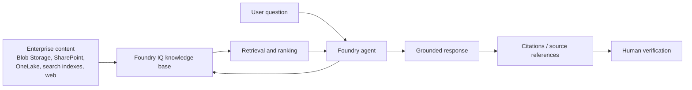

# 04. Ground Agent Responses in Enterprise Knowledge with Foundry IQ

## 1. Purpose and scope

An enterprise agent should not answer product, policy, or operational questions solely from model training data. It needs access to current, relevant organizational information, explicit retrieval behavior, and a way for users to verify the evidence behind an answer.

This chapter follows the Microsoft Learn material **“Build knowledge-enhanced AI agents with Foundry IQ.”** It covers the source's RAG overview, knowledge-base architecture, supported source patterns, retrieval instructions, Contoso product-catalog lab, and Python client integration with approval handling. The evaluation set and production checklist are additional engineering practices; they are not results reported by the transcript.

## 2. Architecture: from content to grounded response

Retrieval-augmented generation (RAG) allows an agent to retrieve relevant organizational content, add it as context, and generate a response informed by that evidence.



The RAG sequence is:

1. **Retrieve** content relevant to the question.
2. **Augment** the question with retrieved context.
3. **Generate** an answer using the question and context.

Foundry IQ is presented in the source as a managed knowledge platform for agents, built on Azure AI Search. Knowledge bases are organized around business domains rather than technical storage locations—for example, “Product Documentation” rather than “Blob Container B.” Multiple agents in a project can share a knowledge base, while each agent is connected only to the knowledge it needs. Improving a shared knowledge base can benefit every connected agent.

The written learning material describes a managed path for discovery, content processing, chunking and embeddings, indexing, and updates when source documents change. The exact refresh behavior depends on the source connector and configuration; verify it rather than assuming all sources update instantly. Retrieval enables grounding, but does not guarantee correctness, completeness, or valid citations; those must be tested.

## 3. Knowledge sources and access patterns

The transcript describes indexed, direct, and real-time patterns across these source types:

| Source | Access pattern described | Typical fit |
|---|---|---|
| Azure AI Search index | Indexed | Existing indexes, custom ranking, filters, and search pipelines |
| Azure Blob Storage | Direct source integration; content is processed for retrieval | PDFs and other documents in blob containers |
| Web | Real-time search through Bing | Current public information; less control over returned sources |
| SharePoint Remote | Real-time queries | Current SharePoint content with Microsoft 365 governance |
| SharePoint Indexed | Indexed | Advanced search, custom analyzers, and custom pipelines |
| Microsoft OneLake | Direct source integration | Files and analytical or unstructured content in Microsoft Fabric |

A knowledge base can combine sources. Choose based on freshness, governance, search features, and where authoritative information lives. Remote SharePoint and indexed SharePoint are not interchangeable: they differ in freshness, maintenance, response time, and search customization.

The source highlights three retrieval-tuning techniques:

- **Scoring profiles / custom scoring** prioritize fields or attributes important to the business.
- **Semantic ranking** improves relevance by considering meaning and context beyond keyword overlap.
- **Custom analyzers** help process specialized formats and terminology, such as HTML, product codes, or technical language.

The written learning material also discusses filters, faceted navigation, multi-language support, query analysis, retrieval-strategy selection, relevance ranking, and source references for Azure AI Search-backed retrieval. It describes simple factual questions as candidates for keyword search and complex questions as potentially benefiting from semantic search and query expansion. Treat this as a description of platform capabilities, not a guarantee that every request will follow one fixed retrieval plan. Validate behavior with your own data and configuration.

## 4. Retrieval instructions are part of the agent contract

Connecting a knowledge base is not enough. Instructions should specify **when to retrieve**, **how to cite**, and **what to do when evidence is missing or ambiguous**.

A source-aligned pattern for a product agent:

```python
retrieval_instructions = """
You are a helpful assistant for Contoso outdoor camping and hiking products.

- Always search the connected knowledge base before answering questions
  about Contoso products or its catalog.
- Base product claims on retrieved documentation; do not guess.
- Cite the source documents used when citations are available.
- If relevant information is not found, say so clearly.
- If the question is ambiguous, ask a focused clarifying question.
"""
```

The lab tells the agent to always search for product questions, provide detailed and accurate information, cite sources, and acknowledge when relevant information is missing. The transcript's HR example is stricter: always search before answering, never answer from model knowledge, use a specified citation format, and provide a fixed fallback. The source's retrieval-testing section also recommends testing direct factual questions, synthesis across documents, questions outside the knowledge base, and ambiguous questions.

Descriptions on knowledge sources are useful context for agents deciding which source to use. Keep names and descriptions meaningful, and make instructions explicit about the agent's domain, when retrieval is required, citation expectations, and fallback behavior.

Instructions express desired behavior; they do not replace authorization controls or evaluation.

## 5. Lab path: Contoso product knowledge

The source lab demonstrates this sequence:

1. Create a Microsoft Foundry project and product-expert agent.
2. Add retrieval and citation instructions.
3. Create or connect an Azure AI Search resource for Foundry IQ.
4. Create an Azure Storage account and a `contosoproducts` container.
5. Upload the three sample Contoso product PDFs.
6. Create a Foundry IQ knowledge base backed by Blob Storage. In the source lab, the knowledge source is named `ks-contosoproducts`, uses the `contosoproducts` container, API-key authentication, minimal content extraction, and the available embedding and chat-completion deployments (the transcript gives `text-embedding-3-small` and `gpt-5` as likely examples).
7. Save the knowledge base and verify its status becomes active. The lab also configures key authentication for the connected Azure AI Search resource; follow the current portal instructions for the resource and SDK version in use.
8. Attach it to the agent and test in the Foundry playground.
9. Connect to the agent from Python using the project endpoint and agent name.
10. Test retrieval and conversation behavior, then clean up lab resources to avoid unnecessary charges.

The playground questions include:

- “What types of tents does Contoso offer?”
- “Tell me about which backpacks are available in XL.”
- “What camping accessories are available?”

The programmatic exercise adds questions about product categories, tent weatherproofing, backpack comparisons, accessories, and a price follow-up. These test direct facts, attributes, cross-document synthesis, recommendations grounded in catalog content, and conversational context.

The starter client uses `DefaultAzureCredential` with environment and managed-identity credential sources excluded, creates an `AIProjectClient` from the project endpoint, gets the agent by name, and creates a server-side conversation. It also maintains a local conversation-history list for display. Keep credentials and endpoints in configuration rather than source code, and use the credential chain appropriate to the target environment.

### Programmatic integration and approvals

The Python client connects to the project, obtains the OpenAI client and agent, creates a conversation, sends messages, and reads responses. The lab configures the Foundry IQ knowledge tool to require approval through the Foundry Toolkit for VS Code extension.

Source-specific details:

- The portal-created knowledge tool runs without approval by default.
- The lab changes approval behavior through the VS Code extension; the written material says the portal does not expose that setting.
- The client handles `mcp_approval_request` output items and sends `mcp_approval_response` items with the corresponding request ID and approve/deny decision.
- The sample loops until no pending approval requests remain. It must handle no request, one request, or multiple requests.
- The written lab warns that agents may also list Web Search or a standalone Azure AI Search tool. Configure approval on the actual Foundry IQ knowledge-base tool (`kb-knowledgebase...`) if the goal is to control knowledge lookups.

SDK calls, tool names, and preview-era behavior are version-sensitive. Verify them against the SDK and API version used by your project.

## 6. A small grounded-answer evaluation set

A successful demo response is not evidence of reliable retrieval. Define expected evidence before running each query and inspect the retrieved source, not just whether the answer sounds plausible.

| ID | Query | Expected behavior | Pass criteria |
|---|---|---|---|
| E1 — Basic fact | “What types of tents does Contoso offer?” | Retrieve catalog evidence and summarize categories | Each named category is supported by a source |
| E2 — Attribute | “What weatherproof features do the tents have?” | Retrieve relevant tent documentation | Features and qualifications match the document |
| E3 — Product filter | “Which backpacks are available in XL?” | Find size-specific details | Products and sizes are explicitly supported |
| E4 — Synthesis | “What is the difference between daypacks and expedition backpacks?” | Retrieve evidence about both types | Comparison is relevant and sources support both sides |
| E5 — Missing evidence | Ask for a specification absent from the PDFs | State that current documentation does not contain the answer | No invented value; clear fallback |
| E6 — Ambiguous | “Which one is best?” without product/use-case context | Ask a clarifying question unless context resolves it | No unsupported assumption |
| E7 — Follow-up | After discussing a product, ask “How much do those items typically cost?” | Preserve context and retrieve price evidence if available | Correct referent; no invented prices |

For each test, record the query, answer, retrieved source or citation, approval decision where relevant, and pass/fail outcome. Assess:

- **Grounding:** Are factual claims supported by retrieved content?
- **Citation validity:** Does the cited source support the adjacent claim?
- **Relevance:** Does the evidence answer the question asked?
- **Completeness:** Are all requested parts and qualifications covered?
- **Abstention:** Does the agent acknowledge missing evidence rather than guessing?
- **Conversation fidelity:** Does a follow-up resolve to the intended prior context?

A citation being present is not enough. Open or inspect the referenced document and verify that it supports the claim. The transcript says citations or source references **may** appear in observed responses; it does not guarantee that every response has a clickable citation. If structured citation metadata is unavailable, record the limitation instead of treating a filename or link alone as proof.

## 7. Source verification and production boundaries

The video walkthrough notes that its displayed PDF link would fail for an unauthenticated user because the underlying blob was not publicly accessible. A reference can identify the source correctly while the user-facing link still fails due to access configuration. Do not make private documents public merely to make citations clickable; verify identity, authorization, and the intended access experience.

Additional production checks:

- **Access boundaries:** Confirm users can retrieve only content they are authorized to see, and verify how the selected connector applies identity and source permissions. Do not assume every connector enforces permissions in the same way; the source specifically contrasts SharePoint Remote, which it says respects SharePoint permissions, with SharePoint Indexed, where permissions are configured during indexing.
- **Freshness:** Define expected indexing or refresh latency and test after documents change. Real-time access and indexed access have different freshness and maintenance trade-offs.
- **Data quality:** Review duplicates, obsolete policies, conflicting documents, and unclear ownership.
- **Failure behavior:** Test unavailable sources, empty retrieval, denied approvals, and inaccessible references.
- **Observability:** Track retrieval failures, citation rates, fallback rates, latency, feedback, and recurring unanswered questions.
- **Change management:** Re-run the evaluation set after changing instructions, sources, indexing settings, or model configuration.

These are production recommendations extending the lab, not claims that the transcript implements every control.

## 8. Common failure modes

- **The agent answers from general knowledge:** strengthen retrieval instructions and check whether the knowledge tool was invoked.
- **The answer sounds plausible but is unsupported:** inspect evidence and enforce missing-evidence fallback behavior.
- **A citation does not support its claim:** verify citation-to-claim alignment, not merely citation presence.
- **The wrong document is retrieved:** review source coverage, terminology, metadata, analyzers, semantic ranking, and scoring profiles.
- **Data is stale:** check the source access pattern and refresh/indexing behavior.
- **A source link fails:** distinguish source attribution from permission to open the source.
- **Approval never appears:** inspect approval settings on the actual knowledge-base tool, not an unrelated tool.
- **Follow-ups lose context:** verify conversation ID reuse and test multiple turns in one conversation.
- **A demo is mistaken for evaluation:** run a fixed test set and compare results across changes.

## 9. Transcript comparison and coverage

This chapter preserves the source's main progression:

- Why RAG is needed for current, private, organization-specific information.
- Foundry IQ as shared knowledge infrastructure for multiple agents.
- Indexed, direct, and real-time source patterns: Azure AI Search, Blob Storage, Web, SharePoint Remote, SharePoint Indexed, and OneLake.
- Retrieval tuning through scoring profiles, semantic ranking, and custom analyzers.
- Instructions for when to retrieve, how to cite, and what to do when evidence is missing.
- The Contoso product-PDF setup and playground queries.
- Python client integration, conversation history, and MCP approval request/response handling.
- Source-link accessibility and resource cleanup.

The evaluation set, scoring rubric, production checklist, and failure-mode analysis are **engineering additions**. They turn the source's suggested response review into repeatable validation without implying that the transcript supplies measured benchmark results.

### Source caveats

- The file contains both video narration and written learning content; some setup details are more explicit in the written lab.
- Resource creation depends on region and model availability; SDK and preview tool behavior may change.
- The source says citations may appear, so citation format and click-through behavior need verification in the target configuration.
- The lab uses API-key authentication for the Blob Storage knowledge source and a Search resource key, and instructs learners to enable the required Search API access setting. These are lab-specific setup choices, not a blanket recommendation for production credential management.
- The written lab specifies model names as examples of what may be available (“likely” deployments); model availability varies by region and project.
- The transcript prerequisites mention Python 3.13 and specifically say Python 3.14 is unsupported by some dependencies at the time of the lab. Confirm current dependency compatibility before creating the environment.
- Three sample PDFs are a demonstration dataset, not evidence of quality over large or heterogeneous enterprise corpora.

## 10. What changed in this review

The first draft covered the requested architecture, source types, agent instructions, lab flow, approval behavior, and evaluation set, but it compressed some source details and could make the line between platform behavior and recommendations clearer. This revision tightens that boundary and adds:

- The business-domain knowledge-base model and shared use across agents.
- The written material's content processing and retrieval-tuning details, with caveats against assuming deterministic behavior.
- More of the actual lab configuration: knowledge-source name, container, extraction mode, example model deployments, Search resource key setup, and active-status check.
- The client's credential selection, agent lookup, server-side conversation, and local conversation history.
- The transcript's contrast between SharePoint Remote and Indexed permission/freshness behavior.
- Python-version and model-availability caveats, plus a specific Microsoft Learning repository reference instead of a generic Learn homepage.

The evaluation set, scoring rubric, and production recommendations remain clearly labeled as additions. They are not represented as measurements or features implemented by the transcript.

## 11. Completion checklist

- [ ] Knowledge base is active and connected to the intended agent.
- [ ] Source documents and access permissions are verified.
- [ ] Instructions define retrieval, citation expectations, and missing-evidence behavior.
- [ ] Basic fact, attribute, synthesis, out-of-scope, ambiguous, and follow-up queries are tested.
- [ ] Retrieved documents support the answer's factual claims.
- [ ] Citation targets are checked for correctness and access behavior.
- [ ] Approval behavior is verified on the actual knowledge-base tool, if required.
- [ ] Results and failures are recorded in the evaluation set.
- [ ] Monitoring and re-evaluation are planned for production changes.
- [ ] Lab resources are deleted when no longer needed.

## Further reading

- [Microsoft Learning lab repository — `mslearn-ai-agents`](https://github.com/MicrosoftLearning/mslearn-ai-agents)
- [Microsoft Foundry portal](https://ai.azure.com/)
- [Azure AI Search documentation](https://learn.microsoft.com/azure/search/)
- [Microsoft Foundry documentation](https://learn.microsoft.com/azure/ai-foundry/)

> **Enterprise AI Engineering Handbook**
>
> *Building Production-Grade Enterprise AI Systems — One Chapter at a Time.*
