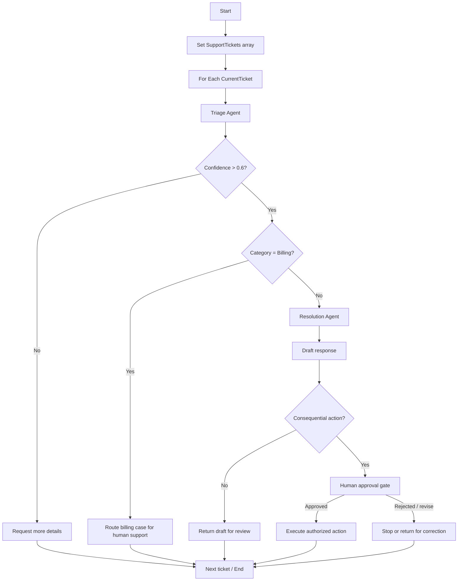

# 05. Orchestrating AI Agents with Microsoft Foundry Workflows

A capable agent can classify a request, use tools, or draft a response. But when a business process must execute several steps in a defined order, branch on a result, process a collection, or pause for review, prompt instructions alone are not a reliable control plane.

Microsoft Foundry workflows provide a visual, declarative way to coordinate agents with explicit control flow. A workflow connects execution nodes, passes data through variables, evaluates conditions, and can include user interaction. The supplied Microsoft Learn module demonstrates these ideas through a customer-support triage workflow and then shows how to invoke a workflow from Python.

This chapter explains the workflow model, reconstructs the ContosoPay example, and adds clearly marked production considerations for teams integrating workflows into enterprise applications.

## 1. Why use a workflow instead of putting everything in one agent?

The source presenter highlights a common design trap: as instructions accumulate more nested rules—“if this happens, do that; otherwise do something else”—the agent is being asked to behave like a deterministic logic engine. Language models are useful for interpretation and generation, but complex branching is often easier to understand and validate when represented explicitly.

A workflow separates responsibilities:

- **Agent reasoning:** interpret a ticket, classify an issue, or draft a response.
- **Control flow:** decide which step executes next.
- **Data transformation:** store, parse, or reset values passed between steps.
- **Human interaction:** request more information or escalate a decision.
- **Application integration:** invoke the workflow and consume its result from code.

This is not a requirement to split every task into multiple agents. Start with the simplest design that makes the business rules observable and testable. A single agent with a tool can remain appropriate when the task does not need explicit multi-step orchestration.

## 2. The workflow execution model

A workflow is a graph of nodes connected by edges. The node performs work; the edge determines where execution proceeds.

### Nodes / executors

The learning module describes each node as an executor with a particular responsibility. Common node families include:

| Node family | Role | Examples in the module |
|---|---|---|
| Invoke | Run an agent and capture its output | Triage agent, resolution agent |
| Flow | Control the next execution path | If/Else, Go To, For Each |
| Data transformation | Store or reshape data | Set Variable, Reset Variable, Parse Value |
| Basic chat | Communicate with the user | Deliver a message or ask a question |
| End | Finish the workflow | Return a final result or status |

The workflow builder also uses variables to pass values between nodes. Agent output can be saved as message text and, when a structured response format is configured, as a JSON object for downstream conditions.

### Edges and control flow

The source describes several ways to connect steps:

- **Direct edge:** always continue to the next node.
- **Conditional edge:** follow a path only when a condition is true.
- **Switch-style branching:** select among multiple possible outcomes.
- **For Each / fan-out and fan-in:** repeat work across a list, potentially distributing work and then collecting results where the workflow pattern supports it.

The visual layout helps developers inspect the intended execution path, but the layout itself is not the specification. Review the configured conditions, variable mappings, and node settings as well as the canvas.

### Power Fx expressions

The module introduces Power Fx as the expression language used to manipulate values and evaluate workflow conditions. Expressions connect structured agent output to deterministic control flow. For example, the lab checks whether a triage confidence value exceeds `0.6`, and separately checks whether the category equals `Billing`.

Treat expressions as business logic: name variables clearly, check that the referenced fields exist, and test boundary cases such as a score equal to the threshold or an unexpected category.

## 3. Choose a workflow pattern deliberately

The source material describes three recurring patterns.

### Sequential workflow

Steps execute in a defined order, with earlier outputs passed to later steps. It fits pipelines such as classify → enrich → draft → review. This is usually the easiest pattern to debug because the expected path is explicit.

### Human-in-the-loop workflow

The workflow performs automated work and then pauses to request input, confirmation, or approval. Use it when missing context, low confidence, or the impact of an action means that fully automatic continuation is inappropriate. A human-review step should be a real control boundary, not just a message that says a human will be involved.

### Group chat workflow

An orchestrator coordinates multiple agents and determines which participant should contribute. This supports more dynamic collaboration than a fixed sequence. It also introduces coordination complexity, so use it when distinct agent roles or context boundaries provide a measurable benefit.

These patterns are not interchangeable. Prefer a sequential workflow for predictable pipelines, human review for explicit oversight, and group chat when the process genuinely benefits from dynamic multi-agent collaboration.

## 4. Worked architecture: ContosoPay support-ticket triage

The Microsoft Learn lab uses three sample tickets for a fictional payments and invoicing platform:

1. An API returns a 403 error when creating invoices.
2. A user asks how to export invoices as CSV.
3. A customer reports a duplicate charge and duplicate receipts.

The workflow initializes an array of tickets, iterates through each ticket, classifies it, checks confidence, routes billing cases to human support, and drafts a response for confident non-billing cases.



### Step A — Initialize and iterate

A `Set Variable` node creates `Local.SupportTickets`, containing the sample ticket strings. A `For Each` node iterates over that array and assigns each item to `Local.CurrentTicket`.

The loop makes the unit of processing explicit: each ticket goes through the same triage and routing logic. In a real application, the array would normally come from an input payload, queue, database, or service rather than being hard-coded in the workflow.

### Step B — Classify with a structured result

The Triage Agent must classify each ticket into exactly one of three categories:

- `Billing`: charges, refunds, duplicate payments, or incorrectly charged invoices.
- `Technical`: API errors, integrations, webhooks, or platform behavior.
- `General`: how-to questions, feature availability, data exports, reports, or UI navigation.

The lab includes an important disambiguation rule: questions about exporting, viewing, or downloading invoices are `General`, not `Billing`; billing applies when money was charged or paid incorrectly.

The agent is configured with a strict JSON Schema containing `customer_issue`, `category`, and `confidence`. The schema requires all three properties and disallows additional properties. The workflow saves both the agent's output text (`TriageOutputText`) and structured object (`TriageOutputJson`). The text can be passed to a later agent, while the JSON fields are used by workflow logic.

Illustrative schema shape from the lab:

```json
{
  "type": "object",
  "properties": {
    "customer_issue": { "type": "string" },
    "category": { "type": "string" },
    "confidence": { "type": "number" }
  },
  "additionalProperties": false,
  "required": ["customer_issue", "category", "confidence"]
}
```

The source lab's schema also supplies a name and strict-mode setting in the Foundry response-format configuration. Follow the schema format expected by the current Foundry interface rather than assuming this abbreviated shape can be pasted unchanged into every SDK or API.

**Architecture point:** structured output is an interface contract between probabilistic reasoning and deterministic workflow logic. It reduces ambiguity, but it does not prove the classification is correct. Validate values and test classification quality separately.

### Step C — Branch on confidence

The first `If/Else` node evaluates:

```text
Local.TriageOutputJson.confidence > 0.6
```

If the condition is false, the workflow delivers a message asking for more details about the issue. If true, the workflow continues to category-based routing.

The value `0.6` is a demonstration threshold, not a universally appropriate production threshold. Calibrate a threshold against representative tickets and the cost of misrouting. Also decide what should happen when confidence is missing, malformed, or outside the expected range.

### Step D — Route billing cases

A second condition checks whether:

```text
Local.TriageOutputJson.category = "Billing"
```

The lab's intended behavior is to escalate billing cases and keep them out of the automated response path. Confident Technical and General cases proceed to the Resolution Agent.

A message saying “escalating to humans” is a teaching demonstration of the branch; the lab does not implement an actual human-approval interaction or a downstream case-management integration. In production, escalation should create or update a real case, queue item, or task through an authorized tool/API, and the workflow should capture the operation's result. Do not claim that a ticket was escalated unless the downstream operation succeeded.

### Add an explicit human-review gate before consequential actions

**Scope extension / production design:** the source introduces human-in-the-loop workflows as a pattern, but the ContosoPay exercise does not build an approval gate before executing a consequential operation. Treat the following as an architecture pattern to implement and verify in the current Foundry workflow capabilities—not as a claim that the lab already contains these nodes.

For actions such as issuing a refund, changing account permissions, publishing content, or sending a binding customer commitment, separate *drafting or recommending* from *executing*. The workflow should:

1. Prepare a proposed action and a compact review package (request context, evidence, proposed action, and expected impact).
2. Pause for an identified human reviewer to approve, reject, or request changes.
3. Resume only after an explicit approval decision has been received and validated.
4. Invoke the authorized business API only on the approved path; enforce authorization again at the service boundary.
5. Record the decision and operation outcome, including rejection, timeout, or downstream failure.

A workflow message that says “sent for approval” is not itself approval, and an agent's confidence score is not authorization. If the deployed workflow pattern cannot reliably pause and resume with a recorded decision, implement the approval boundary in the calling application or an established workflow/approval service instead. Confirm the current Foundry interface and runtime behavior before choosing the implementation mechanism.

### Step E — Draft a response

The Resolution Agent receives the triage output text and drafts a concise response. The lab's instructions include category-specific guidance, a calm and professional tone, a short response for General issues, and a rule not to request credentials, logs, or sensitive information from customers.

Its output is saved to `Local.ResolutionOutputText`. The workflow then continues through the remaining tickets. This separation makes the triage result and response-generation responsibility independently inspectable.

## 5. Build and maintain workflows in Foundry

The lab creates a blank workflow in the Microsoft Foundry portal, adds nodes from the visualizer, configures variables and agent settings, saves the workflow, and previews it with an input such as `Start processing support tickets`.

Important operational details called out by the source:

- Give the workflow a meaningful name so code can reference it.
- Save changes explicitly; the workflow designer does not automatically save every change.
- Inspect intermediate messages and branch behavior in Preview before integrating the workflow into an application.
- The lab describes the workflow builder as a preview feature, so behavior and interface details may change.
- The learning material mentions maintaining workflows with versioning, notes, and visual/YAML representations. Confirm the current portal's available controls before depending on a particular export or lifecycle operation.

Before treating a workflow as deployable, review the full path for every branch—not just the successful path. Check variable names, agent input/output mappings, condition expressions, and the final result delivered to the caller.

### A practical execution and debugging loop

Use a repeatable debugging sequence rather than relying on the final chat response alone:

1. **Save and preview:** run one known input and confirm the expected nodes execute.
2. **Inspect the path:** check intermediate agent output, variables, and the condition that selected each branch.
3. **Exercise both outcomes:** test true and false branches, including the confidence boundary (`0.6` for the lab's strict `> 0.6` condition).
4. **Check the data contract:** verify that the structured response contains the expected fields and values before downstream conditions consume them.
5. **Observe streamed events:** the module describes `response.completed` and `response.output_item.done` events, including workflow-action status where available. Capture enough identifiers to correlate a run with the originating business request.
6. **Test failures and recovery:** inspect behavior for agent errors, malformed output, timeouts, and a downstream operation that fails after a branch has been selected.
7. **Repeat after changes:** save the workflow and rerun the same small test set after modifying nodes, instructions, schemas, or expressions.

The transcript describes listening for workflow-start, node-output, and error events conceptually; the code example in the written lab specifically handles completion and workflow-action events. Do not assume every event is exposed in every SDK version without checking the current runtime documentation.

## 6. Invoke a workflow from Python

The lab demonstrates invoking a named workflow through the Azure AI Projects SDK and the OpenAI-compatible client returned by the project client. The key sequence is: authenticate, create the project client, create a conversation, invoke the workflow using an agent reference, process the stream, and clean up the conversation.

The source's core invocation pattern is:

```python
from azure.identity import DefaultAzureCredential
from azure.ai.projects import AIProjectClient

with (
    DefaultAzureCredential() as credential,
    AIProjectClient(
        endpoint=endpoint,
        credential=credential,
    ) as project_client,
    project_client.get_openai_client() as openai_client,
):
    conversation = openai_client.conversations.create()

    stream = openai_client.responses.create(
        conversation=conversation.id,
        extra_body={
            "agent_reference": {
                "name": "ContosoPay-Customer-Support-Triage",
                "type": "agent_reference",
            }
        },
        input="Start",
        stream=True,
    )

    for event in stream:
        if event.type == "response.completed":
            response = openai_client.responses.retrieve(event.response.id)
            print(response.output_text)

    openai_client.conversations.delete(
        conversation_id=conversation.id
    )
```

This is an abbreviated illustration of the lab's flow, not a guarantee that the exact imports, workflow reference format, or SDK signatures will remain unchanged across package versions. Use the current starter repository and Foundry-generated configuration for the target environment. The lab uses `DefaultAzureCredential`, an existing Foundry project endpoint, and a workflow name that must match the saved workflow.

### Streaming and event handling

The module also demonstrates processing stream events to observe completion and workflow-action status. Common events described include `response.completed` and `response.output_item.done`. Streaming can support progress indicators, intermediate output, and user interfaces that need to reflect workflow execution as it happens.

For an application integration, handle more than the happy path:

- Surface a clear failed or incomplete state if the workflow errors or ends unexpectedly.
- Treat streamed agent text as untrusted output until it passes the application's normal validation and policy checks.
- Correlate a workflow run with the business request and retain useful diagnostic identifiers.
- Close clients and conversations according to the SDK's current lifecycle guidance.
- For human-in-the-loop workflows, implement the required pause, response, and resume behavior; a simple completion-only loop is not sufficient for every workflow pattern.

## 7. Testing the workflow as a business process

A workflow can execute without being correct. Test its routing decisions and externally visible effects with a small, repeatable evaluation set.

| Test case | Expected behavior | What to verify |
|---|---|---|
| API 403 during invoice creation | Technical path if confidence clears threshold | Category, confidence, and response branch |
| Export invoices as CSV | General path | The explicit export-versus-billing rule is followed |
| Duplicate charge | Billing escalation path | Automated resolution is bypassed |
| Ambiguous issue description | Low-confidence branch when appropriate | More information is requested; no invented resolution |
| Confidence exactly `0.6` | False branch under the lab's `> 0.6` condition | Threshold boundary behaves as configured |
| Unexpected category or missing field | Controlled failure or safe fallback | Workflow does not silently route invalid data as normal |
| One ticket fails mid-loop | Defined error behavior | Other tickets and overall run status match requirements |

Measure at least two different things: **classification quality** (whether the agent categorized the ticket correctly) and **workflow correctness** (whether the right branch and action followed). A correct branch based on a wrong classification is still a failed business outcome.

For any branch that triggers a consequential operation, test the downstream tool's failure, timeout, duplicate invocation, and retry behavior. The source lab's escalation message is not a substitute for verifying a real escalation integration.

## 8. Production architecture considerations

The following points extend beyond the lab and are practical design guidance, not claims that the source exercise implements them.

### Keep policy and authorization outside the model

An agent may recommend a category or next step, but trusted application logic should decide whether a requested action is permitted. Enforce authorization in the API or service that performs the action, not only in the prompt or workflow condition.

### Make side effects safe to retry

Workflow runs can fail after a downstream service has completed an operation but before the workflow records success. Use idempotency keys or business-level deduplication for actions such as creating a support case, issuing a refund, or sending a customer message. Retry only when the operation's semantics make it safe.

### Design explicit failure paths

Define behavior for agent timeouts, malformed structured output, missing variables, unavailable downstream services, and partial completion of a loop. A workflow should distinguish “completed successfully,” “completed with items needing review,” and “failed,” instead of collapsing every outcome into a normal response.

### Observe the path, not only the final answer

Capture workflow/run identifiers, node-level outcomes where available, branch decisions, latency, tool/service errors, and escalation outcomes. Avoid logging secrets or unnecessary customer data. Track metrics such as classification accuracy, low-confidence rate, human-escalation rate, completion rate, latency, and cost per processed ticket.

### Version workflow and agent contracts together

A change to the triage JSON schema can break a condition or a downstream agent input. Treat workflow configuration, agent instructions, response schemas, and test cases as a versioned unit. Re-run evaluations when any of them changes, and confirm the deployed workflow name/version or reference resolves to the intended configuration.

### Keep human review meaningful

Route high-impact or uncertain cases to a real reviewer with sufficient context and an explicit approve/reject or revise action. Make it clear whether a workflow is waiting, rejected, resumed, or timed out. Human review should not be bypassed simply because an agent emits a confident score. The source's ContosoPay lab only demonstrates a billing-escalation message; a real approval gate is an additional design requirement, not a completed lab feature.

## 9. Common failure modes

- **Too much branching in one agent prompt:** move stable business routing into explicit workflow conditions.
- **Free-form output used as a control signal:** prefer structured output and validate the required fields and allowed values.
- **Threshold chosen arbitrarily:** evaluate the threshold against representative cases and business risk.
- **Variable mapping is wrong:** inspect each agent node's input and output settings, not only its instructions.
- **Escalation is only text:** connect the branch to a real, authorized escalation mechanism and verify its result.
- **A preview works but the client fails:** verify project endpoint, authentication, package versions, workflow name/reference, and SDK contract.
- **No test for the false branch:** explicitly test low confidence, missing data, and condition boundaries.
- **No lifecycle cleanup:** close clients and delete temporary conversations/resources as appropriate; remove lab resources when finished to avoid unnecessary cost.

## 10. Architecture takeaway

Foundry workflows are most useful when a business process needs visible, repeatable control flow around AI reasoning. Agents handle interpretation and generation; variables carry data; conditions and loops determine execution; human-in-the-loop steps provide oversight; and application code integrates the workflow into a larger system.

The ContosoPay lab demonstrates the key pattern: **collect → iterate → classify with structured output → check confidence → route → draft or escalate**. For production, preserve that separation, add real downstream actions and explicit failure behavior, and test both the agent's decisions and the workflow's response to those decisions.

## Source alignment and caveats

This chapter is based on the supplied Microsoft Learn transcript/module, **“Build agent-driven workflows using Microsoft Foundry.”** The lab covers the Foundry visual workflow designer, sequential/human-in-the-loop/group-chat patterns, executors and edges, variables, structured agent output, Power Fx conditions, loops, preview, and invocation from Python using the Azure AI Projects SDK.

The supplied learning material labels the workflow builder as preview and notes that unexpected behavior or errors may occur. Python/package requirements and SDK signatures can change. The code above follows the source's integration shape but has not been independently executed against a pinned SDK version and live Foundry project; validate it in your environment before adopting it. The sample support tickets and agents are instructional examples, not a complete production support system. The human-approval gate described in this chapter is an explicit architecture extension: the source discusses human-in-the-loop workflows generally, but the ContosoPay lab does not implement a pause/approve/resume step before a consequential action.

## Further reading

- [Microsoft Foundry](https://ai.azure.com/)
- [Microsoft Learn: Develop AI agents in Azure](https://learn.microsoft.com/training/)
- [Microsoft Learning repository: mslearn-ai-agents](https://github.com/MicrosoftLearning/mslearn-ai-agents)

---

> **Enterprise AI Engineering Handbook**
>
> *Building Production-Grade Enterprise AI Systems — One Chapter at a Time.*
