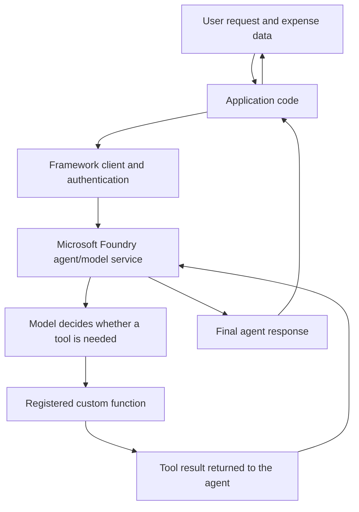

# 06. AI Agents with Agent Framework

## 1. Why code-first agent development?

Visual designers and low-code experiences are useful for quickly exploring an agent, configuring its behavior, and validating an idea. Code-first development becomes important when the application needs normal software-engineering practices: source control, reusable modules, automated tests, dependency management, code review, and integration with existing services.

The Microsoft Agent Framework provides a programming abstraction for creating agents, connecting model clients, registering tools, and managing interactions. The supplied Microsoft Learn module presents it as the next-generation framework that brings together ideas from Semantic Kernel and AutoGen. Its key benefit for this chapter is that application code can define an agent and its capabilities without manually implementing the full model-to-tool dispatch loop.

This chapter follows the supplied module, **“Develop an AI agent with Microsoft Agent Framework.”** Its hands-on example processes expense data and uses a custom function to compose an expense-claim email. The lab's email function prints the message to the console; it does not send a real email.

## 2. The architecture

A code-first agent still depends on the same core boundaries as other agent applications:



The framework manages the tool-call cycle: the model can request a registered function, the framework invokes it, and the function result is made available for the model to produce a response. This removes the need for application code to manually inspect each tool call and dispatch it to the right function.

It does **not** remove the need to design the function safely. Authentication, authorization, input validation, side-effect control, error handling, and observability remain application responsibilities.

## 3. Core building blocks

| Building block | Responsibility |
|---|---|
| Project endpoint and model deployment | Identify the Foundry project and model deployment the application should use. |
| Credential | Obtain a token for the configured service. The lab uses Azure CLI authentication for local development. |
| Client/provider | Connect the framework to the selected model and service. |
| Agent | Combine the client, instructions, and registered tools into one callable unit. |
| Tool function | Implement a bounded operation the model may request. |
| Session/thread or conversation state | Preserve context across turns where the selected provider and API support it. |
| Application entry point | Gather inputs, call the agent, present the result, and handle failures. |

The framework also supports provider abstraction. The module describes a consistent agent interface that can reduce coupling to a particular model provider. Provider flexibility is useful, but it does not mean every provider supports every hosted tool or service feature. Validate feature support and behavior for the actual provider and deployment you choose.

## 4. How this differs from Chapter 01

Chapter 01 and this chapter both build and test a single agent, but they emphasize different development boundaries.

| Dimension | Chapter 01 — Build and Test a Single Agent with Microsoft Foundry and VS Code | Chapter 06 — AI Agents with Agent Framework |
|---|---|---|
| Primary approach | Configure an agent in the Foundry experience, then inspect and call the saved agent from Python. | Define the agent and its custom tool in application code. |
| Example | Contoso IT Support Agent using File Search and Code Interpreter. | Expense-claim agent using one custom Python function. |
| Where behavior is configured | The saved agent configuration owns its instructions, model, and hosted tools; the client calls that configured agent. | The code supplies the client, instructions, and registered tool function. |
| Tool execution | The example uses provider-hosted File Search and Code Interpreter. | The framework dispatches a model-requested call to the registered `submit_claim` function. |
| Conversation handling | The client workflow demonstrates conversations through the Foundry/Projects API; details depend on that API. | The module introduces an agent thread/session as the object that holds conversation messages and state. |
| Main engineering lesson | Version and test the saved configuration; ensure the client calls the intended agent. | Keep tool contracts and business rules in code; understand the chosen provider's thread and persistence behavior. |

**The distinction is not “portal versus no portal.”** Both approaches rely on a configured service, identity, and permissions. The difference is where the agent behavior and tool definitions are expressed and how directly the application owns their lifecycle. Choose based on governance, reuse, testability, required tools, and provider capabilities—not on the assumption that one approach is universally better.

## 5. Connect to Microsoft Foundry

The supplied exercise uses a Foundry project endpoint and a model deployment name stored in environment variables. It authenticates locally with `AzureCliCredential`, which relies on an Azure CLI sign-in.

Example environment configuration:

```dotenv
PROJECT_ENDPOINT=https://<your-foundry-project-endpoint>
MODEL_DEPLOYMENT_NAME=<your-model-deployment-name>
```

Do not commit real endpoints, credentials, secrets, or environment files containing sensitive configuration to source control. Keep environment-specific settings outside the application code.

The written lab uses `FoundryChatClient`. The video walkthrough also shows a provider-specific Azure OpenAI Responses client. These are different client examples from the source material; do not combine their constructors or assume their APIs are interchangeable. Use the client and package versions documented for the exact exercise or application you are implementing.

### Local authentication versus deployed authentication

The lab uses `AzureCliCredential` for a developer workstation. The transcript explicitly notes that this credential is not appropriate as-is inside a web application. For a deployed Azure workload, use an identity strategy designed for that environment—commonly a managed identity—and grant it only the required access. Do not ship a developer's CLI credentials with an application.

## 6. Create a custom tool

The example uses a tool function named `submit_claim`. Its parameters are annotated so the framework can expose meaningful input descriptions to the model. The framework can derive a tool schema from the function signature and annotations.

The lab's function simulates email submission by printing the recipient, subject, and body:

```python
from typing import Annotated

from agent_framework import tool
from pydantic import Field


@tool(approval_mode="never_require")
def submit_claim(
    to: Annotated[str, Field(description="Who to send the email to")],
    subject: Annotated[str, Field(description="The subject of the email")],
    body: Annotated[str, Field(description="The text body of the email")],
):
    """Print an expense-claim email for the demo."""
    print(f"\nTo: {to}")
    print(f"Subject: {subject}")
    print(body, "\n")
```

The `approval_mode="never_require"` setting is used by the supplied demo because the function only prints output. It is **not** a safe default for consequential operations. If a tool sends messages, transfers money, changes records, or performs another consequential action, design explicit authorization and approval controls appropriate to the risk.

A useful tool contract has three properties:

- **Clear purpose:** the function description tells the model when it should be used.
- **Understandable parameters:** types and descriptions make valid arguments easier to construct.
- **Bounded behavior:** the function performs one well-defined operation and does not silently take on unrelated responsibilities.

The model proposes tool use; it is the framework that invokes the registered function. Application code must still validate business rules and enforce permissions independently of the model's decision.

## 7. Create and invoke the agent

The written lab's core implementation uses `FoundryChatClient`, registers the `submit_claim` tool, provides instructions, and invokes `agent.run`. The following is a compact example of that structure. Adapt it to the exact package version and starter file supplied with your lab.

```python
import os
import asyncio

from agent_framework import Agent, tool
from agent_framework.foundry import FoundryChatClient
from azure.identity import AzureCliCredential
from pydantic import Field
from typing import Annotated


@tool(approval_mode="never_require")
def submit_claim(
    to: Annotated[str, Field(description="Who to send the email to")],
    subject: Annotated[str, Field(description="The subject of the email")],
    body: Annotated[str, Field(description="The text body of the email")],
):
    """Simulate submitting a claim by printing the email."""
    print(f"\nTo: {to}\nSubject: {subject}\n{body}\n")


async def main() -> None:
    client = FoundryChatClient(
        project_endpoint=os.environ["PROJECT_ENDPOINT"],
        model=os.environ["MODEL_DEPLOYMENT_NAME"],
        credential=AzureCliCredential(),
    )

    async with Agent(
        client=client,
        name="ExpenseClaimAgent",
        instructions=(
            "You are an assistant for expense-claim preparation. "
            "Use the supplied expense data to create an itemized claim "
            "with a total. Use submit_claim to print the draft email. "
            "Do not claim that an email was actually sent."
        ),
        tools=[submit_claim],
    ) as agent:
        expenses_data = (
            "2026-10-01, train ticket, 42.50; "
            "2026-10-02, client lunch, 28.00"
        )
        response = await agent.run(
            f"Prepare an expense claim from this data: {expenses_data}"
        )
        print(response)


if __name__ == "__main__":
    asyncio.run(main())
```

This example illustrates the architecture, not a guarantee that the snippet runs unchanged with every framework release. Confirm the installed SDK version and the corresponding API reference before implementation. The supplied lab also includes starter-file structure and exception handling that should be retained when completing that exercise.

### What happens during a run?

1. The application loads the project endpoint and model deployment configuration.
2. The credential obtains access to the configured service.
3. The client connects the framework to the Foundry-backed model.
4. The agent receives instructions, the user's request, and the registered tool definitions.
5. The model decides whether the tool is needed and provides arguments.
6. The framework invokes `submit_claim` and returns its result to the agent's execution cycle.
7. The agent produces a final response, which the application displays.

The application does not implement its own tool-dispatch switch statement. That is the central code-first benefit demonstrated by the module.

## 8. Conversation state and multi-turn interactions

A single `agent.run(...)` call handles one request/response exchange. For multi-turn interactions, the module identifies an **agent thread** as the component that carries conversation messages and state. Reuse the same thread for turns belonging to the same conversation; use a different thread for an independent conversation.

The written lab's main code path invokes `agent.run(prompt_messages)` and does not explicitly demonstrate a reusable thread. The source material explains the thread concept and the video uses a different client/API example. The following illustrates the intended lifecycle; verify the thread-creation and `run` argument names against the installed Microsoft Agent Framework version before using it verbatim:

```python
# Illustrative multi-turn pattern — verify API names for your installed SDK.
thread = agent.get_new_thread()

first_response = await agent.run(
    "I need to prepare an expense claim.",
    thread=thread,
)
print(first_response)

follow_up_response = await agent.run(
    "Use the same claim context and summarize the next step.",
    thread=thread,
)
print(follow_up_response)
```

This snippet illustrates thread reuse, not a verified drop-in extension of the written lab. The provider's thread implementation determines whether history is stored remotely or locally:

- **Service-backed history:** the module describes Foundry Agent Service as storing conversation history server-side, which can support continuation across application restarts and scaled-out instances.
- **In-memory history:** for providers without service-side history, conversation state may live in the session object and generally will not survive process loss unless the application persists and restores it.

Do not assume that creating an `Agent` object alone gives your application durable user conversation state. Decide how a conversation is identified, how access to it is authorized, how long it is retained, and whether users can resume or delete it. Keep provider-specific session behavior visible in your application design and tests.

## 9. Test the agent as an application

The supplied exercise's happy path is to run the Python application, enter **“Submit an expense claim,”** and inspect the composed email output. Expand that check into a small repeatable test set before relying on the agent.

| Test | What to verify |
|---|---|
| Valid expense data | The output contains the supplied items and a correct total. |
| Empty or malformed data | The agent does not invent expense entries or report unsupported values as facts. |
| Ambiguous user request | The response follows the intended instructions and does not silently perform an unrelated action. |
| Tool invocation | The tool is called when appropriate and receives valid, understandable arguments. |
| Tool failure | The application surfaces a controlled error and does not claim success. |
| Authentication or quota failure | The application fails clearly and can be retried safely where appropriate. |
| Multi-turn request | Context is preserved only when a session/thread is intentionally reused. |

For deterministic business rules such as arithmetic, validate totals in ordinary application code rather than relying only on the language model. In production, also test authorization, duplicate submissions, timeouts, retry behavior, and the difference between a draft and a successfully completed external action.

## 10. Production design considerations

### Keep tools behind trusted application boundaries

A tool is executable code, not merely a prompt capability. Enforce access control and business constraints inside the function or downstream service. Never rely on agent instructions alone to prevent unauthorized actions.

### Treat side effects explicitly

The lab's `submit_claim` function prints a message and does not send email. If replacing it with a real email service, introduce explicit approval where warranted, idempotency or duplicate protection, delivery-status handling, and auditable records. Only report success after the downstream system confirms the operation.

### Add operational controls

For a production application, consider structured logs, request and correlation IDs, latency and token/cost metrics, tool-call outcomes, bounded timeouts, controlled retries, and tests that can run in CI. Avoid logging credentials or unnecessary personal/financial data from expense claims.

### Keep provider-specific behavior visible

The framework's abstraction can simplify provider changes, but hosted tools, authentication, state persistence, streaming, and response formats may differ. Encapsulate provider-specific configuration and test the behavior that your application depends on before changing providers.

## 11. Common mistakes

- **Using local CLI credentials in production:** use an identity model appropriate to the hosting environment.
- **Treating a printed email as a sent email:** distinguish simulated behavior from actual delivery.
- **Making a tool description vague:** document purpose and parameters so the model can select and call it reliably.
- **Trusting model-generated totals:** validate calculations with deterministic code.
- **Assuming every provider has identical capabilities:** verify the target provider's supported features and API surface.
- **Ignoring conversation lifecycle:** define how session IDs, history, retention, and user access are managed.
- **Copying code across SDK versions without checking:** align imports, client constructors, session APIs, and tool options to a pinned dependency set.

## 12. Chapter takeaway

Code-first development gives teams a maintainable software boundary around agent behavior. Microsoft Agent Framework lets developers define an agent, provide instructions, register typed tool functions, and delegate tool-call dispatch to the framework. The expense-claim exercise demonstrates this end-to-end path, while also showing why authentication, tool semantics, conversation state, and the difference between simulated and real side effects must be handled deliberately.

The next topic can build on this single-agent foundation by exploring **multi-agent orchestration**—and asking when sequential, concurrent, handoff, or group-chat patterns justify the added complexity.

## Source alignment and implementation notes

This chapter is based on the supplied Microsoft Learn transcript and written exercise, **“Develop an AI agent with Microsoft Agent Framework.”** The source demonstrates connecting to a Foundry project, creating an agent, registering a custom function, invoking the agent, and inspecting the composed expense-claim email. The lab's function prints the email to the console rather than sending it.

The video walkthrough and written lab use different client/API examples. This chapter calls out that difference instead of blending them into one purportedly identical implementation. The code here is an illustrative consolidation of the written lab's client and tool structure; it has not been independently executed against a pinned SDK version or a live Foundry project. Preview status, available model deployments, authentication requirements, and package APIs can change.

## Further reading

- Microsoft Learn module: **Develop an AI agent with Microsoft Agent Framework**
- Microsoft Agent Framework documentation and examples for the installed SDK version
- Microsoft Foundry documentation for project endpoints, model deployments, and identity configuration

> **Enterprise AI Engineering Handbook**
>
> *Building Production-Grade Enterprise AI Systems — One Chapter at a Time.*
