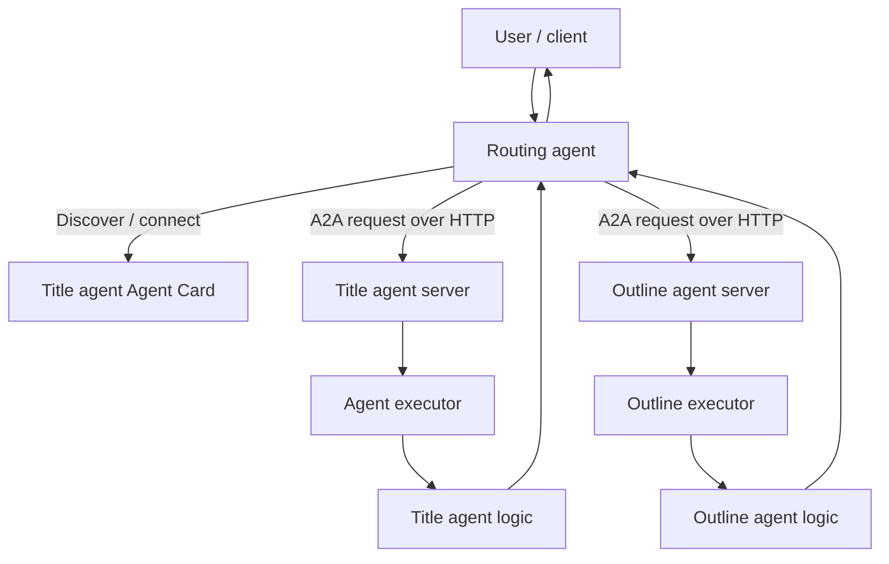

# 08. Connect Independently Hosted Agents with A2A

> Use A2A when an agent must discover and communicate with another agent across a service boundary—not merely call a local function or consume a tool.

## Overview

A2A is useful when agents are hosted, operated, or implemented independently. The **Agent-to-Agent (A2A) protocol** standardizes capability discovery, requests, and responses or task updates.

The supplied Microsoft Learn module demonstrates a technical-writing scenario: a **title agent** generates a headline, an **outline agent** expands it, and a **routing agent** coordinates remote calls. The lab exposes them as HTTP-accessible services but runs them together locally for development. This chapter distinguishes that demonstration from added production guidance.

## 1. When A2A is the right boundary

Choose the integration boundary based on what is being called and who owns it:

| Requirement | Starting point | Why |
|---|---|---|
| Run a bounded operation inside the application | Function/tool call | Lowest coordination overhead when the caller owns the implementation. |
| Reuse tools exposed by a tool server | MCP | Standardized discovery and invocation of tools. |
| Delegate work to a separately hosted agent | A2A | The remote endpoint exposes agent capabilities and handles agent-oriented requests. |
| Coordinate known steps, branches, and approvals | Workflow orchestration | Control flow is explicit and testable. |

A2A and MCP are not interchangeable. MCP focuses on tool access; A2A focuses on agent-to-agent communication and task-oriented interaction. A2A does not, by itself, decide which business actions are authorized or guarantee that a remote answer is correct.

## 2. Reference architecture



The routing agent coordinates without owning the title- or outline-generation logic. Each remote agent has its own logic and server boundary. `run_all.py` starts the components locally; the lab does not demonstrate deployment to separate organizations or cloud environments.

## 3. Agent Card: the discoverable contract

An **Agent Card** is metadata that tells clients and other agents what a remote agent does and how to connect to it. The module identifies these core fields:

- **Identity:** name, description, and version.
- **Endpoint:** the URL of the A2A service.
- **Capabilities:** supported protocol features, such as streaming or push notifications.
- **Input/output modes:** supported media types, such as text.
- **Skills:** named capabilities, with descriptions and examples.
- **Authentication support:** information about access requirements.

The module describes a conventional discovery endpoint such as `/.well-known/agent-card.json`. The card is a discovery contract, not proof that an endpoint is healthy, trustworthy, or authorized for every caller.

### Source-aligned example: title-agent skill and card

The supplied lab defines a `generate_blog_title` skill and publishes a card from `title_agent/server.py`. This excerpt reflects the transcript's structure; it assumes the imports and `host`/`port` configuration from the starter project.

```python
skills = [
    AgentSkill(
        id="generate_blog_title",
        name="Generate Blog Title",
        description="Generates a blog title based on a topic",
        tags=["title"],
        examples=["Can you give me a title for this article?"],
    ),
]

agent_card = AgentCard(
    name="Microsoft Foundry Title Agent",
    description=(
        "An intelligent title generator agent powered by Foundry. "
        "I can help you generate catchy titles for your articles."
    ),
    url=f"http://{host}:{port}/",
    version="1.0.0",
    default_input_modes=["text"],
    default_output_modes=["text"],
    capabilities=AgentCapabilities(),
    skills=skills,
)
```

**Design point:** skill descriptions and examples influence whether a routing agent can select the right remote capability. Keep them precise, scoped, and aligned with actual behavior. Do not advertise unsupported operations.

## 4. Host the agent: server, request handler, executor

The module separates three responsibilities:

1. **Server application:** exposes the agent over HTTP and publishes its Agent Card.
2. **Request handler and task store:** routes incoming protocol requests to the executor and tracks task lifecycle information.
3. **Agent executor:** translates protocol-level requests into calls to the agent's business logic, then sends messages or task events back.

The lab wires these components together as follows:

```python
agent_executor = create_foundry_agent_executor(agent_card)

request_handler = DefaultRequestHandler(
    agent_executor=agent_executor,
    task_store=InMemoryTaskStore(),
)

a2a_app = A2AStarletteApplication(
    agent_card=agent_card,
    http_handler=request_handler,
)
```

These names follow the module. Verify imports and signatures against `requirements.txt`; A2A SDK APIs can evolve.

The executor handles `execute` and, where supported, `cancel`. In the transcript's title-agent executor, request parts are passed to the title-agent logic, progress is reported with task updates, and the task is marked complete with a final message. A simple agent may not support cancellation; production clients should not assume it does.

## 5. Discovery and routing to a remote agent

The module's routing agent coordinates the title and outline agents. At a high level, the request path is:

1. The routing agent obtains or uses the remote-agent connections configured by the starter project.
2. It evaluates the incoming request to decide which remote agent should handle it.
3. It creates an A2A message payload and sends it to the selected remote agent over HTTP.
4. The remote server passes the request to its executor.
5. The executor invokes the agent logic and returns task updates or a final response.
6. The routing agent consumes the response and continues the workflow, passing the generated title to the outline agent when appropriate.
7. The client receives the combined result.

The transcript's routing-agent code uses a named remote connection and sends a protocol request. This is the key handoff boundary:

```python
client = self.remote_agent_connections[agent_name]

payload: dict[str, Any] = {
    "message": {
        "role": "user",
        "parts": [{"kind": "text", "text": task}],
        "messageId": message_id,
    },
}

message_request = SendMessageRequest(
    id=message_id,
    params=MessageSendParams.model_validate(payload),
)

send_response: SendMessageResponse = await client.send_message(
    message_request=message_request
)
```

This snippet is from the supplied module's routing flow. It demonstrates sending a request through an A2A client; it is not a standalone, complete discovery implementation. The remote-connection setup and routing logic live in the starter project. Follow the lab's code to register/discover the title and outline agents rather than assuming that the snippet alone finds every agent dynamically.

### Example request

The lab tests the end-to-end path with a prompt such as:

> Create a title and outline for an article about React programming.

The expected flow is title generation followed by outline generation. Verify the actual returned output in your environment; model responses are not deterministic.

## 6. Messages, tasks, and streaming

The module distinguishes immediate messages from task-based responses. Streaming can deliver partial progress; non-streaming requests wait for a complete response. Clients should correlate requests with IDs, distinguish progress from final output, await asynchronous sends, and handle timeouts, malformed responses, and remote errors. Treat cancellation as optional unless the remote agent supports it. A successful HTTP exchange does not prove the business task succeeded: validate the response against the caller's output contract.

## 7. Run and verify the supplied lab

The transcript's hands-on flow is:

1. Create a Microsoft Foundry project and deploy the lab's model (`gpt-5` in the transcript).
2. Clone `https://github.com/MicrosoftLearning/mslearn-ai-agents.git` and open `Labfiles/09-build-remote-agents-with-a2a/Python`.
3. Create a virtual environment, install `requirements.txt`, and configure `.env` with the project endpoint and model deployment name.
4. Complete the title-agent card/server and executor code, plus the routing-agent request path, following the lab.
5. Run `az login`, then `python run_all.py`.
6. Submit the title-and-outline prompt and inspect the result; delete the lab resource group when finished if it is no longer needed.

The source notes Python 3.13 was tested and Python 3.14 was not supported by some dependencies at the time of the module. Because the lab uses preview or actively developed technologies, confirm current prerequisites and dependency versions if setup fails. This chapter has not independently executed the lab code.

## 8. Production architecture considerations

The lab is a learning example. For independently operated agents, add explicit trust and operational boundaries:

- **Endpoint trust:** govern which Agent Card URLs can be contacted; do not blindly follow untrusted endpoints.
- **Authentication and authorization:** configure credentials per remote service and authorize callers separately. A card is not an access-control mechanism.
- **Data minimization:** send only task-relevant context; exclude secrets and unrelated customer data.
- **Resilience:** set timeouts and bounded retries; retry only when safe to avoid duplicate side effects.
- **Task and output handling:** account for task states and validate remote outputs before downstream use.
- **Observability:** trace correlation IDs, selected agent/skill, latency, outcomes, and failure categories without unnecessary sensitive logging.
- **Limits and compatibility:** cap delegation depth, calls, runtime, and cost; version skills and test changes to cards and output contracts.
- **Approval:** require human review for consequential actions. A2A connectivity does not grant business authority.

### Minimal verification checklist

- [ ] The Agent Card accurately advertises the endpoint and skills.
- [ ] A client can retrieve the card from the configured endpoint.
- [ ] The routing agent selects the expected remote agent for a representative prompt.
- [ ] The remote executor returns a valid response or a clear task failure.
- [ ] The caller handles timeouts, errors, and unsupported streaming/cancellation behavior.
- [ ] Remote calls enforce authentication, authorization, and data-minimization rules.
- [ ] The full title-to-outline flow returns a useful, validated result.

## 9. A2A versus multi-agent orchestration

Chapter 07 focuses on the decision to coordinate multiple agents and on patterns such as sequential or concurrent execution. This chapter focuses on the **interoperability boundary** between agents: how a remote agent describes itself, how another agent connects to it, and how requests cross that boundary.

A multi-agent design can exist without A2A when all agents are coordinated inside one framework or runtime. A2A is valuable when agents need a standardized communication contract across separately hosted services or independently managed environments. It also adds network, security, versioning, and failure-handling complexity, so use it when that boundary is a real requirement.

## Key takeaways

- A2A standardizes discovery and communication between agents; it is not the same as MCP tool access.
- An Agent Card advertises an agent's identity, endpoint, capabilities, supported modes, and skills.
- A server combines the card, request handler/task store, and executor to expose an agent.
- A routing agent selects a remote capability, sends a protocol message, and handles the remote result.
- Clients should support task-aware responses and design for network failure, authentication, and output validation.
- The supplied lab demonstrates a title agent and outline agent coordinated by a routing agent; production deployment requires additional trust and operational controls.

## Related chapters

- **07. Multi-Agent Systems Architecture** — choosing collaboration and orchestration patterns.
- **09. Publishing Agents to Microsoft 365** — distributing a suitable agent to a user-facing channel.

> **Enterprise AI Engineering Handbook**
>
> *Building Production-Grade Enterprise AI Systems — One Chapter at a Time.*
