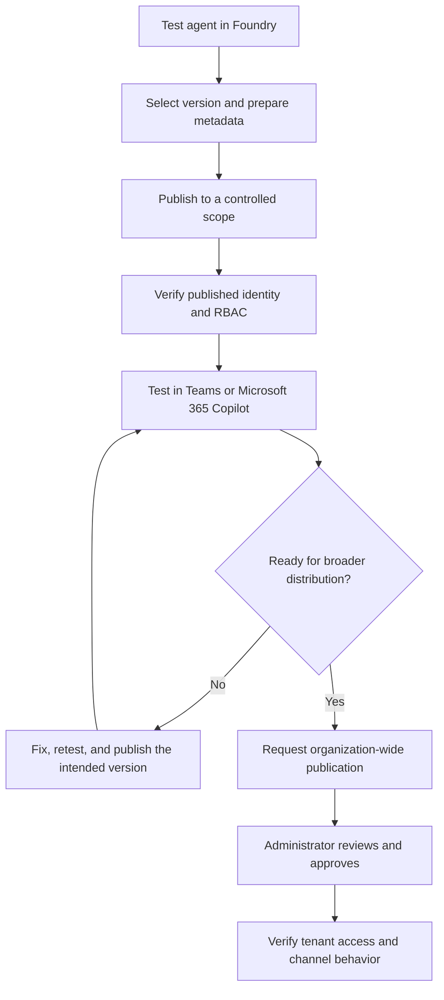
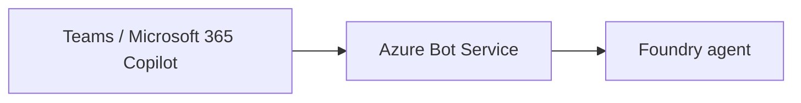
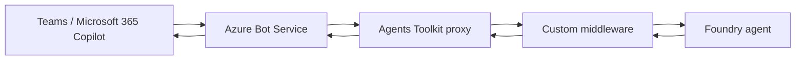

# 09. Publishing Agents to Microsoft 365

*Publication, Integration, Access and Operational Considerations*

> Publishing an agent is a deployment boundary, not just a visibility setting. Validate its identity, permissions, distribution scope, and behavior in the channel where users will interact with it.

## Overview

The Microsoft Learn module **Integrate your agent with Microsoft 365** explains how to publish a Microsoft Foundry agent to Microsoft Teams and Microsoft 365 Copilot, choose who can access it, and test and troubleshoot the published experience. The written module also covers the Microsoft 365 Agents Toolkit and Work IQ.

The central lab scenario is a Contoso **Enterprise Knowledge Agent** grounded in IT security and remote-work policy documents. This chapter follows the source’s publishing workflow and separates what the learning material demonstrates from additional operational recommendations.

## 1. What publishing introduces

The module describes several changes when a Foundry agent is published for Microsoft 365:

- **A stable endpoint:** Microsoft 365 surfaces call the published agent through a consistent endpoint.
- **A distinct agent identity:** the published agent has a Microsoft Entra identity separate from the developer’s project identity.
- **User-data isolation:** one user’s agent conversation is not exposed to another user through the published agent’s conversation context.
- **Channel routing:** an Azure Bot Service is provisioned to route messages between Teams/Microsoft 365 and the agent.
- **An app package and metadata:** the publishing flow prepares the app for discovery and use in the selected surfaces.

These features do not guarantee that every tool or data source will work after publication. The published identity can have different permissions from the developer’s identity, and the channel experience can differ from the Foundry playground. Test both.

## 2. Follow the controlled-publishing workflow

Use this sequence as the main deployment path:



### Prepare the agent

The source lab creates `enterprise-knowledge-agent`, adds two sample documents—an IT security policy and a remote-work policy—and configures the agent to answer policy questions accurately, acknowledge uncertainty, and cite specific policies.

Before publishing:

- Test representative questions covered by the documents.
- Test questions the documents do not answer.
- Confirm knowledge retrieval and citations are appropriate.
- Exercise configured tools and connections.
- Check that instructions and data are suitable for the intended audience.
- Select the intended agent version and prepare accurate app metadata.

The lab’s example questions include laptop password requirements, remote-work core hours, and laptop encryption requirements. They provide simple checks that grounding still works once the agent is available through a channel.

### Prepare the publishing metadata

The source describes completing fields such as the app name, short and full descriptions, developer name, icons, website, privacy policy, and terms of use where applicable. Metadata helps users and administrators understand who provides the agent and what it does.

**Operational recommendation:** treat descriptions and policy links as user-facing release information. Do not put credentials, secrets, internal endpoints, or confidential implementation details in metadata.

## 3. Choose the correct publishing scope

The source material uses scope labels such as *Shared* and *Organization*. Current Foundry portal terminology is **Just you** and **People in your organization**. The labels matter because scope affects both discoverability and who is authorized to invoke the agent.

| Foundry portal choice | REST API `publishScope` | Intended audience | Approval |
|---|---|---|---|
| **Just you** | `Shared` | Initially visible to the publisher; the agent link can be shared with selected users, subject to applicable permissions | Not required |
| **People in your organization** | `Tenant` | Organization-wide distribution after approval | Required |

The mapping above follows the current Microsoft publishing documentation. Do not treat the portal label and REST API value as interchangeable strings: use the portal label in portal instructions and the API value when configuring the REST API.

For a controlled test, choose **Just you** first. Confirm the published experience works before requesting organization-wide distribution. When the organization scope is selected, a Microsoft 365 administrator reviews the request in the Microsoft 365 admin center and can approve or deny it. Approval is a governance checkpoint; it does not replace resource-level authorization or functional testing.

## 4. Publish and verify the target channel

The source’s direct-publishing path is:

1. Open the Foundry portal and select the agent to publish.
2. Test the agent and its grounding in the playground.
3. Select the intended version and open the publishing flow.
4. Complete the app metadata.
5. Select **Just you** for the initial controlled test.
6. Complete publication and wait for the app to become available.
7. Find the agent in Teams and test it with representative messages.
8. If Microsoft 365 Copilot is a target, test there separately as well.

The learning module states that Copilot publication requires the appropriate Microsoft 365 Copilot license. Confirm the current licensing and tenant requirements for the intended target surface before rollout.

### Version behavior needs an explicit check

The video explains that saving an agent modification does not necessarily mean that the modified version is immediately serving users. Current Foundry documentation describes a version selector that can use the latest version by default or be pinned to a specific version. Therefore, verify the active version-selection setting before a release; do not assume either that every save is immediately live or that every update requires a full republish.

### Smoke-test matrix

| Test | What to verify |
|---|---|
| Agent discovery | The publisher can find and open the agent in the expected Teams or Copilot surface. |
| IT policy question | The answer reflects the source document and cites it where configured. |
| Remote-work question | The response uses the appropriate policy content. |
| Unsupported question | The agent acknowledges that the available knowledge does not answer it. |
| Tool-backed request | The tool succeeds under the published agent’s identity. |
| Another authorized user | Access works as intended without exposing another user’s conversation. |
| Restricted resource | Access is denied safely and sensitive details are not disclosed. |
| Responsiveness | End-to-end latency and response rendering are acceptable in the actual channel. |

A successful playground response is not sufficient evidence of a successful deployment. The published channel, identity, and authorization path must all be tested.

## 5. Verify the published identity and permissions

A key lesson in the module is that permissions used during development do not automatically transfer to the published agent identity.

For each protected Azure resource used by the agent’s tools or knowledge connections:

1. Identify the published agent identity in Foundry.
2. List the resources it needs to access, such as Azure AI Search or storage.
3. Assign the minimum required Azure RBAC role at the narrowest practical scope.
4. Test the published agent from the target channel.
5. Review access whenever tools, data sources, or deployment configuration changes.

A common failure pattern is that a tool works in the playground but fails in Teams because the published identity lacks a required role assignment. Check the identity and authorization path before changing working tool code.

**Operational recommendation:** maintain a small access record for each integration: identity, resource, role, scope, and purpose. Avoid broad subscription-level grants when resource-level access is sufficient.

## 6. Direct publishing or an Agents Toolkit proxy?

Direct publishing is the main path in the video and is suitable when Foundry’s built-in integration meets the requirements. The written module presents the Microsoft 365 Agents Toolkit as an optional advanced approach.



With direct publishing, Foundry manages the standard publishing integration.

A proxy-based design adds an application between the channel and the Foundry agent:



Consider the proxy when you have a concrete requirement for custom SSO behavior, middleware, message transformation, custom logging, separate deployment environments, IDE debugging, or CI/CD integration. The proxy adds code and another operational boundary; do not introduce it by default.

The module also mentions other distribution options, including a web application preview, a stable API endpoint, and Azure Bot Service channels. Validate current service support and constraints for the channel you actually intend to use.

## 7. Work IQ: connecting workplace context

The written module also introduces **Work IQ** for accessing workplace information such as emails, meetings, documents, Teams messages, and people information. It describes CLI usage and an MCP-server integration for assistants.

For example, the module demonstrates a CLI-style query:

```bash
workiq ask -q "What were the key decisions in last week's architecture review meeting?"
```

The important architectural distinction is the integration boundary:

- **MCP** exposes tools that a compatible client can discover and invoke.
- **A2A** supports communication with a peer agent through an agent-oriented protocol.
- **REST/API access** may be available for applications that need direct API integration.

Use the specific interface supported by the Work IQ capability and client you select. Do not assume every Work IQ experience uses the same protocol or setup.

### Licensing, consent, and data governance

The supplied learning material describes administrative consent and a Microsoft 365 Copilot license among the prerequisites for its Work IQ CLI/MCP workflow, and notes that the experience was in preview when the material was prepared. Current Work IQ API documentation describes usage-based billing through **Copilot Credits** and says API access is independent of a Microsoft 365 Copilot per-user license. Licensing therefore depends on the particular Work IQ interface and use case; do not reuse the older prerequisite list as a universal rule.

Before enabling workplace-data access, verify current product documentation and tenant configuration. Confirm administrative consent, user-context permissions, usage-based billing where applicable, and the data-processing terms for the selected service. Check that retrieved workplace information is appropriate for the user and task, and avoid retaining sensitive content unnecessarily in logs or telemetry.

Work IQ is supplemental to the chapter’s main deployment workflow. For a channel-publishing task, first establish a correct and secure published agent; add workplace-context integration only when the use case requires it.

## 8. Troubleshoot and operate the published agent

The written module recommends testing after publication, trying different users and clients, investigating tool permissions, and monitoring ongoing behavior.

| Symptom | Checks to make |
|---|---|
| Agent cannot be found | Confirm publication completed; check the selected scope, approval status, tenant app policies, and store propagation. |
| Agent does not respond | Verify the Azure Bot Service and publishing configuration; inspect available logs and retest the agent in Foundry. |
| Tool works in Foundry but fails in Teams | Check the published agent identity’s RBAC access to each protected resource. |
| Answers lack expected grounding | Confirm documents are attached and the knowledge configuration is active; repeat the source-question tests. |
| Response is slow | Measure end-to-end latency; investigate complex instructions, slow tools, large queries, and network latency. |
| Package upload fails | Check package integrity, required metadata and icon dimensions, and tenant custom-app policies. |

For ongoing operations, review request volume, latency, errors, and tool-invocation metrics. If Application Insights is configured, use traces to investigate failures and end-to-end timing. Establish a feedback path and convert recurring issues into regression tests.

When a version changes, verify the version selector and current publishing workflow. Also distinguish changes to the agent version from changes to displayed app metadata; they may have different update procedures.

## 9. Production rollout checklist

- [ ] Grounding, instructions, and configured tools pass representative tests.
- [ ] The intended agent version and version-selection behavior are confirmed.
- [ ] App metadata is accurate and contains no secrets.
- [ ] The publishing scope matches the intended audience.
- [ ] Organization-wide publication has the required administrator approval.
- [ ] The published identity has least-privilege access to required resources.
- [ ] The target Teams and/or Copilot experience is tested by intended users.
- [ ] Privacy, licensing, data handling, and applicable consent requirements are reviewed.
- [ ] Monitoring, feedback ownership, and regression tests are in place.
- [ ] A previous-version or rollback strategy has been considered.
- [ ] Unused lab resources and deployments are cleaned up.

## Key takeaways

- Publishing introduces a managed endpoint, a distinct agent identity, and Microsoft 365 channel integration.
- **Just you** is the controlled initial scope; **People in your organization** requires administrator approval. The corresponding REST API values are `Shared` and `Tenant`.
- Development-time access does not guarantee that the published identity can access protected Azure resources.
- Test the real target channel, not just the Foundry playground.
- Use an Agents Toolkit proxy only when custom integration requirements justify the added complexity.
- Work IQ access methods, licensing, and governance requirements depend on the specific current interface; verify them before implementation.
- Treat publishing as a lifecycle that includes verification, monitoring, updates, and regression testing.

## Related chapters

- **04. Ground Agent Responses in Enterprise Knowledge with Foundry IQ** — knowledge grounding and retrieval evaluation.
- **05. Orchestrating AI Agents with Microsoft Foundry Workflows** — multi-step execution and approval patterns.
- **08. Agent-to-Agent (A2A) Communication Architecture** — peer-agent communication and protocol boundaries.

## Further reading

- [Publish agents to Microsoft 365 Copilot and Microsoft Teams — Microsoft Learn](https://learn.microsoft.com/en-us/azure/ai-foundry/agents/how-to/publish-copilot?view=foundry)
- [Publish agents to Microsoft 365 and Teams using the REST API — Microsoft Learn](https://learn.microsoft.com/en-us/azure/foundry/agents/how-to/publish-copilot-virtual-network)
- [Work IQ overview — Microsoft Learn](https://learn.microsoft.com/en-us/microsoft-365/copilot/extensibility/work-iq/)
- [Work IQ API overview — Microsoft Learn](https://learn.microsoft.com/en-us/microsoft-365/copilot/extensibility/work-iq-api-overview)
- [Licensing and cost considerations for Copilot extensibility — Microsoft Learn](https://learn.microsoft.com/en-us/microsoft-365/copilot/extensibility/cost-considerations)

> **Enterprise AI Engineering Handbook**
>
> *Building Production-Grade Enterprise AI Systems — One Chapter at a Time.*
