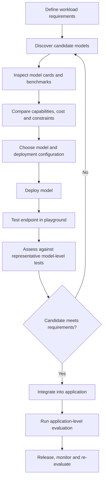

# Azure AI Architecture and Model Lifecycle

## Overview

A generative AI solution is more than a model endpoint. It combines an Azure resource and project boundary, a selected model, a deployment configuration, an application that invokes the model, and a repeatable process for checking whether the chosen model meets workload requirements.

Microsoft Foundry provides capabilities to discover and test models, organize AI assets in projects, deploy supported models, and develop AI applications. The architectural task is to select a suitable model and deployment for a defined workload—not simply the newest model or the highest public benchmark score.

## 1. Understand the platform boundary

- **Azure subscription and resource group:** Provide the wider Azure management, policy, billing, and governance context.
- **Microsoft Foundry resource:** Provides the Azure resource boundary and platform capabilities used by projects.
- **Foundry project:** Organizes assets for an AI solution, such as deployments, connections, and development configuration.
- **Model catalog:** Helps discover candidate models and inspect their capabilities, model information, benchmark results, and deployment availability.
- **Model deployment:** Makes a supported model available for inference through a configured deployment and endpoint.
- **Application:** Calls the endpoint and implements business logic, identity, state, error handling, and use-case-specific controls.

A resource can support multiple projects, which can help separate solutions or development environments. Confirm the current resource and project model when working in an existing environment, because older hub-based experiences and newer Foundry experiences may differ.

## 2. Model-selection lifecycle



The playground is useful for early experiments, but a promising response is not proof of production readiness. Application behavior also depends on prompts, retrieved data, tools, identity, business rules, error handling, and user experience.

## 3. Select models against workload requirements

Use the model catalog to narrow candidates by provider, task, modalities, context limits, tool/function-calling support, benchmark information, deployment options, and availability. Details and supported options vary by model, region, and deployment configuration.

| Decision factor | Questions to answer |
|---|---|
| Task and quality | Is the task conversation, summarization, extraction, coding, reasoning, or multimodal processing? What errors are unacceptable? |
| Input/output modalities | Does the workload need text only, or images, audio, or other supported inputs and outputs? |
| Context and output | How much context is required? What response length is expected? |
| Tool support | Does the model/API support the tool-calling behavior the application requires? |
| Latency and throughput | What are the response-time, concurrency, and throughput targets? Is traffic bursty or sustained? |
| Cost | What input/output volume is expected, and what is the budget per task or request? |
| Data processing | What privacy, residency, or regulatory constraints apply to inference processing? |
| Availability | Is the model offered for the required region, deployment mode, and processing scope? |

Large models may be appropriate for complex reasoning or varied tasks but can have higher latency and cost. Smaller models can be effective for bounded tasks where throughput and cost matter. Treat labels such as “reasoning” or “multimodal” as clues to investigate, not guarantees of workload performance.

### Read benchmarks and model cards critically

Model catalog information and benchmark results are useful for screening candidates. Review the model card and available evaluation details rather than relying only on an overall leaderboard position.

- **Quality and task performance:** Check which tasks and datasets were measured and how closely they resemble your workload.
- **Safety and limitations:** Review documented limitations, intended use, and relevant safety information.
- **Cost and throughput:** Consider token pricing, response length, latency, and realistic request volume together.
- **Evaluation conditions:** Check the model version, benchmark setup, and date where available; results may not be directly comparable across different methodologies.

Public benchmark scores are screening signals, not a guarantee of performance on your own data, prompts, language, or users. Validate finalists with representative examples and agreed acceptance criteria.

### Keep a model decision record

Record what was selected, why it was selected, what was measured, and what remains uncertain. This makes later model or deployment changes easier to review.

```python
from dataclasses import dataclass
from typing import Optional


@dataclass(frozen=True)
class ModelDecision:
    model_name: str
    deployment_name: str
    workload: str
    evaluation_dataset_version: str
    quality_result: str
    latency_p95_ms: Optional[int]
    estimated_cost_per_1k_requests: Optional[float]
    deployment_mode: str
    processing_scope: str
    test_date: str
    known_limitations: tuple[str, ...]


# Illustrative decision-record template, not executable model-selection logic.
decision = ModelDecision(
    model_name="candidate-model",
    deployment_name="support-answering-prod",
    workload="grounded support answers",
    evaluation_dataset_version="support-eval-v1",
    quality_result="Meets the current acceptance threshold",
    latency_p95_ms=None,  # Populate only after measuring under stated conditions.
    estimated_cost_per_1k_requests=None,  # Calculate from observed token usage and pricing.
    deployment_mode="Standard",
    processing_scope="Confirm against data-processing requirements",
    test_date="YYYY-MM-DD",
    known_limitations=("Needs retrieval for internal policy facts",),
)
```

Do not enter `0` when a cost or latency measurement is unknown. Record the test conditions and distinguish measured values from estimates.

## 4. Separate deployment mode from processing scope

These are **two different decisions**. Deployment mode concerns how inference capacity and requests are served. Processing scope concerns where inference data may be processed. Supported combinations depend on the model and service offering; verify the current model details before deployment.

### Deployment mode

| Mode | General characteristics | Typical decision signal |
|---|---|---|
| **Standard** | Consumption-based, commonly billed by tokens; capacity and latency can vary with demand and service conditions. | A reasonable candidate for variable or interactive workloads when its capacity and service characteristics meet requirements. |
| **Provisioned** | Reserved processing capacity, commonly measured in provisioned throughput units (PTUs), subject to the offering's terms. | Sustained volume or a need for more predictable throughput justifies reserved capacity and its cost. |
| **Batch** | Asynchronous processing for eligible workloads; results are retrieved after processing rather than returned as an immediate interactive answer. | Large, non-interactive jobs such as offline enrichment or bulk classification. |
| **Developer** | A limited option for development or evaluation of supported models; not a production-capacity choice. | Temporary testing where explicitly supported by the model offering. |

### Processing scope

| Scope | Meaning to verify | Main trade-off |
|---|---|---|
| **Global** | Processing may occur across supported Azure regions according to the service terms. | Can offer broad capacity, but may not satisfy strict geographic processing requirements. |
| **Data Zone** | Processing is constrained to the Microsoft-defined data zone described for the offering. | A potential fit when that defined boundary satisfies the organization's requirements. |
| **Azure geography / regional** | Processing is constrained according to the specific geography or region option available for the model. | Can help meet location requirements, but availability and capacity may differ. |

Do not assume every mode exists for every scope or model. In particular, batch availability can have a different set of supported scopes from interactive deployments. Check the current deployment-type documentation, regional availability, quota, pricing, and applicable data-processing terms.

### Example workload decisions

| Workload | Initial option to investigate | Why—and what to verify |
|---|---|---|
| Bursty interactive customer support | Standard with an approved processing scope | Flexible consumption may fit variable demand; load-test latency and throttling behavior. |
| Sustained high-volume inference | Provisioned | Compare observed throughput and latency consistency with PTU capacity and cost. |
| Nightly processing of a large document backlog | Batch, if supported | Asynchronous completion is acceptable; confirm model/scope support and operational handling of failed jobs. |
| Sensitive workload with location constraints | A compatible Data Zone or geography-scoped option | The required boundary must be explicitly supported by the chosen model and deployment. |

These are starting hypotheses, not universal prescriptions. Select only after validating workload requirements and current service availability. Global Standard can be a useful baseline when its processing scope and performance characteristics are acceptable, but it is not the default for every regulated or high-throughput workload.

## 5. Endpoint fundamentals and evaluation boundaries

A deployment exposes a model for inference. An application generally needs the endpoint information and deployment identifier expected by the selected API or SDK. Treat those values as environment-specific configuration rather than hard-coding them into application logic.

This chapter establishes the architecture and selection concepts. The next chapter covers application integration, API/SDK usage, authentication, streaming, and conversation state.

For model selection, use a small set of representative prompts or inputs to compare candidates, inspect failures, and confirm basic task fit. Keep the scope clear:

- **Here:** Model cards, benchmark interpretation, playground experiments, candidate comparison, and model-level acceptance criteria.
- **Chapter 04 — Generative AI Optimization and Evaluation:** Versioned evaluation datasets, metric selection, regression workflows, systematic improvement, and application-level evaluation.
- **Chapter 05 — Responsible AI and Production Safety:** Risk analysis, safety evaluation, mitigations, monitoring, and responsible-use controls.

The appropriate metric depends on the task. Exact string matching can be misleading for open-ended generation; grounded answers need checks that claims are supported by supplied context, while extraction or classification may allow reference-based measures. Use metrics as evidence alongside targeted human review, not as substitutes for understanding failure modes.

## 6. Production architecture checklist

Before exposing an application to users, verify that the surrounding architecture addresses:

- **Identity and access:** Use Microsoft Entra ID or managed identity where supported and appropriate; apply least privilege.
- **Configuration and secrets:** Keep credentials out of source control and separate settings by environment.
- **Capacity and resilience:** Understand quotas, rate limits, timeouts, retries, concurrency, and graceful handling of endpoint failures.
- **Observability:** Measure latency, failures, token usage, and cost. Avoid indiscriminate logging of sensitive prompts or personal data.
- **Change control:** Version model/deployment choices, prompts, evaluation datasets, and relevant configuration.
- **Governance:** Confirm privacy, security, processing-location, and safety requirements before release.

The implementation will vary by workload and Azure services. These concerns should influence model and deployment selection from the beginning, not be postponed until after the endpoint works.

## Key takeaways

1. Understand the Foundry resource/project boundary before organizing deployments.
2. Select models against workload requirements; use model cards and benchmarks as evidence, not guarantees.
3. Decide deployment mode and processing scope separately, then verify that the combination is supported.
4. Treat endpoint availability as one milestone, not proof of application readiness.
5. Keep model-level screening distinct from systematic application evaluation and responsible AI controls.
6. Record assumptions and measurements so future model changes can be compared reliably.

## References

- [Microsoft Foundry architecture](https://learn.microsoft.com/en-us/azure/foundry/concepts/architecture)
- [Microsoft Foundry Models overview](https://learn.microsoft.com/en-us/azure/foundry/concepts/foundry-models-overview)
- [Deployment types for Microsoft Foundry Models](https://learn.microsoft.com/en-us/azure/ai-foundry/foundry-models/concepts/deployment-types)
- [Deployment overview](https://learn.microsoft.com/en-us/azure/foundry/concepts/deployments-overview)
- [Microsoft Foundry documentation](https://learn.microsoft.com/en-us/azure/foundry/)

---

> **Enterprise AI Engineering Handbook**
>
> *Building Production-Grade Enterprise AI Systems — One Chapter at a Time.*
