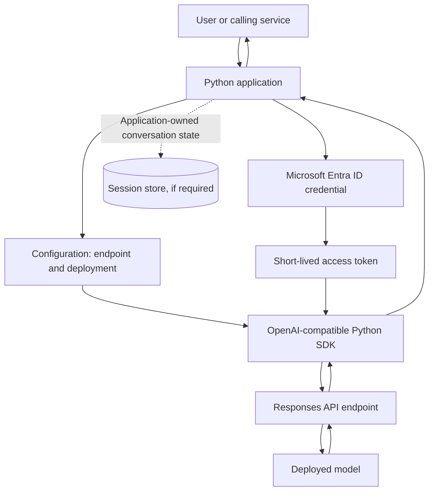

# 02 — Building Generative AI Applications with Python

## 1. Purpose and scope

A model playground is useful for prompt exploration, but an application must also handle authentication, deployment configuration, conversation context, latency, errors, and operational limits. This chapter turns a deployed Microsoft Foundry model into a Python application and focuses on the application boundary around model inference.

**In scope:** choosing an SDK and endpoint, calling the Responses API, managing multi-turn context, streaming output, using asynchronous clients, and understanding Chat Completions for existing integrations.

**Out of scope:** tool execution and agent orchestration (Chapter 03), systematic performance evaluation and optimization (Chapter 04), and detailed responsible-AI controls (Chapter 05).

## 2. Application architecture



Keep the model endpoint and deployment name in configuration rather than scattering them through application code. The Python service owns user/session authorization, request validation, conversation policy, timeout/retry behavior, and application logging. The model endpoint performs inference; it does not replace these application responsibilities.

## 3. Select the SDK and endpoint deliberately

Microsoft Foundry supports an OpenAI-compatible client for direct model inference and a Foundry SDK for project-level capabilities. These approaches can coexist in one application, but they solve different problems.

| Need | Typical choice | Architectural reason |
|---|---|---|
| Direct model inference, Responses API, Chat Completions, portability of OpenAI-compatible code | OpenAI Python SDK | A relatively small inference-focused integration surface |
| Foundry project metadata, connections, tracing, cloud evaluations, or agent-specific capabilities | Microsoft Foundry SDK | Exposes Foundry project-level capabilities |
| Existing application built around message arrays and Chat Completions | Chat Completions API | Useful for maintenance and compatibility; conversation history remains application-managed |
| New conversational application | Responses API | A simpler response model and support for chaining turns through response IDs or other state approaches |

For an Azure OpenAI v1 endpoint, a common endpoint shape is `https://<resource>.openai.azure.com/openai/v1/`. Some Foundry configurations use a different endpoint host. Use the exact endpoint shown for your resource and the **deployment name** expected by that endpoint; do not assume the public model name and deployment name are interchangeable.

## 4. Secure client initialization with Microsoft Entra ID

For production, prefer keyless authentication where the resource and workload identity are configured for it. `DefaultAzureCredential` can use an available developer sign-in locally and a managed identity or another supported credential in an Azure-hosted workload. The identity still needs the appropriate role assignment to invoke the deployed model.

Install the required packages in a virtual environment:

```bash
python -m venv .venv
# Activate the environment for your shell, then:
python -m pip install --upgrade openai azure-identity
```

Create a small client module, for example `foundry_client.py`:

```python
import os

from azure.identity import DefaultAzureCredential, get_bearer_token_provider
from openai import OpenAI


def create_client() -> OpenAI:
    endpoint = os.environ["AZURE_OPENAI_ENDPOINT"].rstrip("/")
    credential = DefaultAzureCredential()
    token_provider = get_bearer_token_provider(
        credential,
        "https://ai.azure.com/.default",
    )
    return OpenAI(
        base_url=f"{endpoint}/openai/v1/",
        api_key=token_provider,
    )
```

Set `AZURE_OPENAI_ENDPOINT` to the resource endpoint, for example `https://<resource>.openai.azure.com`, and configure the deployment name separately. The token provider supplies access tokens; it is not a long-lived API key. For local development, sign in using an approved developer credential such as Azure CLI. In hosted environments, prefer a managed identity when available.

**Security note:** Do not commit secrets, access tokens, or `.env` files containing credentials. If key-based authentication is unavoidable, load the key from a secret store or protected environment variable, restrict access, and rotate it according to policy.

## 5. Generate a response and continue the conversation

The Responses API accepts a prompt through `input` and optional behavior guidance through `instructions`. The `model` parameter is the deployment identifier configured for the endpoint.

```python
import os

from foundry_client import create_client

client = create_client()
model_deployment = os.environ["MODEL_DEPLOYMENT_NAME"]

response = client.responses.create(
    model=model_deployment,
    instructions=(
        "You are a helpful technical assistant. Be concise "
        "and distinguish facts from assumptions."
    ),
    input="Explain the circuit breaker pattern in three bullet points.",
    max_output_tokens=250,
)

print(response.output_text)
```

A simple multi-turn pattern uses the prior response ID:

```python
first = client.responses.create(
    model=model_deployment,
    instructions="You explain software architecture clearly.",
    input="What is a circuit breaker?",
)

follow_up = client.responses.create(
    model=model_deployment,
    instructions="You explain software architecture clearly.",
    input="When should I avoid using it?",
    previous_response_id=first.id,
)

print(follow_up.output_text)
```

Treat a response ID as a reference to prior response context, not as your application's complete session-management solution. Associate the conversation with an authenticated user/session, authorize every request, and decide how long context may be retained. Confirm the service's storage and retention behavior against your organization's privacy and data-governance requirements.

### Response chaining versus application-owned history

- **Response chaining:** send `previous_response_id` to continue from a prior response. This reduces the amount of history your code must construct manually, but does **not** guarantee that context is free or that total token usage remains constant.
- **Application-owned history:** store and send the selected prior messages/items yourself. This gives you control over pruning, summarization, persistence, and replay, at the cost of more implementation responsibility.
- **Chat Completions:** build a `messages` list and append each user message and assistant answer. The application resubmits the chosen history with each call.

For long-running conversations, define a context policy: maximum turns or tokens, when to summarize or prune history, which data may be retained, and how a conversation can be reset or deleted.

## 6. Chat Completions: understand the compatibility path

Chat Completions remains relevant when maintaining existing systems or working with integrations that expect role-based message arrays.

```python
completion = client.chat.completions.create(
    model=model_deployment,
    messages=[
        {"role": "system", "content": "You are a concise technical assistant."},
        {"role": "user", "content": "What is idempotency in an API?"},
    ],
)

answer = completion.choices[0].message.content
print(answer or "")
```

Unlike response chaining, multi-turn context in this pattern is explicitly managed by the application. Keep the system instructions and selected history consistent, and avoid allowing unbounded message arrays to grow indefinitely.

## 7. Streaming improves perceived responsiveness

Streaming lets the UI display partial text while generation is in progress. It improves time-to-first-visible-output, but does not necessarily reduce total model-generation time. Handle completion and failure explicitly in a user-facing service.

```python
stream = client.responses.create(
    model=model_deployment,
    input="Describe the outbox pattern and one trade-off.",
    stream=True,
)

for event in stream:
    if event.type == "response.output_text.delta":
        print(event.delta, end="", flush=True)
    elif event.type == "response.completed":
        print()
    elif event.type == "response.failed":
        raise RuntimeError("Model response failed")
```

The event types supported by the SDK and endpoint should be verified against the deployed API version. In a web application, forward deltas through the appropriate streaming transport (for example, server-sent events or WebSockets) and define behavior for disconnects, cancellation, and partial responses. Do not log raw prompts or streamed output indiscriminately; they may contain sensitive data.

## 8. Asynchronous calls and concurrency

Use `AsyncOpenAI` when the application uses an async framework or benefits from overlapping network-bound work. A single awaited call still waits for that call to finish; concurrency is useful when independent requests can safely run together.

```python
import asyncio
import os

from azure.identity.aio import DefaultAzureCredential, get_bearer_token_provider
from openai import AsyncOpenAI


async def main() -> None:
    endpoint = os.environ["AZURE_OPENAI_ENDPOINT"].rstrip("/")
    model = os.environ["MODEL_DEPLOYMENT_NAME"]

    async with DefaultAzureCredential() as credential:
        token_provider = get_bearer_token_provider(
            credential,
            "https://ai.azure.com/.default",
        )

        async with AsyncOpenAI(
            base_url=f"{endpoint}/openai/v1/",
            api_key=token_provider,
        ) as client:
            prompts = [
                "Define idempotency in one sentence.",
                "Define a bulkhead pattern in one sentence.",
                "Define a retry budget in one sentence.",
            ]
            responses = await asyncio.gather(
                *(
                    client.responses.create(model=model, input=prompt)
                    for prompt in prompts
                )
            )
            for response in responses:
                print(response.output_text)


if __name__ == "__main__":
    asyncio.run(main())
```

In a production API, bound concurrency rather than submitting unlimited tasks. Add request timeouts, cancellation handling, retry rules for transient failures, and rate-limit-aware backoff. Avoid blindly retrying non-idempotent workflows or retrying every error; distinguish authentication/authorization failures, invalid requests, throttling, and transient service errors. Verify async credential and token-provider compatibility with the versions of `azure-identity` and `openai` installed in your environment.

## 9. Practical implementation checklist

- [ ] Confirm the deployed model, endpoint, supported API, and deployment name.
- [ ] Prefer Microsoft Entra ID and grant the runtime identity only the access it needs.
- [ ] Keep endpoint and deployment configuration outside source code.
- [ ] Define an instruction policy and validate user input at the application boundary.
- [ ] Choose response chaining or application-owned history intentionally.
- [ ] Set output limits and a context-retention/pruning policy.
- [ ] Use streaming when incremental output benefits the user experience.
- [ ] Use async for I/O concurrency, with bounded parallelism.
- [ ] Add timeouts, selective retries, rate-limit handling, and safe error messages.
- [ ] Monitor latency, token usage, failure rates, and cost without unnecessarily logging sensitive content.
- [ ] Verify SDK and API behavior against the deployed model and current service documentation before release.

## 10. Key takeaways

1. A model call is only one part of a reliable AI application; identity, state, configuration, and operations belong to the application architecture.
2. Use the Responses API as a starting point for new conversational inference workloads where it is supported; retain Chat Completions when compatibility or an existing integration calls for it.
3. Response chaining simplifies context references, but does not remove the need for session authorization, retention policy, or token-budget management.
4. Entra ID reduces reliance on long-lived keys, provided identity permissions and runtime configuration are set correctly.
5. Streaming improves perceived responsiveness; async helps overlap independent I/O. Neither removes the need for limits, error handling, and monitoring.

## References

- [Configure keyless authentication with Microsoft Entra ID](https://learn.microsoft.com/azure/ai-foundry/foundry-models/how-to/configure-entra-id)
- [Use the Azure OpenAI Responses API](https://learn.microsoft.com/en-us/azure/foundry/openai/how-to/responses)
- [Endpoints for Microsoft Foundry Models](https://learn.microsoft.com/en-us/azure/ai-foundry/model-inference/concepts/endpoints)
- [Microsoft Foundry architecture](https://learn.microsoft.com/en-us/azure/foundry/concepts/architecture)

---

> **Enterprise AI Engineering Handbook**
>
> *Building Production-Grade Enterprise AI Systems — One Chapter at a Time.*
