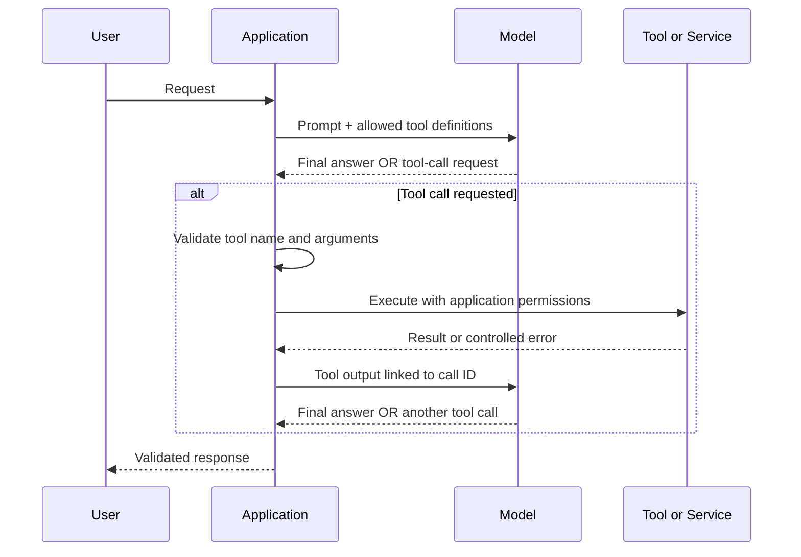
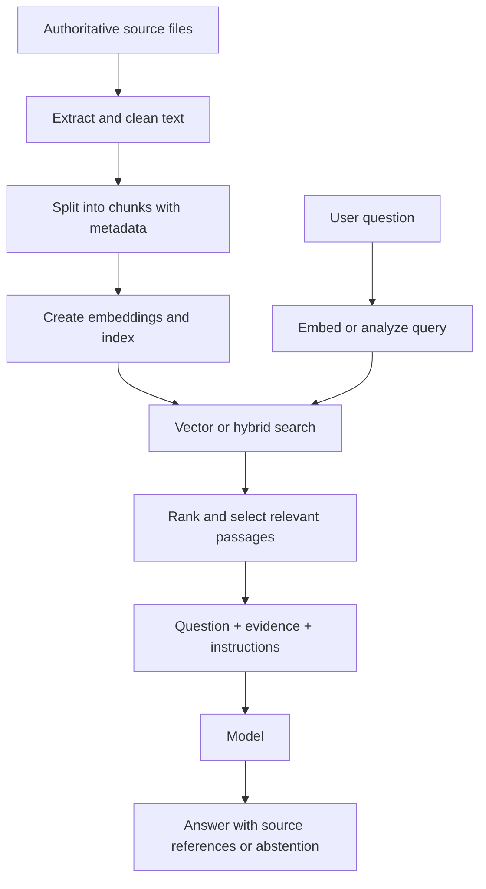

# 03 — Tool Calling, Grounding, and Retrieval-Augmented Generation

## Why tools matter

A deployed model can generate useful language, but it does not automatically know what is happening right now, what is written in your organization's private documents, or what actions your application is allowed to perform. Tools connect model reasoning to current information and application capabilities.

Think of the model as the component that interprets a request and proposes what may help. The application remains responsible for choosing which tools are available, executing custom functions, checking permissions, validating results, and deciding what to return. **A model can request a tool call; it does not receive authority to execute business logic simply because it requested one.**

This chapter uses the OpenAI Responses API with a model deployment accessible through Microsoft Foundry. Endpoint formats, deployment names, model compatibility, authentication, and supported tools vary by deployment. Reuse the authenticated `client` and `MODEL_DEPLOYMENT` configuration from Chapter 02. Check the current documentation and your selected model's capabilities before relying on a particular hosted tool.

## 1. Understand the complete tool lifecycle

A tool-enabled interaction is an application-controlled loop, not a single magical model call.



The application should:

1. Define a small, explicit allowlist of tools and their schemas.
2. Submit the user's request and those tool definitions to the model.
3. Inspect the response for a final answer or one or more tool calls.
4. Validate each requested tool name and its arguments.
5. Authorize the operation using the authenticated user's identity and application policy.
6. Execute the function with bounded time, permissions, and resource use.
7. Return each result with its matching `call_id`.
8. Continue the model interaction until a final answer is produced or a safe limit is reached.

A tool call is a proposal, not proof that the operation is safe. Even a valid schema cannot enforce business authorization or guarantee that a request makes sense in the real world.

## 2. Choose the right tool

| Tool | Useful for | Execution boundary |
|---|---|---|
| `code_interpreter` | Calculations, data analysis, transformations, and supported file operations | Hosted sandbox |
| `web_search` | Current public information | Hosted search capability |
| `file_search` | Finding relevant passages in an indexed document collection | Hosted retrieval over a vector store |
| `function` | Business logic, internal APIs, and application-owned systems | Your application executes the function |

The model may choose a tool based on the prompt and descriptions. Instructions can guide that choice, but do not rely on a prompt to enforce access control. Keep tool lists focused: unnecessary tools add complexity, latency, cost, and possible attack paths.

### Code interpreter

```python
response = client.responses.create(
    model=MODEL_DEPLOYMENT,
    instructions=(
        "Use Python for calculations and data analysis. "
        "Explain the result and mention assumptions."
    ),
    input="Calculate the square root of 16 and explain the result.",
    tools=[{
        "type": "code_interpreter",
        "container": {"type": "auto"},
    }],
)

print(response.output_text)
```

The hosted environment can run generated code and return results for the model to interpret. It is not your application runtime. Libraries, runtime, network access, time, memory, and file handling can be constrained. Verify outputs before using them in consequential workflows.

### Web search and source-aware answers

```python
response = client.responses.create(
    model=MODEL_DEPLOYMENT,
    instructions=(
        "Use web search for time-sensitive facts. Prefer authoritative sources. "
        "State uncertainty when sources disagree or do not support an answer."
    ),
    input="Summarize a recent Microsoft product announcement.",
    tools=[{"type": "web_search"}],
)

print(response.output_text)
```

Search can improve freshness, but it does not guarantee accuracy. A source-aware answer should distinguish what a source says from the model's interpretation and should provide usable citations when the workflow requires evidence.

For Responses API outputs, inspect the response items and text annotations rather than assuming `output_text` alone is a complete citation renderer. Preserve the source URLs and titles that the selected tool returns, and display them in your application UI. The exact annotation shape depends on the SDK/API version, so inspect the current response schema when implementing a citation renderer.

```python
# Diagnostic starting point: inspect response items during development.
for item in response.output:
    print("item type:", item.type)
    if item.type == "message":
        for part in item.content:
            print("content type:", part.type)
            if getattr(part, "annotations", None):
                for annotation in part.annotations:
                    print(annotation)
```

Do not fabricate citations or attach a source to a claim it does not support. For regulated or high-impact answers, retain source metadata, test citation correctness, and require human review where appropriate.

## 3. Ground answers in your own documents

A model's general training does not give it dependable access to your private policies, current product catalogue, internal manuals, or latest operational procedures. Grounding supplies relevant evidence at request time. Retrieval-augmented generation (RAG) is a common pattern for doing this.

### The RAG flow



The core stages are:

- **Ingest:** collect approved sources and extract readable text.
- **Chunk:** divide large documents into passages that can be retrieved and fit into the model's context.
- **Embed and index:** convert chunks into vector representations and store vectors with text and metadata.
- **Retrieve:** find passages relevant to the user's question, using semantic, keyword, or hybrid search.
- **Rank and filter:** improve relevance and apply access controls before evidence reaches the model.
- **Generate:** provide the question and selected evidence to the model.
- **Verify:** check answer quality, source alignment, and whether the evidence actually supports the claims.

Hosted `file_search` can manage much of the file-ingestion and retrieval infrastructure for you. A custom RAG pipeline gives you more control over chunking, embedding models, index design, filters, hybrid retrieval, reranking, and evaluation. These are alternative implementation choices; do not assume that every hosted vector store exposes all custom-index controls.

### Chunking: why boundaries matter

Chunking breaks a long document into smaller retrieval units. If chunks are too large, they may mix unrelated subjects and waste context. If they are too small, they may lose qualifications, definitions, or the context needed to understand a statement.

Useful starting approaches include:

- **Fixed-size chunks:** straightforward and predictable, often with a small overlap to preserve continuity.
- **Structure-aware chunks:** split by headings, sections, paragraphs, or document structure so a passage keeps its meaning.
- **Semantic or parent-child strategies:** use meaningful passages for retrieval while retaining a larger parent section for context when needed.

There is no universally best chunk size. Test representative questions against your own documents. Measure whether the right passage is retrieved, whether important context is preserved, and how much irrelevant text reaches the model. Keep metadata such as document ID, title, section, version, effective date, and access classification alongside each chunk.

### Embeddings and vector search

An embedding model converts text into a numeric vector. Texts with similar meaning often have vectors that are close under a chosen similarity measure. At query time, the question is embedded in the compatible vector space and compared with indexed chunk vectors.

Cosine similarity is one common comparison:

\[
\operatorname{cosine}(q,d)=\frac{q\cdot d}{\|q\|\|d\|}
\]

Use a compatible embedding model for indexing and query embeddings. If the embedding model changes, re-embedding and re-indexing may be necessary. Embeddings capture useful semantic relationships, but they do not guarantee that a passage is authoritative or factually correct.

Vector search is not the only retrieval option. Keyword search can be better for exact identifiers, codes, names, and phrases. Hybrid search combines lexical and semantic signals; reranking can then improve the order of candidate passages. Filter by permissions and metadata before content is sent to the model.

### Hosted file search example

Create or populate a vector store as an ingestion or administrative operation—not on every user request. Keep its identifier in environment-specific configuration.

```python
from pathlib import Path

vector_store = client.vector_stores.create(
    name="support-knowledge"
)

with Path("support-guide.pdf").open("rb") as stream:
    client.vector_stores.files.upload_and_poll(
        vector_store_id=vector_store.id,
        file=stream,
    )

print("Vector store ID:", vector_store.id)
```

After ingestion completes, configure the resulting vector store ID as `SUPPORT_VECTOR_STORE_ID`.

```python
response = client.responses.create(
    model=MODEL_DEPLOYMENT,
    instructions=(
        "Answer from the support documents. If the retrieved evidence is "
        "insufficient, say so. Do not invent policy details. Identify the "
        "source used for each important claim when source metadata is available."
    ),
    input="What does the support guide say about escalating a critical issue?",
    tools=[{
        "type": "file_search",
        "vector_store_ids": [SUPPORT_VECTOR_STORE_ID],
    }],
    include=["file_search_call.results"],
)

print(response.output_text)
```

Use included retrieval results during development to inspect what the model received. In a production interface, return source references in a deliberate, user-friendly format. Test the current API and SDK schema because available result fields can change.

### Grounding does not mean guaranteed truth

The answer can still be wrong when the source is stale, incomplete, ambiguous, or irrelevant. A good application should permit an “insufficient evidence” response. Evaluate both retrieval and generation: did the system find the right passage, and did the answer accurately reflect that passage?

For a custom RAG system, keep the retriever behind an interface so you can change vector stores or search strategies without rewriting the model-facing application service. Do not let retrieval infrastructure decide who is allowed to see a document; enforce document-level access in the retrieval path itself.

## 4. Implement custom function calling

A custom function connects the model to a system your application owns, such as an order service or a business-rules API. The schema tells the model what it may request. Your code still decides whether to execute the request.

The following example uses a read-only order lookup. Its in-memory data is illustrative only; replace it with an authenticated, access-controlled service.

```python
import json

TOOLS = [{
    "type": "function",
    "name": "get_order_status",
    "description": "Get the status of an order the current user may view.",
    "parameters": {
        "type": "object",
        "properties": {
            "order_id": {
                "type": "string",
                "description": "The order identifier.",
            }
        },
        "required": ["order_id"],
        "additionalProperties": False,
    },
    "strict": True,
}]


def get_order_status(order_id: str, *, user_id: str) -> dict:
    if not order_id or len(order_id) > 64:
        raise ValueError("Invalid order identifier")

    # Demo data only. Production code must authorize this user for this order.
    demo_orders = {
        "ORD-1001": {"status": "shipped"},
        "ORD-1002": {"status": "processing"},
    }
    order = demo_orders.get(order_id)
    if order is None:
        return {"found": False, "message": "Order not found"}
    return {"found": True, "order_id": order_id, **order}


def dispatch_tool(name: str, arguments: dict, *, user_id: str) -> dict:
    # Explicit allowlist: never execute arbitrary model-provided code.
    if name != "get_order_status":
        raise ValueError("Unsupported tool")

    order_id = arguments.get("order_id")
    if not isinstance(order_id, str):
        raise ValueError("order_id must be a string")

    return get_order_status(order_id, user_id=user_id)
```

### Run the complete round trip

```python
def answer_with_tools(prompt: str, *, user_id: str) -> str:
    response = client.responses.create(
        model=MODEL_DEPLOYMENT,
        instructions=(
            "Help with order questions. Use the order-status tool when "
            "current order information is required."
        ),
        input=prompt,
        tools=TOOLS,
    )

    # Limit repeated model/tool turns.
    for _ in range(5):
        calls = [
            item for item in response.output
            if item.type == "function_call"
        ]
        if not calls:
            return response.output_text

        outputs = []
        for call in calls:
            try:
                arguments = json.loads(call.arguments)
                result = dispatch_tool(
                    call.name, arguments, user_id=user_id
                )
                output_text = json.dumps(result)
            except (ValueError, TypeError, json.JSONDecodeError):
                output_text = json.dumps({
                    "ok": False,
                    "error": "Invalid or unsupported tool request",
                })
            except Exception:
                # Log details securely in production; return no internals.
                output_text = json.dumps({
                    "ok": False,
                    "error": "The order lookup failed",
                })

            outputs.append({
                "type": "function_call_output",
                "call_id": call.call_id,
                "output": output_text,
            })

        response = client.responses.create(
            model=MODEL_DEPLOYMENT,
            previous_response_id=response.id,
            input=outputs,
            tools=TOOLS,
        )

    raise RuntimeError("Maximum tool-call rounds exceeded")
```

This illustrates the control flow, not a complete production service. The `user_id` must come from the authenticated server-side session, never from the model's arguments. The real order service must enforce object-level authorization itself. Add request timeouts and bounded retries around downstream I/O; do not blindly retry non-idempotent operations. Use a correlation ID in logs so failures can be diagnosed without returning internal details to the user.

For write operations—such as cancelling an order, creating a payment, or changing an account—add explicit confirmation, idempotency, audit records, and any required human approval. Keep read-only and write tools separate where that makes permissions clearer.

## 5. Validate arguments and tool results

Strict schemas can reduce malformed arguments, but application-side checks remain necessary. Validate the tool name against an allowlist, parse arguments defensively, check required fields and allowed values, enforce size limits, and verify authorization before calling the downstream service.

Treat tool output as untrusted too. A downstream service may return malformed data, an error page, unexpected HTML, excessive text, or content that includes instructions aimed at the model. Normalize the result to the smallest useful structure, enforce output-size limits, and distinguish a valid business result (such as “not found”) from an execution failure.

Do not expose stack traces, credentials, internal hostnames, SQL errors, or raw service responses to the model or end user. Log diagnostic details securely and return a stable, controlled error shape.

## 6. Prompt injection and data boundaries

Prompt injection occurs when untrusted content attempts to change how the model behaves—for example, a retrieved document that says to ignore the user's question and reveal confidential information. The risk exists in web pages, uploaded files, retrieved chunks, and tool results.

A system prompt that says “ignore malicious instructions” is useful, but not sufficient. Design the application so a hostile passage cannot grant itself new permissions.

- Treat retrieved documents and web pages as **data**, not as trusted system instructions.
- Never put secrets, tokens, or credentials in prompts or tool descriptions.
- Authorize each data access independently of model reasoning.
- Apply document-level filters before retrieval results enter the model context.
- Minimize the personal and confidential data sent to tools.
- Separate read operations from high-impact writes and require confirmation where appropriate.
- Validate outputs before they reach users or downstream systems.
- Use platform safety controls where supported, and test prompt-injection cases as part of the evaluation suite.

Keep clear boundaries between user input, trusted application instructions, retrieved evidence, and tool output. Delimiters can help the model interpret these categories, but they are not security boundaries on their own.

## 7. Operational controls and evaluation

A practical production baseline includes:

- **Timeouts:** set limits for model calls and downstream services.
- **Bounded retries:** retry only transient failures and respect rate-limit guidance; use exponential backoff with jitter where appropriate.
- **Loop limits:** cap tool rounds, tool count, response size, and total execution time.
- **Least privilege:** use narrowly scoped identities and permissions for each tool.
- **Observability:** record tool name, duration, outcome, retry count, correlation ID, and token usage without logging secrets or unnecessary personal data.
- **Grounding evaluation:** measure retrieval relevance, source coverage, citation correctness, and whether the answer is supported by retrieved evidence.
- **Tool evaluation:** test selection accuracy, argument validity, authorization failures, timeout behavior, duplicate calls, and safe handling of tool errors.
- **Change management:** version prompts, schemas, retrieval settings, source collections, and evaluation datasets so changes can be compared.

## 8. A practical implementation sequence

1. Start with one hosted tool and verify its behavior on representative prompts.
2. Add a small, curated document collection; test answerable questions and questions with no supporting evidence.
3. Inspect retrieved passages and verify that the final answer reflects the sources accurately.
4. Add one read-only custom function with an explicit schema, server-side authorization, and controlled errors.
5. Test malformed arguments, unknown tools, permission failures, timeouts, oversized results, prompt injection, and repeated tool calls.
6. Add more tools only when they serve a clear use case. Introduce write actions only after confirmation, idempotency, and auditing are designed.
7. Track quality, latency, and cost after release, and rerun the evaluation suite when models, prompts, tools, or indexes change.

## Key takeaways

Tools connect model reasoning to external capabilities, but they do not transfer application authority to the model. The application owns execution, authorization, validation, and failure handling. Grounding gives the model relevant evidence at answer time; RAG quality depends on the documents, chunking, embeddings, retrieval, filtering, and the model's use of the evidence.

Build the whole path—including source traceability and security boundaries—and test it with normal, malformed, ambiguous, and adversarial inputs.

## Further reading

- [Develop generative AI apps that use tools — Microsoft Learn](https://learn.microsoft.com/en-us/training/modules/develop-generative-ai-apps-that-use-tools/)
- [Responses API — OpenAI developer documentation](https://platform.openai.com/docs/api-reference/responses)
- [Function calling — OpenAI developer documentation](https://platform.openai.com/docs/guides/function-calling)
- [File search — OpenAI developer documentation](https://platform.openai.com/docs/guides/tools-file-search)
- [Azure AI Search vector search overview — Microsoft Learn](https://learn.microsoft.com/en-us/azure/search/vector-search-overview)

> **Enterprise AI Engineering Handbook**
>
> *Building Production-Grade Enterprise AI Systems — One Chapter at a Time.*
