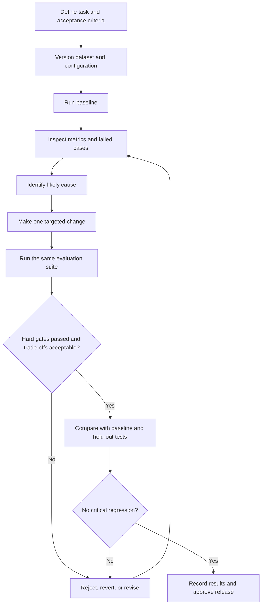

# 04 — Generative AI Optimization and Evaluation

## Why optimization starts with evidence

When a generative AI application gives a poor answer, it is tempting to rewrite the prompt or switch to a larger model. Either change might help, but neither is guaranteed to address the cause. The answer may be wrong because the instructions are unclear, the model is a poor fit for the task, retrieval missed the relevant evidence, or the application assembled the context incorrectly.

A more reliable approach is to define what success means, measure the current system, diagnose the failure, make a targeted change, and run the same tests again. That turns prompt experimentation into an engineering process.

This chapter focuses on prompt and generation settings, task-specific model comparison, RAG and fine-tuning trade-offs, evaluation datasets, and repeatable measurement. Detailed retrieval and tool-execution designs belong in Chapter 03; broader risk assessment, guardrails, and incident response belong in Chapter 05.

## 1. Define success before changing the system

Evaluation starts with the task, not with a metric. A customer-support answer, a structured extraction result, and a code-generation response do not have the same definition of quality.

For each application, write down:

- **Task success:** What must the system accomplish for the user?
- **Correctness and completeness:** Which facts, fields, or steps must be right?
- **Grounding:** Which claims must be supported by supplied evidence?
- **Instruction following:** Which format, tone, and constraints are mandatory?
- **Safety and privacy:** Which outcomes are unacceptable?
- **Performance:** What response time, failure rate, and cost are acceptable?

Separate hard requirements from preferences. A response that is slightly more concise may be preferable, but a privacy violation or invalid required schema may be an automatic failure.

### Example acceptance criteria

The values below are illustrative, not universal targets. Set real thresholds from product requirements, risk, user expectations, and measured baselines.

| Dimension | Example acceptance criterion |
|---|---|
| Task quality | At least 90% of representative cases meet the agreed rubric |
| Grounding | No unsupported critical policy claims in the reviewed test set |
| Latency | p95 end-to-end latency stays within the product's response-time budget |
| Reliability | Successful completion rate meets the service's target |
| Cost | Average cost per completed task stays within the budget |
| Safety | No critical policy or privacy failures in the release-gating cases |

Do not collapse every dimension into one weighted score. Some requirements—such as access control, safety, and required output validity—should be hard gates. A quality improvement should not be allowed to conceal a critical regression.

## 2. Design representative evaluation datasets

A test set should resemble the work the application is expected to perform. A handful of easy examples can make a prompt look excellent while leaving important failure modes undiscovered.

Include cases that reflect the actual task:

- Common requests and high-volume workflows.
- Difficult, ambiguous, or incomplete requests.
- Boundary cases and unusual input formats.
- Questions for which the supplied evidence is insufficient.
- Relevant safety-sensitive or adversarial cases.
- Representative long inputs, structured outputs, or tool-dependent tasks where applicable.

For each case, store the input, expected behavior, evaluation criteria, and any reference evidence needed to judge the answer. Some tasks need a reference answer; others are better assessed against required facts, a schema, a rubric, or executable tests.

### Example: a versioned JSONL dataset

JSON Lines is convenient because each line is an independent test case and can be added to version control.

```json
{"id":"policy-001","input":"How long do I have to return an item?","expected_facts":["Use the return period stated in the approved policy"],"source_ids":["returns-policy-v3"],"tags":["common","grounded"]}
{"id":"policy-002","input":"Can I return an item bought more than a year ago?","expected_facts":["Do not infer an exception that is not in the policy"],"source_ids":["returns-policy-v3"],"tags":["boundary","grounded"]}
{"id":"policy-003","input":"What is the return period for a product not covered by the supplied documents?","expected_facts":["State that the evidence is insufficient"],"source_ids":[],"tags":["unsupported","abstention"]}
```

These are illustrative test definitions. The expected facts should be made precise enough for the chosen evaluator and the real policy.

Keep a **development set** for prompt and configuration iteration and, where practical, a **held-out test set** for checking whether an improvement generalizes beyond the examples used during tuning. Avoid repeatedly tuning against the held-out set; doing so gradually turns it into another development set.

Version the dataset and its expected answers. Record why cases were added or changed. Verified production failures and user feedback should feed future dataset revisions, while preserving a stable benchmark for comparisons across releases.

## 3. Improve prompts and instruction design systematically

A useful instruction set makes the task and boundaries explicit. It should tell the model what to do, what evidence it may use, what output is expected, and what to do when it cannot answer reliably.

```python
SUPPORT_INSTRUCTIONS = """
You are a support assistant for our product.

Answer policy questions using only the approved source material
provided with the request.
Do not invent policy details, dates, prices, or product capabilities.
If the evidence is insufficient, say so instead of guessing.
Preserve important exceptions and qualifications.
Return the requested output format and cite the relevant source
when source information is available.
"""
```

When reviewing a weak result, classify the failure before changing the prompt:

- Did the model misunderstand the task?
- Was the required information missing from the context?
- Was the evidence present but ignored or misrepresented?
- Did the output violate a format or business rule?
- Did the application pass incorrect or unauthorized context?

Only the first and some of the fourth categories are likely to be fixed primarily through instructions. Missing evidence calls for a data or retrieval fix; incorrect application context requires an application fix.

Change one meaningful variable at a time where possible. Run the same evaluation set after a prompt change and inspect both improvements and regressions. More instructions are not automatically better: conflicting, duplicated, or overly restrictive instructions can create new failures.

## 4. Understand generation parameters

Generation parameters influence how a supported model produces its response. They do not supply missing knowledge or guarantee factual correctness. Parameter names, ranges, defaults, and availability vary by model and API, so check the selected model's documentation before configuring them.

| Parameter | General effect | Practical guidance |
|---|---|---|
| `temperature` | Controls the randomness of token selection for models that support it | Compare lower and higher values on the same cases. Lower values can make outputs more predictable, but do not guarantee correctness. |
| `top_p` | Limits token selection to a probability-mass subset | Treat it as an alternative sampling control where supported. Avoid changing it and temperature together in the first experiment. |
| `max_output_tokens` or equivalent | Limits the amount of generated output | Set a limit appropriate to the task. Too small a limit can truncate required reasoning or structured output; too large a limit can increase latency and cost. |
| Stop sequences, where supported | Stop generation when configured conditions are reached | Use only when the stopping behavior is well-defined and test for accidental truncation. |
| Structured-output or format settings, where supported | Constrain the response format, such as JSON | Prefer supported schema-constrained output for machine-consumed responses, then validate the result in application code. |

Do not assume every model exposes the same settings, or that identically named settings behave identically across providers.

### A controlled parameter experiment

1. Choose a fixed model, prompt version, dataset version, and application configuration.
2. Record the baseline settings and results.
3. Change one supported parameter.
4. Run the same cases; use repeated runs when variability is part of the behavior being measured.
5. Compare task quality, format validity, output length, latency, and cost.
6. Keep the change only if it improves the intended outcome without violating hard requirements.

For example, reducing temperature may reduce variation in some tasks, but it will not fix a retrieval pipeline that consistently returns the wrong policy. Diagnose the source of the error before tuning sampling settings.

## 5. Compare models against the actual workload

Public benchmark results are useful for narrowing the candidate list, but they do not establish which model will work best in a particular application. Task fit, context requirements, supported modalities, structured-output behavior, tool compatibility, latency, availability, and cost can all affect the decision.

Use a consistent comparison process:

1. **Describe the task.** Specify inputs, expected outputs, complexity, context size, and required capabilities.
2. **Shortlist suitable candidates.** Check model documentation, limitations, availability, and deployment constraints.
3. **Use the same test conditions.** Keep the dataset, prompt intent, evaluation rubric, and application path comparable. Record unavoidable differences.
4. **Measure more than answer quality.** Capture grounding where relevant, output validity, latency, failure rate, and estimated cost.
5. **Inspect failures.** Identify which types of requests each candidate handles poorly; an average score can hide a critical weakness.
6. **Choose against acceptance criteria.** Prefer a model that meets the task's quality and operational requirements without unnecessary cost or complexity.

### Model comparison record

| Candidate | Task quality | Grounding / validity | p95 latency | Cost per task | Failure patterns | Decision |
|---|---|---|---|---|---|---|
| Model A | Measure | Measure | Measure | Estimate / measure | Record examples | Meets / misses gates |
| Model B | Measure | Measure | Measure | Estimate / measure | Record examples | Meets / misses gates |

Fill this table with results from your own evaluation; do not substitute vendor benchmark scores for application measurements.

A smaller or less expensive model may be sufficient for a narrow, well-defined task. A more capable model may be justified when the task needs stronger reasoning, longer context, or more reliable instruction following. The correct choice is workload-specific, and should be rechecked when models, prices, or requirements change.

Keep **model selection** separate from **model optimization**. First establish that a candidate can meet the task requirements. Then tune its prompt, generation settings, retrieval configuration, and application flow.

## 6. Choose between RAG and fine-tuning

RAG and fine-tuning solve different problems. They can be combined, but neither is a universal replacement for the other.

| Question | RAG | Fine-tuning |
|---|---|---|
| Primary purpose | Supply relevant external evidence at request time | Adapt model behavior using task-specific examples |
| Changing or private facts | Often a strong fit when connected to approved, current sources | Not a dependable substitute for retrieving frequently changing facts |
| Consistent response style or task pattern | Can help through instructions and examples in context | May help when a repeated behavior remains unreliable after prompt improvements |
| Traceability to source documents | Can provide source passages for citation and review | Does not by itself establish that a generated claim is supported by a source |
| Operational considerations | Indexing, access filters, retrieval quality, context size, and search latency | Training-data quality, supported model options, training cost, and ongoing evaluation |

Use RAG when the system needs information from approved documents, current records, or changing organizational knowledge. Use fine-tuning when evaluation shows a repeatable behavior or format problem that prompting and application design do not adequately solve, and suitable training examples are available.

A practical decision sequence is:

1. Establish the baseline with a representative dataset.
2. Improve instructions and output constraints.
3. Check whether the application supplies the correct context.
4. Improve retrieval when relevant evidence is missing or poorly ranked.
5. Consider fine-tuning for a persistent, repeated behavior problem.
6. Compare the result with the baseline using the same held-out tests, including quality, safety, latency, and cost.

Do not fine-tune simply because answers contain incorrect facts if the real problem is that the required facts were never supplied.

## 7. Evaluate the whole application, not just the model

The deployed application may add retrieval, tools, conversation history, data transformations, formatting, and authorization logic. A model that performs well in isolation can still fail when these components are combined.

For RAG applications, evaluate retrieval and generation separately:

- **Retrieval:** Was the right evidence found, ranked highly enough, current, and authorized for the user?
- **Generation:** Does the answer accurately represent the evidence, preserve important caveats, and acknowledge gaps?
- **End-to-end behavior:** Did the complete application answer the user's question correctly and within the required operational limits?

Useful measures depend on the task. Retrieval may use metrics such as Recall@K or ranking measures. Generation may be assessed for correctness, completeness, groundedness, and citation quality. Structured outputs should be checked for syntax, schema, required fields, and business rules. For subjective tasks, use a defined rubric and human review rather than relying on a single automatic score.

Automated or model-based evaluators can help compare large numbers of outputs, but they can also be inconsistent or biased. Validate them against a human-reviewed sample, keep evaluator settings consistent across comparisons, and inspect important failures directly.

## 8. Measure quality, grounding, performance, cost, and reliability

Choose a small set of measures that reflect the application's risks and objectives. Keep the definitions consistent across runs.

| Dimension | What to measure | Questions to ask |
|---|---|---|
| Task quality | Correctness, relevance, completeness, instruction following | Did the answer solve the user's actual problem? |
| Grounding | Support for important claims, evidence coverage, citation correctness | Can the answer be traced to the supplied evidence? |
| Retrieval | Relevant evidence retrieved and ranked in useful positions | Did the model receive the passages it needed? |
| Output validity | Schema validity, required fields, business-rule checks | Can downstream systems safely consume the result? |
| Safety | Defined policy, privacy, and harmful-output checks | Did the system produce any prohibited or high-risk outcome? |
| Latency | End-to-end time; optionally p50/p95 and stage-level timing | Does the application meet its response-time objective? |
| Reliability | Completion rate, timeouts, error rate, recovery success | Does the workflow complete consistently under expected conditions? |
| Cost | Input/output tokens, retrieval and tool usage, estimated cost per successful task | Is the system cost-effective for completed work, not merely per request? |

Averages alone are insufficient. Review tail latency, failure categories, and the performance of important subgroups or task types. For high-impact workflows, a small number of severe failures may matter more than a modest improvement in the overall score.

Record enough information to reproduce each evaluation run:

- Model and deployment identifier or version, where available.
- Prompt and application version.
- Generation parameters.
- Evaluation dataset version.
- Retrieval/index configuration and relevant source versions.
- Evaluator version or rubric.
- Run date, per-case results, aggregate metrics, latency, and cost.

## 9. Make evaluation repeatable and use regression gates

Every meaningful change should trigger evaluation if it can alter application behavior. That includes prompt edits, model upgrades, generation parameter changes, retrieval or embedding changes, tool changes, and modifications to orchestration or context assembly.



A practical release gate can be expressed as explicit checks. The thresholds below are illustrative:

```python
from dataclasses import dataclass


@dataclass(frozen=True)
class EvaluationResult:
    quality_score: float
    critical_safety_failures: int
    invalid_output_rate: float
    p95_latency_ms: float
    estimated_cost_per_task: float


@dataclass(frozen=True)
class AcceptanceCriteria:
    minimum_quality: float = 0.90
    maximum_invalid_output_rate: float = 0.01
    maximum_p95_latency_ms: float = 2500
    maximum_cost_per_task: float = 0.05


def passes_release_gate(
    result: EvaluationResult,
    criteria: AcceptanceCriteria,
) -> bool:
    return (
        result.quality_score >= criteria.minimum_quality
        and result.critical_safety_failures == 0
        and result.invalid_output_rate
        <= criteria.maximum_invalid_output_rate
        and result.p95_latency_ms
        <= criteria.maximum_p95_latency_ms
        and result.estimated_cost_per_task
        <= criteria.maximum_cost_per_task
    )
```

The example illustrates the shape of a quality gate, not a complete evaluation framework. In a real system, calculate each value from recorded per-case results, define the scoring methodology, and set thresholds that match the product's requirements. The cost value is expressed in the application's chosen currency and accounting unit; it must be configured for the actual deployment.

Do not rely on a single score to make the release decision. A change that improves average quality but introduces a critical safety failure should fail the gate. Likewise, a small cost reduction should not justify a major reliability regression.

For higher-risk deployments, consider staged rollout, canary comparisons, or shadow evaluation before exposing a change to all users. Continue monitoring after release: offline tests are controlled, while production traffic reveals new requests, changing data, and failure patterns the test set may not yet cover.

## 10. Balance quality, latency, reliability, and cost

These dimensions interact. A larger model or longer context may improve some answers while increasing latency and cost. Extra retrieval or reranking can improve evidence selection but adds processing time. A more aggressive timeout may protect resources but cause more requests to fail.

Use a deliberate decision sequence:

1. **Set non-negotiable requirements.** Define minimum quality, safety, validity, and reliability thresholds.
2. **Measure the baseline.** Capture quality, end-to-end and tail latency, failures, and cost per completed task.
3. **Find the dominant bottleneck.** Determine whether the main issue is the model, prompt, context, retrieval, tools, or infrastructure.
4. **Change the relevant component.** Avoid replacing the model when the evidence shows that retrieval is the problem.
5. **Compare the full trade-off.** Include unsuccessful requests, retries, and extra tool calls in operational cost where possible.
6. **Keep only an acceptable improvement.** A change must pass the hard gates and meet the product's overall objectives.

Streaming can improve perceived responsiveness without necessarily reducing total generation time. Asynchronous I/O can increase throughput when requests overlap, but concurrency must be bounded to protect downstream services. Reusing clients, limiting unnecessary context, and avoiding redundant tool calls can reduce overhead, but validate each change with measurements.

There is no universal best model or parameter setting. The best configuration is the one that reliably meets the real task requirements within the application's latency and cost budget.

## 11. A practical optimization walkthrough

Imagine a support assistant that sometimes gives incorrect return-policy answers.

1. Build a versioned test set containing questions with known answers, ambiguous requests, and questions not covered by the approved documents.
2. Run the current application. Save its answer, retrieved passages, timing, token usage, and errors for each case.
3. Inspect the failures. If the correct policy passage is missing, investigate indexing, chunking, filters, or ranking.
4. If the passage is present but the answer misstates it, revise the instructions and test whether the model preserves exceptions and abstains when evidence is insufficient.
5. If the answer is correct but the output is too long or inconsistent, test output constraints and supported generation parameters.
6. If repeated behavior or formatting failures remain, compare suitable models and consider whether fine-tuning is justified.
7. Run the same evaluation suite and held-out checks. Compare quality, grounding, safety, p95 latency, reliability, and cost.
8. Keep the change only if it passes the acceptance criteria. Record the decision and retain the failed cases for future regression testing.

This process avoids treating every incorrect answer as a prompt problem. Each change should address a diagnosed failure and produce evidence that the system improved.

## Key takeaways

- Define success and acceptance criteria before tuning.
- Use representative, versioned datasets with development and held-out cases where practical.
- Change prompts and generation settings through controlled experiments.
- Select models against the application's workload, not benchmark scores alone.
- Use RAG to supply evidence; consider fine-tuning for persistent behavior patterns.
- Measure task quality alongside grounding, safety, latency, reliability, and cost.
- Run regression tests after changes and block releases that violate hard requirements.
- Revisit the evaluation dataset as verified production failures and user needs evolve.

The goal is not the highest isolated benchmark score. It is a generative AI application that completes its real tasks reliably, with evidence that changes improve the system without introducing unacceptable trade-offs.

## Further reading

- [Optimize generative AI model performance with Microsoft Foundry — Microsoft Learn](https://learn.microsoft.com/en-us/training/modules/optimize-generative-ai-model-performance-with-azure-ai-foundry/)
- [Azure AI Search vector search overview — Microsoft Learn](https://learn.microsoft.com/en-us/azure/search/vector-search-overview)
- [Evaluate generative AI applications — Microsoft Learn](https://learn.microsoft.com/en-us/azure/ai-studio/concepts/evaluation-approach-gen-ai)

> **Enterprise AI Engineering Handbook**
>
> *Building Production-Grade Enterprise AI Systems — One Chapter at a Time.*
