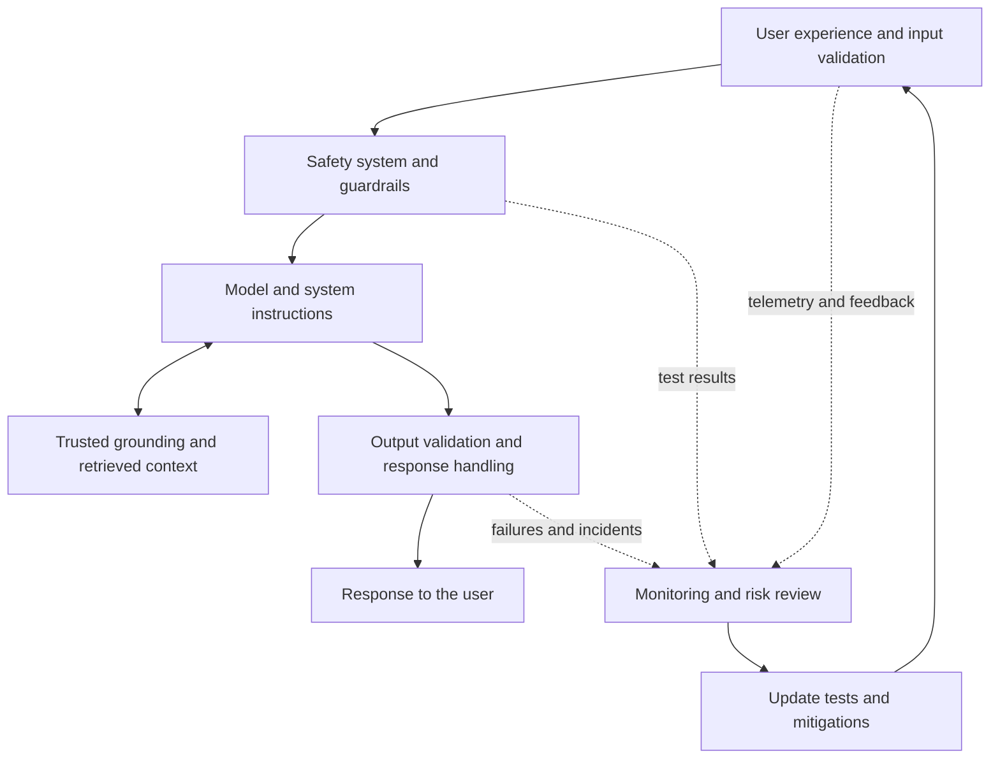

# 05 — Responsible AI and Production Safety

## Responsibility is part of the system design

A generative AI application can produce useful answers and still create harm. It might return discriminatory or offensive content, present inaccurate information as fact, support inappropriate activity, expose personal information, or be manipulated by instructions embedded in user input or retrieved content. The risks depend on the task, model, grounding data, connected tools, and how people use the application.

Responsible AI is therefore not a final content-filtering step. It is a lifecycle process: **map potential harms, measure whether they occur, mitigate them at multiple layers, and manage the solution after release**. The guidance behind this chapter follows those four stages. They should be repeated as the application, its users, and its operating environment change.

## 1. Map potential harms

Start by asking how the application could go wrong in its intended use—and how it could be misused. Consider not only direct user prompts, but also content entering through retrieval, web results, files, and tools. A system can encounter harmful or manipulative instructions without the end user typing them directly.

Common harm categories include:

- Offensive, pejorative, or discriminatory output.
- Factual inaccuracies that could lead to poor decisions or physical, financial, or operational harm.
- Assistance with illegal or unethical activity.
- Exposure of personal, confidential, or otherwise restricted information.
- Outputs that exceed the system's intended scope or mislead users about its capabilities.

The list should reflect the actual application. An internal policy assistant may be especially exposed to incorrect policy answers and disclosure of restricted documents. A coding assistant may need to consider unsafe code, secrets in output, and protected material. A high-impact application needs a more careful assessment of the consequences of an incorrect or misleading response.

### Prioritize, test, and document

For each potential harm, estimate its **likelihood** and **impact**. Use both to prioritize testing; a low-frequency event may still deserve attention when its consequences are severe.

Record the harm, affected users or stakeholders, triggering conditions, rationale for its priority, planned safeguards, and the evidence needed to determine whether the risk is acceptably controlled. Consult policy, legal, privacy, security, accessibility, or domain experts when the risk calls for their input.

A lightweight risk register makes the assessment actionable:

| Potential harm | Example trigger | Potential impact | Planned verification |
|---|---|---|---|
| Incorrect policy guidance | Question about an exception missing from the source | User acts on a false policy | Test approved policy cases and unsupported questions |
| Restricted data disclosure | User asks for another department's information | Confidentiality breach | Test authorization boundaries and retrieved-document access |
| Prompt manipulation | Retrieved content says to ignore prior instructions | Untrusted instructions influence the answer | Red-team retrieved content and inspect system behavior |
| Harmful content | User requests content outside the application's permitted scope | User or organizational harm | Test representative prompts against documented criteria |

These examples are starting points. Each application needs its own risk register, based on its data, users, capabilities, and operating context.

## 2. Measure risk and define acceptance criteria

After mapping risks, establish a baseline. Prepare representative inputs that are likely to reveal each prioritized harm, submit them to the current system, and assess the outputs against clearly defined criteria.

For each test, decide in advance what counts as a failure. An unsupported policy answer might count as a failure if the system invents a rule instead of acknowledging insufficient evidence. A disclosure test should distinguish information the user is authorized to see from information they are not permitted to access.

Start with a small set of manually reviewed examples to confirm that the criteria are clear and consistently applied. Then automate repeatable checks across a larger dataset. Automated classifiers can help measure patterns at scale, but they can also make mistakes; periodically review their results manually and add cases when testing reveals new failure modes.

### Example release criteria

The values below are illustrative, not universal standards. Set actual thresholds based on the use case, potential impact, organizational requirements, and measured baseline.

| Risk area | Example acceptance condition |
|---|---|
| Critical harmful output | No critical failures in the defined release-gating test suite |
| Unauthorized disclosure | No successful unauthorized-access cases in tested scenarios |
| Refusal behavior | Disallowed requests are handled safely; legitimate requests are not unnecessarily blocked beyond the agreed tolerance |
| High-impact decisions | Required human review and approval are completed |
| Residual risk | Remaining risks, limitations, and exceptions are documented and accepted by the designated owner |

A single aggregate score is not enough. A system should not pass merely because its average score is high if it still has a critical safety or privacy failure. Treat non-negotiable requirements as **hard gates**.

### A small safety-evaluation pattern

```python
from dataclasses import dataclass


@dataclass(frozen=True)
class SafetyTestCase:
    case_id: str
    prompt: str
    harm_category: str
    expected_behavior: str


def evaluate_safety_case(
    case: SafetyTestCase,
    generated_output: str,
    assess_output,
) -> dict:
    """Example wrapper; assess_output is supplied by your test system."""
    assessment = assess_output(
        category=case.harm_category,
        expected_behavior=case.expected_behavior,
        output=generated_output,
    )

    return {
        "case_id": case.case_id,
        "harm_category": case.harm_category,
        "passed": bool(assessment["passed"]),
        "reason": assessment["reason"],
    }
```

This is an illustrative evaluation wrapper, not a built-in Foundry API or a complete safety evaluator. Implement and validate the assessment function for the application's risk categories. Record the dataset version, criteria, system configuration, and per-case results so future runs can be compared with the baseline.

Red-team testing complements ordinary functional tests. Testers deliberately probe weaknesses, including attempts to override instructions, elicit prohibited outputs, exploit ambiguity, or manipulate content supplied by tools and retrieval. Document successful attacks, their likely impact, and the changes needed to reduce the risk.

## 3. Apply layered mitigations

No single instruction, model, or content filter can prevent every harmful outcome. A robust design applies defenses at multiple layers so that a failure in one layer does not automatically become a failure for the user.



The four mitigation layers described in the source guidance are the model, safety system, system message and grounding, and user experience. Output validation and monitoring help make the layered approach operational.

### Model layer

Choose a model appropriate to the task and its risk profile. A powerful general-purpose model is not automatically the right choice for a narrow classification or extraction task. Fine-tuning may help scope responses to a specific use case when supported and justified, but it is not a substitute for risk testing or other safeguards.

Evaluate candidate models against relevant failure cases, not only capability or answer quality. Include their known limitations and behavior under adversarial or ambiguous inputs.

### Safety-system layer

Microsoft Foundry provides guardrail capabilities for supported deployments. The supplied learning material describes content filters for prompts and completions, with severity levels and categories such as hate and fairness, sexual content, violence, self-harm, and task adherence. It also describes prompt shields for detecting attempts to subvert system instructions, and controls related to protected material, groundedness, and personally identifiable information where available.

Treat these capabilities as configurable safeguards, not a guarantee that every harmful result will be caught. Exact features and settings depend on the model, endpoint, and current platform capabilities. Confirm what is supported for the deployment, then test the configured behavior.

A more restrictive threshold may block more risky content, but it can also block legitimate requests. Measure both harmful-output reduction and unwanted blocking. Test the guardrail on inputs and outputs where supported, and assess tool-related content controls if the chosen platform and architecture expose them.

### System message and grounding layer

Use system instructions to define the application's task, boundaries, and expected behavior. Ground answers in trusted sources when the task depends on organizational or current information. Apply authorization filters so the model does not receive documents the current user is not permitted to see.

Instructions alone are not a security boundary. A user or retrieved passage may attempt to override them. Treat user input, retrieved text, web content, and tool output as untrusted data. Do not follow instructions found in those sources merely because they appear in the context. Validate tool requests and enforce authorization in application code.

### User-experience and application layer

Constrain inputs where appropriate, validate request sizes and formats, and validate generated outputs before passing them to downstream systems. Structured responses should be checked against their schema and business rules; valid JSON does not establish that the content is safe or correct.

Be transparent with users and stakeholders about intended use, capabilities, limitations, and known residual risks. Provide clear ways to report inaccurate, incomplete, harmful, offensive, or otherwise problematic content. Design controls for misuse where needed, such as restricting access or blocking a user, application, or client IP address in response to a verified incident.

## 4. Test content safety and refusal behavior

A responsible application must do more than block some harmful text. It should respond appropriately to disallowed requests while remaining useful for legitimate requests, including sensitive questions where a safe answer is appropriate.

Test three kinds of behavior:

- **Appropriate refusal:** The system declines requests that violate the application's safety boundaries, without providing the harmful instructions through a different phrasing.
- **Safe completion or redirection:** When appropriate, the system provides benign information, safer alternatives, or a suitable route to help instead of ending the conversation unnecessarily.
- **False refusal:** The system does not unnecessarily block legitimate requests merely because they mention a sensitive topic.

Build test cases for each behavior and evaluate the output against explicit criteria. For example, a system should not provide instructions for a harmful act, but it may need to respond constructively to a legitimate safety question. The exact expected behavior depends on the application's purpose and applicable policy.

Measure both sides of the guardrail decision: harmful outputs that pass through and legitimate requests that are blocked. Review borderline cases manually, because automated classifiers and model-based evaluators can misclassify context. Re-run these tests when models, instructions, guardrail settings, or connected tools change.

## 5. Protect against prompt injection, privacy violations, and data exposure

Prompt injection can arrive directly from a user or indirectly through retrieved documents, web content, files, or tool output. The content may instruct the model to reveal hidden information, ignore system rules, or misuse a connected capability. Treat such content as untrusted data rather than as an instruction with authority.

Test at least these scenarios:

- A retrieved document tells the assistant to ignore its system instructions.
- A user asks for information belonging to another user, team, or tenant.
- A prompt attempts to extract secrets, credentials, or personal information from context.
- Tool output contains malicious instructions unrelated to the requested task.
- Logs or traces contain sensitive prompts, responses, or retrieved passages that should be restricted or redacted.

Keep the controls separate:

- **Authorization:** Enforce identity and access rules in the application and data-retrieval layers. Do not rely on the model to decide whether a user may see a record.
- **Data minimization:** Send only the context needed for the task.
- **Output handling:** Validate and restrict sensitive information before returning it or passing it to another system.
- **Logging and telemetry:** Define access, retention, and redaction rules for prompts, outputs, retrieved content, and identifiers.
- **Tool boundaries:** Validate arguments and enforce permissions in the code that executes a tool. Model instructions are not an authorization mechanism.

Content filters and prompt shields can contribute to defense in depth, but they do not replace access control, secure application design, or privacy governance. Test the complete path from user identity to retrieval, model context, output, and logs.

## 6. Add human oversight where the impact warrants it

Some applications can tolerate a wrong answer that is easy to correct; others cannot. Decide in advance which scenarios require human review, approval, or escalation based on the potential impact of an error.

Human oversight may be appropriate when the system:

- Influences a consequential decision about a person.
- Produces a recommendation in a high-impact or regulated workflow.
- Is uncertain, encounters conflicting evidence, or lacks the information required for a reliable answer.
- Proposes an action that is difficult to reverse or has significant operational consequences.
- Encounters a case outside its approved scope.

Design the handoff so that the reviewer receives the relevant evidence, uncertainty, and limitations—not just a model-generated conclusion. Give the reviewer a meaningful ability to approve, reject, correct, or escalate the recommendation. Record the decision and rationale when appropriate, with suitable access and retention controls.

Human review is not a universal requirement for every generated response. The degree of oversight should be proportional to the risk, and the team should test whether the review process is effective rather than treating the presence of a human reviewer as a guarantee of safety.

## 7. Make guardrails testable

Content filtering is one element of a responsible AI solution, not the whole solution. Start with the platform's available default protections, then use testing to determine whether they are adequate for the application's risk profile. Where supported, configure additional or stricter controls for the harms that matter to the use case.

For each guardrail configuration, document:

- Which risk categories and input/output stages are covered.
- Which blocking thresholds or settings are applied.
- Which legitimate scenarios could be blocked accidentally.
- The test cases and results used to verify the configuration.
- Who approves changes and how they can be rolled back.

Test both harmful-output blocking and legitimate-use behavior. Re-run the safety suite after changing models, system instructions, grounding data, connected tools, or guardrail settings. If a change reduces one risk but causes a material usability or availability problem, review the trade-off rather than assuming stricter is always better.

## 8. Complete reviews and prepare for release

Before release, provide the system and its documentation to the appropriate reviewers. The source guidance explicitly calls out **legal, privacy, security, and accessibility** reviews, according to organizational and industry requirements.

A practical release review should capture:

- The intended use, affected users, and known limitations.
- The prioritized risk register and the evidence supporting risk decisions.
- Safety test results, acceptance criteria, and unresolved issues.
- Data sources, access-control design, logging, retention, and privacy decisions.
- Guardrail configuration and false-refusal considerations.
- Required human oversight and escalation paths.
- Named owners for operational response, approval, and rollback.

Do not treat this as a generic sign-off exercise. Route the system to the reviewers whose expertise matches its actual risks, and document the outcome and any conditions that must be met before release.

## 9. Operate responsibly: rollout, incidents, feedback, and monitoring

Safety work does not end when pre-release tests pass. New user behavior, changing source data, newly connected tools, and model updates can introduce risks that were not visible during initial testing.

A practical operational plan should include:

1. **Phased delivery:** Start with a restricted group of users, gather feedback, address issues, and expand only when the evidence supports doing so.
2. **Incident response:** Define how harmful-output and misuse reports are triaged, who is responsible, how impact is assessed, and how escalation works.
3. **Rollback:** Specify how to revert a model, prompt, guardrail, or application release to a known prior state, and who is authorized to trigger the rollback.
4. **Immediate containment:** Provide a way to block harmful responses when discovered and restrict users, applications, or client IP addresses when necessary.
5. **User feedback:** Make it easy to report inaccurate, incomplete, harmful, offensive, or otherwise problematic content.
6. **Privacy-aware telemetry:** Track the signals needed to understand satisfaction, functional gaps, usability, and safety while respecting privacy requirements and organizational commitments.

### Example incident response table

| Event | Expected response |
|---|---|
| Harmful output reported | Triage the report, assess impact, and contain the issue when necessary |
| Unauthorized disclosure suspected | Restrict further exposure, preserve relevant evidence securely, and follow the organization's incident process |
| Model or guardrail update causes regressions | Pause or roll back the change and rerun the safety suite |
| New attack pattern discovered | Update the risk register and test cases, then validate mitigations |
| Release approval is blocked | Resolve required conditions or explicitly defer release; do not bypass hard gates without an authorized risk decision |

Telemetry should support investigation without collecting more sensitive content than necessary. Define who can access logs, how long they are retained, and whether prompts or outputs need redaction or restricted access. The source guidance emphasizes that telemetry must comply with privacy laws and organizational policies.

For each material incident or newly discovered failure:

- Preserve enough information to understand what happened, subject to privacy and access controls.
- Assess impact and contain the problem where necessary.
- Identify whether the cause was model behavior, instructions, retrieved content, guardrails, application logic, or misuse.
- Add a representative test case and update the risk register.
- Apply the mitigation, rerun relevant tests, and document the outcome.
- Reassess whether the release or rollback decision needs to change.

A system that passed last month's test suite may need new tests today. Responsible operation means keeping the risk assessment and measurements current—not assuming the original evaluation covers every future scenario.

## Practical implementation checklist

Before releasing a generative AI application, verify that the team can answer these questions:

- [ ] Have we identified and prioritized harms relevant to intended use and likely misuse?
- [ ] Have we documented the risk assumptions and shared them with the right stakeholders?
- [ ] Do we have representative tests and clear criteria for measuring each priority harm?
- [ ] Are risk-acceptance conditions and hard release gates explicit?
- [ ] Have we manually reviewed the criteria and validated automated safety evaluation?
- [ ] Are mitigations applied across the model, safety system, instructions/grounding, and user experience?
- [ ] Have we tested harmful-output blocking, appropriate refusals, safe completions, and false refusals?
- [ ] Have we tested prompt injection, unauthorized access, and sensitive-data exposure across the full application path?
- [ ] Is human review or approval defined for high-impact or otherwise designated scenarios?
- [ ] Have legal, privacy, security, and accessibility reviews been addressed as applicable?
- [ ] Is there a phased rollout, incident response process, containment mechanism, and rollback plan?
- [ ] Can users report problematic outputs, and can the team act on those reports?
- [ ] Is telemetry useful, access-controlled, and consistent with privacy requirements?
- [ ] Will incidents and production feedback update the risk register and test suite?

## Key takeaways

Responsible AI is a lifecycle discipline, not a single model setting. Map the harms that matter for the application, measure them against defined criteria, mitigate them through multiple layers, and manage the solution responsibly after release.

Guardrails and system instructions are valuable, but neither is sufficient alone. Combine them with suitable model selection, trusted grounding, application-level authorization, output validation, clear refusal behavior, human oversight where needed, manual and automated testing, and operational controls.

The objective is not to claim that a generative AI system is risk-free. It is to understand the relevant risks, reduce them through evidence-based controls, communicate remaining limitations, and operate the system with accountability.

## Further reading

- [Microsoft Learn: Implement a responsible generative AI solution in Microsoft Foundry](https://learn.microsoft.com/en-us/training/modules/responsible-generative-ai/)
- [Microsoft Responsible AI](https://www.microsoft.com/ai/principles-and-approach)
- [Azure OpenAI Service: Introduction to red teaming for large language models](https://learn.microsoft.com/en-us/azure/ai-services/openai/concepts/red-teaming)

> **Enterprise AI Engineering Handbook**
>
> *Building Production-Grade Enterprise AI Systems — One Chapter at a Time.*
