# 01 — Azure AI Architecture and Model Lifecycle

*From Foundry foundations to model selection, deployment, and
evaluation*

## Overview

A generative AI application is more than a model endpoint. You need a
place to organize the work, a way to choose and deploy a model, and a
repeatable way to check whether it behaves well enough for the job. This
chapter walks through those pieces in the order you are likely to meet
them.

**Microsoft Foundry** provides a portal and programmatic tools for
developing **AI solutions on Azure**. The portal supports **model discovery**
**and deployment, project configuration, and experimentation**. The **SDKs and
APIs** let developers integrate **model capabilities into applications** and
automate repeatable operations.

This chapter explains two Microsoft azure AI concepts:

1.  **Plan and prepare to develop AI solutions on Azure** — platform
    boundaries, the Foundry portal, developer tools, SDKs, Foundry
    Tools, and responsible AI principles.
2.  **Select, deploy, and evaluate Microsoft Foundry models** — model
    catalog exploration, model cards and benchmarks, deployment choices,
    playground testing, and manual and automated evaluation.

The aim is to connect the AI concepts with what you actually do
in the portal, then make a model choice you can explain. The 
**Foundry interface and available models change over time**, so treat the
**screenshots** below as visual guides—not as proof that every button or
option will look exactly the same in your account.

> **Learning pattern:** Understand the concept → see where it appears in
> Foundry → try it in the portal → validate the result → record the
> architectural lesson.

## 1. Understand the Microsoft Foundry platform

### 1.1 Resource hierarchy

**A Foundry project** belongs to a Microsoft Foundry resource. The resource
sits within the wider Azure subscription and resource-group structure.

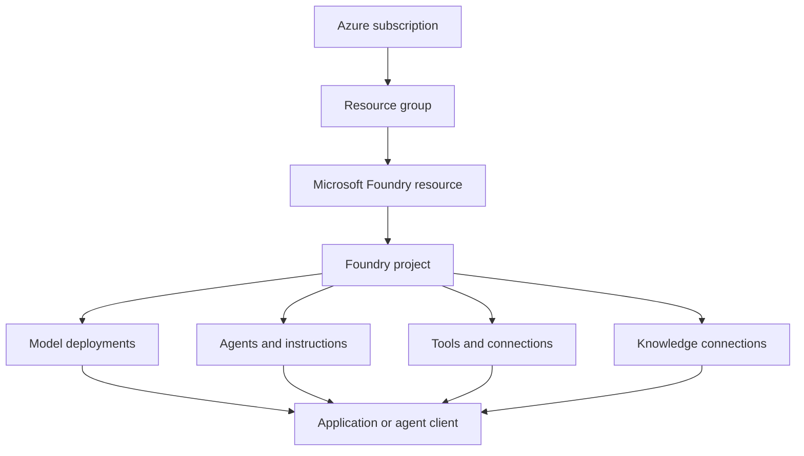

| Component                  | Plain-English explanation                                                                        | Why it matters                                                                          |
|:---------------------------|:-------------------------------------------------------------------------------------------------|:----------------------------------------------------------------------------------------|
| Azure subscription         | The larger Azure billing, policy, quota, and governance boundary.                                | Determines which subscription and governance controls apply.                            |
| Resource group             | A logical group for related Azure resources.                                                     | Helps organize lifecycle, access, and management.                                       |
| Microsoft Foundry resource | The Azure resource boundary that supports Foundry projects and capabilities.                     | Resource configuration and region can affect what is available.                         |
| Foundry project            | A workspace for solution assets such as deployments, connections, and development configuration. | Gives developers a place to organize and work with a solution.                          |
| Model deployment           | A configured model made available for inference.                                                 | Supplies the endpoint and deployment details an application uses.                       |
| Application                | The code or service that calls the model and implements the business behavior.                   | Adds identity, state, validation, retries, observability, and domain-specific controls. |

A Foundry resource can support more than one project. A project may
contain multiple deployments and other AI assets. This separation can
help organize applications or environments, but it is not a substitute
for deliberate access control and environment governance.

> **Terminology note:** Microsoft Foundry has evolved from earlier Azure
> AI Foundry and hub-based experiences. The current portal may differ
> from attached screenshots. Follow the interface shown in your
> tenant and use the current documentation when labels or capabilities
> do not match.

### 1.2 What belongs in a project?

A useful mental model is that a project organizes the assets used to
build an AI solution:

- **Models:** deployed language or multimodal models that applications
  can invoke.
- **Agents:** model-backed configurations that can combine instructions,
  tools, and knowledge.
- **Tools:** built-in capabilities, custom integrations, and external
  connections.
- **Knowledge:** data sources or retrieval connections used to ground
  responses.
- **Connections and configuration:** details needed to access supported
  services and work with the project.

Not every solution needs every asset. A simple text-generation
application may need only a model deployment and client application. A
grounded agent may also need a knowledge source and tools.

### Infographic 01: Foundry project overview

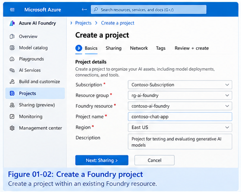

<!--Sample image only.* When you do the lab, replace this with a capture of
your own project overview. Hide tenant, subscription, endpoint, and
other sensitive details before sharing it.-->

The point to notice is the project context and its navigation. A project
is where you work with the solution’s assets; browsing a model in the
catalog does not mean you have deployed it.

### 1.3 Portal, APIs, and developer tools

The portal is a good place to explore and try things out. For a real
application, you will usually move into a code editor and use an API or
SDK, tests, and deployment automation.

The source module introduces Visual Studio Code and Foundry-related
extensions as one possible development environment. It also
distinguishes between direct model interaction and higher-level agent
development:

| Option                | Use it when                                                                                      | Architectural role                                                          |
|:----------------------|:-------------------------------------------------------------------------------------------------|:----------------------------------------------------------------------------|
| REST API              | You need a language-neutral HTTP integration or direct control over requests.                    | Lowest-level interface in this comparison.                                  |
| OpenAI SDK            | You are directly calling a compatible model API for chat or generation.                          | Convenient client for model interaction.                                    |
| Microsoft Foundry SDK | You are working with broader Foundry capabilities and supported project or agent operations.     | Higher-level integration with the Foundry platform.                         |
| Foundry Tools SDKs    | You need a specialized capability such as speech, language, translation, or document processing. | Adds a task-specific AI service alongside or instead of a generative model. |

Choose an SDK based on the API and service you actually need. Do not
assume that all SDKs expose identical features or use the same endpoint
and authentication pattern.

### 1.4 Foundry Tools beyond generative models

A generative model is not automatically the best or only option for
every AI task. The module also introduces specialized Foundry Tools,
including capabilities for:

- **Language:** language detection, key phrases, entities, and related
  text analysis.
- **Speech:** speech recognition and speech synthesis.
- **Translation:** converting text or speech between languages.
- **Document processing:** extracting information from forms, invoices,
  receipts, and other documents.
- **Content understanding:** interpreting information in documents and
  other supported content.

For a production design, decide whether a model, a specialized service,
or a combination of both best meets the requirement. For example, a
model may explain a document, while a document-processing service
extracts structured fields that need predictable validation.

### 1.5 Responsible AI starts during design

The first module introduces Microsoft’s six responsible AI principles:

1.  **Fairness**
2.  **Reliability and safety**
3.  **Privacy and security**
4.  **Inclusiveness**
5.  **Transparency**
6.  **Accountability**

These principles affect more than the final safety review. They
influence model choice, data access, prompt design, user experience,
evaluation, monitoring, and operational ownership. This chapter
introduces the principles; detailed risk assessment, mitigations, and
production safety belong in the dedicated responsible AI chapter.

## 2. Follow the model lifecycle

A model-selection workflow should start with a workload requirement—not
with whichever model is newest or most prominent in the catalog.

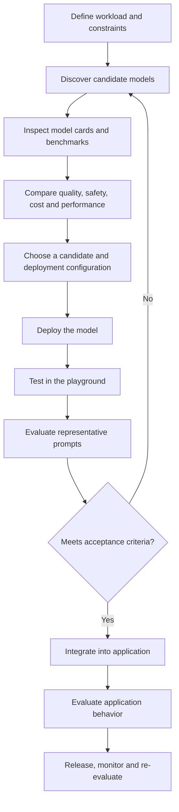

The playground is useful for early experiments, but one good answer does
not prove production readiness. Real application behavior also depends
on prompts, retrieved data, tools, identity, business rules, error
handling, and user experience.

## 3. Explore the model catalog

The model catalog helps you discover possible candidates and inspect
their supported capabilities and deployment options. The source
transcript describes models from Azure-hosted offerings as well as
partner and community providers. Billing, hosting, licensing, and
supported deployment options can differ between offerings.

### 3.1 Shortlist models against the workload

Before opening the catalog, write down what the application must do.

| Decision factor         | Questions to answer                                                                                   |
|:------------------------|:------------------------------------------------------------------------------------------------------|
| Task                    | Is the workload conversation, summarization, extraction, coding, reasoning, or multimodal processing? |
| Quality                 | What counts as a correct and useful answer? Which errors are unacceptable?                            |
| Modalities              | Does it need text only, or image, audio, or other supported inputs and outputs?                       |
| Context and output      | How much input context is required? How long should responses be?                                     |
| Tool support            | Does the required model/API support the tool-calling behavior?                                        |
| Latency and throughput  | What are the response-time, concurrency, and throughput targets?                                      |
| Cost                    | What is the expected request volume and budget per task?                                              |
| Processing requirements | What privacy, residency, or regulatory constraints apply?                                             |
| Availability            | Is the model available for the needed region, deployment type, and scope?                             |
| Customization           | Is fine-tuning or another supported customization path required?                                      |

Large models may be useful for complex reasoning or varied tasks but can
cost more and respond more slowly. Smaller models may suit bounded tasks
where throughput and cost matter. These are hypotheses to test, not
universal rules.

### Infographic 02: Model catalog and filters

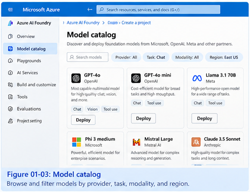

<!-- *Sample image only.* In your own screenshot, show a search or filter
that helps narrow the list. Pick two candidates for the same workload
and jot down why each deserves a closer look.-->

### 3.2 Read a model card

Think of the model card as your first due-diligence check. It helps you
decide whether a candidate is worth testing. Depending on the model and
current portal experience, inspect:

- provider and model family;
- intended tasks and supported modalities;
- context-window and output constraints;
- tool/function-calling support where applicable;
- benchmark and evaluation information;
- known limitations and responsible AI considerations;
- supported deployment options and availability;
- licensing, pricing, or terms that apply to that offering.

Do not infer support from a model name alone. Verify the specific model
version, API, and deployment option.

### Infographic 03: Model card

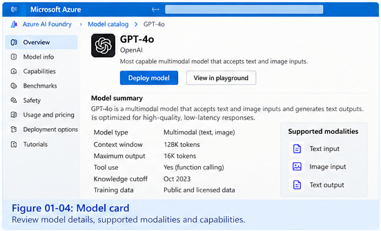

<!--*Sample image only.* On the real model card, note three capabilities,
two limitations or constraints, and one question you still need to
verify. Check the actual model version and deployment option rather than
assuming every version supports the same features.-->

## 4. Compare benchmark metrics carefully

The second module demonstrates comparing models through benchmark
information and a leaderboard or trade-off view. Benchmarks can help
narrow the shortlist, but they do not replace tests on your own prompts
and data.

The transcript discusses several dimensions:

| Dimension      | What it tells you                                                                    | What it does not guarantee                                                                |
|:---------------|:-------------------------------------------------------------------------------------|:------------------------------------------------------------------------------------------|
| Quality        | How useful or successful responses were under a benchmark’s conditions.              | That the model will answer your domain questions correctly.                               |
| Safety         | How the model performed on particular safety-related tests.                          | That every unsafe or adversarial input will be handled correctly.                         |
| Throughput     | How quickly the model processes prompts or returns output under measured conditions. | That your application will meet its latency target under your traffic pattern.            |
| Cost           | A benchmark or estimated cost comparison under stated assumptions.                   | Your actual bill, which depends on usage, pricing, output length, and deployment details. |
| Context window | The amount of context the model can accept within the supported configuration.       | That it will use every part of a long input equally well.                                 |
| Fluency        | Linguistic correctness and naturalness of the response.                              | That the answer is factually correct or relevant.                                         |

Benchmark methods and scales may differ. Check the model version, test
conditions, date, and methodology where available. Avoid treating a
single leaderboard score as a complete ranking for every workload.

### Example: the fastest model is not always the best model

Imagine two hypothetical candidates for an internal support assistant:

| Measure                       |                   Candidate A |                            Candidate B |
|:------------------------------|------------------------------:|---------------------------------------:|
| Relative response speed       |                        Faster |                                 Slower |
| Relative cost                 |                         Lower |                                 Higher |
| Answer detail in sample tests |                         Brief |                     More comprehensive |
| Best initial fit              | High-volume, bounded requests | Requests requiring richer explanations |

These are illustrative values and observations, not real Foundry
benchmark results. If the application only needs short classifications,
Candidate A may be a good fit. If users need detailed explanations,
Candidate B may justify its cost. The next step is to test both with the
same representative prompts.

### Infographic 04: Leaderboard or trade-off chart

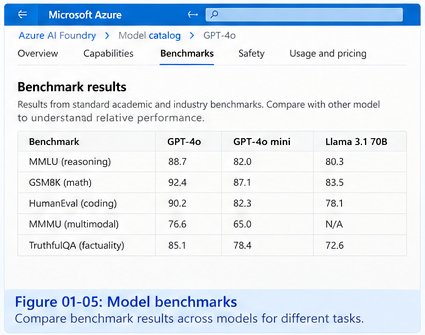

<!--*Sample image only; the displayed scores are illustrative.* Use the
current portal’s comparison view if available. Decide which candidate
you would test first, then write down what evidence you still need. A
leaderboard can help you shortlist models, but it cannot tell you how
your own application will perform.-->

## 5. Choose deployment mode and processing scope separately

Deployment configuration is a consequential architectural decision. Two
separate questions must be answered:

1.  **How will inference capacity and requests be served?**
2.  **Where may inference data be processed under the selected
    offering’s terms?**

The available combinations depend on the model and service offering.
Confirm current options in the model’s deployment experience and
documentation.

### 5.1 Deployment modes described in the module

| Mode            | General characteristics                                                                                                         | When to investigate it                                                                       |
|:----------------|---------------------------------------------------------------------------------------------------------------------------------|:---------------------------------------------------------------------------------------------|
| **Standard**    | Consumption-oriented serving, commonly billed by usage; performance and capacity depend on the offering and service conditions. | Interactive or variable workloads where its limits and behavior are acceptable.              |
| **Provisioned** | Reserved processing capacity, commonly expressed through provisioned throughput units (PTUs), subject to offering terms.        | Sustained workloads where reserved capacity and predictable throughput may justify the cost. |
| **Batch**       | Asynchronous processing for eligible workloads; results are retrieved after the job completes.                                  | Large non-interactive workloads where immediate responses are unnecessary.                   |
| **Developer**   | A limited option for development or evaluation of supported offerings.                                                          | Temporary testing where explicitly available; not a default production choice.               |

Do not assume every mode exists for every model. Quotas, supported APIs,
region, pricing, and capacity can change.

### 5.2 Processing scope

| Scope                            | General meaning to verify                                                                       | Main trade-off                                                                           |
|:---------------------------------|:------------------------------------------------------------------------------------------------|:-----------------------------------------------------------------------------------------|
| **Global**                       | Processing may occur across supported Azure regions according to the specific service terms.    | May provide broad capacity, but may not meet strict geographic processing requirements.  |
| **Data Zone**                    | Processing is constrained to the Microsoft-defined data zone applicable to the offering.        | Can help meet a defined boundary if that boundary satisfies organizational requirements. |
| **Regional or geography-scoped** | Processing is constrained according to the region or geography option supported for that model. | Provides tighter location control, but availability and capacity may differ.             |

These are conceptual descriptions, not a promise that every option is
available for every model or region. Verify the actual terms for the
selected deployment.

### 5.3 Example workload decisions

| Workload                           | Initial option to investigate              | What to validate                                                                 |
|:-----------------------------------|:-------------------------------------------|:---------------------------------------------------------------------------------|
| Bursty interactive support         | Standard with an approved processing scope | Latency, throttling, quota, and cost under realistic traffic.                    |
| Sustained high-volume inference    | Provisioned                                | Required throughput, utilization, and cost versus reserved capacity.             |
| Nightly document backlog           | Batch, if supported                        | Completion time, failed-job handling, and supported model/scope combination.     |
| Workload with location constraints | Compatible Data Zone or regional option    | Whether the exact processing boundary meets policy and contractual requirements. |

Treat these as starting hypotheses, not universal prescriptions.

### Infographic 05: Deployment configuration

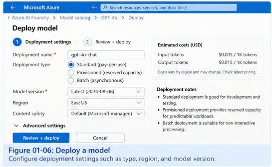

<!-- *Sample image only.* Before deploying, check the model, deployment type,
region or processing scope where applicable, quota, and expected cost.
Never include keys or secrets in a screenshot. -->

### 5.4 Record the decision

A lightweight decision record prevents an experimental choice from
becoming an undocumented production dependency.

``` python
from dataclasses import dataclass
from typing import Optional


@dataclass(frozen=True)
class ModelDecision:
    model_name: str
    deployment_name: str
    workload: str
    evaluation_dataset_version: str
    quality_result: str
    latency_p95_ms: Optional[int]
    estimated_cost_per_1k_requests: Optional[float]
    deployment_mode: str
    processing_scope: str
    test_date: str
    known_limitations: tuple[str, ...]


# Illustrative template: replace placeholders with measured or verified values.
decision = ModelDecision(
    model_name="candidate-model",
    deployment_name="support-answering-test",
    workload="grounded support answers",
    evaluation_dataset_version="support-eval-v1",
    quality_result="Pending evaluation",
    latency_p95_ms=None,
    estimated_cost_per_1k_requests=None,
    deployment_mode="Verify selected mode",
    processing_scope="Verify selected scope",
    test_date="YYYY-MM-DD",
    known_limitations=("Requires retrieval for internal policy facts",),
)
```

This is a record template, not model-selection logic. Do not enter `0`
for an unknown measurement. Keep measured values separate from
estimates, and record test conditions so later comparisons are
meaningful.

## 6. Deploy and test in the playground

Once you select a supported model and configuration, deploy it to make
it available for inference. The endpoint and deployment information are
environment-specific configuration that the client application must use.

A practical first test should answer more than “does it respond?” Use a
small, repeatable prompt set that represents the intended workload.

### A simple manual test set

For an AI software-development assistant, for example:

1.  **Basic task:** “Describe three considerations when designing a
    generative AI application.”
2.  **Constraint-following task:** “Explain the same considerations in
    exactly five bullet points.”
3.  **Ambiguous request:** “Help me choose the best model.” Check
    whether it asks for workload details rather than making unsupported
    assumptions.
4.  **Knowledge-dependent task:** Ask about a private policy or internal
    fact that was not supplied. Check whether the model acknowledges the
    limitation instead of inventing an answer.
5.  **Longer task:** Provide a multi-part prompt and assess
    completeness, latency, and whether the response follows the
    requested structure.

These are starter prompts, not an evaluation dataset or a guarantee of
safety. Adapt them to the real use case.

### Infographic 06: Playground test

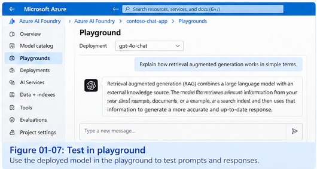

<!--*Sample image only.* Try a small set of representative prompts in your
deployed model. Where possible, use the same prompts for both candidates
and compare relevance, completeness, latency, and any cost signals the
portal exposes. -->

One good-looking response does not prove a model is ready. Keep prompts
fixed when comparing candidates, and record the model or deployment
version and the date so you can repeat the test later.

## 7. Evaluate model behavior

The source module demonstrates both manual comparison and automated
evaluation. Manual evaluation is useful for small, focused comparisons;
automated evaluation helps repeat tests over a larger dataset and can
support regression testing.

### 7.1 Understand the metrics

| Metric                 | Plain-English question                                                         | Example failure                                                               |
|:-----------------------|:-------------------------------------------------------------------------------|:------------------------------------------------------------------------------|
| **Quality**            | Is the response useful and sufficiently correct for the task?                  | A technically inaccurate explanation.                                         |
| **Relevance**          | Does it answer the prompt rather than drifting to another topic?               | A response that explains AI history when asked for deployment steps.          |
| **Fluency**            | Is the language natural and linguistically correct?                            | A confusing or grammatically broken answer.                                   |
| **Groundedness**       | Are claims supported by the supplied context or evidence being evaluated?      | A policy answer that states a rule absent from the retrieved source.          |
| **Safety**             | Does the response behave appropriately under the safety criteria being tested? | A response that provides disallowed assistance or mishandles a risky request. |
| **Throughput/latency** | Does the model respond at an acceptable speed for the workload?                | A response that takes too long at the expected traffic level.                 |

The appropriate metric depends on the task. An open-ended answer may not
have one exact reference string. Grounded responses need checks that
claims are supported by the provided context. Extraction and
classification tasks may allow more direct comparison with expected
outputs.

Automated evaluators are evidence, not unquestionable truth. Inspect
failure examples and use human review where the impact or ambiguity
warrants it.

### 7.2 Manual versus automated evaluation

| Approach                 | Strength                                                                       | Limitation                                                                            |
|:-------------------------|:-------------------------------------------------------------------------------|:--------------------------------------------------------------------------------------|
| Manual comparison        | Lets a person inspect tone, completeness, usefulness, and surprising failures. | Slow and difficult to scale consistently.                                             |
| Automated evaluation     | Repeats tests across a dataset and can produce comparable metrics.             | Depends on dataset quality, evaluator suitability, configuration, and interpretation. |
| Human review of failures | Helps explain why a result failed and whether the metric was appropriate.      | Requires time and clear review criteria.                                              |

### 7.3 An evaluation workflow

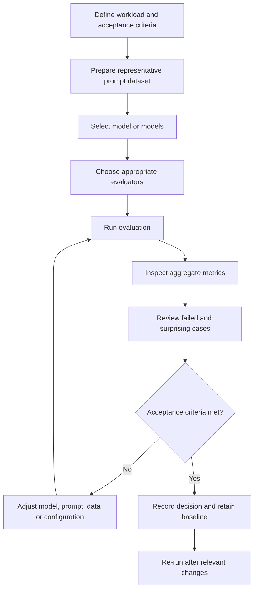

In the course walkthrough, the evaluation flow starts with a
travel-related dataset, then moves through evaluator selection, a run,
and inspection of a failure. That last step matters: a score alone
rarely tells you what to fix. The exact portal steps and available
evaluators may change, so use the current interface rather than relying
on old screenshots.

### Infographic 07: Evaluation setup

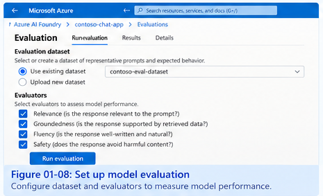

<!--*Sample image only.* Capture the target, dataset, and evaluators you
actually selected. Make sure you can explain what each evaluator
measures and why it belongs in this test.-->

### Infographic 08: Evaluation results and a failure

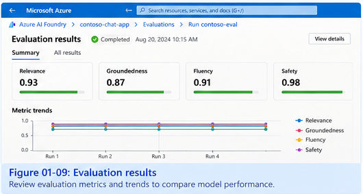

<!--*Sample image only; the scores are fictional examples.* When you run the
evaluation, capture your real results and inspect at least one failure.
Hide sensitive prompts or data. Write down what likely caused the
failure, what you would change, and how you would retest it.-->

## 8. From model-level tests to application readiness

Model-level evaluation is not the same as application-level evaluation.

- **Model-level screening:** model cards, benchmark interpretation,
  playground experiments, and a small representative prompt set.
- **Application-level evaluation:** prompts, retrieval, tools, identity,
  business rules, multi-turn state, error handling, and user experience
  working together.
- **Responsible AI and production safety:** risk analysis, safety
  testing, mitigations, monitoring, and accountability.

A model can perform well in the playground and still fail when connected
to the wrong knowledge source, given excessive permissions, or used with
an unclear prompt. Test the complete application before release.

### Production readiness checklist

Before exposing an application to users, verify that the design
addresses:

- [ ] **Identity and access:** use Microsoft Entra ID or managed
  identity where supported and appropriate; apply least privilege.
- [ ] **Configuration and secrets:** keep credentials out of source
  control and separate settings by environment.
- [ ] **Capacity and resilience:** understand quotas, rate limits,
  timeouts, retries, concurrency, and graceful failure behavior.
- [ ] **Observability:** measure latency, failures, token usage, and
  cost; avoid indiscriminate logging of sensitive prompts or personal
  data.
- [ ] **Change control:** version model/deployment choices, prompts,
  evaluation datasets, and relevant configuration.
- [ ] **Data governance:** verify privacy, security,
  processing-location, and retention requirements.
- [ ] **Evaluation baseline:** retain representative tests and results
  so later changes can be compared.
- [ ] **Operational ownership:** define who reviews failures, approves
  changes, and responds to incidents.

These are architecture recommendations that extend beyond the portal
demonstrations. Implement them using the services and controls
appropriate to the actual solution.

## 9. Hands-on lab sequence

Use this sequence when you perform the Azure lab. Capture screenshots at
the relevant steps and replace the placeholders in this chapter with
your own images.

1.  **Open or create a Foundry project.** Verify the resource and region
    context.
2.  **Explore the model catalog.** Filter candidates for a specific
    workload.
3.  **Inspect two model cards.** Record capabilities, limitations, and
    availability.
4.  **Compare benchmarks.** Identify the trade-off you want to
    investigate.
5.  **Deploy one candidate.** Record the selected deployment type and
    processing scope.
6.  **Test in the playground.** Use the same prompts for repeatable
    comparison.
7.  **Run an evaluation if available in your environment.** Record the
    dataset, evaluators, results, and a failure example.
8.  **Complete a model decision record.** State what you selected, what
    evidence supports it, and what remains uncertain.
9.  **Clean up lab resources** that are no longer needed, following your
    organization’s resource and retention policies.

### Lab notes to capture

| Item                              | Your notes |
|:----------------------------------|:-----------|
| Workload being tested             |            |
| Candidate models                  |            |
| Chosen deployment configuration   |            |
| Processing-scope requirement      |            |
| Prompt set or dataset             |            |
| Quality and safety observations   |            |
| Latency and cost evidence         |            |
| Known limitations                 |            |
| Decision and next validation step |            |

## Key takeaways

1.  A Foundry resource and its projects provide the platform context for
    organizing AI solution assets.
2.  The portal is useful for discovery and experimentation; APIs and
    SDKs support application integration and automation.
3.  Specialized Foundry Tools can complement or replace generative
    models for specific tasks.
4.  Choose models against workload requirements, and use model cards and
    benchmarks as screening evidence—not guarantees.
5.  Deployment mode and processing scope are separate decisions; verify
    the supported combination for the selected model.
6.  A successful deployment or one good playground response is not proof
    of production readiness.
7.  Manual comparison, automated evaluation, and review of failures each
    provide different evidence.
8.  Record assumptions, measurements, limitations, and decisions so
    model changes can be evaluated later.

## Related chapters

- **Chapter 02 — Building Gen AI Apps with Python:**
  application integration, API/SDK usage, authentication, streaming, and
  conversation state.
- **Chapter 03 — Tool Calling, Grounding, and RAG:** connecting model
  responses to tools and relevant knowledge.
- **Chapter 04 — Generative AI Optimization and Evaluation:** systematic
  evaluation datasets, metrics, regression workflows, and improvement.
- **Chapter 05 — Responsible AI and Production Safety:** risk analysis,
  mitigations, safety evaluation, and ongoing controls.

## References

- [Microsoft Foundry
  architecture](https://learn.microsoft.com/en-us/azure/foundry/concepts/architecture)
- [Microsoft Foundry Models
  overview](https://learn.microsoft.com/en-us/azure/foundry/concepts/foundry-models-overview)
- [Deployment types for Microsoft Foundry
  Models](https://learn.microsoft.com/en-us/azure/ai-foundry/foundry-models/concepts/deployment-types)
- [Deployment
  overview](https://learn.microsoft.com/en-us/azure/foundry/concepts/deployments-overview)
- [Microsoft Foundry
  documentation](https://learn.microsoft.com/en-us/azure/foundry/)

> **Enterprise AI Engineering Handbook**
>
> *Building Production-Grade Enterprise AI Systems — One Chapter at a Time.*
