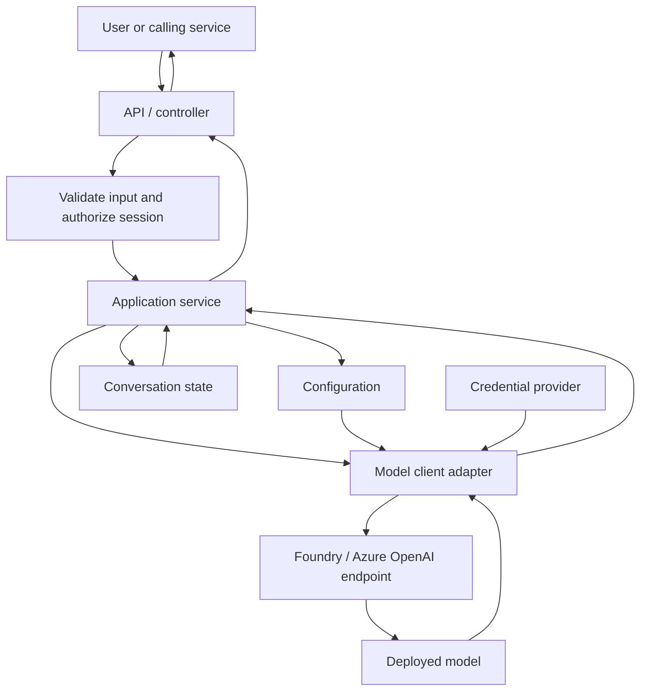
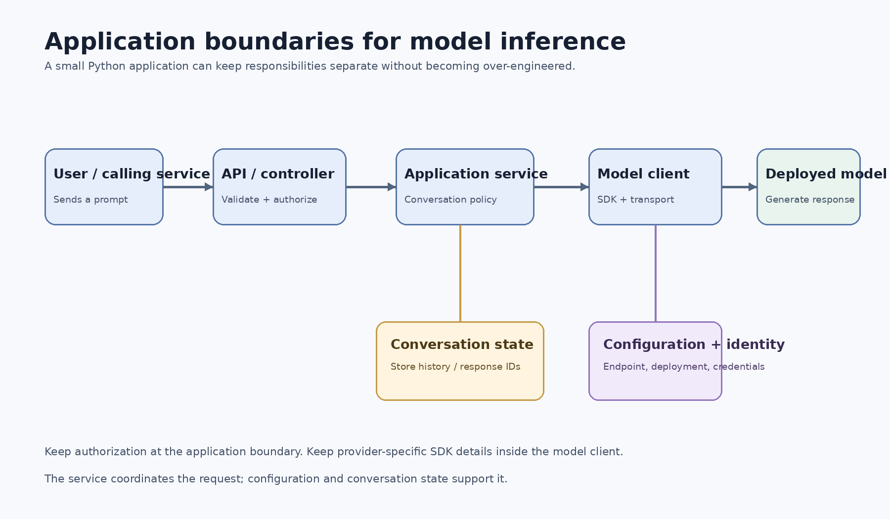
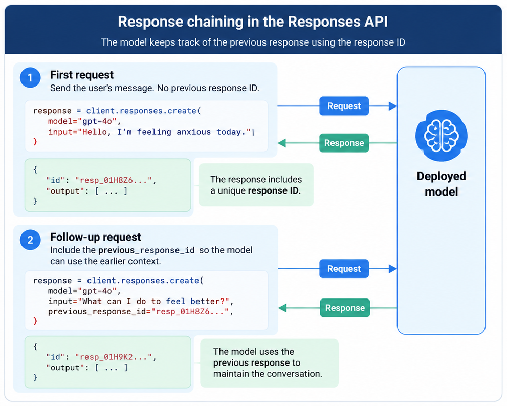
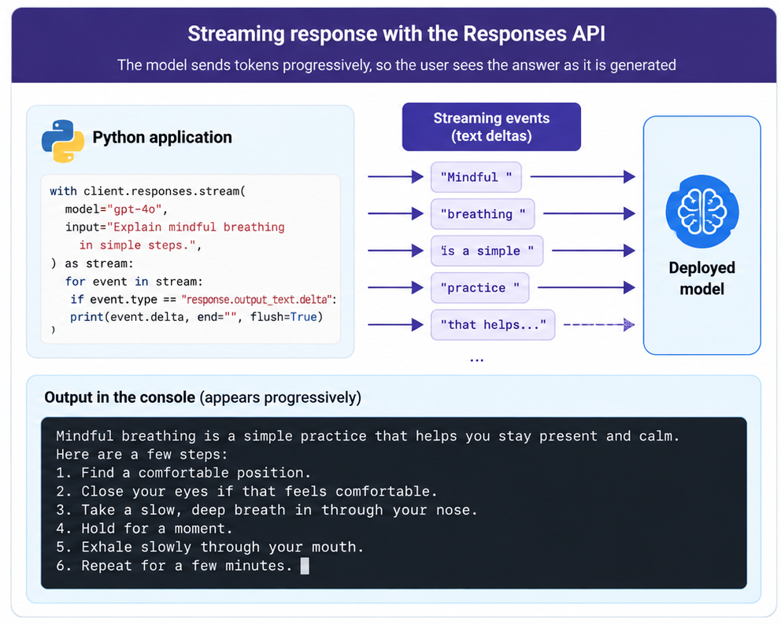

# 02 - Building Generative AI Applications with Python

## From a model that answers to an application that can chat

A deployed model is a good start. We can open Microsoft Foundry, enter a
prompt, and see an answer. But a working application needs to do a
little more: connect to the right deployment, authenticate, send the
right instructions, and decide what to do with the response.

The difference becomes clearer when we try to make the model hold a
conversation. Asking one question is easy. Asking a follow-up that
depends on the previous answer raises another question: how does the
model know what we're talking about?

We'll work through these problems one at a time. First, we'll explore
the model in Foundry. Then we'll connect to it from Python, try two ways
of making chat requests, and improve the experience with response
chaining, streaming, and asynchronous calls. Along the way, we'll look
at the engineering decisions that matter when the small example becomes
part of a real application.


## 1. The application has more than one responsibility

Before we start writing the first request, it helps to picture the small application we're heading towards. The model is only one part of it. Something must validate the incoming request, decide which conversation it belongs to, obtain credentials, call the deployment, and turn the result into something the user interface can safely display.

The separation below is deliberately modest. It is not a requirement to introduce a large framework or a collection of microservices. Even a small Python application benefits from keeping these responsibilities distinct.






*Infographic 01 — Application architecture for model inference with Microsoft Foundry.*


Think of the pieces this way:

- **Configuration** knows the endpoint, deployment name, timeout, and other runtime settings. It should not make model calls.
- **Model client** owns the SDK connection, credentials, and transport defaults. It should not decide which user can access a conversation.
- **Application service** decides which instructions and conversation context to send, calls the model, and translates provider responses into application data.
- **API or controller** validates the caller's request, checks access to the conversation, and maps application outcomes to HTTP or UI responses.

This boundary becomes especially useful when we add error handling, persistent conversation history, or another model provider. It also gives us a place to test the application without calling a live model.

## 2. Spend a moment in the Model Playground

Before opening an editor, start in the **Model Playground** for your
deployed model. It gives us a quick way to experiment without writing
code for every change.

Try a prompt, read the answer, and then change something. You can
compare models, adjust settings such as temperature and maximum output
tokens, and add instructions that guide the model's behaviour.

Temperature influences how varied or predictable responses tend to be.
It isn't a simple quality dial: the right setting depends on what the
application is trying to do. Maximum output tokens limits how much text
the model can generate. If the application needs a short answer, there
may be little value in allowing an extremely long one.

Instructions are useful for shaping the response. For example, try
asking the model to explain a technical topic in plain English, or to
keep the answer concise. Notice how the same question can produce a
different style of answer when the instruction changes.

The playground also has a **Code** option. It can generate a sample for
a selected API, language, and SDK, using details such as the endpoint,
deployment name, and current settings. That gives us a bridge from
experimentation to implementation. The generated sample is a starting
point, not something we need to copy blindly; we still need to
understand what it configures and how it fits our application.

Now let's leave the playground and make the same kind of request from
Python.

## 3. Connect Python to the deployed model

Before we can send a prompt, the application needs to know where to send
it and how to authenticate.

### Which endpoint do we need?

Microsoft Foundry provides different endpoints for different kinds of
work. If we're calling a deployed model directly, an Azure
OpenAI-compatible endpoint and the OpenAI Python SDK are a
straightforward option. A typical Azure OpenAI v1 endpoint has this
shape:

``` text
https://<resource-name>.openai.azure.com/openai/v1/
```

Use the exact endpoint shown for your resource. Don't guess the hostname
or append a path based on an example; the details can vary with the
service configuration.

A Microsoft Foundry project endpoint is useful for project-level
capabilities, including work with agents and tools. The Foundry SDK and
OpenAI client can also be used together in applications that need both
project capabilities and direct model calls. In this chapter, we're
focusing on a direct model request, so we'll use the OpenAI-compatible
client.

We also need the **deployment name**. Keep it separate from the
endpoint. The public model name shown in a catalogue and the deployment
identifier expected by an application are not necessarily the same.

### Set up authentication

The client needs credentials. An API key may be supported, but
identity-based authentication helps avoid putting a long-lived key into
application code.

With Microsoft Entra ID, `DefaultAzureCredential` tries supported
credential sources for the environment. On a developer's machine, it may
use a signed-in developer identity; in an Azure-hosted workload, it can
use a configured managed identity. The identity must have the required
permission to invoke the model---getting a token is not the same as
being authorized to use the resource.

Install the packages in your Python environment:

``` bash
python -m venv .venv
# Activate the environment for your shell, then:
python -m pip install --upgrade openai azure-identity
```

Then create the client. This example assumes `AZURE_OPENAI_ENDPOINT`
contains the resource endpoint without the `/openai/v1/` suffix, and
`MODEL_DEPLOYMENT_NAME` contains the deployment name.

``` python
import os

from azure.identity import DefaultAzureCredential, get_bearer_token_provider
from openai import OpenAI

endpoint = os.environ["AZURE_OPENAI_ENDPOINT"].rstrip("/")
model_deployment = os.environ["MODEL_DEPLOYMENT_NAME"]

credential = DefaultAzureCredential()
token_provider = get_bearer_token_provider(
    credential,
    "https://ai.azure.com/.default",
)

client = OpenAI(
    base_url=f"{endpoint}/openai/v1/",
    api_key=token_provider,
)
```

For local development, use an approved developer sign-in, such as Azure
CLI, if that is part of your setup. For a hosted workload, a managed
identity is often a good option when the resource and permissions are
configured for it. Keep endpoint and deployment settings outside the
source code, and never commit API keys, access tokens, or a `.env` file
containing secrets.


*Infographic 02 — Deployed models and endpoint details in Microsoft Foundry.*


### Keep configuration outside the request logic

As the application grows, avoid reading environment variables throughout the code. Load the required settings once when the application starts, validate them, and pass them to the components that need them.

```python
# config.py
import os
from dataclasses import dataclass

@dataclass(frozen=True)
class Settings:
    endpoint: str
    deployment: str
    timeout_seconds: float = 45.0

    @classmethod
    def from_env(cls) -> "Settings":
        endpoint = os.environ["AZURE_OPENAI_ENDPOINT"].rstrip("/")
        deployment = os.environ["MODEL_DEPLOYMENT_NAME"].strip()
        timeout = float(os.getenv("MODEL_TIMEOUT_SECONDS", "45"))
        if not deployment:
            raise ValueError("MODEL_DEPLOYMENT_NAME must not be empty")
        if timeout <= 0:
            raise ValueError("MODEL_TIMEOUT_SECONDS must be positive")
        return cls(endpoint, deployment, timeout)
```

Failing during startup is much easier to diagnose than discovering a missing deployment name halfway through a user's request. In a deployed environment, provide these values through the platform's configuration mechanism and keep secrets in an approved secret store.

### Put a small service boundary around the SDK

The controller should not need to understand every detail of the OpenAI SDK response object. A service can accept validated input and return a small application-level result.

```python
class ChatService:
    def __init__(self, client, settings):
        self.client = client
        self.settings = settings

    def answer(self, user_text: str, previous_response_id: str | None = None):
        text = user_text.strip()
        if not text:
            raise ValueError("Message must not be empty")
        if len(text) > 8_000:
            raise ValueError("Message is too long")

        request = {
            "model": self.settings.deployment,
            "instructions": "You are a helpful technical assistant.",
            "input": text,
            "max_output_tokens": 700,
        }
        if previous_response_id:
            request["previous_response_id"] = previous_response_id

        response = self.client.responses.create(**request)
        return {
            "text": response.output_text,
            "response_id": response.id,
            "request_id": response._request_id,
        }
```

The size limit is an example, not a universal value. Choose limits for your product, model context window, and cost envelope. In a multi-user application, never trust a response ID supplied by the browser on its own: verify that it belongs to the authenticated user's conversation.

### Plan for failures before users encounter them

A model request can fail because of a bad payload, missing permissions, throttling, a network interruption, or a service-side problem. These are different situations. Retrying an invalid request will not fix it, and retrying an authentication failure can simply waste time.

The OpenAI Python SDK already retries some transient failures. Check the behaviour of the SDK version you deploy, set an explicit timeout, and avoid stacking an unbounded application retry loop on top of SDK retries.

| Failure | What to investigate | Typical application response |
|---|---|---|
| 401 / authentication | Credential source, token scope, expired or unavailable identity | Surface a stable service-configuration error; alert operators |
| 403 / permission | Role assignment and resource authorization | Do not retry blindly |
| 400 / bad request | Payload shape, API compatibility, unsupported parameter | Correct the request |
| 404 / not found | Endpoint and deployment name | Correct configuration |
| 429 / throttling | Quota, deployment capacity, retry guidance | Back off within a bounded retry budget |
| Timeout, connection, or 5xx | Network and transient service health | Retry only when appropriate and within the caller's deadline |

Log duration, a correlation ID, status category, and provider request ID when available. Do not log credentials, bearer tokens, or raw prompts and responses by default. If content logging is required, apply access controls, redaction, retention, and the relevant privacy policy.


The client is ready. Let's send a question and see what comes back.

## 4. Make the first request with the Responses API

The Responses API separates the assistant's instructions from the user's
input. That makes a first request easy to read:

``` python
response = client.responses.create(
    model=model_deployment,
    instructions=(
        "You are a helpful AI assistant that answers questions "
        "and provides information."
    ),
    input="Tell me about the ELIZA chatbot.",
)

print(response.output_text)
```

The `model` value identifies the deployment. `instructions` describes
how the assistant should behave, and `input` contains the user's
question. The response object exposes the generated text through
`output_text`.

In the original walkthrough, the example asks about **ELIZA**, an early
chatbot that used patterns and text transformations to create the
impression of a conversation. It's a useful example for a reason: after
asking about ELIZA, we can ask, "How does it compare to modern LLMs?"

A person would understand that "it" refers to ELIZA. But the model
doesn't automatically receive every previous request just because we
called it from the same program. If we send only the follow-up question,
the model may not know what "it" means.

So our first request works, but our conversation still has a gap. We
need a way to carry context into the next turn.

### Link a follow-up with `previous_response_id`

The Responses API supports response chaining. We save the ID returned by
the first response and pass it to the next request:

``` python
first_response = client.responses.create(
    model=model_deployment,
    instructions="You are a helpful AI assistant that answers questions and provides information.",
    input="Tell me about the ELIZA chatbot.",
)

follow_up = client.responses.create(
    model=model_deployment,
    instructions="You are a helpful AI assistant that answers questions and provides information.",
    input="How does it compare to modern LLMs?",
    previous_response_id=first_response.id,
)

print(follow_up.output_text)
```

The ID acts like a bookmark to the earlier response context. Instead of
manually constructing a list of all previous messages for this example,
we can refer to the preceding response and provide the new question.

In a chat loop, we'd keep a variable such as `last_response_id`. It
starts as `None`; after each successful response, we replace it with the
new response's ID. The next request uses that value to continue the
exchange.

This makes the code simpler, but it doesn't mean the conversation has no
cost or that token usage remains constant. The service still needs to
process the context required for the next answer. And in a real
application, the response ID is only one part of session management: we
still need to associate the conversation with the right user and decide
what context can be retained.



*Infographic 03 — Linking a follow-up request to the earlier response with `previous_response_id`.*

We've seen one way to make the conversation continuous. Now let's look
at the other common API shape, because it's still widely used in
existing applications.

## 5. See how Chat Completions handles the same conversation

Chat Completions represents a request as a list of messages. Each
message has a role---such as `system`, `user`, or `assistant`---and
content.

``` python
completion = client.chat.completions.create(
    model=model_deployment,
    messages=[
        {
            "role": "system",
            "content": "You are a helpful AI assistant that answers questions and provides information."
        },
        {
            "role": "user",
            "content": "Tell me about the ELIZA chatbot."
        },
    ],
)

answer = completion.choices[0].message.content
print(answer or "")
```

Notice how the system instruction is just another item in the `messages`
array, with the `system` role. The user's prompt is a separate message.
The result is returned as a completion object, so we read the first
choice and then its message content.

Chat Completions has been widely adopted across model platforms and
remains useful when maintaining existing applications or working with
integrations that expect message arrays. The main difference shows up
when we want to keep a conversation going.

### The application owns the message history

With Chat Completions, our code maintains the history and sends the
selected messages on each request. After we receive the assistant's
answer, we add it to the list so the next turn can use it.

``` python
conversation_messages = [
    {
        "role": "system",
        "content": "You are a helpful AI assistant that answers questions and provides information."
    }
]

while True:
    input_text = input("\nYou: ")

    if input_text.strip().lower() == "quit":
        print("Assistant: Goodbye!")
        break

    conversation_messages.append({
        "role": "user",
        "content": input_text,
    })

    completion = client.chat.completions.create(
        model=model_deployment,
        messages=conversation_messages,
    )

    assistant_message = completion.choices[0].message.content or ""
    print("Assistant:", assistant_message)

    conversation_messages.append({
        "role": "assistant",
        "content": assistant_message,
    })
```

This is the basic shape of a terminal chat application: read a question,
send it with the conversation so far, display the answer, and save that
answer before the next turn.

The approach gives the application direct control over which messages
are included. The trade-off is that the code must maintain the list
correctly, and the request grows as more history is sent. Longer
conversations may need a policy for pruning older messages or
summarising them so that the context remains useful and within the
model's limits.

### The practical difference

| Aspect | Responses API | Chat Completions API |
|---|---|---|
| Request structure | `instructions` and `input` | A `messages` array |
| Reading the answer | `response.output_text` | `completion.choices[0].message.content` |
| Context in our examples | Chain a turn with `previous_response_id` | Store and resend the selected message history |
| Common fit | New applications where the endpoint supports the Responses API | Existing integrations and message-array workflows |

Neither API makes conversation design disappear. The choice depends on
what your endpoint supports and how much control you want over message
history.

## 6. Put the pieces into a small chat application

At this point, the building blocks are familiar: a deployed model, an
authenticated client, a request, and a way to carry context. The
walkthrough brings them together in a small Python command-line
application.

The practical flow is simple:

1.  Read text from the user.
2.  Exit if the user types `quit`.
3.  Send the input and the required context to the model.
4.  Display the answer.
5.  Save the information needed for the next turn.

The original demonstration starts with Chat Completions and then
switches to the Responses API. This is a useful comparison because the
application can look much the same from the user's perspective, even
though the code that carries conversation state differs.

Here is the central loop using the Responses API:

``` python
last_response_id = None

while True:
    input_text = input("\nYou: ")

    if input_text.strip().lower() == "quit":
        print("Assistant: Goodbye!")
        break

    response = client.responses.create(
        model=model_deployment,
        instructions=(
            "You are a helpful AI assistant that answers questions "
            "and provides information."
        ),
        input=input_text,
        previous_response_id=last_response_id,
    )

    print("Assistant:", response.output_text)
    last_response_id = response.id
```

The first request has no previous response ID, so it starts a new
exchange. After the model responds, the application stores the ID and
supplies it with the next question.

The example is intentionally small. A production service would add error
handling, timeouts, session authorization, and safe user-facing error
messages. It would also make sure that a response ID belongs to the
correct user's conversation. These safeguards sit around the request;
they don't change the basic flow we've just built.

## 7. Let the answer appear while it's being generated

Try the chat application with a longer question. Depending on the
response, the terminal may appear to do nothing until the full answer
arrives. The model is working, but the user has no sign of progress.

**Streaming** changes that. Instead of waiting for the complete answer,
the client receives events as the model generates text. We can print
each text delta as it arrives.

``` python
stream = client.responses.create(
    model=model_deployment,
    instructions="You are a helpful AI assistant that answers questions and provides information.",
    input=input_text,
    previous_response_id=last_response_id,
    stream=True,
)

for event in stream:
    if event.type == "response.output_text.delta":
        print(event.delta, end="", flush=True)
    elif event.type == "response.completed":
        last_response_id = event.response.id
        print()
```

The `response.output_text.delta` events contain pieces of text. Printing
them without a newline lets the answer build up on the same line. When
the response completes, we store its ID so the next turn can continue
the conversation.

Streaming improves the time until the user sees the first part of an
answer; it doesn't necessarily reduce the total time required to
generate the answer. A web application would normally forward these
updates to the browser using an appropriate streaming transport. It
should also decide what happens if the request fails or the user
disconnects halfway through.



*Infographic 04 — Text appearing progressively as streaming events arrive.*

## 8. When asynchronous calls make sense

Our terminal chat waits for a response before it asks the next question.
For a small interactive example, that is perfectly reasonable.

But imagine a service that needs to call a model several times for
independent tasks. If each request waits for the previous one to finish,
we're leaving time on the table while the application waits for network
responses. Python's asynchronous client lets the program await requests
without blocking the event loop, and `asyncio.gather()` can run
independent calls concurrently.

``` python
import asyncio
from openai import AsyncOpenAI

async def main():
    async with AsyncOpenAI(
        base_url=f"{endpoint}/openai/v1/",
        api_key=token_provider,
    ) as async_client:
        prompts = [
            "Define idempotency in one sentence.",
            "Define the bulkhead pattern in one sentence.",
            "Define a retry budget in one sentence.",
        ]

        responses = await asyncio.gather(
            *(
                async_client.responses.create(
                    model=model_deployment,
                    input=prompt,
                )
                for prompt in prompts
            )
        )

        for response in responses:
            print(response.output_text)

asyncio.run(main())
```

This example assumes `endpoint`, `model_deployment`, and
`token_provider` have already been configured. If your application uses
asynchronous credentials, use the matching async credential setup and
verify compatibility with the versions of the Azure Identity and OpenAI
packages installed in your environment.

Async does not automatically make one model request finish faster. It is
most useful when the application can overlap independent network-bound
work. If you start many requests together, put a sensible limit on
concurrency and plan for timeouts, cancellation, throttling, and
transient failures.

## What we've built---and what to take into your own application

We began in the Model Playground, where we could experiment with a
deployed model before writing code. We then connected from Python and
made a first request. The ELIZA example exposed a problem that isn't
obvious from a single prompt: follow-up questions need context. That led
us to response chaining in the Responses API and application-managed
history in Chat Completions.

From there, we improved the interaction. Streaming lets users see text
as it arrives, and asynchronous calls help when independent network
operations can overlap.

The production choices follow from the same journey. Keep endpoint and
deployment settings out of the source code. Use an identity with the
correct permissions. Decide how each conversation is associated with a
user and how long its context should be retained. Add timeouts and error
handling around network calls, and keep concurrency within the limits
your application and service can support.

You don't need to add every possible feature on day one. Start with a
working request, understand how context is carried, and introduce
streaming or async when the user experience or workload calls for it.
That gives you a small application you can reason about---and a solid
foundation to extend.

## References

-   [Configure keyless authentication with Microsoft Entra
    ID](https://learn.microsoft.com/azure/ai-foundry/foundry-models/how-to/configure-entra-id)
-   [Use the Azure OpenAI Responses
    API](https://learn.microsoft.com/en-us/azure/foundry/openai/how-to/responses)
-   [Endpoints for Microsoft Foundry
    Models](https://learn.microsoft.com/en-us/azure/ai-foundry/model-inference/concepts/endpoints)

------------------------------------------------------------------------


> **Enterprise AI Engineering Handbook**
>
> *Building Production-Grade Enterprise AI Systems — One Chapter at a Time.*
