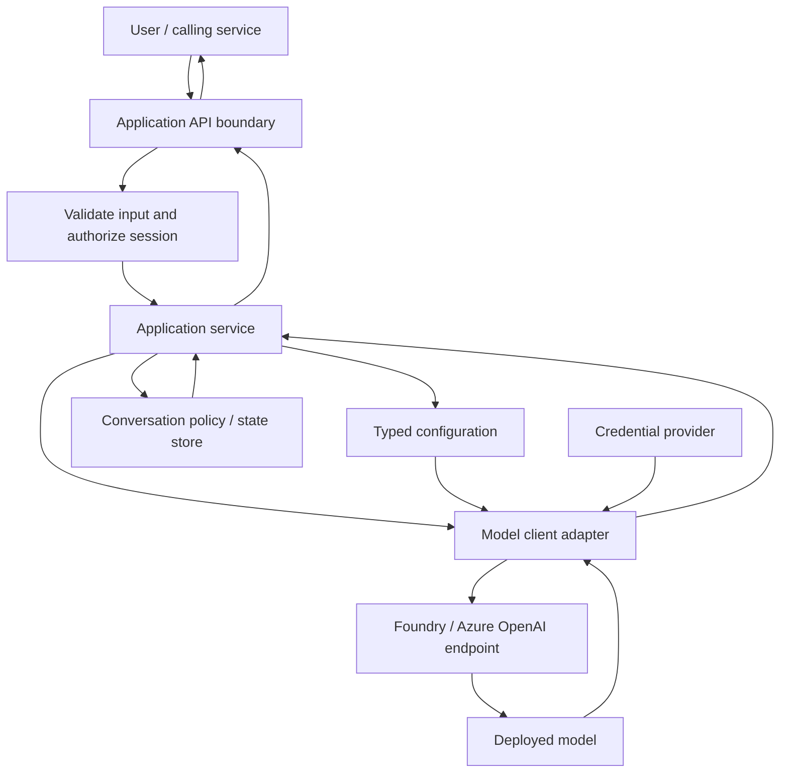
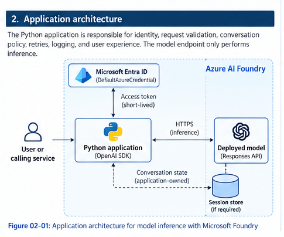
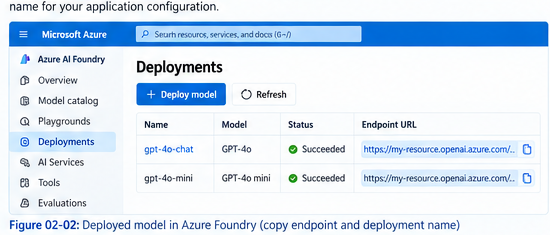
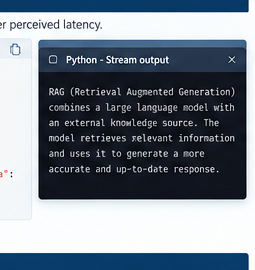

# 02 — Building Generative AI Applications with Python

## 1. From a model call to an application

A playground proves that a model can answer a prompt. A useful application has more responsibilities: it loads the right deployment, authenticates safely, validates requests, decides what conversation context to send, handles slow or failed calls, and returns a response without exposing internal errors to the user.

This chapter builds those responsibilities into a small, maintainable Python design. The examples use the OpenAI-compatible client with a Microsoft Foundry/Azure OpenAI v1 endpoint. Exact endpoint formats, supported APIs, authentication scope, and model capabilities depend on the deployment you created, so use the endpoint and deployment name shown for your resource.

**In scope:** SDK and endpoint selection, Responses API and Chat Completions, authentication, conversation state, synchronous and asynchronous calls, streaming, configuration, error handling, and practical client boundaries.

**Covered elsewhere:** tool execution and retrieval architecture (Chapter 03), systematic evaluation and optimization (Chapter 04), and detailed responsible-AI controls (Chapter 05).

### What the Microsoft Learn lab actually walks through

The source module starts in the Foundry playground, where you can compare models and adjust settings such as temperature and the maximum output length. It then moves into a small terminal-based Python chat app. The lab first uses Chat Completions, switches to the Responses API, adds response chaining so a follow-up can refer to the previous turn, then demonstrates streaming and an asynchronous client. It finishes by revisiting Chat Completions and showing how the application must retain and resend its own message history.

That sequence matters: the lab is teaching the difference between making a model call and building a conversation around model calls. The production patterns later in this chapter extend that learning exercise; they are not all implemented in the lab itself.

> **A note about versions:** the lab's files, endpoint format, and SDK examples reflect the environment used when the course was recorded. Copy the endpoint shown in your own Foundry resource and check the installed SDK's current documentation if a method or setting differs.

## 2. Application architecture and boundaries






Keep four concerns separate:

- **Configuration** knows endpoint, deployment name, timeout, and runtime mode. It does not make model calls.
- **Client adapter** creates the SDK client and owns transport-level defaults. It does not decide which user is allowed to access a conversation.
- **Application service** decides which instructions and history to send, calls the model, and translates provider failures into application-level outcomes.
- **API/controller layer** validates the request, authenticates the caller, authorizes access to a conversation, and maps application outcomes to HTTP or UI responses.

This separation makes the model provider easier to replace and makes unit tests possible without calling a live model. Do not let a browser or untrusted caller supply arbitrary endpoint URLs, deployment names, system instructions, or another user's response/session identifier.

## 3. Choose the SDK, endpoint, and API

Microsoft Foundry offers project-level capabilities as well as model inference. Select the smallest integration surface that meets the application requirement.

| Requirement | Practical starting point | Why |
|---|---|---|
| Direct inference through Responses or Chat Completions | OpenAI Python SDK with the endpoint format documented for your deployment | Small inference-focused client and familiar request/response types |
| Foundry project operations such as project connections, agents, tracing, or evaluation workflows | Microsoft Foundry SDK | Project-level features beyond a basic model request |
| Existing application already built around role-based messages | Chat Completions | Avoid an unnecessary migration while maintaining a working integration |
| New conversational inference application where supported | Responses API | Supports response objects and response chaining as well as application-owned state |

An Azure OpenAI v1 endpoint commonly resembles `https://<resource>.openai.azure.com/openai/v1/`. Foundry configurations may expose a different host or endpoint shape. Copy the exact inference endpoint from the resource/project view and follow the SDK sample for that endpoint; do not append `/openai/v1/` twice. Pass the **deployment name** expected by the endpoint as `model`, not automatically the public model family name.



The course distinguishes two broad endpoint styles. An Azure OpenAI-compatible endpoint is a direct route to model inference, while a Foundry project endpoint can expose project-level capabilities such as agents and tools. The SDK and authentication details differ, so don't mix snippets from the two patterns without checking which endpoint you have.

The APIs also have different state models:

- **Responses API:** send `input`; where supported, `previous_response_id` can link a follow-up to a previous response.
- **Chat Completions:** send a `messages` array. The application selects and resends the conversation history on each turn.

The choice does not remove the need for application-side authorization, context limits, retention policy, or error handling.

## 4. Tune the request before writing more code

The playground is a useful place to get a feel for the model before wiring it into an application. The transcript calls out two settings in particular:

| Setting | What it changes | Practical advice |
|---|---|---|
| Temperature | How varied or predictable generated responses tend to be | Start with the default, then test changes against the task. More variation is not automatically better. |
| Maximum output tokens | The upper limit on the generated response length | Set a limit that fits the expected answer. A very high limit can allow unnecessarily long responses and increase cost. |
| Instructions/system message | The role, tone, boundaries, and response style you ask the model to follow | Keep instructions clear and test them with both normal and edge-case prompts. Instructions are not a replacement for application security checks. |

These controls are model/API dependent. Check which parameter names are supported by your selected API and deployment rather than assuming the playground labels map one-to-one to every SDK method.

## 5. Configuration and local setup

Use a virtual environment and pin/test dependency versions in the project's lock file or requirements file. The following is a minimal starting point, not a substitute for a tested lock file:

```bash
python -m venv .venv
# Activate .venv for your shell
python -m pip install --upgrade openai azure-identity
```

Set configuration outside source control. For example, in your shell or deployment environment:

```text
AZURE_OPENAI_ENDPOINT=https://<your-resource>.openai.azure.com
MODEL_DEPLOYMENT_NAME=<your-deployment-name>
MODEL_TIMEOUT_SECONDS=45
```

For local development, you can use a local `.env` file if your application loads one, but keep it out of version control. In Azure-hosted workloads, use the platform's configuration and secret facilities. Validate required settings during startup so a missing deployment name fails early instead of during a user's request.

A small configuration module can be kept dependency-free:

```python
# config.py
import os
from dataclasses import dataclass


@dataclass(frozen=True)
class Settings:
    endpoint: str
    deployment: str
    timeout_seconds: float = 45.0

    @classmethod
    def from_env(cls) -> "Settings":
        endpoint = os.environ["AZURE_OPENAI_ENDPOINT"].rstrip("/")
        deployment = os.environ["MODEL_DEPLOYMENT_NAME"].strip()
        timeout = float(os.getenv("MODEL_TIMEOUT_SECONDS", "45"))
        if not deployment:
            raise ValueError("MODEL_DEPLOYMENT_NAME must not be empty")
        if timeout <= 0:
            raise ValueError("MODEL_TIMEOUT_SECONDS must be positive")
        return cls(endpoint=endpoint, deployment=deployment, timeout_seconds=timeout)
```

Avoid reading environment variables throughout business logic. Load them once at startup and pass the settings to the components that need them.

## 6. Authentication: make the runtime choice explicit

For production, Microsoft Entra ID is generally preferable when supported by the deployment and organization policy. It avoids embedding a long-lived model key in application configuration, but it still requires the correct identity, token scope, and authorization assignment.

| Situation | Typical choice | Implementation note |
|---|---|---|
| Local development | `DefaultAzureCredential` with an approved developer sign-in, such as Azure CLI | Run `az login` and verify that the signed-in identity has access to the model resource |
| Azure-hosted application | Managed identity through `DefaultAzureCredential` or an explicit managed identity credential | Grant only the permissions required to invoke the model; confirm system-assigned vs. user-assigned identity configuration |
| Environment where Entra ID is unavailable or policy requires a key | API key from a protected secret store | Never commit the key; rotate it and restrict access according to policy |

The OpenAI-compatible v1 endpoint commonly uses this Entra ID token scope: `https://ai.azure.com/.default`. Some Azure OpenAI-specific client/endpoint combinations use a different documented scope or authentication parameter. Follow the instructions for the exact endpoint you selected; do not copy an auth snippet across endpoint types without checking it.

Create the client once during application startup and reuse it rather than constructing a new client for every request:

```python
# model_client.py — synchronous client
from azure.identity import DefaultAzureCredential, get_bearer_token_provider
from openai import OpenAI

from config import Settings


def create_model_client(settings: Settings) -> tuple[OpenAI, DefaultAzureCredential]:
    credential = DefaultAzureCredential()
    token_provider = get_bearer_token_provider(
        credential,
        "https://ai.azure.com/.default",
    )
    client = OpenAI(
        base_url=f"{settings.endpoint}/openai/v1/",
        api_key=token_provider,
        timeout=settings.timeout_seconds,
        max_retries=2,
    )
    return client, credential
```

The `api_key` parameter receives a callable that supplies a short-lived bearer token; the application is not storing the access token as a static key. Close both the SDK client and credential when the application shuts down. In a web server, use its startup/shutdown or lifespan mechanism rather than creating and closing clients inside each request.

If you choose key authentication instead, use a separate, explicit configuration path (for example, `MODEL_API_KEY` from a secret manager) and do not silently fall back to a key when Entra ID fails. A failed identity configuration should be visible during startup or health checks, not hidden by an unexpected authentication downgrade.

## 7. Make a request through a service boundary

The service should receive validated input and return application data, not leak raw SDK objects to every caller. This example is intentionally small enough to understand, but has a real service boundary:

```python
# chat_service.py
from openai import OpenAI

from config import Settings

INSTRUCTIONS = (
    "You are a helpful technical assistant. Be clear, concise, "
    "and state uncertainty when you cannot verify a claim."
)


class ChatService:
    def __init__(self, client: OpenAI, settings: Settings) -> None:
        self._client = client
        self._settings = settings

    def answer(self, user_text: str, previous_response_id: str | None = None) -> dict:
        text = user_text.strip()
        if not text:
            raise ValueError("Message must not be empty")
        if len(text) > 8_000:
            raise ValueError("Message is too long")

        request = {
            "model": self._settings.deployment,
            "instructions": INSTRUCTIONS,
            "input": text,
            "max_output_tokens": 700,
        }
        if previous_response_id:
            request["previous_response_id"] = previous_response_id

        response = self._client.responses.create(**request)
        return {
            "text": response.output_text,
            "response_id": response.id,
            "request_id": response._request_id,
        }
```

The size limit is an application example, not a universal recommended value. Choose limits based on the product, model context window, expected costs, and validation requirements. Do not accept `previous_response_id` from a caller without checking that it belongs to the authenticated user's authorized conversation.

A web/API layer should catch `ValueError` as a client input problem and convert provider exceptions to stable application errors. It should not return stack traces, access tokens, endpoint credentials, or raw internal exception text to the caller.

## 8. Conversation state is an application decision

The main difference is easiest to see side by side:

| Question | Responses API | Chat Completions API |
|---|---|---|
| How do you send the current prompt? | Usually through `input`, with optional `instructions` | Through a `messages` array containing roles such as `system`, `user`, and `assistant` |
| How can a follow-up keep context? | Where supported, pass `previous_response_id` | Store and resend the selected conversation messages |
| What does the application need to manage? | User/session authorization, response IDs, retention policy, and context limits still belong to the application | The application manages the message history, along with authorization, retention, and context limits |
| When is it a sensible choice? | A new conversational inference app where the endpoint supports it | Existing integrations or applications built around role-based message arrays |

The main difference is easiest to see in the code and the state model:

**Response chaining.** Store the most recent response ID with the application's conversation record and pass it as `previous_response_id` for the next turn. This reduces the amount of history your code constructs manually. It does not mean the prior context has no token cost, and the response ID is not an authorization credential.

**Application-owned history.** Store selected user/assistant turns in a database or session store, then send the history your policy permits. This gives the application control over pruning, summarization, retention, deletion, and replay. It also makes the application responsible for data integrity and context assembly.

For Chat Completions, the application typically keeps a message array:

```python
messages = [
    {"role": "system", "content": "You are a helpful technical assistant."},
    {"role": "user", "content": "What is idempotency?"},
    {"role": "assistant", "content": "Idempotency means repeating an operation has the same intended effect."},
    {"role": "user", "content": "Why does it matter for retries?"},
]

completion = client.chat.completions.create(
    model=settings.deployment,
    messages=messages,
    max_tokens=300,
)
answer = completion.choices[0].message.content or ""
```

In production, use a session store keyed by an application-generated conversation ID and authenticated owner. Define a context policy: maximum turns or tokens, when to prune or summarize, what data can be retained, and how users can reset or delete a conversation. Treat conversation content as untrusted input; prior assistant text is not a security boundary.

## 9. Error handling, timeouts, and retries

Model calls fail for different reasons, and those failures need different responses. An invalid request will not be fixed by retrying it; a `401` usually points to authentication; a `403` points to authorization; a `429` means throttling or quota pressure; and connection/time-out/`5xx` errors may be transient.

The OpenAI Python SDK retries some connection errors, timeouts, rate limits, and server errors by default (commonly two retries; confirm behavior for your installed version). Configure a request timeout and understand the SDK's retry policy before adding an outer retry loop. Layering multiple retry loops can multiply latency and request volume.

```python
# model_errors.py
import logging

from openai import (
    APIConnectionError,
    APITimeoutError,
    AuthenticationError,
    BadRequestError,
    InternalServerError,
    NotFoundError,
    PermissionDeniedError,
    RateLimitError,
)

logger = logging.getLogger(__name__)


def safe_answer(service, user_text: str, previous_response_id: str | None = None) -> dict:
    try:
        return service.answer(user_text, previous_response_id)
    except (AuthenticationError, PermissionDeniedError):
        # Operational alert: inspect identity, role assignment, and endpoint setup.
        logger.exception("Model authentication/authorization failed")
        raise RuntimeError("The AI service is not configured to access the model.") from None
    except (BadRequestError, NotFoundError):
        # Check payload, API/endpoint compatibility, deployment name, and capabilities.
        logger.exception("Model request was rejected")
        raise RuntimeError("The AI request could not be processed.") from None
    except RateLimitError:
        # SDK retries eligible cases; do not immediately create an unbounded retry loop.
        logger.warning("Model rate limit reached")
        raise RuntimeError("The AI service is busy. Please try again shortly.") from None
    except (APITimeoutError, APIConnectionError, InternalServerError):
        logger.warning("Transient model service failure", exc_info=True)
        raise RuntimeError("The AI service is temporarily unavailable.") from None
```

This function illustrates classification and safe messages; in a web application, use typed domain exceptions and map them to stable HTTP status codes in the controller. Avoid using `RuntimeError` as the final domain model in a larger codebase.

Practical rules:

- **Authentication/authorization:** do not retry blindly. Check identity, token scope, endpoint, and role assignments.
- **Bad request/not found:** correct the payload, deployment name, endpoint, or API compatibility. Retrying the same request will usually fail again.
- **Rate limiting:** respect server retry guidance where available, cap attempts, and apply back-pressure or a queue when traffic exceeds capacity.
- **Transient network/timeout/5xx:** use a bounded retry budget and exponential backoff with jitter if you implement retries yourself. Keep the total time within the caller's deadline.
- **Cancellation:** propagate cancellation rather than converting every cancellation into a retry.
- **Ambiguous timeouts:** the service may have completed generation even if the client timed out. Avoid blindly repeating downstream side effects; model generation itself should not be treated as a transactional operation.

Log a correlation ID, duration, status category, and provider request ID when available. Do not log API keys, bearer tokens, or raw prompts/responses by default. If content logging is required for debugging, apply explicit access controls, redaction, retention, and consent/policy requirements.

## 10. Streaming responses without losing control

Streaming improves perceived responsiveness by allowing the UI to render text as it arrives. It does not guarantee faster total generation. The service must distinguish a completed response from a failed or interrupted stream; partial output is not automatically a successful final answer.




```python
from openai import APIConnectionError, APITimeoutError


def stream_answer(client, deployment: str, prompt: str):
    """Yield text deltas; let the API layer own transport and disconnect handling."""
    with client.responses.create(
        model=deployment,
        input=prompt,
        stream=True,
        max_output_tokens=700,
    ) as stream:
        completed = False
        for event in stream:
            if event.type == "response.output_text.delta":
                yield event.delta
            elif event.type == "response.completed":
                completed = True
            elif event.type == "response.failed":
                raise RuntimeError("Model response failed")
        if not completed:
            raise RuntimeError("Model stream ended before completion")
```

Confirm the stream context-manager behavior and event names against your installed SDK version. When wiring this into server-sent events or WebSockets, stop consuming the upstream stream when the caller disconnects, apply an overall deadline, and record whether the stream completed. The SDK does not automatically replay a stream after partial output, because replaying could duplicate text already sent to the client.

If you need the response ID for later turns, capture it from the completed event and persist it only after validating that the stream completed successfully. Do not treat a partially streamed response as the canonical conversation turn without an explicit product policy.

## 11. Asynchronous calls and bounded concurrency

Use `AsyncOpenAI` when the surrounding application is asynchronous, for example an async web API. The benefit appears when requests overlap; replacing one synchronous call with one `await` does not make that model generate faster. Bound concurrency so a burst of requests cannot exhaust your own resources or overwhelm deployment capacity.

The learning-path pattern for asynchronous Entra ID uses the async credential/token provider. Keep the credential alive for the application's lifetime and close it at shutdown:

```python
import asyncio
import os

from azure.identity.aio import DefaultAzureCredential, get_bearer_token_provider
from openai import AsyncOpenAI


async def main() -> None:
    endpoint = os.environ["AZURE_OPENAI_ENDPOINT"].rstrip("/")
    deployment = os.environ["MODEL_DEPLOYMENT_NAME"]

    async with DefaultAzureCredential() as credential:
        token_provider = get_bearer_token_provider(
            credential,
            "https://ai.azure.com/.default",
        )
        async with AsyncOpenAI(
            base_url=f"{endpoint}/openai/v1/",
            api_key=token_provider,
            timeout=45.0,
            max_retries=2,
        ) as client:
            semaphore = asyncio.Semaphore(4)

            async def ask(prompt: str) -> str:
                async with semaphore:
                    response = await client.responses.create(
                        model=deployment,
                        input=prompt,
                        max_output_tokens=200,
                    )
                    return response.output_text

            prompts = [
                "Define idempotency in one sentence.",
                "Define a bulkhead pattern in one sentence.",
                "Define a retry budget in one sentence.",
            ]
            answers = await asyncio.gather(*(ask(prompt) for prompt in prompts))
            for answer in answers:
                print(answer)


if __name__ == "__main__":
    asyncio.run(main())
```

The semaphore is a local concurrency guard for this process, not a global rate limiter across multiple replicas. A scaled service may need shared rate limiting, a queue, or deployment-level capacity controls. In an async web application, do not call synchronous network I/O directly on the event loop; use the async client for async requests. Verify that the versions of `openai` and `azure-identity` you deploy support the exact async token-provider integration shown here.

Async streaming follows the same event model but uses `async for` and must also handle disconnects and incomplete streams. Do not use `asyncio.gather()` to fan out arbitrary user-supplied workloads without limits.

## 12. Reproduce the learning lab

The course lab is intentionally small. It uses a terminal loop that asks for a prompt until the user types `quit`, which makes it easy to see what each API call changes.

1. Open the provided Python chat-app folder and install its requirements.
2. Configure the endpoint and model deployment from your Foundry resource.
3. Run the starter app with Chat Completions and ask a simple question such as `Tell me about the ELIZA chatbot.`
4. Switch the request to `client.responses.create(...)` and try the same prompt.
5. Ask a follow-up such as `How does it compare to modern LLMs?` before response chaining is added. Notice that the model may not know what “it” refers to because the requests are independent.
6. Save the returned response ID and pass it as `previous_response_id` on the next request. Repeat the two prompts and observe the difference.
7. Enable `stream=True` and print text as `response.output_text.delta` events arrive.
8. Open the async sample and use `AsyncOpenAI` with `await` to make the request.
9. Review the Chat Completions example that appends user and assistant messages to a list. This is the application-managed alternative to response chaining.

The course demonstrates these steps as a learning exercise; it does not by itself provide a complete web service, persistent session database, production retry policy, or multi-user authorization layer. Those are engineering responsibilities added when the pattern is turned into a real application.

## 13. Practical implementation checklist

- [ ] Confirm the model deployment, exact endpoint, supported API, authentication scope, and deployment name.
- [ ] Load configuration once at startup and fail fast when required values are missing.
- [ ] Prefer Entra ID where supported; grant least privilege and verify the runtime identity.
- [ ] Create and reuse SDK clients; close clients and credentials at shutdown.
- [ ] Separate configuration, provider client, application service, and API/controller responsibilities.
- [ ] Validate input length and shape before calling the model.
- [ ] Authorize every conversation/session and never trust a response ID as an access token.
- [ ] Select response chaining or application-owned history intentionally; define retention and pruning rules.
- [ ] Set timeouts, output limits, and a bounded retry policy. Know the SDK's built-in retries.
- [ ] Distinguish authentication, permission, validation, throttling, timeout, connection, and server failures.
- [ ] Stream only when incremental output helps; handle cancellation, disconnects, and incomplete responses.
- [ ] Bound async concurrency and consider limits across all service replicas.
- [ ] Log duration, status category, correlation ID, and provider request ID without exposing sensitive content.
- [ ] Test error paths with mocked SDK responses and run a small integration test against the actual deployment.

## 14. Key takeaways

A production-ready generative AI application is more than an SDK call. The model client should be a small, reusable adapter; the application service should own conversation policy; and the API layer should enforce caller identity, input validation, and session authorization. Responses and Chat Completions offer different ways to represent turns, but neither replaces application-level state management. Authentication, bounded retries, explicit timeouts, streaming completion checks, and concurrency limits are part of the implementation—not optional cleanup after the happy path works.

## References

- [Develop a generative AI chat app with Microsoft Foundry](https://learn.microsoft.com/en-us/training/modules/develop-ai-solutions-azure-openai/)
- [Configure keyless authentication with Microsoft Entra ID](https://learn.microsoft.com/azure/ai-foundry/foundry-models/how-to/configure-entra-id)
- [Use the Azure OpenAI Responses API](https://learn.microsoft.com/en-us/azure/foundry/openai/how-to/responses)
- [Microsoft Foundry model inference endpoints](https://learn.microsoft.com/en-us/azure/ai-foundry/model-inference/concepts/endpoints)
- [OpenAI Python SDK: errors, retries, and timeouts](https://github.com/openai/openai-python)
- [Azure Identity Python API: token providers](https://learn.microsoft.com/en-us/python/api/azure-identity/azure.identity)

---

> **Enterprise AI Engineering Handbook**
>
> *Building Production-Grade Enterprise AI Systems — One Chapter at a Time.*
