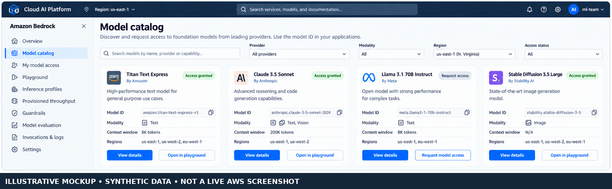
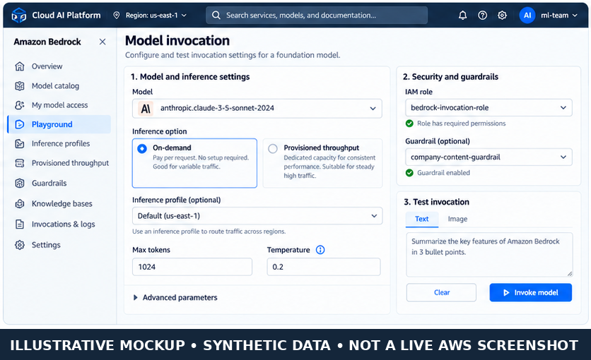
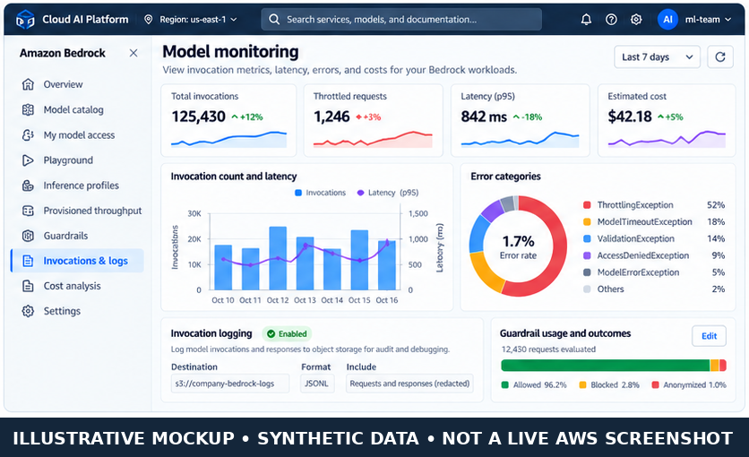

# Bedrock Platform and Model Access

> **Updated edition:** clarifies model/resource identifiers, cross-Region inference profiles, token-based quota behavior, and separates the illustrative console panels.

Amazon Bedrock provides managed access to supported foundation models through APIs. Your application sends an inference request to a model or inference resource; AWS operates the underlying model-serving infrastructure. That is different from packaging a model and managing its serving configuration on SageMaker AI.

The operational work does not disappear: the team still needs to select a suitable model, verify access and regional availability, design permissions, understand throughput and quotas, protect inputs and outputs, and observe latency, errors, and cost.

## 1. Bedrock and SageMaker AI: which path fits?

| Decision factor | Amazon Bedrock | SageMaker AI hosting |
|---|---|---|
| Main purpose | Invoke supported foundation models through managed APIs | Deploy custom, trained, or otherwise supported models with configurable hosting |
| Infrastructure responsibility | AWS manages the underlying foundation-model serving capacity | You select and configure hosting resources and deployment behavior |
| Model choice | Catalog of supported providers and model families, subject to region and access | Model artifacts, containers, framework and instance choices compatible with the hosting path |
| Customization | Features vary by model; supported options can include prompting, knowledge bases, fine-tuning/customization, and guardrails | More direct control over model packaging, containers, serving stack, and custom inference code |
| Capacity | On-demand where supported, inference profiles, and provisioned throughput for eligible models; availability varies | Provisioned endpoint capacity and supported scaling/hosting options |
| Best fit | Applications that want managed access to foundation models with minimal serving operations | Custom models or workloads needing more direct control over hosting and runtime |

Neither service is universally better. Choose per workload, and validate model quality, region, throughput, latency, data handling, integration effort and total cost.

## 2. Model access, identifiers and regions

Before coding, identify the **exact model or inference resource** that the application will call. The value supplied as `modelId` can represent different resource types, not only a base model ID.

| Resource type | What to use for `modelId` | Important note |
|---|---|---|
| Base foundation model | Model ID or supported ARN | Must be available for the requested operation in the chosen Region and have required access |
| Inference profile | Inference profile ID or ARN | Can route supported requests across Regions; review the profile's source/destination Region behavior and data-residency requirements |
| Provisioned Throughput | Provisioned model ARN | Use the provisioned resource associated with the model |
| Custom or imported model | Supported model/deployment ARN or associated provisioned resource, depending on its type | Follow the documentation for that resource; do not assume all model types use the same identifier |

Model catalogs, supported modalities, streaming support, inference features, quotas and prices change. Check the current model catalog and regional availability immediately before implementation. An ID copied from an example or another Region is not a reliable deployment configuration. Cross-Region inference profiles route requests to supported Regions, so review the profile's routing behavior against residency, compliance and organization policy before using it.



*Figure 1. Model discovery concept. This is a generated UI mockup with synthetic data, not a live AWS screenshot.*



*Figure 2. Invocation configuration concept. This is a generated UI mockup with synthetic data, not a live AWS screenshot.*



*Figure 3. Operational monitoring concept. Metrics and model examples are synthetic, not observed AWS account data.*

## 3. Inference APIs and current SDK pattern

Use the **Converse API** for a consistent messages-based interface across models that support it. It accepts structured messages and common inference configuration, and supports features such as system prompts, guardrails and tool configuration where the selected model/API supports them. Converse does not mean every model exposes identical capabilities: check model/API restrictions and model-specific inference parameters.

Use **InvokeModel** when you need a model's native request/response schema, for example for a model-specific payload or non-chat task. The request body and response format are model-specific. Use `ConverseStream` or `InvokeModelWithResponseStream` when the selected model and application need streaming. Check the model's documented input/output modalities and API support first.

### Minimal Python example using Boto3 Converse

This example assumes you have configured AWS credentials through an IAM role, AWS IAM Identity Center, or another supported credential provider. Replace the model ID and Region with values confirmed for your account and use case.

```python
import boto3
from botocore.config import Config
from botocore.exceptions import ClientError, BotoCoreError

REGION = "us-east-1"
MODEL_ID = "replace-with-a-supported-model-or-inference-profile-id"

client = boto3.client(
    "bedrock-runtime",
    region_name=REGION,
    config=Config(
        connect_timeout=3,
        read_timeout=90,
        retries={"max_attempts": 3, "mode": "standard"},
    ),
)

def ask_bedrock(question: str) -> str:
    try:
        response = client.converse(
            modelId=MODEL_ID,
            messages=[
                {
                    "role": "user",
                    "content": [{"text": question}],
                }
            ],
            inferenceConfig={
                "maxTokens": 400,
                "temperature": 0.2,
            },
        )
        blocks = response["output"]["message"]["content"]
        return "\n".join(
            block["text"] for block in blocks if "text" in block
        )
    except (ClientError, BotoCoreError) as exc:
        # Log safe request metadata/correlation ID; never log credentials.
        raise RuntimeError("Bedrock inference failed") from exc

if __name__ == "__main__":
    print(ask_bedrock("Explain the difference between a model and an inference endpoint."))
```

The `inferenceConfig` fields shown are common Converse fields, but a model may impose its own constraints. Pin and test a current Boto3/Botocore version in your application environment. This snippet is a minimal pattern, not a tested deployment for a particular model ID.

For a model-specific InvokeModel request, use the model's documented JSON schema rather than copying a body from a different provider. The official API reference describes `modelId`, `body`, content types, guardrail parameters, performance configuration and service tiers.

## 4. On-demand, inference profiles and provisioned throughput

| Option | Operational behavior | Consider it when |
|---|---|---|
| **On-demand** | Invoke an eligible model without purchasing dedicated model capacity; subject to quotas, throttling and model availability | Traffic is variable or you are starting with a workload whose volume is not yet predictable |
| **Inference profile** | A resource for supported model invocation, including cross-Region routing for supported profiles | You need the profile's supported routing/throughput behavior and your data-residency policy permits it |
| **Provisioned Throughput** | Purchase dedicated throughput for an eligible model/resource, generally with a committed cost | Traffic is sustained or predictable and you need reserved capacity characteristics |
| **Service tiers / latency optimization** | Optional request settings for supported models and APIs; availability and pricing depend on model and Region | A measured latency or priority objective justifies the option and its cost |

Do not equate Provisioned Throughput with a universal “always faster” guarantee. Model, quota, workload shape, service tier, concurrency and prompt/output token counts all affect observed performance. Estimate cost with the actual model's input/output pricing and expected token distribution, and compare with measured latency and throttling under representative load.

## 5. IAM and model access controls

Separate **human setup permissions** from **application invocation permissions**.

- **Human/admin role:** model discovery, access configuration where applicable, guardrail management, logging setup, quota requests and resource administration.
- **Application role:** only the invocation actions and model/inference-profile resources the application needs.
- **Guardrails:** grant the required guardrail access and use the supported request fields. Apply guardrails to the specific API call where needed; do not assume a guardrail is active merely because one exists in the account.
- **Explicit denies:** if you need to block inference for a model, AWS documents that both `bedrock:InvokeModel` and `bedrock:InvokeModelWithResponseStream` must be considered; these denies also affect corresponding Converse APIs.
- **Credential handling:** use role-based credentials and short-lived credentials where available. Do not place access keys in source code, client-side applications or logs.

A narrow policy should scope invocation to the required resources wherever resource-level permissions are supported. Start from the official Bedrock service authorization guidance rather than granting broad administrator access.

## 6. Invocation logging, guardrails and operations

### Invocation logging

Bedrock invocation logging can record request and response data for supported invocations to configured destinations such as CloudWatch Logs and/or Amazon S3, depending on the logging configuration. Treat prompts and outputs as potentially sensitive data:

- Enable only what your debugging, audit and compliance use case needs.
- Apply least-privilege access, encryption, retention and lifecycle controls to log destinations.
- Redact or avoid sensitive values in application logs; do not assume invocation logging automatically redacts every sensitive field.
- Add request metadata or application correlation IDs when supported so logs can be linked to a workflow without exposing secrets.

### Guardrails

Bedrock Guardrails can help evaluate prompts and responses against configured policies such as content filters, denied topics, sensitive-information filters and other supported safeguards. Feature support and behavior vary by model/API and configuration. Test both allowed and blocked cases, define how the application handles a blocked response, and measure false positives/negatives. Guardrails are not a substitute for authorization, application validation, retrieval controls or human review for high-impact decisions.

### Errors, throttling and latency

| Symptom | Likely causes to check | Response |
|---|---|---|
| Access denied | Missing IAM action, resource scope, model access prerequisite, or guardrail permission | Inspect the exact API/action/resource in the error and verify the execution role |
| Model not found or unavailable | Incorrect ID/ARN, wrong Region, unsupported API, or unavailable model | Confirm the identifier and regional/model capability table |
| Throttling | Account/model quota, burst concurrency, token throughput, or request rate | Check Service Quotas and service metrics; apply bounded exponential backoff with jitter and reduce concurrency if needed |
| Validation error | Request schema or parameter not supported by the chosen model | Validate against that model's inference parameter documentation |
| High latency | Large prompt/context, long output, model choice, queueing/throttling or network overhead | Measure end-to-end latency and token counts; optimize prompts/output limits and test supported performance options |

Use bounded retries for transient throttling or service errors. Do not blindly retry authorization and validation errors. Set an application deadline consistent with expected generation time, especially for large outputs; avoid retry storms during an outage.

### Observability

Track request count, error categories, throttling, input/output token counts where available, end-to-end latency (including p50/p95/p99), guardrail outcomes, and estimated cost. Bedrock Runtime quotas are commonly token-based and are scoped by model and Region; the applicable quotas are shared across supported inference APIs on that runtime endpoint. Use Service Quotas and the current regional quota tables rather than assuming a universal requests-per-second ceiling. Use CloudWatch metrics/logs and application telemetry together. Establish alerts for error-rate and throttling changes, latency objectives and cost spikes. Model quality and groundedness need application-level evaluation; API health alone does not prove answer quality.

## 7. Operational checklist

- [ ] Confirm model capability, ID/ARN, API compatibility and regional availability.
- [ ] Verify any model access prerequisites and the invoking role's least-privilege IAM permissions.
- [ ] Check Service Quotas and expected request/token throughput before load testing.
- [ ] Decide on-demand, inference profile or Provisioned Throughput using realistic traffic and cost estimates.
- [ ] Set request deadlines, bounded retries and concurrency limits; test throttling and transient failures.
- [ ] Decide whether invocation logging is required; secure destinations and define retention/redaction.
- [ ] Configure and test guardrails for the intended input/output path; test blocked responses.
- [ ] Capture latency percentiles, errors, throttling, token usage and cost signals.
- [ ] Recheck price, quota and regional availability before production changes.
- [ ] Document fallback behavior, incident ownership and a safe model/configuration change process.

## Related handbook chapters

Link this chapter to the existing **Foundation Models** and **Prompt Engineering** chapters using their verified repository-relative paths. Those chapters should explain model behavior and prompt design; this one focuses on the AWS platform and the operational contract around model access. Exact paths are intentionally not guessed here.

## Further reading

- [Prerequisites for running model inference](https://docs.aws.amazon.com/bedrock/latest/userguide/inference-prereq.html)
- [Converse API](https://docs.aws.amazon.com/bedrock/latest/userguide/conversation-inference.html)
- [InvokeModel API](https://docs.aws.amazon.com/bedrock/latest/userguide/inference-api.html)
- [Identity-based IAM policy examples](https://docs.aws.amazon.com/bedrock/latest/userguide/security_iam_id-based-policy-examples.html)
- [Amazon Bedrock model invocation logging](https://docs.aws.amazon.com/bedrock/latest/userguide/model-invocation-logging.html)
- [Amazon Bedrock quotas](https://docs.aws.amazon.com/bedrock/latest/userguide/quotas.html)
- [Bedrock Runtime endpoint quotas](https://docs.aws.amazon.com/bedrock/latest/userguide/quotas-runtime.html)
- [Use an inference profile in model invocation](https://docs.aws.amazon.com/bedrock/latest/userguide/inference-profiles-use.html)
- [Amazon Bedrock pricing](https://aws.amazon.com/bedrock/pricing/)

---

> **Enterprise AI Engineering Handbook**
>
> *Building Production-Grade Enterprise AI Systems — One Chapter at a Time.*
