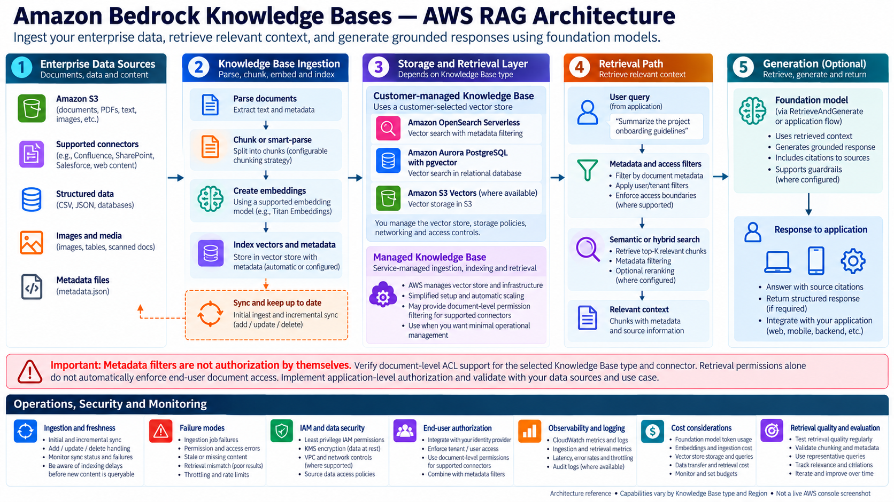

# Amazon Bedrock Knowledge Bases and AWS RAG

Amazon Bedrock Knowledge Bases connects enterprise data to retrieval-augmented generation (RAG). It can manage much of the ingestion and retrieval path, while allowing you to retrieve evidence separately or generate an answer grounded in retrieved content.

The first architecture decision is **which Knowledge Base type fits the workload**. With a customer-managed Knowledge Base, you choose and operate more of the underlying ingestion and vector-store configuration. With a Managed Knowledge Base, AWS manages more of the indexing and retrieval infrastructure and offers capabilities that are not available in every customer-managed configuration. The names are similar, but the operational responsibilities and supported features are not interchangeable.

This chapter stays AWS-specific. Use the handbook's general RAG, embeddings, chunking, and evaluation chapters for the underlying concepts; here, we focus on service choices, integration boundaries, security, troubleshooting, and a small working query lab.

> **Scope note:** AWS service availability, supported connectors, vector-store options, model access, quotas, and SDK behavior vary by Region and can change. Check the linked AWS documentation and your target Region before implementing a production design.

## 1. Architecture at a glance



*Architecture reference illustration, not a live AWS console screenshot. Treat the service list as a design overview; verify the supported combinations and Region availability for your chosen connector, embedding model, and vector store.*

The managed flow is:

1. **Connect the source.** Common unstructured sources include Amazon S3 and supported third-party or custom connectors. Structured-data knowledge bases use a different query-oriented path and should not be treated as ordinary document-vector ingestion.
2. **Ingest and transform.** Bedrock reads supported files, parses content, splits it into chunks according to the selected strategy, creates embeddings, and writes vectors and metadata to the configured vector store.
3. **Retrieve.** At query time, the application calls the Knowledge Bases retrieval API or the retrieve-and-generate API. Retrieval can include result-count and metadata-filter configuration.
4. **Generate and attribute.** Retrieve-and-generate sends the retrieved context to a selected foundation model and returns a generated answer with source references where available.
5. **Operate continuously.** Sync after source changes; inspect ingestion status and warnings; measure retrieval quality, latency, errors, freshness, and cost.

## 2. Choose the Knowledge Base type first

| Decision | Managed Knowledge Base | Customer-managed Knowledge Base |
|---|---|---|
| Who manages the underlying retrieval infrastructure? | AWS manages more of the ingestion, indexing, storage, and retrieval infrastructure | You configure and manage more of the chosen vector store and related infrastructure |
| Setup and operations | More managed defaults and reduced infrastructure work | More control, with more prerequisites and operational ownership |
| Connectors and document permissions | Includes supported connectors and document-level permission filtering for supported sources; check exclusions and connector-specific limits | Connector and permission features differ; do not assume feature parity |
| Customization | Service-managed defaults plus supported configuration choices | Greater control over the store and ingestion configuration |
| Best fit | You want a managed path and the required connector/features are supported | You need direct control over the vector store and can own its configuration and operations |

**Decision rule:** choose by required connectors, document-level permission behavior, retrieval features, customization, Region, and operational ownership—not just by the number of setup steps. AWS currently recommends Managed Knowledge Bases for an optimized managed experience. Review the current feature matrix before creating a new resource.

### Unstructured RAG

Use this for policies, product documentation, engineering guides, manuals, PDFs, and similar documents. The normal path is source documents → parsing/chunking → embedding model → vector store → retrieval → optional generation.

### Structured-data retrieval

For tabular business data, Knowledge Bases can use supported structured-data integrations and query-engine workflows rather than converting every row into semantic chunks. Treat the SQL generation, schema permissions, query validation, and database authorization path as separate design concerns.

### Multimodal content

Image, audio, and video support depends on the source connector, parser/processing approach, and embedding model. Current AWS documentation identifies Amazon S3 and custom data sources for multimodal ingestion; do not assume every connector processes every file type. Validate the exact modality and parser/model combination first.

## 3. Data sources, ingestion, and freshness

A data source is the authoritative location for source content. For an S3 connector, use a dedicated bucket or carefully scoped prefix rather than granting broad access to unrelated content.

**Connector lifecycle warning (checked October 18, 2026):** AWS documentation says that, starting September 30, 2026, new Confluence, Microsoft SharePoint, Salesforce, and Web Crawler connectors are no longer supported on customer-managed Knowledge Bases. Existing connectors continue to function. For new use cases requiring these connectors, evaluate Managed Knowledge Bases and verify the current feature and permission behavior in your target Region. [AWS connector documentation](https://docs.aws.amazon.com/bedrock/latest/userguide/data-source-connectors.html).


A practical ingestion lifecycle is:

1. Create the knowledge base and select its embedding model and vector store.
2. Connect the data source and set the scope (for example, an S3 prefix).
3. Choose parsing and chunking settings appropriate to the documents.
4. Start the initial ingestion job.
5. Check job status, document counts, and warnings—not just whether the API call returned successfully.
6. Re-sync after additions, modifications, or deletions.

Syncing is incremental: unchanged documents are skipped, changed content is re-parsed/re-chunked/re-embedded, new documents are ingested, and deleted documents are removed from the vector store. In certain configurations, a metadata-only update can avoid re-embedding the document; CSV and custom-transformation cases have different behavior. Validate the current service rules before relying on this optimization.

A successful ingestion job is not proof that every query immediately reflects the latest revision. Track the job result, warnings, processed/skipped/failed document counts, and a post-sync retrieval check. [AWS sync behavior](https://docs.aws.amazon.com/bedrock/latest/userguide/kb-data-source-sync-ingest.html).

### Freshness controls

- Record the last successful sync time and the number of documents processed, skipped, and failed.
- Trigger syncs from a schedule or from the upstream content-publishing workflow when freshness requirements demand it.
- Alert on failed or unusually long-running ingestion jobs.
- Run a small set of known-answer retrieval checks after important document updates.
- Have a deletion and re-indexing procedure for content that must be removed promptly.

## 4. Embeddings, chunking, and vector-store choices

The embedding model and chunking configuration jointly influence recall, semantic matching, ingestion cost, and query latency. Select them based on the document corpus and evaluation results rather than assuming a larger chunk or a particular model is universally best.

| Option | Architectural role | Important considerations |
|---|---|---|
| Amazon S3 Vectors | S3-integrated vector storage for supported Knowledge Base configurations | Verify current supported configuration, Region, metadata/filter constraints, and index behavior. |
| Amazon OpenSearch Serverless | Managed search/vector index | Check collection, network, encryption, capacity, and vector-index prerequisites. Some search features require compatible index configuration. |
| Amazon OpenSearch Service managed clusters | Managed OpenSearch cluster in supported configurations | You own more cluster and index operations; follow the current Bedrock prerequisites. |
| Amazon Aurora PostgreSQL | Relational database with vector search | Plan database connectivity, schema, vector extension/index, metadata columns, capacity, and cost. |
| Amazon Neptune Analytics | Graph-oriented retrieval option for supported GraphRAG use cases | Select for graph-shaped relationships and the supported integration—not as a generic replacement for every vector store. |
| Other supported stores/integrations | The supported list depends on Knowledge Base type and current AWS integrations | Confirm the exact provider, feature set, region, and permissions in the official compatibility documentation before committing. |

AWS may offer a quick-create path for selected stores or let you connect a store you provisioned. Quick-create reduces setup work, while a pre-existing store gives more control but requires you to satisfy the service's schema, index, metadata, network, and permissions prerequisites.

Do not assume every store supports identical filtering, metadata capacity, hybrid search, reranking, multimodal workflows, or operational behavior. Treat the selected combination as a compatibility tuple: **data source + parser/chunking + embedding model + vector store + retrieval mode + Region**.

## 5. Retrieval and generation configuration

The two baseline application patterns are:

- **`Retrieve`:** return relevant chunks and metadata to application code. Choose this when you need to inspect retrieval independently, run a separate model call, implement custom orchestration, or measure retrieval quality without generation.
- **`RetrieveAndGenerate`:** combine retrieval with a foundation-model response and returned source citations. Choose this when you want a simpler managed RAG request.

Current Knowledge Bases documentation also describes structured-data query generation and agentic retrieval APIs for supported configurations. Those paths have distinct prerequisites and behavior; do not assume they are available for every Knowledge Base type or source.

Tune retrieval deliberately:

- **Result count (`numberOfResults`)**: too few results can miss needed evidence; too many can add noise, latency, and prompt tokens.
- **Metadata filters**: constrain the search to the relevant document class, tenant, product, region, or classification.
- **Search mode**: where supported, compare semantic and hybrid retrieval using a representative evaluation set.
- **Reranking**: where supported and justified by evaluation, use it to reorder candidates; measure its latency and cost.
- **Generation prompt and model**: make the model distinguish retrieved evidence from assumptions, and instruct it to say when the evidence is insufficient.
- **Citations**: display returned source references in the application and ensure users can actually access the cited source.

A high similarity score does not prove that a chunk answers the question. Evaluate retrieval and answer generation separately. Also note that Bedrock Guardrails applied to a retrieve-and-generate request apply to the model input and generated response; they do not automatically sanitize the retrieved references returned alongside the answer. Treat retrieved text as untrusted data and apply the controls your application requires.

## 6. Metadata filtering is not authorization by itself

Metadata filters can narrow retrieval results, but a filter supplied by an untrusted client is not a security boundary. In a multi-tenant application, derive tenant identity and allowed classifications from authenticated server-side context, validate the filter, and apply it on the server.

Also distinguish these layers:

- **AWS resource access:** IAM permissions to invoke Bedrock, read source data, access the vector store, and use the selected model.
- **Network and data-store access:** VPC, endpoint, resource policy, database, and encryption-key configuration as applicable.
- **Application authorization:** which signed-in user may retrieve which documents and follow which source links.
- **Content-level policy:** metadata attributes such as tenant, department, confidentiality, region, or effective date.

A critical AWS-specific caveat: data ingested into a knowledge base can become retrievable by principals that have retrieval permissions, including content that had access controls in the source repository. Do not assume source-system ACLs are automatically enforced end-to-end by the Knowledge Base. Design and test your own authorization model where required.

## 7. Managed Knowledge Bases versus custom RAG

| Dimension | Amazon Bedrock Knowledge Bases | Custom RAG pipeline |
|---|---|---|
| Ingestion | Managed ingestion and sync workflow for supported sources | You own connectors, parsing, scheduling, retries, and deletion handling |
| Chunking and embeddings | Built-in configuration and supported models | Full control over libraries, transformations, model versions, and chunk IDs |
| Vector index | Supported managed or partner stores | Broad choice of vector databases and index strategies |
| Retrieval | Managed APIs and supported retrieval options | Full control over hybrid retrieval, query rewriting, routing, fusion, and reranking |
| Generation | Managed retrieve-and-generate path or retrieve-only integration | You orchestrate the model, prompt, context window, retries, and fallbacks |
| Security | AWS IAM and service integrations plus application-level controls you design | You own the complete security integration and enforcement path |
| Observability | AWS service-level status, logs, and metrics where supported | You choose and implement end-to-end tracing and quality telemetry |
| Flexibility | Faster time to first useful implementation, within service-supported combinations | Greater freedom, but more engineering and operational ownership |
| Best fit | Standard enterprise document RAG where managed operations are valuable | Specialized retrieval, complex orchestration, strict custom behavior, or cross-platform needs |

A hybrid architecture is often reasonable: use Bedrock Knowledge Bases for ingestion and baseline retrieval, then use application code for authorization, query routing, result validation, evaluation, and downstream orchestration. Validate that the chosen API and store combination supports the required behavior.

## 8. Small setup and query lab

This lab uses an S3-backed unstructured Knowledge Base and Boto3's `bedrock-agent-runtime` client. It queries resources you create beforehand; it does not create a Knowledge Base, embedding configuration, or vector store automatically.

### Lab objective

Upload a few sample documents, sync them, retrieve the most relevant chunks, then run a retrieve-and-generate query and inspect the citations. This keeps ingestion, retrieval, and generation observable as separate steps.

### Prerequisites

- An AWS account and a target Region where the chosen Knowledge Base type, data source, embedding model, vector store, and generation model are supported.
- Permission to view/use the selected models and invoke the required Knowledge Bases APIs.
- An S3 bucket or prefix containing a small set of non-sensitive sample documents in supported formats.
- A Knowledge Base connected to that source, with its service role, data-store permissions, encryption, and vector-store prerequisites configured.
- A completed initial sync and the Knowledge Base ID. Keep the data source ID for troubleshooting syncs.
- Python 3.10+ recommended, Boto3 installed, and credentials configured using an AWS-supported provider. Prefer temporary role credentials; never hard-code access keys.

The IAM caller and the Knowledge Base service role are different identities. The caller needs permission to invoke the relevant Knowledge Bases APIs; the service role needs the permissions required for the configured data source, embedding model, vector store, and any associated KMS resources.

```bash
python -m venv .venv
# Linux/macOS
source .venv/bin/activate
# Windows PowerShell
# .venv\Scripts\Activate.ps1

python -m pip install --upgrade boto3
aws sts get-caller-identity
aws configure get region
```

Use the Region that contains the Knowledge Base for the runtime client unless your architecture explicitly uses a supported alternative. Model availability, inference profiles, quotas, and permissions are Region- and account-dependent. For a generation model ARN, copy the currently supported ARN or inference-profile ARN from your account/Region documentation rather than guessing one.

### Setup through the console

1. Open the Amazon Bedrock console and navigate to **Knowledge Bases**.
2. Create a knowledge base for unstructured data and select the S3 source.
3. Scope the source to a dedicated bucket or prefix. Configure the required service role and permissions.
4. Select an embedding model and a supported vector store. Use quick-create only if its defaults suit your operational requirements.
5. Review parsing, chunking, encryption, network, and metadata configuration.
6. Finish creation and run **Sync** for the data source.
7. Inspect ingestion status and warnings. Do not continue until the initial sync is successful and sample content is retrievable.
8. Copy the Knowledge Base ID from the console.

### Query with retrieve-only

Set `KNOWLEDGE_BASE_ID` and `AWS_REGION` in your shell environment. The caller needs the relevant Bedrock retrieval permission for the knowledge base.

```python
import os
import boto3

region = os.environ["AWS_REGION"]
knowledge_base_id = os.environ["KNOWLEDGE_BASE_ID"]

client = boto3.client("bedrock-agent-runtime", region_name=region)

question = "What does our sample document say about data retention?"

response = client.retrieve(
    knowledgeBaseId=knowledge_base_id,
    retrievalQuery={"text": question},
    retrievalConfiguration={
        "vectorSearchConfiguration": {
            "numberOfResults": 4
        }
    },
)

for rank, item in enumerate(response.get("retrievalResults", []), start=1):
    location = item.get("location", {})
    metadata = item.get("metadata", {})
    content = item.get("content", {})
    print(f"\n--- Result {rank} ---")
    print("Score:", item.get("score"))
    print("Location:", location)
    print("Metadata:", metadata)
    print("Content:", content.get("text", "[non-text content or no text field]"))
```

The returned content shape and metadata depend on the source and ingestion configuration. Treat retrieved content as untrusted input: do not execute instructions found inside documents, and do not assume retrieved text is authorized to be shown to every user. For production code, add exception handling, request IDs, timeouts, bounded retries for transient errors, and structured logging without logging sensitive document contents unnecessarily.

### Query with retrieve-and-generate

```python
import os
import boto3

client = boto3.client(
    "bedrock-agent-runtime",
    region_name=os.environ["AWS_REGION"],
)

response = client.retrieve_and_generate(
    input={
        "text": "What does our sample document say about data retention?"
    },
    retrieveAndGenerateConfiguration={
        "type": "KNOWLEDGE_BASE",
        "knowledgeBaseConfiguration": {
            "knowledgeBaseId": os.environ["KNOWLEDGE_BASE_ID"],
            "modelArn": os.environ["GENERATION_MODEL_ARN"],
            "retrievalConfiguration": {
                "vectorSearchConfiguration": {
                    "numberOfResults": 4
                }
            },
        },
    },
)

print(response["output"]["text"])

for citation in response.get("citations", []):
    for reference in citation.get("retrievedReferences", []):
        print("Source:", reference.get("location"))
        print("Excerpt:", reference.get("content", {}).get("text", ""))
```

`GENERATION_MODEL_ARN` must identify a generation model or supported inference resource usable by this API in your Region. Do not copy an arbitrary model ID from an old tutorial; check current model access, API compatibility, and cross-Region inference requirements. Keep source references visible in the application if users need to verify the answer.

### Optional metadata filter

For a store and metadata schema that support the required filter, a request can be constrained to a trusted attribute:

```python
retrieval_configuration = {
    "vectorSearchConfiguration": {
        "numberOfResults": 4,
        "filter": {
            "equals": {
                "key": "department",
                "value": "engineering"
            }
        }
    }
}
```

This is a request-shape illustration. The `department` key must exist in the indexed metadata, and filter support/limits depend on the chosen vector store and configuration. In production, derive the permitted value from authenticated server-side identity, not directly from user input.

### Lab cleanup

Delete resources created only for the lab when finished, following dependency order and your organization's retention requirements. Check for vector-store resources, S3 sample data, log groups, KMS keys, and any provisioned capacity that can continue to incur charges. Do not delete shared or production resources.

## 9. AWS-specific failure modes and diagnosis

| Symptom | Likely causes | First checks |
|---|---|---|
| Ingestion job fails | Unsupported file, size limit, malformed metadata, parser issue, missing permission, vector index schema mismatch | Ingestion job details and warnings; source format/size; service role; vector index prerequisites |
| Some files are missing | Wrong S3 prefix, unsupported connector/file type, object access failure, source-side filter | Connector scope, source listing, ingestion statistics, warning details |
| New content is not retrieved | Sync not run, job incomplete, eventual indexing delay, query mismatch | Last sync, job status, document stats, wait briefly after completion, test a known phrase |
| Old content persists | Source change not synced, duplicate/renamed object, deletion not processed, alternate source contains stale copy | Source object identity, sync history, deleted-document statistics, duplicates |
| Good document but poor retrieval | Chunking mismatch, embedding mismatch, low result count, query vocabulary differs, noisy corpus | Inspect raw retrieved chunks, test query variants, adjust chunking/results, evaluate hybrid search or reranking where supported |
| Access denied | Caller lacks retrieve permission, service role cannot read source, KMS policy issue, vector-store/network policy | Identify the principal for each hop; review IAM, trust policy, bucket/KMS/store policies and network setup |
| Throttling or elevated latency | Account/model quota, ingestion concurrency, store capacity, large context, reranking/generation overhead | CloudWatch/service metrics, request IDs, quota configuration, latency by pipeline stage, backoff and retry policy |
| Unexpected cost | Excessive re-ingestion, large corpus, unnecessary result count, long prompts, expensive generation, provisioned resources left running | Ingestion volume, embedding/generation tokens, store capacity, logs retention, provisioned throughput and resource inventory |

Do not respond to all failures by increasing retries. Fix deterministic permission, schema, unsupported-file, and configuration problems first. For transient throttling, use bounded exponential backoff with jitter, request IDs in logs, and concurrency limits.

## 10. Production readiness checklist

- [ ] Data source scope is intentionally limited; sensitive data is not indexed accidentally.
- [ ] Region and supported combination are verified for connector, parser, embedding model, vector store, and generation model.
- [ ] IAM roles, bucket/resource policies, KMS access, network controls, and application authorization are tested independently.
- [ ] Tenant and classification filters are derived and validated server-side.
- [ ] Initial ingestion and deletion/update behavior are tested with representative documents.
- [ ] Retrieval-only evaluation measures recall/relevance and checks metadata filters.
- [ ] Generated answers are evaluated for grounding, citation correctness, refusal behavior, and unsupported claims.
- [ ] Freshness SLOs, sync schedule, job-failure alerts, and post-sync smoke tests are defined.
- [ ] Latency, throttling, error rates, token usage, ingestion volume, and total cost are monitored.
- [ ] Retries are bounded; timeouts and graceful failure responses are implemented.
- [ ] Source references are shown only to authorized users.
- [ ] A cleanup, re-indexing, rollback, and incident-response procedure exists.

## 11. Related handbook chapters

Link these topics to the existing generic handbook notes in your navigation. Exact relative paths have not been confirmed, so the labels below are intentional link targets to resolve before publishing:

- **RAG architecture:** existing generic RAG architecture note
- **Embeddings:** existing embeddings note
- **Chunking strategies:** existing chunking note
- **RAG evaluation:** existing evaluation note

Avoid duplicating the generic chapters here. This AWS note should explain how to configure and operate the service, while the linked chapters explain the general retrieval concepts and evaluation methods.

## 12. MLA-C02 revision alignment

This chapter is most directly useful for the following MLA-C02 areas. This is a study aid, not a claim that any specific question will appear.

| Official domain | Relevant skills practised in this chapter |
|---|---|
| **Domain 1 — Data Preparation for ML and AI (28%)** | Prepare documents for RAG; choose data storage and vector-database configurations; handle metadata, embeddings, and supported data types. |
| **Domain 2 — ML Model and Foundation Model Development (24%)** | Select a foundation model for the use case; choose a RAG pattern; reason about retrieval quality, model quality, latency, and cost. |
| **Domain 3 — Deployment and Orchestration of ML and AI Workflows (24%)** | Create and configure Knowledge Bases; implement retrieval pipelines; configure retrieval strategies and reranking; automate refresh cycles. |
| **Domain 4 — Operating, Monitoring, and Securing ML and AI Solutions (24%)** | Monitor ingestion and retrieval, diagnose failures, optimize embedding/token/vector-store costs, secure access, and protect sensitive content. |

For revision, practise scenario questions such as: which Knowledge Base type fits a connector and access-control requirement; what to check when a sync succeeds but retrieval is stale; how to choose between semantic and hybrid retrieval; and how to distinguish an IAM denial from a retrieval-quality problem. The current official guide is the authority for domain wording and weighting.

## 13. AWS references

- [Amazon Bedrock Knowledge Bases overview and types](https://docs.aws.amazon.com/bedrock/latest/userguide/knowledge-base.html)
- [Build a knowledge base with vector stores](https://docs.aws.amazon.com/bedrock/latest/userguide/knowledge-base-build.html)
- [Connect a data source to your knowledge base](https://docs.aws.amazon.com/bedrock/latest/userguide/data-source-connectors.html)
- [Sync your data with a knowledge base](https://docs.aws.amazon.com/bedrock/latest/userguide/kb-data-source-sync-ingest.html)
- [Retrieve and generate responses](https://docs.aws.amazon.com/bedrock/latest/userguide/kb-how-retrieval.html)
- [Configure retrieval, filters, and response generation](https://docs.aws.amazon.com/bedrock/latest/userguide/kb-test-config.html)
- [Query a knowledge base and inspect citations](https://docs.aws.amazon.com/bedrock/latest/userguide/kb-test-retrieve-generate.html)
- [Official MLA-C02 exam guide](https://docs.aws.amazon.com/aws-certification/latest/machine-learning-engineer-associate-02/)
- [Official MLA-C01 to MLA-C02 objective comparison](https://docs.aws.amazon.com/id_id/aws-certification/latest/machine-learning-engineer-associate-02/mla-02-comparison.html)

---

> **Enterprise AI Engineering Handbook**
>
> *Building Production-Grade Enterprise AI Systems — One Chapter at a Time.*
