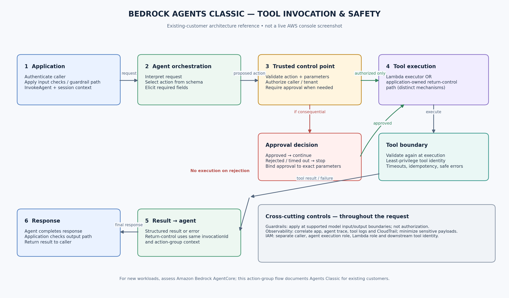

# Amazon Bedrock Agents Classic, Guardrails, and Evaluation

> **Service lifecycle note (October 2026):** Amazon Bedrock Agents is now called **Amazon Bedrock Agents Classic** and has been closed to new customers since July 30, 2026. Existing customers can continue using it, but AWS recommends assessing **Amazon Bedrock AgentCore** for new agentic workloads and migration planning. The action-group API and lab below are specifically for eligible existing Agents Classic customers; they are not a new-account onboarding path. See the [Agents Classic maintenance-mode guidance](https://docs.aws.amazon.com/bedrock/latest/userguide/agents-classic-maintenance-mode.html).

An agent is useful when a request needs more than one model response. It can interpret the goal, select an available action, collect parameters, invoke a tool, inspect the result, and decide what to do next. That flexibility is also the risk: a model can propose an action, but it must not be trusted to authorize the action.

For eligible existing customers, Bedrock Agents Classic provides managed orchestration for supported agent workflows. Action groups describe the tools an agent can call, and execution can route to AWS Lambda or return control to the application. Guardrails add configurable safeguards around supported model input/output paths. Evaluation helps teams test whether behavior is useful, grounded, and safe. For a new implementation, assess AgentCore’s current runtime and tool-integration options against the same architectural requirements rather than assuming the Classic action-group API is available.

The central engineering rule is simple: **the model proposes; trusted application code validates and authorizes; the tool performs only the permitted operation.**

## 1. Agent-to-tool architecture



*Illustrative architecture reference, not a live AWS console screenshot. The diagram shows a low-risk read-only flow. Production behavior depends on the agent configuration, model, action-group schema, permissions, and application code.*

For an existing Agents Classic deployment, a typical action-group request follows this sequence:

1. The application sends the user's request and session context to the Bedrock Agents Runtime `InvokeAgent` API.
2. The agent interprets the request and selects an action group based on its description and schema.
3. Bedrock elicits the required parameters and prepares an action invocation.
4. The action group routes to a configured executor:
   - **Lambda:** Bedrock invokes the configured Lambda function; the function validates parameters, performs the allowed operation, and returns a structured response.
   - **Return control:** Bedrock returns the proposed action and parameters to the calling application. The response includes an `invocationId` and `invocationInputs`; the application executes the tool and sends results in a subsequent `InvokeAgent` request’s `sessionState`, using the same invocation ID and action group. This is a distinct application-owned execution path, not a Lambda response.
5. The agent uses the tool result to continue reasoning and produce a response.
6. The application handles errors and final response delivery. Apply guardrails at the input/output boundaries supported by the chosen API path, and emit correlated operational logs throughout the request rather than treating safety checks or logging as a single final step.

An action-group schema is a contract that tells the model which operations and parameters are available. It is not a security boundary. The Lambda function or application tool must validate every parameter and enforce business authorization independently.

## 2. Action groups and execution roles

### Action group configuration

An action group can be defined with either:

- **OpenAPI schema:** describes API paths, HTTP methods, parameters, request bodies, and responses.
- **Function schema:** describes named functions and their parameters.

These are alternative schema styles for defining actions; don't configure both on the same action group. The configured executor can use a Lambda function or `RETURN_CONTROL`, depending on the integration design. Prepare the agent after changes and test the prepared version/alias used by the application.

### Keep the identities separate

There are several identities in the request path, and they should not be conflated:

- **Application caller:** the user or backend role allowed to invoke the agent runtime.
- **Agent execution role:** the role the agent assumes to access the AWS resources needed for its configured orchestration and model use.
- **Lambda execution role:** the role assumed by the Lambda function to access its own dependencies.
- **Lambda resource-based policy:** must permit the Bedrock service to invoke the function where that invocation path is used.
- **Tool's business identity:** for a downstream API, database, or SaaS system, use the narrowly scoped identity intended for that tool.

The application caller's permission to invoke an agent does not mean the caller should receive the agent's tool permissions. Similarly, the agent execution role should not become a general-purpose administrator role.

## 3. Guardrails: important, but not authorization

Amazon Bedrock Guardrails can apply configurable policies such as content filters, denied topics, sensitive-information filters, word filters, and prompt-attack protections, depending on the supported feature and model path. Guardrails can be used with supported Bedrock Agents workflows.

Use guardrails to help manage model input and output risks, not to decide whether a particular employee may delete a record or whether a tenant may access another tenant's data. Those decisions belong in deterministic application and service authorization.

Operational points:

- Test guardrails against realistic benign and adversarial prompts; an overly broad policy can block legitimate work.
- Select the guardrail version/configuration deliberately and retest after changes.
- Check how the configured agent/API path applies guardrails to inputs, outputs, and action-group flows.
- Log the intervention outcome and request correlation IDs without unnecessarily retaining sensitive prompts or tool payloads.
- Budget for guardrail evaluation calls as well as model inference; a blocked prompt may still incur guardrail charges.
- Guardrails do not make tool output trustworthy. Validate the tool result and treat retrieved text or external API content as untrusted data.

## 4. Evaluation: measure the whole workflow

A single successful demo is not evidence that an agent is ready for production. Evaluate several layers separately:

| Layer | What to measure | Example test |
|---|---|---|
| Intent and routing | Correct action selection; unnecessary tool calls | Ask for service status, then ask an unrelated question |
| Parameter extraction | Valid values, missing fields, ambiguous requests | Provide an unsupported service name or omit the service |
| Tool behavior | Correct result, deterministic validation, timeout/error handling | Simulate a dependency failure or malformed parameter |
| Grounded response | Correctness, completeness, faithfulness, appropriate refusal | Compare the answer with the tool result or expected reference |
| Safety | Prompt-injection resistance, sensitive-data handling, policy adherence | Ask the agent to ignore rules or request restricted information |
| Operations | Latency, tool failures, throttling, retries, token use, cost | Run a representative load and failure test |
| Human workflow | Correct escalation and approval behavior | Attempt a consequential action without approval |

Amazon Bedrock Evaluations supports model evaluations and RAG evaluations; it is not a general-purpose automatic agent-workflow test runner for every tool action. Use an evaluation dataset and the supported evaluation path for model or RAG quality, then add application-level tests for routing, tool invocation, authorization, approval, and recovery.

For RAG evaluations, supported metrics can include context relevance/coverage and generated-answer metrics such as correctness, completeness, faithfulness, and citation precision/coverage, depending on the evaluation type. For agents, create a separate test harness that records the expected action, allowed parameters, tool result, final answer, and safety outcome.

## 5. Managed agents versus custom orchestration

This is an architectural comparison, not a claim that every option is available to every AWS account. Agents Classic is a legacy managed path for existing customers; AgentCore is the AWS direction to assess for new agentic workloads. Confirm current service capabilities, Region availability, and migration guidance before selecting components.

| Choice | Strengths | Trade-offs | Good fit |
|---|---|---|---|
| **Amazon Bedrock Agents Classic (existing customers)** | Managed planning and action selection, action groups, supported Knowledge Base integration, managed runtime | Closed to new customers since July 30, 2026; existing customers should plan with AWS maintenance-mode guidance and assess migration options | Existing workloads that are already using Agents Classic |
| **Amazon Bedrock AgentCore** | AWS direction for building and operating agentic applications; evaluate its runtime and tool-integration capabilities for the target architecture | Components, integration model, and operational responsibilities differ from Agents Classic; validate current regional/service support | New agentic workloads and migration planning |
| **Custom orchestration** | Explicit control over state transitions, retries, routing, approval gates, policies, and provider portability | Your team owns planning logic, tool registry, state, resilience, observability, and testing | Complex workflows with deterministic control requirements or custom coordination |
| **Hybrid** | Managed agent capabilities where useful, application-owned authorization and selected workflow steps | More than one orchestration boundary to document and test | Most practical enterprise designs where managed planning is useful but critical actions require explicit application controls |

Do not choose a managed agent simply because the workflow uses an LLM, and do not build a custom orchestration engine unless the control it provides is worth the added operational responsibility.

## 6. Minimal, low-risk tool integration lab

This lab creates a read-only `get_service_status` tool. It returns a fixed status for an allowlisted public service. It does not change infrastructure, write to a database, send messages, or call an external system.

### Prerequisites and availability caveat

- This specific action-group lab is for **existing customers who already have access to Amazon Bedrock Agents Classic**. AWS closed Agents Classic to new customers on July 30, 2026. If your account is new to the service, do not expect to enable this lab; assess Amazon Bedrock AgentCore and its current documentation instead.
- An eligible AWS account and Region with access to Agents Classic and a supported foundation model.
- Permission to create and prepare an agent, configure an action group, create a Lambda function, and invoke the prepared agent.
- An execution role for the agent and a Lambda execution role with only the permissions needed for this lab.
- Python 3.11+ for the Lambda example (select a runtime currently supported by Lambda when creating the function).
- A guardrail is recommended for experimentation but is not a substitute for the tool's allowlist and validation.

### Step A — Define the action contract

Use an OpenAPI schema like this for the action group. It deliberately exposes one read-only operation with one constrained input.

```yaml
openapi: 3.0.1
info:
  title: Public Service Status API
  version: "1.0.0"
paths:
  /service-status:
    get:
      operationId: getServiceStatus
      description: Get the status of an allowlisted public service. Read-only.
      parameters:
        - name: serviceName
          in: query
          required: true
          description: Public service name to check.
          schema:
            type: string
            enum: [status-page, documentation, api]
      responses:
        "200":
          description: Status returned
          content:
            application/json:
              schema:
                type: object
                properties:
                  serviceName:
                    type: string
                  status:
                    type: string
                  readOnly:
                    type: boolean
```

Upload the schema to an S3 location that the agent configuration can access, or use the console's inline schema editor. Create the action group and select a Lambda executor. Use a dedicated function for this lab rather than attaching the agent to a production function.

### Step B — Lambda tool implementation

This function validates the action and parameter again. The model's enum is helpful, but the Lambda allowlist is the enforcement point.

```python
import json

ALLOWED_SERVICES = {
    "status-page": "operational",
    "documentation": "operational",
    "api": "degraded",
}

def lambda_handler(event, context):
    action_group = event.get("actionGroup", "ServiceStatus")
    api_path = event.get("apiPath", "/service-status")
    http_method = event.get("httpMethod", "GET").upper()

    # Only the single read-only action in this lab is accepted.
    if api_path != "/service-status" or http_method != "GET":
        return _response(action_group, api_path, http_method, 400,
                         {"error": "Unsupported action"})

    parameters = {
        item.get("name"): item.get("value")
        for item in event.get("parameters", [])
        if item.get("name")
    }
    service_name = parameters.get("serviceName")

    if service_name not in ALLOWED_SERVICES:
        return _response(action_group, api_path, http_method, 400,
                         {"error": "Unsupported serviceName"})

    body = {
        "serviceName": service_name,
        "status": ALLOWED_SERVICES[service_name],
        "readOnly": True,
    }
    return _response(action_group, api_path, http_method, 200, body)


def _response(action_group, api_path, http_method, status_code, body):
    return {
        "messageVersion": "1.0",
        "response": {
            "actionGroup": action_group,
            "apiPath": api_path,
            "httpMethod": http_method,
            "httpStatusCode": status_code,
            "responseBody": {
                "application/json": {
                    "body": json.dumps(body)
                }
            },
        },
    }
```

The statuses above are synthetic lab data, not live service-health information. The function makes no network calls and has no write capability.

### Step C — Configure and prepare the agent

1. Create the agent and give it an instruction such as: “Answer questions about the listed public service status. Use `getServiceStatus` when a supported service is named. If the service is not allowlisted, explain that it is unsupported. Never claim this lab data is live.”
2. Attach the action group using the OpenAPI schema and the lab Lambda function.
3. Configure the agent execution role according to the current AWS instructions. Keep it scoped to the required model and resources.
4. Ensure the Lambda resource policy permits the intended Bedrock invocation path. Avoid broad principals or wildcard permissions where a scoped source ARN can be used.
5. Prepare the agent and create or select an alias for the version the application will invoke.
6. Test valid inputs, unsupported service names, missing parameters, malformed inputs, and tool errors in the console before using the runtime client.

### Step D — Invoke the prepared agent

Set the following environment variables using values from your AWS account:

```bash
export AWS_REGION="your-region"
export BEDROCK_AGENT_ID="your-agent-id"
export BEDROCK_AGENT_ALIAS_ID="your-prepared-alias-id"
```

PowerShell equivalent:

```powershell
$env:AWS_REGION = "your-region"
$env:BEDROCK_AGENT_ID = "your-agent-id"
$env:BEDROCK_AGENT_ALIAS_ID = "your-prepared-alias-id"
```

Minimal Boto3 invocation:

```python
import os
import uuid
import boto3

client = boto3.client(
    "bedrock-agent-runtime",
    region_name=os.environ["AWS_REGION"],
)

response = client.invoke_agent(
    agentId=os.environ["BEDROCK_AGENT_ID"],
    agentAliasId=os.environ["BEDROCK_AGENT_ALIAS_ID"],
    sessionId=str(uuid.uuid4()),
    inputText="What is the current status of the public API service?",
)

for event in response["completion"]:
    if "chunk" in event:
        print(event["chunk"]["bytes"].decode("utf-8"), end="")
    elif "trace" in event:
        # Keep trace logging controlled; traces can contain sensitive content.
        print("\n[Agent trace event received]")
```

The Runtime API streams events. In a production application, handle exceptions and all relevant event types, set appropriate timeouts, capture AWS request IDs, and avoid printing raw traces or user content to unrestricted logs. This snippet is a starter, not a complete production client.

**Return-control alternative:** if the action group is configured with `RETURN_CONTROL`, this exact Lambda lab path does not apply. Your application must inspect `returnControl`, validate the proposed operation and parameters, execute only the approved tool call, then send the tool result back using `sessionState.returnControlInvocationResults` with the same `invocationId` and action-group details. Do not execute a returned action solely because the model proposed it; authorization and approval remain application responsibilities.

### What to verify

- A supported service name triggers the intended read-only action.
- An unsupported service is rejected by Lambda even if the model attempts to call it.
- The Lambda cannot write to AWS resources because its role does not grant write permissions.
- The application caller, agent execution role, and Lambda role are distinct and scoped.
- Tool errors do not lead the agent to invent a successful result.
- Logs let an operator correlate an invocation, tool execution, and response without exposing unnecessary sensitive content.

## 7. Human approval for consequential actions

For a consequential action—such as deleting data, changing access, sending money, issuing a refund, or notifying customers—do not rely on the model saying that it obtained consent.

Use an explicit approval gate:

1. The agent proposes an action and parameters; nothing has executed yet.
2. Trusted application code validates the schema, identity, authorization, and expected impact.
3. If approval is required, the application presents the exact operation and consequences to an authorized human.
4. The application authenticates and records the decision, binding it to the exact parameters or an immutable request identifier.
5. **Only an approved request** is passed to the tool. A rejection, timeout, or missing approval terminates the execution path.
6. The tool revalidates authorization and current state immediately before execution, then records the outcome.

Agents Classic supports a user-confirmation option for supported action-group workflows, but the application must still ensure that the approved parameters are the ones executed. Treat confirmation as a workflow feature, not a replacement for authorization, audit, and transaction controls. For high-impact actions, keep an explicit application-enforced approval gate and ensure rejection cannot fall through to execution.

## 8. Security checklist for agent tool access

- [ ] Expose only the actions required for the use case; prefer narrow read-only tools first.
- [ ] Use clear tool names, descriptions, schemas, enums, ranges, and required fields.
- [ ] Validate every model-supplied parameter inside the tool implementation.
- [ ] Enforce business authorization in trusted code; never use prompt instructions as access control.
- [ ] Keep application caller, agent execution role, Lambda role, and downstream service identity separate.
- [ ] Scope IAM permissions to specific actions and resources; avoid administrator access and broad wildcards.
- [ ] Restrict Lambda invocation with a resource-based policy appropriate to the intended Bedrock agent.
- [ ] Protect secrets using an approved secrets-management mechanism; never return credentials to the model.
- [ ] Treat tool outputs, retrieved documents, and third-party responses as untrusted input.
- [ ] Require explicit human approval for write, destructive, financial, privacy-sensitive, or externally visible actions; rejection/timeout paths must never reach the executor.
- [ ] Bind approval to the exact normalized parameters and revalidate them at execution time.
- [ ] Make sensitive operations idempotent and protect against duplicate invocation.
- [ ] Add timeouts, bounded retries, rate limits, and safe failure behavior.
- [ ] Enable appropriate logging, metrics, tracing, and CloudTrail auditing; control access and retention.
- [ ] Test prompt injection, invalid arguments, cross-tenant access, denied permissions, throttling, and partial failures.
- [ ] Re-evaluate the workflow when the model, prompt, schema, tool implementation, guardrail, or permissions change.

## 9. Troubleshooting

| Symptom | Likely cause | First checks |
|---|---|---|
| Agent never invokes a tool | Tool description/schema is unclear, action group disabled, agent not prepared, wrong alias | Review action trace, action group state, prepared version and alias |
| Tool receives missing or invalid parameters | Ambiguous request, schema mismatch, model extraction issue | Check schema and trace; validate in Lambda and return a clear repromptable error where supported |
| Lambda invocation is denied | Missing resource-based permission, wrong function/version/Region, role issue | Review Lambda resource policy, agent configuration, execution role, and CloudTrail |
| Tool returns access denied | Lambda execution role or downstream identity lacks permission | Identify which identity performs the denied call; grant only the required permission |
| Agent invents a successful result after a failure | Tool error not returned clearly, weak instructions, no test coverage | Return structured failure, test failure paths, and make the final answer acknowledge unknown status |
| Guardrail blocks a benign request | Policy too broad or configured strength unsuitable | Inspect intervention metadata and refine through controlled testing |
| High latency or cost | Too many reasoning steps/tool calls, slow dependencies, long prompts, excessive retries | Measure per-step latency and token use; constrain tools and retry policy |
| Audit trail is incomplete | Logs only capture final response, not tool decisions/results | Correlate runtime request, action trace, Lambda logs, and CloudTrail events |

## 10. MLA-C02 revision alignment

The current MLA-C02 guide explicitly includes deploying and configuring agents for specific tasks and tool integration in Domain 3, and agent workflow monitoring, security, Guardrails, and auditing in Domain 4. The official guide is the authority for current scope and wording.

| Domain | Relevance to this chapter |
|---|---|
| **Domain 2 — ML Model and Foundation Model Development (24%)** | Compare managed and custom solutions; evaluate model behavior and response quality; use evaluation datasets and human/LLM-based assessments where appropriate. |
| **Domain 3 — Deployment and Orchestration of ML and AI Workflows (24%)** | Configure an agent, action groups, tool integration, aliases, and workflow execution. |
| **Domain 4 — Operating, Monitoring, and Securing ML and AI Solutions (24%)** | Monitor agent/tool failures and latency, manage cost, enforce least privilege, configure Guardrails, and audit activity. |

The note is an architecture-oriented study resource, not a guarantee that a specific implementation detail appears on the exam.

## 11. Related handbook chapters

Connect this note to your existing generic chapters:

- **Agent architecture:** the general agent lifecycle, state, planning, orchestration, and failure handling.
- **Tool calling:** schemas, argument validation, tool contracts, idempotency, retries, and safe execution.

Exact relative paths have not been confirmed, so insert the actual handbook paths before publishing rather than guessing them. Keep the generic design principles in those chapters and the Bedrock-specific implementation details here.

## 12. AWS references

- [Agents Classic maintenance mode, availability change, and migration guidance](https://docs.aws.amazon.com/bedrock/latest/userguide/agents-classic-maintenance-mode.html)
- [Amazon Bedrock AgentCore](https://docs.aws.amazon.com/bedrock-agentcore/latest/devguide/what-is-bedrock-agentcore.html)
- [Agents for Amazon Bedrock overview (Agents Classic)](https://docs.aws.amazon.com/bedrock/latest/userguide/agents.html)
- [Add an action group to an agent](https://docs.aws.amazon.com/bedrock/latest/userguide/agents-action-add.html)
- [Define OpenAPI schemas for action groups](https://docs.aws.amazon.com/bedrock/latest/userguide/agents-api-schema.html)
- [Configure Lambda functions for agent action groups](https://docs.aws.amazon.com/bedrock/latest/userguide/agents-lambda.html)
- [Return control to the agent developer](https://docs.aws.amazon.com/bedrock/latest/userguide/agents-returncontrol.html)
- [Handle fulfillment of an action, including user confirmation](https://docs.aws.amazon.com/bedrock/latest/userguide/action-handle.html)
- [How Guardrails work](https://docs.aws.amazon.com/bedrock/latest/userguide/guardrails-how.html)
- [Evaluate Amazon Bedrock resources](https://docs.aws.amazon.com/bedrock/latest/userguide/evaluation.html)
- [Create a RAG evaluation job](https://docs.aws.amazon.com/bedrock/latest/userguide/knowledge-base-evaluation-create-ro.html)
- [MLA-C02 official exam guide](https://docs.aws.amazon.com/aws-certification/latest/machine-learning-engineer-associate-02/)

---

> **Enterprise AI Engineering Handbook**
>
> *Building Production-Grade Enterprise AI Systems — One Chapter at a Time.*
