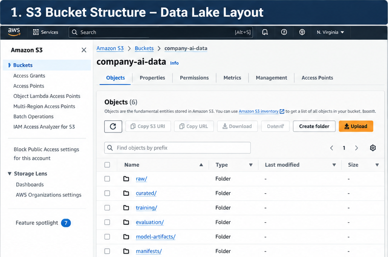
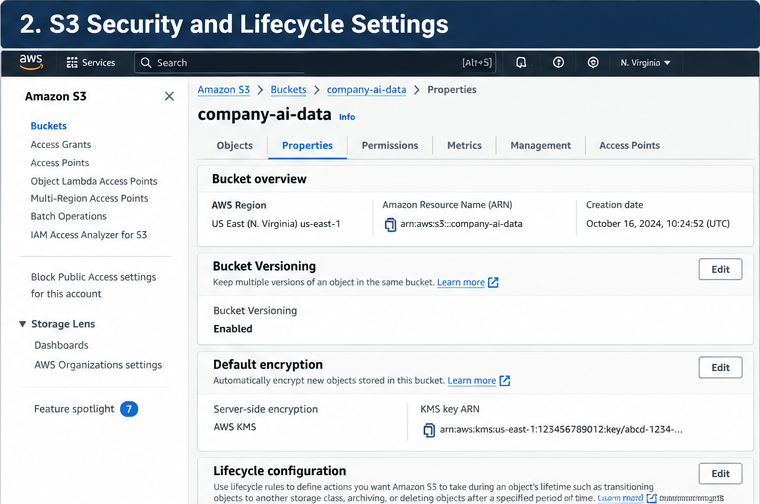
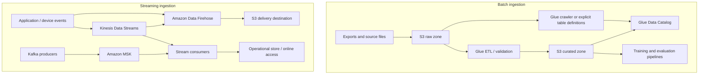
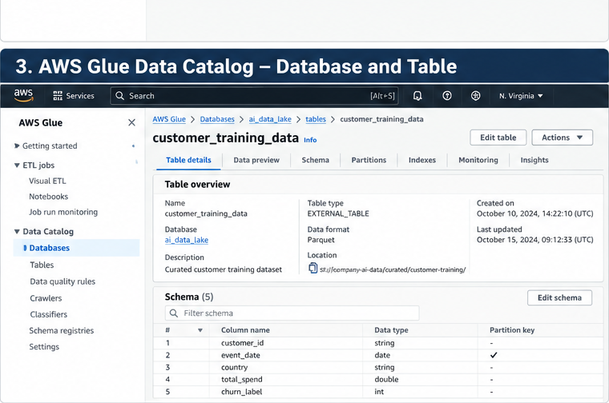
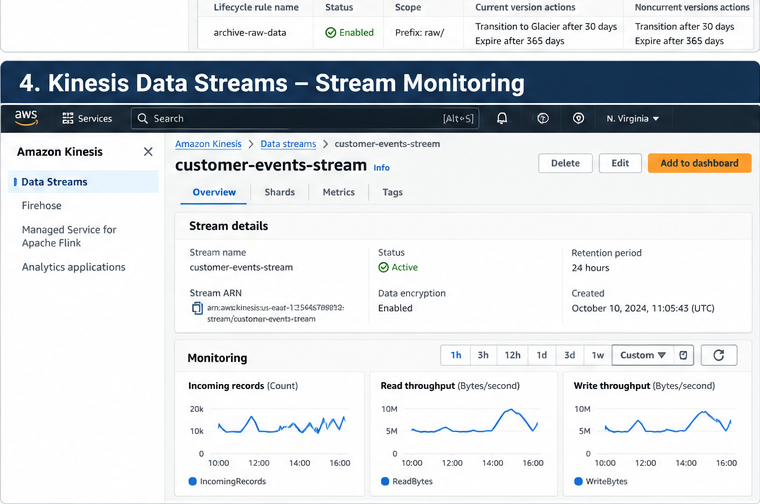

# Data Storage and Ingestion for AI on AWS

AI platforms rarely use one type of data or one access pattern. A
training pipeline may scan millions of records in batches, an online
inference service may retrieve a record by key, a retrieval-augmented
generation (RAG) application may index source documents, and a streaming
pipeline may capture events continuously.

A reliable architecture separates **durable data storage, metadata and
discovery, stream transport, processing, and low-latency application
access**. Amazon S3 is often the durable foundation for an AI data lake,
but it is not a universal replacement for file systems or databases.
Choose services according to access patterns, latency, scale, security,
and cost.

## 1. Organizing an AI data lake in Amazon S3

Amazon S3 stores objects in buckets. Each object has a key that
identifies it within its bucket. A key such as
`training/2026/part-0001.parquet` looks like a file path, but the
separators are part of the object key rather than a traditional
directory hierarchy.

A practical starting layout is:

``` text
s3://company-ai-data/
  raw/
    customer-events/ingest_date=2026-10-16/
    documents/source_system=policies/
  curated/
    customer-features/schema_version=v2/
  training/
    churn/dataset_version=v3/
  evaluation/
    churn/dataset_version=v2/
  model-artifacts/
    churn/run_id=abc123/
  manifests/
    churn/
```

Use prefixes to separate lifecycle stages, teams, sensitivity levels,
retention requirements, and access patterns.

-   **Partition for real queries.** Partition analytical data by
    dimensions such as date or region when consumers commonly filter on
    them. Too many partitions or tiny files can create their own
    overhead.
-   **Avoid excessive small files.** Compact files when the processing
    engine and access pattern benefit.
-   **Preserve lineage.** Record source, schema version, transformation
    version, and dataset manifest when reproducibility matters.
-   **Keep raw and curated data distinct.** Preserve source payloads
    where permitted; publish validated, transformed outputs to separate
    prefixes.
-   **Treat prefixes as logical boundaries, not security controls.** IAM
    and resource policies must enforce access.

### Bucket controls that affect architecture

-   **Versioning:** Helps recover from overwrites and accidental
    deletions. Pair it with lifecycle rules for noncurrent versions.
-   **Lifecycle:** Transition or expire data according to retention and
    access requirements. Include retrieval charges and minimum
    storage-duration rules in cost estimates.
-   **Encryption:** S3 automatically encrypts new objects at rest.
    SSE-KMS can provide customer-managed key control, auditability, and
    separation of duties when required.
-   **Public access:** Keep S3 Block Public Access enabled unless a
    reviewed requirement explicitly calls for public access.
-   **Reproducibility:** A prefix alone does not guarantee that a future
    training run reads the same data. Use versioned manifests and
    controlled publication.
-   **Object ownership:** Prefer S3 Object Ownership with ACLs disabled
    unless an integration has a specific need for ACLs.

Select a storage class based on access frequency, retrieval latency,
retention, and total cost---not just object size.

### Screenshot: S3 data-lake layout



*Figure 1: Separate source, curated, training, evaluation, and artifact data by purpose.*


### Screenshot: S3 protection and lifecycle



*Figure 2: Bucket controls should reflect recovery, retention, encryption, and cost requirements.*


## 2. Storage decision matrix

  ------------------------------------------------------------------------------
  Service           Storage model        Suitable AI workloads Main trade-off
  ----------------- -------------------- --------------------- -----------------
  **Amazon S3**     Object storage       Raw and curated       Not a POSIX file
                                         datasets,             system or
                                         training/evaluation   transactional
                                         files, model          database
                                         artifacts, logs,      
                                         source documents      

  **Amazon EBS**    Block storage        EC2-attached volumes, Attached to
                                         scratch space,        compute; not a
                                         staging, low-latency  shared data lake
                                         block access          

  **Amazon EFS**    Managed NFS file     Shared Linux files    File-system
                    system               and workloads         performance and
                                         requiring concurrent  cost differ from
                                         file access           object storage

  **Amazon FSx**    Managed file systems Workloads needing a   Choose the FSx
                                         particular protocol   type based on
                                         or high-performance   protocol,
                                         shared file access,   performance, and
                                         including selected    compatibility
                                         HPC/ML pipelines      

  **Amazon RDS /    Relational database  Application metadata, Usually not the
  Aurora**                               labels, workflow      default store for
                                         state, structured     large raw
                                         operational records   training datasets

  **Amazon          Key-value/document   Low-latency key       Requires careful
  DynamoDB**        database             lookups, inference    key and
                                         metadata, job state,  access-pattern
                                         online feature access design

  **Amazon          Search and analytics Text search, hybrid   Not a
  OpenSearch        engine               retrieval, and vector general-purpose
  Service**                              search where its      data lake or the
                                         capabilities fit      default store for
                                                               every embedding

  **Amazon          Managed ML feature   Consistent feature    Adds a feature
  SageMaker Feature store                management for        lifecycle and
  Store**                                training and          schema contract;
                                         inference             choose
                                                               online/offline
                                                               needs
                                                               deliberately
  ------------------------------------------------------------------------------

**Rule of thumb:** use S3 for durable bulk data, databases for
application queries and transactional state, EBS/EFS/FSx when compute
needs block or file semantics, and OpenSearch when its search
capabilities justify its operational and cost profile. Use Feature Store
when shared, governed feature definitions and training/serving
consistency solve a real problem.

### Vector storage: choose by retrieval requirements

A vector index is generally a derived representation, not the only copy
of the source content. Retain authoritative documents and metadata
separately so that indexing can be repeated and deletion requirements
can be propagated.

  --------------------------------------------------------------------------
  Option                  Consider it when        Watch for
  ----------------------- ----------------------- --------------------------
  **Amazon OpenSearch     You need vector search  Index sizing, mapping,
  Service**               alongside text search,  filtering, refresh
                          filters, or hybrid      behavior, and operational
                          retrieval               cost

  **Amazon RDS for        Embeddings belong close Vector index and query
  PostgreSQL / Aurora     to relational records   performance at target
  PostgreSQL with         and SQL joins or        scale; database sizing and
  `pgvector`**            transactional           connection limits
                          application data matter 

  **Amazon S3 with a      S3 is the durable       S3 object storage by
  supported               source or data-lake     itself is not a drop-in,
  vector-capable service  layer and a specific    low-latency vector-query
  or workflow**           AWS capability uses it  engine; verify the exact
                          as part of a vector     service and query
                          retrieval architecture  capabilities

  **Amazon Bedrock        You want a managed RAG  Supported sources,
  Knowledge Bases**       ingestion and retrieval synchronization/deletion
                          workflow integrated     behavior, permissions, and
                          with supported data     underlying vector-store
                          sources and retrieval   choice
                          stores                  
  --------------------------------------------------------------------------

Do not choose a vector store by embedding count alone. Evaluate vector
dimensions, metadata filters, hybrid retrieval, update/delete frequency,
latency, scale, tenancy, backup, and operational ownership.

## 3. Data formats and access patterns

The format affects scan cost, processing performance, schema handling,
and interoperability. Choose it based on how data is written and read.

  ---------------------------------------------------------------------------
  Format            Strengths         Good fit              Trade-offs
  ----------------- ----------------- --------------------- -----------------
  **CSV**           Simple, widely    Small exports, simple Weak type
                    supported,        tabular interchange   information;
                    human-readable                          quoting and
                                                            delimiter edge
                                                            cases;
                                                            inefficient for
                                                            large analytical
                                                            scans

  **JSON**          Flexible nested   Raw ingestion, event  Larger payloads
                    records; common   payloads,             and parsing
                    in APIs and       semi-structured data  overhead; schema
                    events                                  consistency must
                                                            be managed

  **Parquet**       Columnar, typed,  Curated analytical    Not ideal for
                    compressed,       datasets, large       hand editing or
                    supports column   training/processing   frequent
                    pruning           tables                single-record
                                                            updates

  **ORC**           Columnar and      Analytical pipelines  Confirm
                    compressed with   and engines that work compatibility
                    rich type support well with ORC         with downstream
                                                            services and
                                                            tooling
  ---------------------------------------------------------------------------

For large analytical datasets, columnar formats such as Parquet or ORC
can reduce the amount of data scanned when a job reads only selected
columns. Compression can reduce storage and transfer costs, although the
actual benefit depends on the data and workload.

A common pattern is to **retain a permitted raw representation and
publish validated, compressed columnar data for repeated analytics and
training**. Use partitioning only where it matches query filters. Check
that the selected format and schema are supported end to end by the
ingestion, processing, catalog, and training tools.

For multimodal datasets, store large binary assets such as images and
audio in S3, and keep identifiers, labels, timestamps, source
information, and split assignments in structured manifests or tables.
Preserve the association between each asset and its annotation; do not
rely on filenames alone as the only record of lineage.

## 4. Batch and streaming ingestion

Choose the ingestion architecture according to how quickly data must
become usable and how much processing is needed before storage.



### Batch ingestion

A typical batch pipeline lands source data in an S3 raw prefix,
validates and transforms it, then publishes curated output to a separate
prefix.

AWS Glue can run data integration jobs, while the Glue Data Catalog
stores metadata such as table definitions, schemas, locations, and
partitions. The catalog does not move or transform the underlying data.
Discovering a schema also does not prove that the data satisfies
business or model-quality requirements.

Use Glue crawlers when automatic schema discovery is appropriate. For
stable production datasets, explicit table definitions and controlled
schema changes can provide more predictable contracts.

### Streaming service choices

-   **Amazon Kinesis Data Streams:** use when applications need to
    consume a retained event stream, support multiple consumers, or
    replay records within the configured retention window.
-   **Amazon Data Firehose:** use managed buffering and delivery to
    supported destinations such as S3 when the primary requirement is
    delivery rather than a custom stream-processing application.
    Firehose can receive data directly from supported producers or from
    configured streaming sources such as Kinesis Data Streams; confirm
    the supported source and destination combination for your design.
-   **Amazon MSK:** use when the workload needs Apache Kafka APIs,
    existing Kafka clients/connectors, or compatibility with a
    Kafka-based event architecture. Account for partition design,
    throughput, retention, and cluster or serverless configuration.
-   **Amazon Managed Service for Apache Flink:** consider when
    continuous stateful stream processing, windowing, or event-time
    computations are required rather than simple delivery.

These services are complementary rather than interchangeable. For
example, Kinesis Data Streams can serve consumers while Firehose
delivers a copy to S3 for analytics and offline training.

For production workloads, define how the pipeline handles duplicates,
late-arriving events, schema changes, failed deliveries, retries, and
replay. Choose a partition key that distributes traffic adequately; a
hot key can limit effective throughput even when overall stream capacity
appears sufficient.

### Screenshot: Glue Data Catalog



*Figure 3: The Data Catalog describes the schema and location of data stored elsewhere, such as S3.*


### Screenshot: streaming monitoring



*Figure 4: Monitor throughput and consumer health; investigate throttling and lag rather than assuming the stream is adequately provisioned.*


## 5. Ingestion and storage troubleshooting

Troubleshooting starts by identifying which stage is failing: source
extraction, transport, delivery, object storage, metadata discovery, or
downstream processing.

  -----------------------------------------------------------------------
  Symptom                 Likely causes to check  Useful first actions
  ----------------------- ----------------------- -----------------------
  S3 upload fails with    IAM identity policy,    Identify the caller
  `AccessDenied`          bucket policy, KMS key  role and denied action;
                          policy, organization    check object and bucket
                          controls, or endpoint   ARNs separately;
                          policy                  validate KMS
                                                  permissions

  Upload or listing fails Client timeouts, retry  Use SDK retries and
  for a large dataset     behavior, request       managed/multipart
                          pattern, network path,  upload where
                          or inefficient          appropriate; measure
                          single-threaded         before increasing
                          transfer                concurrency

  Glue job cannot read    Wrong S3 location, role Confirm the job role,
  expected objects        permissions, KMS        exact prefix,
                          access, network         encryption key access,
                          configuration, or       and a small
                          malformed input         representative input

  Catalog schema is wrong Schema inference,       Inspect the actual
  or stale                changed source          object and table
                          structure, crawler      definition; define
                          scope, or unmanaged     stable schemas and
                          schema changes          compatibility rules

  Stream consumer falls   Insufficient processing Check throughput,
  behind                  capacity, hot partition throttling, iterator
                          key, slow downstream    age/consumer lag,
                          writes, or uneven       partition-key
                          traffic                 distribution, and
                                                  downstream latency

  Firehose delivery is    Destination             Inspect delivery error
  delayed or failing      permissions, service    metrics and logs,
                          limits, transformation  verify destination role
                          errors, destination     and KMS access, and
                          capacity, or buffering  validate record format
                          configuration           

  Training run sees       Mutable prefixes,       Pin a dataset
  different data          overwritten objects,    version/manifest and
                          changing source         record source and
                          exports, or missing     transformation versions
                          manifest                

  Storage costs rise      Noncurrent object       Review S3 Storage Lens
  unexpectedly            versions, excessive     or cost reports,
                          small objects,          lifecycle rules,
                          retrieval/transition    versions, and retention
                          charges, incomplete     obligations before
                          cleanup, or duplicated  deleting anything
                          data                    
  -----------------------------------------------------------------------

Do not respond to every ingestion problem by increasing capacity. First
distinguish permission errors from throttling, downstream bottlenecks,
schema failures, and data-quality failures. Record metrics and logs at
each pipeline boundary so the failing stage is observable.

## 6. Combining sources and publishing curated datasets

AI datasets often combine data from multiple systems---for example,
event history in S3, customer attributes in a relational database, and
reference data in another export. A robust pipeline should define join
keys, timestamp semantics, duplicate handling, missing-value policy,
schema contracts, and the publication boundary.

Use AWS Glue for managed data integration and Spark-based distributed
transformations when the workload fits. A custom Python job may be
sufficient for small inputs, but it should not load an unbounded dataset
into memory. For large joins and transformations, select a distributed
processing approach and size it against data volume, shuffle behavior,
and the target SLA.

A practical publication flow is:

1.  Land source extracts in separate raw prefixes.
2.  Validate file readability, schema, expected partitions, and required
    fields.
3.  Transform and join sources using explicit keys and timestamp rules.
4.  Write curated output to a new versioned location rather than
    overwriting the last known-good dataset.
5.  Publish a manifest containing source identifiers, schema version,
    transformation version, record counts, and validation results.
6.  Allow training or downstream consumers to use the new version only
    after validation succeeds.

Detailed transformation techniques, feature engineering, and
data-quality policies belong in the companion data-processing and
feature-engineering notes. This note focuses on the storage and
ingestion contracts that make those workflows dependable.

## 7. SageMaker Feature Store: online and offline access

SageMaker Feature Store helps teams define, ingest, discover, and serve
reusable ML features. It is worth considering when multiple models or
services need consistent feature definitions, feature lineage, and a
managed path between training and inference.

-   **Online store:** optimized for low-latency retrieval of the latest
    feature values for inference or other online applications.
-   **Offline store:** supports historical feature data and analytical
    access for training, evaluation, and exploration; its storage and
    query path differs from online serving.
-   **Feature groups:** organize related features under a defined schema
    and record identifier, with event-time considerations for historical
    correctness.
-   **Ingestion design:** decide how features are generated, validated,
    written, updated, and monitored. Define behavior for late or
    duplicate events and schema evolution.
-   **Training-serving consistency:** use consistent feature definitions
    and appropriate point-in-time logic to reduce training/serving skew
    and prevent future information from leaking into historical training
    examples.

Feature Store is not automatically necessary for every project. For a
simple one-off model with a stable batch dataset, versioned S3 data may
be enough. It becomes more valuable when features are reused, online
lookups are needed, or the team needs stronger controls over feature
definitions and serving behavior.

## 8. Storage patterns for AI workloads

  -----------------------------------------------------------------------
  Data asset              Suggested starting      Design considerations
                          point                   
  ----------------------- ----------------------- -----------------------
  Raw source data         S3 `raw/` prefix        Preserve source
                                                  payloads where
                                                  permitted; record
                                                  source and ingestion
                                                  time

  Curated training        S3 `curated/` or        Version manifests and
  dataset                 `training/` prefix      schemas; partition for
                                                  actual read patterns

  Model artifacts         S3 location used by the Restrict writes to
                          training workflow       pipeline roles;
                                                  associate artifacts
                                                  with run metadata

  Evaluation datasets     Separate S3 prefix or   Restrict modifications;
                          bucket                  record dataset and
                                                  evaluation-code
                                                  versions

  Images/audio and        S3 objects plus         Keep stable asset IDs,
  annotations             manifests or catalog    labels, source
                          tables                  metadata, and split
                                                  assignments linked

  Knowledge-base source   S3 source-document      Track ownership,
  documents               prefix or another       update/delete
                          supported source        workflows, and
                                                  ingestion status

  Online prediction       DynamoDB or RDS/Aurora  Choose based on
  metadata                                        key-value versus
                                                  relational access
                                                  patterns

  Search and retrieval    OpenSearch, PostgreSQL  Keep source data
  index                   with `pgvector`, or a   separately; evaluate
                          supported managed       filtering, latency,
                          retrieval option        scale, and operational
                                                  needs

  Reusable online/offline SageMaker Feature Store Align feature
  ML features             where justified         definitions, event
                                                  time, and
                                                  training/serving
                                                  requirements

  Streaming events        Kinesis Data Streams or Define retention,
                          MSK, with Firehose or   replay, schema
                          consumers delivering to compatibility, and
                          S3                      idempotency
  -----------------------------------------------------------------------

For a Bedrock knowledge base or another retrieval application, S3 can
hold source documents while a separate retrieval store contains derived
chunks and embeddings. Re-ingestion should be repeatable, and required
deletions must propagate to derived indexes.

For traditional ML, keep training data, evaluation data, and model
artifacts logically distinct. Record the exact input dataset and
relevant code/configuration for each run. A model registry does not, by
itself, make the original dataset immutable or reproducible.

## 9. IAM, bucket policies, and KMS

Use workload roles instead of long-lived access keys in code. A
SageMaker job, Lambda function, ECS task, or application should receive
only the permissions needed for its own prefixes and actions.

The following identity policy is an illustrative starting point for a
workload that reads one dataset prefix and writes to a separate artifact
prefix. Replace the bucket and prefixes with your own.

``` json
{
  "Version": "2012-10-17",
  "Statement": [
    {
      "Sid": "ReadTrainingData",
      "Effect": "Allow",
      "Action": ["s3:GetObject"],
      "Resource": "arn:aws:s3:::company-ai-data/training/churn/*"
    },
    {
      "Sid": "ListTrainingPrefix",
      "Effect": "Allow",
      "Action": ["s3:ListBucket"],
      "Resource": "arn:aws:s3:::company-ai-data",
      "Condition": {
        "StringLike": {
          "s3:prefix": [
            "training/churn",
            "training/churn/*"
          ]
        }
      }
    },
    {
      "Sid": "WriteRunArtifacts",
      "Effect": "Allow",
      "Action": ["s3:PutObject"],
      "Resource": "arn:aws:s3:::company-ai-data/model-artifacts/churn/*"
    }
  ]
}
```

Key details:

-   `s3:ListBucket` applies to the bucket ARN; object actions such as
    `s3:GetObject` and `s3:PutObject` apply to object ARNs.
-   The example permits artifact writes but not deletes. Add deletion
    permissions only when a defined cleanup process requires them.
-   A bucket policy can enforce broader controls, such as denying
    non-TLS requests or restricting cross-account access.
-   An explicit `Deny` overrides an `Allow`. A TLS-only bucket policy
    can deny requests where `aws:SecureTransport` is `false`; test
    policy changes carefully to avoid disrupting required service
    integrations.
-   With SSE-KMS, the workload may need appropriate KMS permissions, and
    the KMS key policy must permit the intended use.
-   Keep Block Public Access enabled. Consider S3 Access Points or S3
    Access Grants when they simplify controlled multi-team access.
-   Enable appropriate CloudTrail and S3 data-event logging when
    required by audit and security objectives.

## 10. Python example: upload and list a dataset in S3

Install the AWS SDK for Python:

``` bash
python -m pip install boto3
```

For local development, use a supported credential chain such as IAM
Identity Center. In AWS, prefer the workload's IAM role over embedding
access keys in source code. This example assumes the bucket exists and
the caller can upload to and list the selected prefix.

``` python
from pathlib import Path
import boto3
from botocore.exceptions import ClientError

BUCKET = "replace-with-your-bucket"
PREFIX = "training/churn/dataset_version=v1/"
LOCAL_DIR = Path("./data/churn")

s3 = boto3.client("s3")


def upload_dataset(local_dir: Path, bucket: str, prefix: str) -> int:
    if not local_dir.exists() or not local_dir.is_dir():
        raise ValueError(f"Dataset directory does not exist: {local_dir}")

    uploaded = 0
    for path in local_dir.rglob("*"):
        if not path.is_file():
            continue

        relative_path = path.relative_to(local_dir).as_posix()
        key = f"{prefix.rstrip('/')}/{relative_path}"

        try:
            s3.upload_file(str(path), bucket, key)
        except ClientError as exc:
            # In production, log structured error details without secrets.
            print(f"Upload failed for s3://{bucket}/{key}: {exc}")
            raise

        print(f"Uploaded s3://{bucket}/{key}")
        uploaded += 1

    return uploaded


def list_dataset(bucket: str, prefix: str) -> None:
    paginator = s3.get_paginator("list_objects_v2")
    found = False

    try:
        for page in paginator.paginate(Bucket=bucket, Prefix=prefix):
            for obj in page.get("Contents", []):
                found = True
                print(f"{obj['Key']} ({obj['Size']} bytes)")
    except ClientError as exc:
        print(f"Listing failed for s3://{bucket}/{prefix}: {exc}")
        raise

    if not found:
        print("No objects found for this prefix.")


if __name__ == "__main__":
    count = upload_dataset(LOCAL_DIR, BUCKET, PREFIX)
    print(f"Uploaded {count} files")
    list_dataset(BUCKET, PREFIX)
```

The paginator avoids assuming one response contains every object.
`upload_file` supports managed multipart uploads for larger files. The
example deliberately does not silently delete existing objects or
implement a production data-publication protocol.

For production, add structured logging, retry/error handling appropriate
to the workload, manifest generation, integrity checks, and an explicit
policy for overwriting existing keys. If an operation fails, distinguish
missing resources, permission failures, KMS access, throttling, and
network errors rather than treating them as the same issue.

## 11. Versioning, lifecycle, cleanup, and cost

Deleting an object in a versioned bucket may add a delete marker while
older versions continue to incur storage costs. Lifecycle rules should
account for current objects, noncurrent versions, incomplete multipart
uploads, and retention requirements.

Before cleanup:

-   Use a dedicated development bucket or isolated prefix; never point
    cleanup scripts at a shared production bucket.
-   Check versioning, replication, Object Lock, retention, and lifecycle
    configuration before deleting data.
-   Set lifecycle policies for temporary uploads, intermediate data, and
    obsolete noncurrent versions according to approved retention
    requirements.
-   Avoid blanket `s3:DeleteObject`, `s3:*`, or `Resource: "*"`
    permissions when narrower grants are possible.
-   Review storage, requests, retrieval, transitions, transfer,
    streaming, and logging costs.
-   Configure budgets or alerts for longer-running experiments.
-   Keep secrets out of object names, metadata, logs, and notebooks.
-   Test permitted and denied access paths before declaring a workload
    secure.

## 12. Architecture review checklist

-   [ ] Storage service matches the access pattern: object, file, block,
    relational, key-value, feature, or search.
-   [ ] Raw and curated data are separated, with documented schema and
    partition strategies.
-   [ ] Format choices reflect the read pattern and downstream
    compatibility.
-   [ ] Training and evaluation datasets have traceable versions or
    manifests.
-   [ ] Multimodal assets remain linked to their labels and metadata.
-   [ ] Batch and streaming paths define failure, retry, duplicate, and
    replay behavior.
-   [ ] Monitoring can distinguish permission failures, delivery
    failures, throttling, and consumer lag.
-   [ ] Glue Data Catalog metadata is managed intentionally and
    validated against the data.
-   [ ] Feature Store is used where online/offline feature needs justify
    it.
-   [ ] Workload roles are scoped to required buckets, prefixes,
    actions, and KMS keys.
-   [ ] Lifecycle, versioning, encryption, logging, and cleanup policies
    fit sensitivity and retention needs.

## Key takeaways

Amazon S3 is usually the durable foundation for AI datasets and
artifacts, but storage selection should follow access patterns rather
than a blanket rule to store everything in S3. CSV and JSON are useful
for interchange and raw payloads; Parquet and ORC often suit repeated
analytical scans. Kinesis Data Streams, Data Firehose, MSK, and managed
stream processing serve different needs. Glue Data Catalog makes data
discoverable but does not store or validate the data. For retrieval and
ML features, choose the appropriate vector or feature-serving layer
while preserving source lineage, access controls, and repeatability.

## References

-   [Amazon S3
    documentation](https://docs.aws.amazon.com/AmazonS3/latest/userguide/Welcome.html)
-   [Amazon S3 storage
    classes](https://docs.aws.amazon.com/AmazonS3/latest/userguide/storage-class-intro.html)
-   [Amazon S3 lifecycle
    management](https://docs.aws.amazon.com/AmazonS3/latest/userguide/object-lifecycle-mgmt.html)
-   [AWS storage services](https://aws.amazon.com/products/storage/)
-   [AWS Glue Data
    Catalog](https://docs.aws.amazon.com/glue/latest/dg/catalog-and-crawler.html)
-   [Amazon Kinesis Data
    Streams](https://docs.aws.amazon.com/streams/latest/dev/introduction.html)
-   [Amazon Data
    Firehose](https://docs.aws.amazon.com/firehose/latest/dev/what-is-this-service.html)
-   [Amazon
    MSK](https://docs.aws.amazon.com/msk/latest/developerguide/what-is-msk.html)
-   [Amazon Managed Service for Apache
    Flink](https://docs.aws.amazon.com/managed-flink/latest/java/what-is.html)
-   [Amazon SageMaker Feature
    Store](https://docs.aws.amazon.com/sagemaker/latest/dg/feature-store.html)
-   [Amazon OpenSearch Service vector
    search](https://docs.aws.amazon.com/opensearch-service/latest/developerguide/vector-search.html)
-   [pgvector documentation](https://github.com/pgvector/pgvector)
-   [Amazon Bedrock Knowledge
    Bases](https://docs.aws.amazon.com/bedrock/latest/userguide/knowledge-base.html)
-   [AWS IAM best
    practices](https://docs.aws.amazon.com/IAM/latest/UserGuide/best-practices.html)

> **Enterprise AI Engineering Handbook**
>
> *Building Production-Grade Enterprise AI Systems --- One Chapter at a
> Time.*
