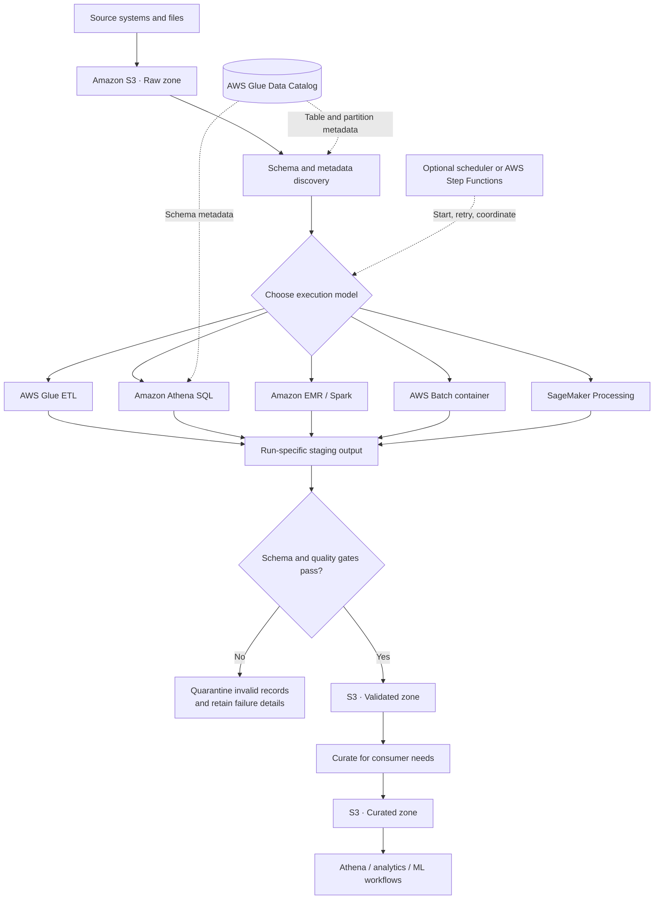
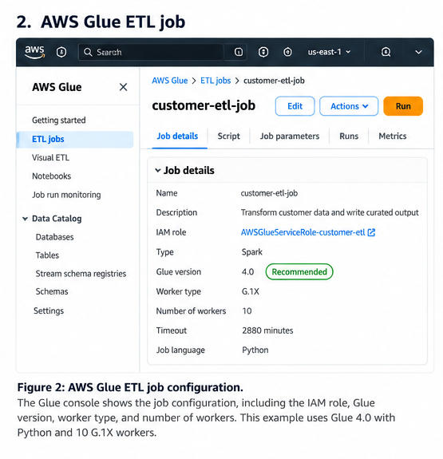
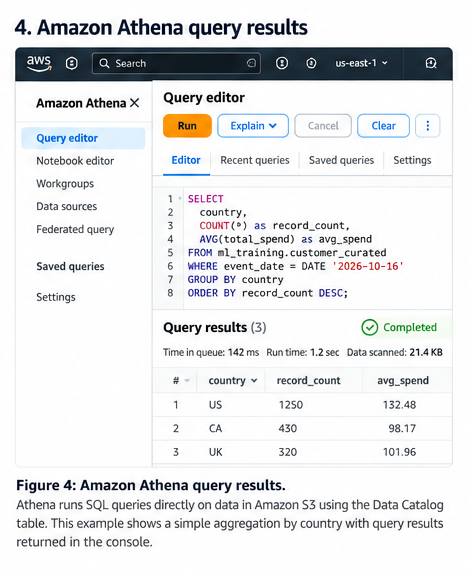

# AWS ETL and Distributed Processing

Data ingestion gets source data into the platform. ETL and distributed processing turn it into data that downstream systems can trust: consistently typed, validated, and shaped for analytics or machine-learning workloads.

AWS offers several ways to do this, and they are not interchangeable. AWS Glue is a managed data integration service; Athena is useful when SQL over data in Amazon S3 is sufficient; EMR provides more control over distributed processing frameworks; AWS Batch runs general containerized batch jobs; and SageMaker Processing fits processing tasks that are part of machine-learning workflows.

The design goal is to choose the simplest execution model that meets the workload's requirements while making quality, recovery, and publication explicit.


> **Console snapshots in this note:** Three screenshot slots are included where the AWS Console adds practical value. They are clearly marked as placeholders, not presented as real screenshots. Capture them from your own AWS lab and save the images under an `images/` directory beside this Markdown file. If your handbook uses another asset path, adjust the links accordingly.

## 1. Reference architecture: raw, validated, and curated zones

Keep source data immutable where practical. Write transformed results to new locations instead of modifying the raw input. This separation supports replay, debugging, lineage, and data-quality investigations.



The diagram shows alternatives, not a requirement to use every processing service in one pipeline. A small workflow might use only Glue, while a SQL-centric workflow might use Athena.

- **Raw zone:** source representation preserved for audit and replay.
- **Validated zone:** records that pass defined structural and business checks.
- **Curated zone:** data shaped for a consumer, such as a partitioned analytical table or an ML training dataset.
- **Quarantine:** invalid or suspicious records plus enough context to diagnose and repair them.
- **Staging output:** a run-specific location that is not exposed to consumers until the pipeline passes its quality gates.

The Glue Data Catalog stores metadata such as table definitions, schemas, and partitions. It does not itself guarantee that the underlying records are correct.


### Console snapshot 2 — Glue Data Catalog table

<!-- Replace this placeholder with a genuine screenshot captured from your AWS account. -->


*Figure 2. Glue Data Catalog table details. Capture the table's schema/columns and partition keys, if used, preferably from the sample lab table.*

**What to look for:** The Catalog describes how services interpret data; it does not validate every row in S3. A table definition can exist even when files contain malformed or unexpected values. Keep the capture focused on metadata.

## 2. Choose the service by workload

| Option | Best fit | Transformation style | Latency pattern | Operational burden | Cost model to watch |
|---|---|---|---|---|---|
| **AWS Glue** | Managed data integration and scheduled ETL | Managed ETL, commonly Spark-based for large transformations | Batch; startup and execution time matter | Low to moderate | Worker capacity, duration, retries, and frequency |
| **Amazon Athena** | SQL queries and transformations over supported data in S3 | Serverless SQL; supported CTAS and `INSERT INTO` patterns can materialize results | Interactive or scheduled query execution | Low; schema, partitions, permissions, and query tuning remain your responsibility | Bytes scanned, query frequency, and result storage |
| **Amazon EMR** | Distributed processing with framework or runtime control | Apache Spark and other supported big-data frameworks | Batch and other supported deployment patterns | Moderate to high | Compute, runtime, storage, idle resources, and deployment mode |
| **AWS Batch** | Custom containerized batch compute | Your container's code and dependencies | Queued batch jobs | Moderate | Compute duration, resources, image/storage costs, and idle capacity where applicable |
| **SageMaker Processing** | Data preparation or evaluation within ML workflows | Container-based scripts and supported processing frameworks | Managed batch job | Moderate | Instance type/count, runtime, storage, and data transfer where applicable |

These are workload-oriented guidelines, not hard limits. Limits, formats, regional availability, and pricing depend on configuration. Check current AWS documentation before deploying.

### A practical decision rule

- Choose **Glue** when you need managed ETL with minimal infrastructure management.
- Choose **Athena** when the transformation is naturally expressed in SQL and the data is queryable in S3.
- Choose **EMR** when you need a supported framework, dependency, or runtime configuration—or deeper control over distributed execution—that Glue does not meet as simply.
- Choose **AWS Batch** when the work is a custom containerized task such as file conversion or a specialized batch program.
- Choose **SageMaker Processing** when preprocessing, feature preparation, or evaluation is a step in an ML workflow.

Do not choose by data volume alone. Transformation complexity, startup overhead, framework requirements, execution frequency, recovery needs, team expertise, and cost can change the decision.

## 3. AWS Glue: managed ETL and metadata

### Console snapshot 1 — Glue ETL job configuration

<!-- Replace this placeholder with a genuine screenshot captured from your AWS account. -->


*Figure 1. AWS Glue job details. Capture the job overview showing the job name, Glue version, worker type/count, IAM role, and script location where visible. Redact account-specific or sensitive details.*

**What to look for:** The job definition connects the script, execution role, runtime, and compute settings. This screenshot documents configuration; it does not prove that a run succeeded. Use job run history or CloudWatch logs separately when diagnosing failures.

A typical Glue workflow is:

1. Store source files under an S3 raw prefix.
2. Define a schema or use a crawler to discover one.
3. Run a Glue job to validate and transform the data.
4. Write results to a separate S3 prefix, often in a columnar format such as Parquet.
5. Register or update table metadata in the Glue Data Catalog when required.
6. Make only validated and published datasets available to downstream consumers.

A crawler can infer schema and update catalog metadata for supported data. This can be convenient for discovery, but inference should not replace a deliberate schema contract in a stable production pipeline. For controlled datasets, explicitly managed schemas and reviewed schema evolution can be more predictable.

### Illustrative Glue PySpark pattern

This snippet illustrates the transformation logic. It is **not a complete deployable Glue job**. A deployed job also needs a compatible Glue/Spark runtime, Glue job initialization and lifecycle, an execution role, input/output configuration, logging, and deployment settings.

The example uses `try_cast`; confirm that the selected Spark runtime supports the expression. If not, use a runtime-compatible parsing strategy and test malformed values explicitly.

```python
from pyspark.sql import functions as F

raw_path = "s3://example-bucket/raw/orders/"
staging_path = "s3://example-bucket/staging/orders/run_id=2026-10-16T120000Z/"
quarantine_path = "s3://example-bucket/quarantine/orders/run_id=2026-10-16T120000Z/"

orders = (
    spark.read.option("header", True).csv(raw_path)
    .withColumn("order_id", F.trim("order_id"))
    .withColumn("customer_id", F.trim("customer_id"))
    .withColumn("amount_decimal", F.expr("try_cast(amount AS DECIMAL(12,2))"))
    .withColumn("event_date_parsed", F.to_date("event_date", "yyyy-MM-dd"))
)

checks = [
    ("MISSING_ORDER_ID", F.col("order_id").isNull() | (F.col("order_id") == "")),
    ("MISSING_CUSTOMER_ID", F.col("customer_id").isNull() | (F.col("customer_id") == "")),
    ("INVALID_AMOUNT", F.col("amount_decimal").isNull()),
    ("NEGATIVE_AMOUNT", F.col("amount_decimal") < 0),
    ("INVALID_EVENT_DATE", F.col("event_date_parsed").isNull()),
]

# Keep every applicable reason, rather than only the first one.
reason_array = F.filter(
    F.array(*[
        F.when(condition, F.lit(reason))
        for reason, condition in checks
    ]),
    lambda reason: reason.isNotNull()
)

checked = orders.withColumn("quarantine_reasons", reason_array)
valid = checked.filter(F.size("quarantine_reasons") == 0)
invalid = checked.filter(F.size("quarantine_reasons") > 0)

(
    valid.select(
        "order_id",
        "customer_id",
        F.col("amount_decimal").alias("amount"),
        F.col("event_date_parsed").alias("event_date"),
    )
    .write.mode("errorifexists")
    .parquet(staging_path)
)

invalid.write.mode("errorifexists").parquet(quarantine_path)
```

The run-specific output and `errorifexists` mode help prevent an accidental overwrite, but they do not complete the publication workflow. A production orchestrator should create a unique run identifier, verify the output, record counts and schema, and then publish a manifest, catalog pointer, or table snapshot using a strategy appropriate to the storage format. If a run fails, the system should not expose its partial output as the latest successful dataset.

## 4. Hands-on lab: validate an orders dataset

This lab runs locally with PySpark before the transformation is moved into Glue. It demonstrates the quality boundary between valid and quarantined records.

### 4.1 Prerequisites and input

Use a compatible Java runtime and PySpark installation. Run the script from a disposable working directory; the output paths below are local directories. A real Glue deployment additionally requires AWS configuration, S3 permissions, an execution role, and a selected Glue runtime.

Save as `orders.csv`:

```csv
order_id,customer_id,amount,event_date
1001,C001,49.90,2026-10-01
1002,C002,120.00,2026-10-01
1003,C003,-5.00,2026-10-02
1004,,32.50,2026-10-02
1005,C005,invalid,2026-10-03
1006,C006,18.25,2026-10-03
```

Rules:

- `order_id` and `customer_id` must be present.
- `amount` must parse as a decimal and be non-negative.
- `event_date` must parse as `yyyy-MM-dd`.

Expected outcome: **3 valid rows and 3 quarantined rows**.

### 4.2 Local PySpark script

Save as `validate_orders.py`:

```python
from pyspark.sql import SparkSession, functions as F

spark = (
    SparkSession.builder
    .appName("orders-etl-lab")
    .getOrCreate()
)

orders = (
    spark.read.option("header", True).csv("orders.csv")
    .withColumn("order_id", F.trim("order_id"))
    .withColumn("customer_id", F.trim("customer_id"))
    .withColumn("amount_decimal", F.expr("try_cast(amount AS DECIMAL(12,2))"))
    .withColumn("event_date_parsed", F.to_date("event_date", "yyyy-MM-dd"))
)

checks = [
    ("MISSING_ORDER_ID", F.col("order_id").isNull() | (F.col("order_id") == "")),
    ("MISSING_CUSTOMER_ID", F.col("customer_id").isNull() | (F.col("customer_id") == "")),
    ("INVALID_AMOUNT", F.col("amount_decimal").isNull()),
    ("NEGATIVE_AMOUNT", F.col("amount_decimal") < 0),
    ("INVALID_EVENT_DATE", F.col("event_date_parsed").isNull()),
]

reason_array = F.filter(
    F.array(*[
        F.when(condition, F.lit(reason))
        for reason, condition in checks
    ]),
    lambda reason: reason.isNotNull()
)

checked = orders.withColumn("quarantine_reasons", reason_array)
valid = checked.filter(F.size("quarantine_reasons") == 0)
quarantined = checked.filter(F.size("quarantine_reasons") > 0)

valid_count = valid.count()
quarantine_count = quarantined.count()

print(f"Valid rows: {valid_count}")
print(f"Quarantined rows: {quarantine_count}")

if valid_count != 3 or quarantine_count != 3:
    raise ValueError("Unexpected row counts; review the input and validation rules.")

(
    valid.select(
        "order_id",
        "customer_id",
        F.col("amount_decimal").alias("amount"),
        F.col("event_date_parsed").alias("event_date"),
    )
    .write.mode("overwrite")
    .parquet("output/validated/orders")
)

(
    quarantined
    .write.mode("overwrite")
    .parquet("output/quarantine/orders")
)

spark.stop()
```

Run:

```bash
spark-submit validate_orders.py
```

Expected output:

```text
Valid rows: 3
Quarantined rows: 3
```

Here, `overwrite` is intentional because this is a repeatable local lab in a disposable output directory. Do not copy that setting into a shared production prefix without a publication and recovery strategy.

## 5. Athena: query and validate data in S3


### Console snapshot 3 — Athena query and results

<!-- Replace this placeholder with a genuine screenshot captured from your AWS account. -->


*Figure 3. Athena query editor and results. Capture a short validation query and its result grid using the lab dataset. Redact account-specific or sensitive details.*

**What to look for:** Athena lets you inspect data and run SQL checks without managing query servers. Where practical, show the query and a small result set together so the validation outcome is clear.

Athena is useful for inspecting data and running SQL checks without provisioning a cluster. The data must be in a supported format and accessible through the required catalog metadata and permissions.

Assuming a registered table named `validated_orders` exposes `amount` as a numeric type:

```sql
SELECT
    COUNT(*) AS row_count,
    COUNT_IF(order_id IS NULL OR trim(order_id) = '') AS missing_order_ids,
    COUNT_IF(customer_id IS NULL OR trim(customer_id) = '') AS missing_customer_ids,
    COUNT_IF(amount < 0) AS negative_amounts
FROM validated_orders;
```

For the validated dataset, the missing-key and negative-amount counts should be zero. This is a useful check, but it does not cover every business rule or detect every possible duplicate.

### Control query cost

- Prefer columnar formats such as Parquet for repeated analytical scans when appropriate.
- Partition on fields commonly used in filters, such as a date, only when the expected query pattern and data layout justify it.
- Select only required columns rather than `SELECT *`.
- Filter on partition columns to reduce the data scanned.
- Check query execution statistics and current pricing before optimizing based on assumptions.

For example, if the table is partitioned by `event_date`:

```sql
SELECT order_id, customer_id, amount
FROM validated_orders
WHERE event_date = DATE '2026-10-01';
```

The table's actual partition scheme and column types must match the query. Athena can also materialize results through supported CTAS and `INSERT INTO` patterns; treat those outputs as managed datasets and validate them before switching consumers.

## 6. When EMR is worth the added control

Consider EMR when the workload needs a distributed processing environment with more control over the runtime than a straightforward managed ETL job provides—for example, a Spark application with specific dependencies or tuning requirements.

Before choosing it, ask:

- Does the workload require a supported Spark version, library, runtime configuration, or framework that the simpler option does not satisfy?
- Will control over execution and scaling materially improve reliability or performance?
- Can the team manage configuration, troubleshooting, dependencies, and capacity?
- Which EMR deployment mode fits the workload, and how does its measured cost compare?

If Glue meets the requirements, EMR's additional control may not justify the operational overhead. If the workload genuinely needs that control, EMR may be the better fit. Do not assume that every EMR workload requires a long-running cluster; compare currently available deployment modes.

## 7. AWS Batch versus SageMaker Processing

These services can both run jobs, but they fit different boundaries.

**AWS Batch** is a good fit for general containerized batch compute. Package code and dependencies in an image, define the job's resource requirements, and let Batch schedule it through the configured queue and compute environment. A specialized file-conversion job is one example.

**SageMaker Processing** is suited to processing steps in an ML workflow—for example, preparing a training dataset or running model evaluation scripts. Its inputs and outputs can be integrated with the rest of the managed ML workflow.

Choose based on the role of the task, not just because it processes data: general-purpose container compute points toward Batch, while ML-specific processing within a managed ML lifecycle points toward SageMaker Processing.

## 8. Orchestration and recovery

Keep orchestration proportional to the workflow. A schedule and one Glue job may be sufficient for a simple pipeline. If the pipeline has dependent steps, explicit branching, retries, timeouts, or failure paths, AWS Step Functions can coordinate those steps.

Regardless of the orchestrator, design for recovery:

- **Idempotency:** the same input and run identifier must not silently create duplicate published data.
- **Bounded retries:** retry transient failures, not deterministic code errors or invalid records.
- **Failure isolation:** quarantine invalid records with reason codes and retain enough context to diagnose them.
- **Quality gates:** verify schema, counts, required fields, and business rules before publication.
- **Controlled publication:** write to staging, validate, and expose the result only after success.
- **Observability:** capture run duration, input/output counts, errors, retries, and quarantined-record counts.
- **Replay:** retain source data and transformation version information so a corrected run can be reproduced.
- **Notification:** alert when retries are exhausted, quality checks fail, or data volume changes unexpectedly.

A successful job status does not prove that the resulting dataset is correct. The job may finish while producing no records, dropping unexpected input, or violating business rules.

## 9. Security, cost, and operations

Before deploying, verify that:

- The execution role has least-privilege access to the required S3 prefixes, catalog resources, logs, and encryption keys.
- Raw, quarantine, staging, and curated zones have appropriate access controls and retention policies.
- Production jobs do not accidentally write to development prefixes.
- Schema changes are reviewed, and consumers read only published datasets.
- Job size, worker count, runtime, concurrency, retry policy, and schedule are measured.
- Temporary and failed outputs have a cleanup or retention policy.
- Every run records a run identifier, transformation version, input/output counts, and status.
- Cost monitoring follows the service-specific driver: Glue capacity and duration, Athena bytes scanned, EMR compute and idle time, or Batch/Processing compute duration.

A simple operational contract for every pipeline is: **what input was processed, which code version ran, what output was produced, which checks passed, and whether that output was published**.

## 10. Architecture review checklist

1. Can source data be replayed without depending on mutable upstream state?
2. Are schemas and validation rules explicit?
3. Is each service chosen for a clear workload reason?
4. Are invalid records explainable and recoverable?
5. Can retries run safely without duplicating published output?
6. Is output published only after quality checks pass?
7. Can operators identify the failed run and processing step from logs and metrics?
8. Are access permissions, retention, and service-specific costs understood?

If the team cannot explain how a failed run is recovered or how consumers are protected from partial output, the pipeline design is incomplete.

## Key takeaways

- Use **Glue** for managed ETL, **Athena** for SQL over supported S3 data, **EMR** when distributed-processing control matters, **AWS Batch** for general containerized batch compute, and **SageMaker Processing** for processing steps in ML workflows.
- Separate raw, validated, quarantine, staging, and curated responsibilities so replay and publication rules are explicit.
- Use the Glue Data Catalog for metadata, not as a substitute for quality controls.
- Make reruns safe with run-specific outputs, validation gates, and an explicit publication strategy.
- Measure representative workload behavior and service-specific costs before committing to an execution model.

## Further reading

- [AWS Glue documentation](https://docs.aws.amazon.com/glue/)
- [AWS Glue versions and release notes](https://docs.aws.amazon.com/glue/latest/dg/release-notes.html)
- [Developing AWS Glue jobs](https://docs.aws.amazon.com/glue/latest/dg/author-job.html)
- [What is Amazon Athena?](https://docs.aws.amazon.com/athena/latest/ug/what-is.html)
- [Amazon EMR documentation](https://docs.aws.amazon.com/emr/)
- [What is AWS Batch?](https://docs.aws.amazon.com/batch/latest/userguide/what-is-batch.html)
- [SageMaker Processing](https://docs.aws.amazon.com/sagemaker/latest/dg/processing-job.html)
- [What is AWS Step Functions?](https://docs.aws.amazon.com/step-functions/latest/dg/welcome.html)

## Console screenshot capture checklist

Before publishing this note:

- [ ] Replace all three placeholders with genuine AWS Console captures from the lab.
- [ ] Save files using the exact names in the Markdown links, or update the paths.
- [ ] Redact account IDs, user identities, sensitive bucket/table names, and private data.
- [ ] Crop each image to the relevant job settings, table metadata, or SQL/results.
- [ ] Confirm that screenshots reflect the configuration described in this note.
- [ ] If the lab has not been deployed to AWS, keep the placeholders clearly marked; do not use mock screenshots as if they were real.

> **Enterprise AI Engineering Handbook**
>
> *Building Production-Grade Enterprise AI Systems — One Chapter at a Time.*