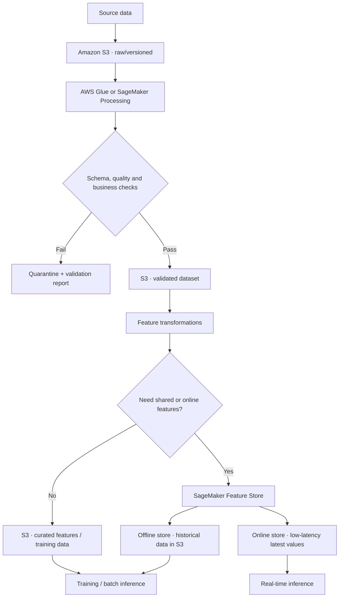
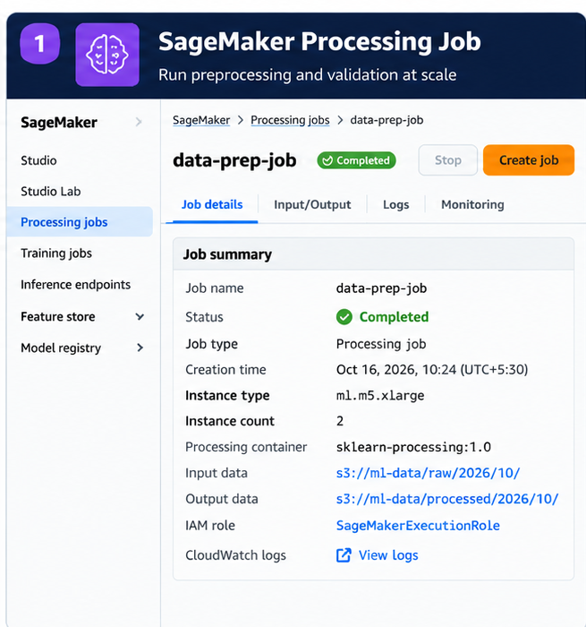
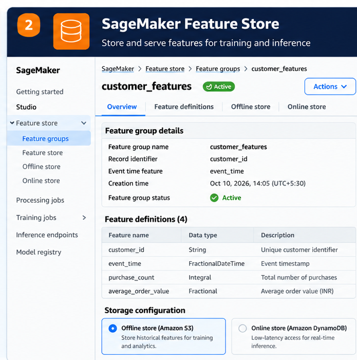
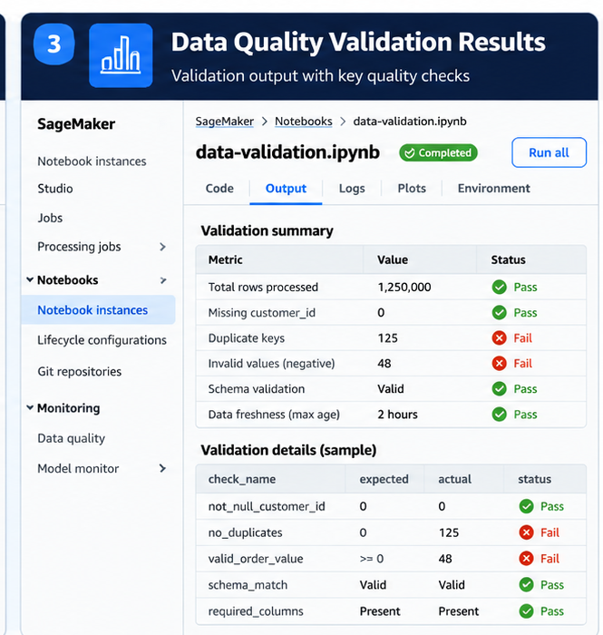

# Data Quality and Feature Engineering on AWS

A successful pipeline run is not the same as a trustworthy dataset. A required column might disappear, a source system might introduce a new category, duplicate entities might inflate counts, or a feature might be calculated one way during training and another way in production. These problems often look small in a data job and become expensive only after they reach a model.

On AWS, keep the design proportional to the workload. Amazon S3 plus versioned transformation code and repeatable checks is often enough for a batch dataset. Amazon SageMaker Processing provides managed compute for preprocessing and validation jobs, while Amazon SageMaker Feature Store becomes useful when features need consistent reuse, historical access, or low-latency online retrieval.

This chapter stays close to the engineering work: choosing AWS services, defining checks, producing repeatable outputs, and deciding when a managed feature store is worth the extra moving parts. Use your generic data-preparation and feature-engineering notes for the underlying theory; this chapter is about putting those ideas into an AWS workflow.

## 1. Reference architecture



The components are alternatives where appropriate, not mandatory stages. For a one-off batch training dataset, the path can end at a versioned S3 output. Add Feature Store when its serving, sharing, or historical-access benefits justify its operational and cost footprint.

## 2. What to validate

| Check | Example failure | Practical handling |
|---|---|---|
| Schema and types | `event_time` changes from timestamp to free-form text | Validate required columns and compatible types; fail or explicitly map approved changes |
| Missing values | `customer_id` is null | Reject or quarantine records when the field is required; impute only when justified |
| Duplicates | Same business key appears twice | Define the real uniqueness key and deterministic deduplication rule |
| Range and domain | `quantity = -5` where only positive values are valid | Apply business rules and retain rejection reasons |
| Freshness | Daily partition is absent or too old | Check expected arrival windows and alert on stale data |
| Leakage | A feature includes information only known after the prediction time | Enforce event-time cutoffs and point-in-time-correct feature construction |
| Training-serving skew | Offline and online calculations use different transformations | Reuse versioned feature logic and compare sampled outputs |
| Distribution drift | A feature's range or category mix changes materially | Track summary statistics and investigate changes before retraining |

Not every failed check should stop the entire pipeline. Define severity and action explicitly: **fail** for structural or safety-critical errors, **quarantine** bad records when safe, and **warn** for monitored shifts that require investigation.

## 3. AWS tools for data preparation and quality

These services overlap in places, but they are not interchangeable. Choose based on the work you need to do and how you want to operate it.

| Tool | A good fit | What to keep in mind |
|---|---|---|
| **AWS Glue Data Quality** | Defining and evaluating data-quality rules in Glue-based data pipelines | Treat rule outcomes as pipeline signals: decide which failures block publication and which create warnings |
| **AWS Glue DataBrew** | Visual, low-code data profiling and preparation, especially when analysts need to inspect data before standardizing transformations | Useful for exploration and recipe-based preparation; use versioned, tested code when transformations need conventional software delivery controls |
| **SageMaker Data Wrangler** | Exploring, importing, and transforming data as part of an ML preparation workflow | Useful for ML-focused data preparation; validate the exported transformations and include them in repeatable pipeline execution |
| **SageMaker Processing** | Running a Python or Spark script in managed, isolated compute | Best when you want explicit code, dependencies, input/output channels, and a job you can automate |
| **AWS Glue ETL / Spark on Amazon EMR** | Larger-scale distributed transformation and integration | Choose based on ecosystem fit, runtime control, scale, and operational responsibility—not data size alone |

A practical pattern is to profile and explore first, formalize the rules and transformations in versioned assets, then run the same checks every time the pipeline executes. Exploration helps you discover problems; repeatable rules help stop them from returning unnoticed.

## 4. AWS implementation options

| Option | Use it when | Trade-offs |
|---|---|---|
| **Amazon S3 + Python/Pandas or Spark** | Dataset is batch-oriented and a small number of consumers can share a clear file contract | Simple and inexpensive to reason about, but lineage, contracts, and reuse must be designed by your team |
| **AWS Glue** | Validation and transformation belong in a managed data integration/ETL flow, particularly for cataloged data | Managed execution and integration; job startup, worker sizing, runtime compatibility, and retries still need attention |
| **SageMaker Processing** | Preprocessing, feature engineering, validation, or evaluation is a managed step in an ML workflow | Runs a script/container on managed compute and writes outputs to S3; job configuration, IAM, logs, and instance cost remain your responsibility |
| **SageMaker Feature Store** | Feature definitions need to be reused across teams or models, historical values matter, or online inference needs low-latency feature lookups | Adds a feature-group contract, ingestion and access design, operational dependencies, and cost; avoid it when S3 tables already meet the need |

### A useful decision rule

Start with S3 and repeatable code. Move validation to Glue or SageMaker Processing when managed execution, scale, integration, or workflow repeatability warrants it. Introduce Feature Store when the feature lifecycle—not simply the existence of engineered columns—requires a managed shared store or online serving path.

## 5. A repeatable validation and preprocessing script

The following example uses Pandas so it can run locally before being adapted to a SageMaker Processing container or another orchestrated batch job. It expects a CSV with `record_id`, `event_time`, `age`, and `amount`. It writes accepted rows, quarantined rows with reasons, and a JSON summary. It does not upload to AWS by itself.

Save as `validate_features.py`:

```python
from pathlib import Path
import json
import pandas as pd

INPUT = Path("data/customers.csv")
OUTPUT = Path("build/validated")
REQUIRED = {"record_id", "event_time", "age", "amount"}

def main() -> None:
    OUTPUT.mkdir(parents=True, exist_ok=True)
    df = pd.read_csv(INPUT)

    missing_columns = REQUIRED - set(df.columns)
    if missing_columns:
        raise ValueError(f"Missing required columns: {sorted(missing_columns)}")

    # Normalize types explicitly; invalid parses become missing values.
    df["event_time"] = pd.to_datetime(df["event_time"], errors="coerce", utc=True)
    df["age"] = pd.to_numeric(df["age"], errors="coerce")
    df["amount"] = pd.to_numeric(df["amount"], errors="coerce")

    reasons = pd.Series("", index=df.index, dtype="string")

    def add_reason(mask: pd.Series, reason: str) -> None:
        nonlocal reasons
        reasons.loc[mask] = reasons.loc[mask].map(
            lambda current: f"{current};{reason}" if current else reason
        )

    add_reason(df["record_id"].isna(), "missing_record_id")
    add_reason(df["event_time"].isna(), "invalid_event_time")
    add_reason(df["age"].isna(), "invalid_age")
    add_reason(df["amount"].isna(), "invalid_amount")
    add_reason(df["age"].lt(0), "negative_age")
    add_reason(df["amount"].lt(0), "negative_amount")

    # Mark every row involved in a duplicate key, not just later occurrences.
    duplicate_key = df["record_id"].notna() & df["record_id"].duplicated(keep=False)
    add_reason(duplicate_key, "duplicate_record_id")

    rejected = reasons.ne("")
    accepted = df.loc[~rejected].copy()
    quarantine = df.loc[rejected].copy()
    quarantine["validation_reasons"] = reasons.loc[rejected]

    # This example writes deterministic local outputs. In production, write to
    # a run-specific S3 prefix, validate outputs, then publish via a manifest
    # or controlled pointer rather than overwriting consumer-visible data.
    accepted.to_parquet(OUTPUT / "accepted.parquet", index=False)
    quarantine.to_parquet(OUTPUT / "quarantine.parquet", index=False)

    summary = {
        "input_rows": int(len(df)),
        "accepted_rows": int(len(accepted)),
        "quarantined_rows": int(len(quarantine)),
        "validation_version": "1.0.0",
    }
    (OUTPUT / "validation-summary.json").write_text(
        json.dumps(summary, indent=2), encoding="utf-8"
    )
    print(json.dumps(summary, indent=2))

if __name__ == "__main__":
    main()
```

Run locally:

```bash
python -m pip install pandas pyarrow
python validate_features.py
```

The script above checks data integrity; it deliberately does not try to define a universal feature pipeline. Feature transformations depend on the meaning of each field. Here is a small example of transformations that might follow validation for a numeric model. Fit learned transformations on the training split only, then reuse the fitted transformer for validation, test, and serving data.

```python
import pandas as pd
from sklearn.compose import ColumnTransformer
from sklearn.preprocessing import OneHotEncoder, StandardScaler
from sklearn.pipeline import Pipeline
from sklearn.impute import SimpleImputer

numeric_features = ["age", "amount"]
categorical_features = ["channel"]

preprocessor = ColumnTransformer(
    transformers=[
        ("numeric", Pipeline([
            ("impute", SimpleImputer(strategy="median")),
            ("scale", StandardScaler()),
        ]), numeric_features),
        ("categorical", Pipeline([
            ("impute", SimpleImputer(strategy="most_frequent")),
            ("encode", OneHotEncoder(handle_unknown="ignore")),
        ]), categorical_features),
    ],
    remainder="drop",
)

# Split first. Fit only on training data to avoid leaking validation/test
# statistics into training.
X_train_ready = preprocessor.fit_transform(X_train)
X_valid_ready = preprocessor.transform(X_valid)
```

`X_train` and `X_valid` represent the feature frames created by your split logic. Persist the fitted preprocessing pipeline with the model artifact, or otherwise version and deploy the same transformation contract for inference. For time-dependent or entity-based data, choose a split strategy that prevents future information or related records from leaking across splits.

### Production notes

- Pin Python and dependency versions; run the same tests in CI and in the processing image.
- Treat the required schema and validation rules as versioned contracts.
- Add a stable run ID, input dataset version, code revision, and configuration version to the report.
- Decide whether duplicate records should be quarantined, deduplicated using a deterministic ordering rule, or handled upstream. Do not silently keep an arbitrary row.
- Write to a run-specific destination such as `s3://<bucket>/validated/run_id=<id>/`. Promote only after checks pass; do not let a failed retry partially replace a published dataset.
- Restrict S3 and KMS permissions to the required prefixes and keys. Avoid logging raw PII in validation errors.
- For large data, use Spark/Glue or SageMaker Processing with an appropriate distributed container rather than assuming Pandas fits memory.

### Make the quality gate explicit

A quality report is useful only when the pipeline knows what to do with it. Define thresholds in configuration and keep them with the rule-set version. For example:

- **Fail the run:** required columns are missing, key fields cannot be parsed, or a critical integrity rule is violated.
- **Quarantine rows:** individual records are invalid but can safely be isolated without corrupting the rest of the batch.
- **Warn and investigate:** a non-critical distribution or freshness measure has moved outside its normal range.

Avoid choosing thresholds only because they make a pipeline pass. Base them on business impact and observed data behaviour, and review them when the source contract changes.

## 6. Run validation with SageMaker Processing

SageMaker Processing runs preprocessing, feature engineering, data validation, and evaluation scripts on managed infrastructure. The job takes configured inputs, runs a selected processing container and script, and writes outputs to S3. This separates transformation code from the laptop or notebook that submits the job.

A typical operational pattern is:

1. Store input data and versioned code in S3 or a controlled image.
2. Configure the processing image, instance type/count, input channels, output destinations, execution role, and network settings.
3. Run the job and inspect status, CloudWatch logs, and metrics.
4. Validate the produced report and output manifest.
5. Publish the validated dataset only when quality gates pass.

Use a processing job when it is useful to isolate compute, scale beyond a local environment, or make preprocessing a repeatable ML workflow step. It is not automatically necessary for every dataset. A local test is useful for development; the managed job should still run the same contract tests before output is published.



*Figure 1. Illustrative Processing job details. This is a generated console-style visual, not a capture from a live AWS account. Use a real console capture when documenting an actual lab.*

## 7. SageMaker Feature Store: online and offline access

SageMaker Feature Store groups feature definitions and records under a feature group. A record has a record identifier and event time. Choose the store configuration based on the access pattern:

| Store | Main purpose | Data behavior | Typical consumer |
|---|---|---|---|
| **Offline store** | Historical feature data for exploration, training, and batch inference | Retains historical records in S3; supports analysis and point-in-time dataset construction | Training and batch inference |
| **Online store** | Low-latency lookup for real-time prediction | Serves the latest feature record for an identifier | Online inference service |
| **Both** | Reuse a feature definition for offline training and online serving | Offline and online stores can be configured together and kept aligned by the service | Systems needing consistent training and serving features |

Feature Store can reduce repeated feature pipelines and help teams share feature definitions. It does not eliminate the need to define event-time semantics, validate feature values, control access, monitor freshness, or prevent leakage. Verify the current storage, API, and pricing details before implementation.



*Figure 2. Illustrative feature group with record identifier, event time, definitions, and offline/online storage choices. This is a generated console-style visual, not a live-account screenshot.*

### When a plain S3 design is enough

Use S3 with Parquet or another suitable format, the Glue Data Catalog when useful, and a documented schema when:

- Features are batch-only and mainly consumed by training or batch inference.
- One pipeline owns the transformations and consumers can read a versioned dataset.
- Low-latency feature lookups are not required.
- Sharing, online/offline synchronization, and feature discovery do not justify another managed service.

Consider Feature Store when multiple models or teams need reusable features, online predictions need low-latency access to current values, or historical feature data must be managed as a shared capability. Make the decision based on a concrete access and ownership requirement, not because every ML project needs a feature store.

## 8. Dataset versioning and lineage

A reproducible dataset is more than an S3 path. Record enough metadata to explain exactly how it was produced:

- **Input identity:** source path, partition/date range, object version or manifest, and extraction timestamp.
- **Transformation identity:** Git commit, container/dependency versions, transformation configuration, and schema version.
- **Validation evidence:** rule-set version, row counts, rejected counts by reason, and quality-gate result.
- **Output identity:** immutable run-specific path, manifest, creation time, and checksum where practical.
- **ML linkage:** dataset version used for a training run and the resulting model artifact/version.

Use S3 versioning where it fits the recovery model, immutable run-specific output prefixes, and manifests to identify the exact set of files in a dataset. S3 versioning helps recover object revisions but is not, by itself, a complete dataset-lineage system. Keep data retention, privacy deletion, and lifecycle policies aligned with governance requirements.

For Feature Store, also record feature-group names, feature definitions, event-time rules, processing code revision, and the data sources used to generate features. Use the available SageMaker lineage and metadata facilities where they meet the need, while retaining your own explicit run manifest for reproducibility.

## 9. Bias, class imbalance, and data protection

Data quality is not only about nulls and incorrect types. A dataset can be perfectly parseable and still misrepresent the population or task it is supposed to support.

- **Sampling or selection bias:** some populations are missing or under-represented because of how the data was collected.
- **Measurement or label bias:** the recorded value or label reflects a flawed measurement process or historical decision.
- **Class imbalance:** one label occurs much more often than another. Accuracy alone may hide poor performance on the minority class.
- **Distribution shift:** the mix of features or labels changes between collection periods or environments. This is a signal to investigate, not automatic proof of bias or model failure.

Before training, inspect relevant slices and label distributions, check the source and labeling process, and decide whether stratified splitting, resampling, augmentation, or additional data collection is justified. Do not rebalance blindly: preserve the natural evaluation distribution when it represents production, and document any sampling strategy.

For AWS workflows, use the tools that match the task: AWS Glue Data Quality or DataBrew for data checks and preparation, SageMaker Data Wrangler for ML data exploration and transformations, SageMaker Ground Truth for supported labeling workflows, and SageMaker Clarify where its bias-analysis capabilities fit. These tools support the process; they do not replace domain review or a clearly defined fairness objective.

Treat privacy as part of data preparation, too. Classify sensitive fields, minimize what enters the training set, and apply masking, redaction, or anonymization where appropriate. Use IAM least privilege and encryption, and avoid putting raw personal data into logs or quarantine reasons. Anonymization is not simply deleting a name; assess whether records can still be re-identified from combinations of attributes.

## 10. Training-serving skew and leakage

**Training-serving skew** occurs when a feature has different meaning or calculation between training and inference. For example, training might calculate a customer's 30-day spend using completed calendar days while the online service includes a partial current day. The column names match, but the values represent different things.

Reduce skew by:

- Reusing transformation code or a shared, versioned feature contract.
- Defining time zones, event time, window boundaries, null handling, and categorical mappings explicitly.
- Comparing offline feature values with values produced by the serving path for a sample of entity IDs.
- Tracking freshness and missing-feature rates.
- Testing that training data only uses information available at the prediction timestamp.

Leakage is related but distinct: it happens when training uses information that would not have been available at prediction time. Point-in-time correctness matters for both offline feature creation and evaluation splits.

## 11. Validation checklist

Use this before promoting a dataset or feature batch:

- [ ] Required columns exist and types match the approved schema.
- [ ] Schema changes are classified as compatible, requiring a mapping, or breaking.
- [ ] Missing values and invalid ranges have explicit handling rules.
- [ ] Duplicate keys are measured and handled deterministically.
- [ ] Event time, timezone, freshness, and partition completeness are checked.
- [ ] Leakage and point-in-time correctness are considered.
- [ ] Validation reports include total, accepted, and rejected rows plus reason counts.
- [ ] Automated tests cover valid rows, missing columns, type-conversion failures, duplicates, and boundary values.
- [ ] Quality thresholds and fail/warn/quarantine actions are versioned with the rule set.
- [ ] Input, code, dependency, rule-set, and output versions are recorded.
- [ ] Outputs are written to a run-specific location and are not published before checks pass.
- [ ] Retries are safe and cannot silently publish partial results.
- [ ] IAM, encryption, retention, and PII handling are reviewed.
- [ ] Processing failures and quality failures are separately observable.
- [ ] Training and serving transformations are tested for parity where applicable.
- [ ] Compute and storage are sized for the workload, with cleanup and cost controls.



*Figure 3. Illustrative validation output highlighting passed and failed checks. Values are synthetic examples; use real job results for operational evidence.*

## 12. Key takeaways

- Make data contracts and quality gates explicit; a successful job is not proof of good data.
- Use S3 and simple, versioned transformations when batch access is sufficient.
- Use Glue for managed ETL integration and SageMaker Processing for managed ML preprocessing, validation, and evaluation jobs.
- Use SageMaker Feature Store when shared feature management, historical access, or low-latency online retrieval solves a real requirement.
- Version the data, code, configuration, and validation rules together so a model's training dataset can be reconstructed.
- Treat skew, leakage, freshness, and schema drift as engineering concerns that need automated tests and monitoring.

## Further reading

- [Amazon SageMaker Processing](https://docs.aws.amazon.com/sagemaker/latest/dg/processing-job.html)
- [Amazon SageMaker Feature Store](https://docs.aws.amazon.com/sagemaker/latest/dg/feature-store.html)
- [Feature Store concepts](https://docs.aws.amazon.com/sagemaker/latest/dg/feature-store-concepts.html)
- [Feature Store storage configurations](https://docs.aws.amazon.com/sagemaker/latest/dg/feature-store-storage-configurations.html)
- [Using Feature Store in the console](https://docs.aws.amazon.com/sagemaker/latest/dg/feature-store-use-with-studio.html)
- [AWS Glue documentation](https://docs.aws.amazon.com/glue/)
- [AWS Glue Data Quality](https://docs.aws.amazon.com/glue/latest/dg/glue-data-quality.html)
- [AWS Glue DataBrew](https://docs.aws.amazon.com/databrew/latest/dg/what-is.html)
- [SageMaker Data Wrangler](https://docs.aws.amazon.com/sagemaker/latest/dg/data-wrangler.html)
- [SageMaker Clarify](https://docs.aws.amazon.com/sagemaker/latest/dg/clarify-configure-processing-jobs.html)
- [SageMaker Ground Truth](https://docs.aws.amazon.com/sagemaker/latest/dg/sms.html)

## Related handbook notes

Keep the conceptual explanations in your generic handbook notes and link them here using the repository's actual relative paths:

- **Data preparation and missing values:** link to the existing general data-preparation note.
- **Feature engineering and transformations:** link to the existing feature-engineering note.
- **Data leakage and validation strategy:** link to the existing model-validation note.
- **Training-serving skew:** link to the existing feature-serving or ML operations note.

I have left these as named link targets rather than guessing filenames that may not match your repository. Once the exact paths are known, replace each description with a relative Markdown link. This AWS chapter should remain focused on service choices, execution patterns, quality gates, security, and operations.

> **Enterprise AI Engineering Handbook**
>
> *Building Production-Grade Enterprise AI Systems — One Chapter at a Time.*
