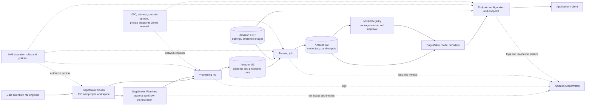
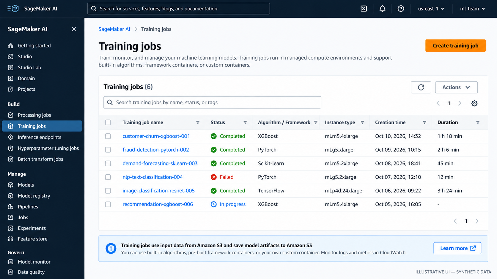
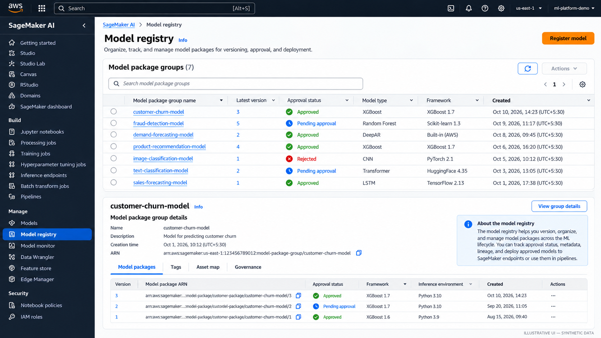
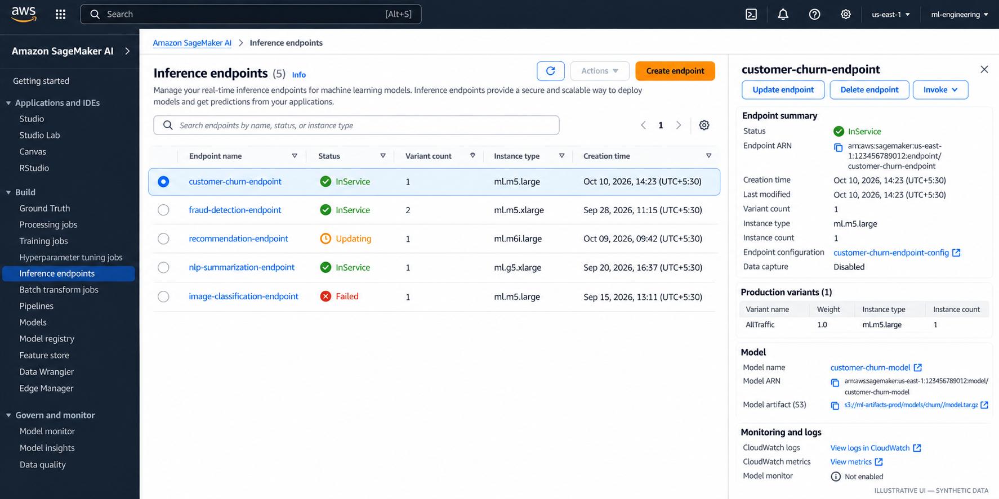

# SageMaker AI Platform Overview

Amazon SageMaker AI provides managed building blocks for the machine-learning lifecycle: prepare data, run processing and training jobs, package model artifacts, deploy models, and operate repeatable workflows. It reduces the amount of infrastructure the team must build and maintain, but it does not remove responsibility for data quality, model behavior, security, deployment decisions, or production reliability.

Think of SageMaker AI as a managed ML execution and lifecycle platform—not as a replacement for every AWS service around it. Amazon S3 usually holds datasets and model artifacts; Amazon ECR stores container images; IAM defines permissions; CloudWatch collects logs and metrics; and VPC configuration controls network paths when private connectivity is required.

This chapter focuses on the platform and its service boundaries. Use your generic ML notes for the mathematics, algorithm selection, model evaluation theory, and feature-engineering principles.

## 1. End-to-end SageMaker architecture



The diagram shows a common path, not a mandatory sequence. A first experiment can run a training job and save its artifact to S3 without Pipelines or Model Registry. A production workflow may add automated quality gates, evaluation, model registration, approval, deployment, and rollback controls.

**Important distinction:** a model artifact in S3, a model package in the Registry, a SageMaker model definition, and a deployed endpoint are four different things. They represent the trained files, a governed versioned package, deployment configuration, and a running inference service, respectively.

## Console walkthrough: training, registry, and serving

The following console-style illustrations show the kinds of resources to look for while following the lifecycle. They are **illustrative mockups with synthetic data, not screenshots captured from a live AWS account**. Console labels and layouts can change by region, account setup, and AWS UI updates.



*Figure 1. Training jobs: check job status, framework or algorithm, compute type, duration, and logs.*



*Figure 2. Model Registry: review model package versions and approval status before promotion.*



*Figure 3. Inference endpoints: inspect endpoint status, instance configuration, model association, and CloudWatch links.*

## 2. Terminology map

| Component | What it means | When you use it |
|---|---|---|
| **SageMaker Studio** | Web-based development environment for ML work | Explore data, author code, inspect jobs, and work with ML resources |
| **Domain, user profile, and space** | Studio access and workspace constructs | Organize users, shared work, permissions, and compute environments |
| **Processing job** | Managed execution for data preparation, validation, evaluation, or batch tasks | Run a script against S3 inputs and write outputs without managing a long-lived server |
| **Training job** | Managed compute that runs a training container | Fit a model and write model artifacts and training outputs |
| **Training image** | Container image with an algorithm, framework, and runtime | Choose a built-in algorithm, supported framework container, or custom image |
| **Input channel** | Named data input supplied to a training job | Separate training, validation, or other data sources |
| **Model artifact** | Files produced by training, commonly packaged as `model.tar.gz` | Preserve the trained model and load it for deployment or later use |
| **SageMaker model** | Deployment definition referencing model artifacts and inference container settings | Describe how the model should be loaded and served |
| **Endpoint configuration** | Settings for the model variants and instances behind an endpoint | Specify production or test hosting capacity and traffic configuration |
| **Endpoint** | Managed HTTPS inference resource | Serve low-latency online predictions |
| **Batch Transform** | Managed batch inference over a dataset without a persistent endpoint | Score large batches when always-on online serving is unnecessary |
| **Model Registry** | Versioned model packages and approval metadata, organized with package groups | Track candidate models and control promotion into deployment |
| **SageMaker Pipelines** | Workflow steps and dependencies for repeatable ML processes | Automate processing, training, evaluation, registration, and related steps |
| **S3** | Durable object storage for data, outputs, and artifacts | Exchange inputs and outputs between jobs and preserve versioned assets |
| **ECR** | Container image registry | Store custom training or inference images; SageMaker also provides managed images |
| **IAM execution role** | Permissions assumed by a SageMaker workload | Grant narrowly scoped access to S3, ECR, logs, KMS, and other required resources |
| **CloudWatch** | Logs, metrics, alarms, and dashboards | Investigate failed jobs, observe endpoints, and alert on operational problems |
| **VPC configuration** | Network placement and connectivity controls | Isolate workloads, restrict network access, and connect privately to supported resources |

Names and console organization can evolve. Check the current AWS documentation before relying on a particular Studio experience or SDK interface.

## 3. How the AWS services fit together

### Amazon S3 — data and artifacts

S3 is the normal hand-off point between many SageMaker jobs. Teams commonly store raw and curated datasets, processing outputs, training inputs, model artifacts, evaluation reports, and pipeline outputs there. Use clear prefixes, encryption, lifecycle rules, and access policies; separate data and artifact locations when that makes permissions and retention easier to reason about.

S3 does not validate data or train a model by itself. Your scripts and managed jobs define those behaviors.

### Amazon ECR — container images

SageMaker runs training and inference code in containers. ECR stores images your team builds, versions, and publishes. For a first lab, use a supported SageMaker framework image through the SDK rather than building a custom container. Create a custom image only when the required runtime, libraries, system packages, or execution behavior cannot be met by a suitable supported image.

### IAM — permissions, not network access

SageMaker execution roles let jobs access the AWS resources they need. Scope permissions to the relevant S3 prefixes, KMS keys, ECR repositories, and logging resources where practical. The person or pipeline that creates a resource may also need `iam:PassRole` permission to pass the execution role to SageMaker.

Avoid treating broad managed policies as a finished production security design. Begin with a working lab role, then narrow its permissions before using sensitive data or production workloads.

### CloudWatch — operational evidence

Training and processing jobs publish logs to CloudWatch Logs; endpoint and job metrics can be inspected through CloudWatch. Use logs to find startup, dependency, data-access, and script errors. For production, add alarms and dashboards for the signals that matter to the workload—such as endpoint latency, invocation errors, capacity, job failures, and pipeline failures.

A job marked `Completed` proves that the managed job completed successfully; it does not prove that the data was valid or that the model is useful.

### VPC — network boundaries

VPC settings are relevant when jobs or endpoints must run with private network connectivity or reach resources that are not publicly accessible. Subnets, security groups, routing, DNS, and VPC endpoints all affect connectivity. Private networking can also introduce failure modes: a job may have valid IAM permissions but still fail because it cannot reach S3, ECR, a package repository, or another dependency.

Network isolation and IAM solve different problems. Use both where the threat model and workload require them.

## 4. Built-in algorithms, framework scripts, and custom containers

Choose the least complex option that meets the workload's requirements.

| Approach | What the team supplies | Good fit | Trade-off |
|---|---|---|---|
| **Built-in algorithm** | Data, supported input format, hyperparameters, and compute settings | A supported algorithm matches the task and its constraints | Lowest implementation effort, but less freedom over algorithm internals |
| **Supported framework + training script** | A script such as `train.py`, dependencies supported by the chosen image, and job configuration | Custom model logic using frameworks such as scikit-learn, PyTorch, or TensorFlow | Good balance of control and managed infrastructure |
| **Extended prebuilt image** | A derived image or supported dependency-installation configuration | A supported framework is suitable but needs extra packages or system libraries | More build and patching responsibility |
| **Custom container** | Docker image, runtime, dependencies, training entry point, and compatible output behavior | Required framework, native dependency, or runtime is not supported by available images | Maximum control; team owns image security, compatibility, reproducibility, and maintenance |

SageMaker still runs the container and manages the configured job lifecycle, but it does not author or validate your algorithm. For custom containers, the team must ensure the training process follows SageMaker's expected input, output, and failure conventions.

Do not choose a custom container merely because the model is custom. A custom `train.py` can often run inside a supported framework image.

## 5. What SageMaker manages—and what the team still owns

| Area | SageMaker AI can manage | Team remains responsible for |
|---|---|---|
| Job infrastructure | Provisioning and lifecycle of configured processing/training compute | Selecting suitable instance types, capacity, timeouts, and cost limits |
| Execution environment | Running supported or supplied containers | Code correctness, dependency pinning, container security, reproducible builds |
| Data hand-off | Mounting or streaming configured inputs and writing configured outputs | Data contracts, quality checks, privacy, retention, and dataset selection |
| Training | Running the configured training process and capturing outputs | Algorithm design, leakage prevention, experiment design, and model usefulness |
| Model hosting | Managed endpoint infrastructure and configured scaling options | Availability targets, model behavior, latency/cost trade-offs, load testing, rollout and rollback policy |
| Workflow | Executing defined pipeline steps and dependencies | Defining meaningful gates, safe retries, idempotency, lineage, and release policy |
| Access and networking | Integration with IAM and VPC features | Least privilege, role separation, security-group design, encryption choices, and threat modeling |
| Observability | Logs and service metrics | Dashboards, alarms, incident response, actionable thresholds, and business-level monitoring |
| Governance | Registry metadata and approval workflows | Evaluation criteria, approval ownership, audit policy, and deployment authorization |

The practical rule: managed infrastructure reduces undifferentiated operational work; it does not outsource engineering judgment.

## 6. A minimal “hello training job” lab plan

The first lab should prove the core lifecycle without adding a pipeline, endpoint, registry, or custom container. Use a small public or synthetic tabular dataset and a simple supported scikit-learn training script.

### Lab goal

1. Put a small dataset in S3.
2. Create a minimal `train.py` script that loads the data, fits a simple model, and saves the trained estimator.
3. Use the SageMaker Python SDK's supported scikit-learn estimator and a compatible managed framework image.
4. Configure an execution role with access only to the lab's input and output locations plus the required logging permissions.
5. Submit one training job and follow its status and logs.
6. Confirm that the job wrote a model artifact to its configured S3 output location.
7. Record the image/framework version, code revision, input-data location, job configuration, and artifact path.
8. Delete any optional resources created during the lab; do not create an endpoint for this first exercise.

### Suggested project layout

```text
hello-sagemaker-training/
├── data/
│   └── train.csv
├── src/
│   └── train.py
├── requirements.txt
└── README.md
```

Keep the first model deliberately simple. The purpose is to learn how code, input data, execution roles, container images, job configuration, logs, and model artifacts connect—not to optimize model accuracy.

### Minimal training script outline

The code below is the training entry point, not the entire lab. Before running it, install a current compatible `sagemaker` SDK version in your local environment or Studio, configure AWS credentials, select the target Region, create a least-privilege SageMaker execution role, and upload a CSV whose target column is named `target`. Pin compatible framework/image versions in the actual lab and follow the current official SDK example for entry-point conventions.

```python
# src/train.py
import os
import joblib
import pandas as pd
from sklearn.ensemble import RandomForestClassifier

# Configure the training channel to match the estimator's input channel.
train_dir = os.environ.get("SM_CHANNEL_TRAIN", "/opt/ml/input/data/train")
train_file = os.path.join(train_dir, "train.csv")

df = pd.read_csv(train_file)
X = df.drop(columns=["target"])
y = df["target"]

model = RandomForestClassifier(
    n_estimators=50,
    random_state=42,
)
model.fit(X, y)

model_dir = os.environ.get("SM_MODEL_DIR", "/opt/ml/model")
os.makedirs(model_dir, exist_ok=True)
joblib.dump(model, os.path.join(model_dir, "model.joblib"))
```

For a runnable lab, make the CSV schema match the script, use a compatible scikit-learn estimator/container version, and configure the SDK input channel named `train`. The training image and SDK handle the job execution contract; the script handles loading, fitting, and saving the model.

### Validate and clean up

- [ ] The training job reaches `Completed`.
- [ ] CloudWatch logs show the script started and finished without exceptions.
- [ ] The configured S3 output contains the model artifact.
- [ ] The execution role can access only the required lab resources.
- [ ] The run's code, data, image version, configuration, and artifact location are recorded.
- [ ] No endpoint or other continuously billed resource remains after the lab.

**Cost and safety:** SageMaker training compute is billable while the job runs; S3 storage and related services can also incur charges. Use a small dataset and short job, check regional pricing, and clean up resources you created. Never place credentials in the training script or commit them to source control.

## 7. When to introduce the lifecycle components

- **Add Processing** when data preparation, validation, evaluation, or other batch code needs managed compute separate from training.
- **Add Pipelines** when steps must run repeatably with dependencies, parameters, artifacts, and explicit quality gates.
- **Add Model Registry** when model versions need metadata, review, approval, and controlled promotion.
- **Add an endpoint** when an application needs online predictions. For scheduled or large batch scoring, compare Batch Transform or another batch pattern before paying for an always-on endpoint.
- **Add Studio workspace governance** when multiple people need controlled, auditable development environments.
- **Add private VPC configuration** when the security and connectivity requirements call for it; design routes and endpoints deliberately.

Do not add every service to a proof of concept just because it exists. Start with the smallest path that demonstrates the requirement, then add lifecycle controls as the team needs them.

## 8. Related handbook notes

Use the generic ML notes for concepts and this AWS chapter for implementation and service boundaries.

- **Feature engineering theory:** `01-feature-engineering-basics.md` is the remembered filename; confirm its location before turning it into a relative link.
- **Data preparation and validation on AWS:** [Data Quality and Feature Engineering on AWS](../01-aws-data-architecture/03-data-quality-and-feature-engineering-on-aws.md).
- **Processing and ETL choices:** [AWS ETL and Distributed Processing](../01-aws-data-architecture/02-aws-etl-and-distributed-processing.md).
- **Model training and evaluation theory:** add links after confirming the generic notes' exact paths in the repository tree.

## Further reading

- [Amazon SageMaker AI FAQs and overview](https://aws.amazon.com/sagemaker/ai/faqs/)
- [SageMaker AI documentation](https://docs.aws.amazon.com/sagemaker/latest/dg/whatis.html)
- [SageMaker AI Studio](https://docs.aws.amazon.com/sagemaker/latest/dg/studio.html)
- [Processing jobs](https://docs.aws.amazon.com/sagemaker/latest/dg/processing-job.html)
- [Training jobs](https://docs.aws.amazon.com/sagemaker/latest/dg/how-it-works-training.html)
- [Deploy models for inference](https://docs.aws.amazon.com/sagemaker/latest/dg/how-it-works-deployment.html)
- [Model Registry](https://docs.aws.amazon.com/sagemaker/latest/dg/model-registry.html)
- [SageMaker Pipelines](https://docs.aws.amazon.com/sagemaker/latest/dg/pipelines.html)
- [Choose an algorithm implementation](https://docs.aws.amazon.com/sagemaker/latest/dg/algorithms-choose.html)
- [Docker containers for training and deploying models](https://docs.aws.amazon.com/sagemaker/latest/dg/docker-containers.html)
- [SageMaker execution roles](https://docs.aws.amazon.com/sagemaker/latest/dg/sagemaker-roles.html)
- [SageMaker VPC configuration](https://docs.aws.amazon.com/sagemaker/latest/dg/infrastructure-gateway.html)

---

> **Enterprise AI Engineering Handbook**
>
> *Building Production-Grade Enterprise AI Systems — One Chapter at a Time.*
