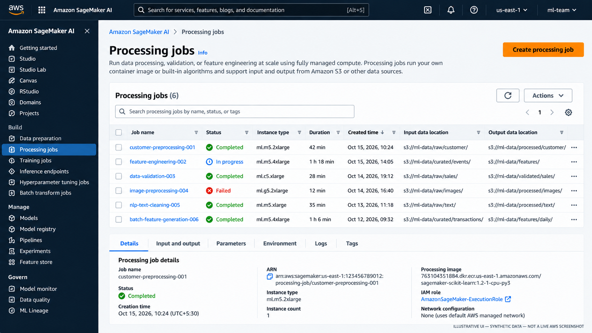
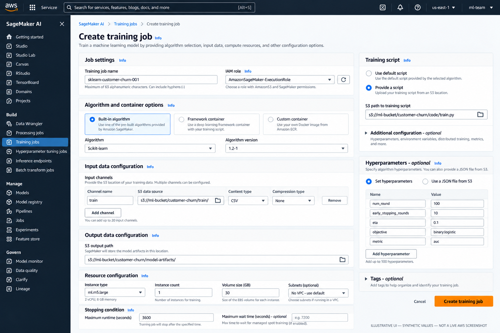
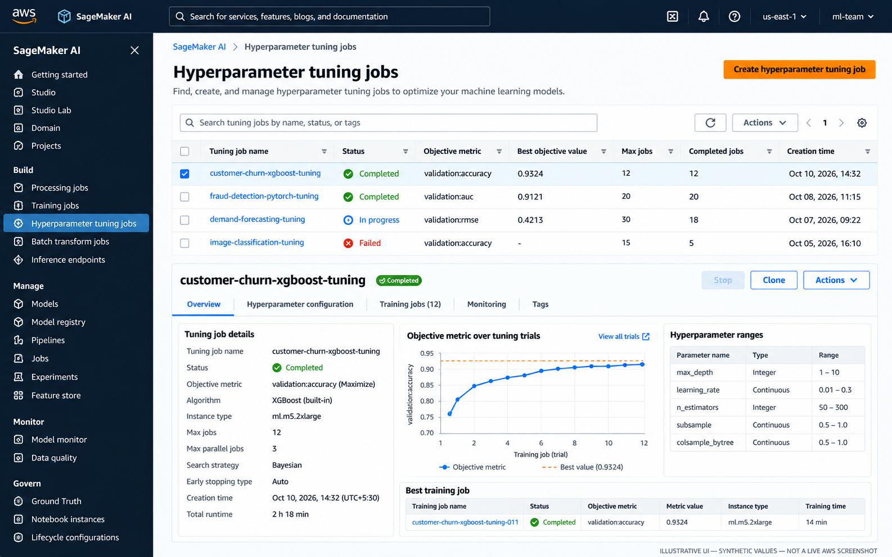

# Training, Processing, and Tuning Workflows on Amazon SageMaker AI

A useful way to think about a SageMaker job is: your team supplies the code or algorithm, data, container choice, compute settings, and output location; SageMaker runs that workload and reports how it went. The engineering decisions still matter: choose the right job type, make the input/output contract clear, and keep each run reproducible and within budget.

This note goes one level deeper than the platform overview. It focuses on job configuration and practical workflow decisions. Keep algorithm theory, feature-engineering principles, and metric definitions in your generic ML notes.

## 1. Choose the right job type

| Workload | SageMaker option | Typical input | Typical output | Compute lifecycle |
|---|---|---|---|---|
| Prepare, validate, transform, or analyze data | **Processing job** | S3 datasets and processing code | Processed data, reports, evaluation output in S3 | Provisioned for the job, then released |
| Fit model parameters | **Training job** | Training and optional validation channels | Model artifact and training output in S3 | Provisioned for the job, then released |
| Score a large dataset without an always-on service | **Batch Transform** | Model plus batch input data | Batch predictions in S3 | Provisioned for the transform job, then released |
| Serve low-latency predictions to an application | **Real-time endpoint** | Individual inference requests | Predictions returned to callers | Hosting capacity remains provisioned until changed or deleted |
| Compare hyperparameter configurations | **Automatic Model Tuning job** | Training-job definition, data channels, search ranges, objective metric | Many child training jobs and a best candidate | Multiple training runs; cost depends on trials, parallelism, and instance choice |

Processing, training, and batch inference are jobs; a real-time endpoint is a deployed service. Use Processing when the work is preparation, validation, evaluation, or other batch computation—not when the purpose is to fit the model itself.



*Figure 1. Processing jobs: inspect status, compute configuration, input/output locations, and job details. This is an illustrative mockup with synthetic data, not a live AWS console screenshot.*

## 2. Anatomy of a training job

A training job is configured from a handful of connected choices:

- **Algorithm or training code:** a built-in algorithm, a script running in a supported framework image, or a custom container.
- **Container image:** the runtime and dependencies used to execute the training process.
- **Input channels:** named data sources, commonly S3 locations, made available to the container.
- **Compute:** instance type, instance count, storage volume, and maximum runtime.
- **Hyperparameters and environment:** values supplied to the training program.
- **Output configuration:** S3 location for the model artifact and other outputs.
- **Execution role and network configuration:** AWS permissions and, where required, VPC subnets and security groups.
- **Observability:** job status, CloudWatch logs, metrics, and failure reasons.



*Figure 2. The job form brings together the role, algorithm/container, input channels, output path, compute, stopping conditions, and hyperparameters. Values shown are synthetic and the UI is illustrative.*

### Input channels: names are part of the contract

A channel gives the training job a name and a data source. Common names include `train`, `validation`, and `test`, but channel names are not magic by themselves: the selected algorithm or training script must expect the configured names and data format.

With the SageMaker Python SDK, the input mapping passed to `fit()` defines channels. A script-mode framework container exposes channel data in the training environment, commonly through environment variables such as `SM_CHANNEL_TRAIN`; the exact conventions depend on the chosen framework/container and SDK integration.

Plan for:

- A stable S3 prefix or data manifest for each run.
- A format the selected algorithm can read.
- Train/validation/test separation appropriate to the task.
- Explicit handling of compression, sharding, and input mode for larger workloads.
- Permissions for the execution role to read the input objects.

### Output artifacts are not the same as job logs

SageMaker stores the trained model artifact in the configured S3 output location, commonly as a compressed archive. Training logs and reported metrics are available separately through CloudWatch and job metadata. A completed job does not automatically register a model or deploy an endpoint; those are separate lifecycle steps.

## 3. Choose the implementation style

| Option | Team supplies | Choose it when | Main trade-off |
|---|---|---|---|
| **Built-in algorithm** | Data channels, hyperparameters, and resource configuration | A supported algorithm fits the use case and its input constraints | Fastest setup; less control over internals |
| **Framework image + training script** | Script such as `train.py`, framework-compatible dependencies, and job configuration | You need custom model logic in scikit-learn, XGBoost, PyTorch, TensorFlow, or another supported framework | Usually the best starting point for custom training |
| **Custom container** | Docker image, runtime, libraries, entry point, and expected input/output behavior | A required dependency or runtime is not supported by an appropriate prebuilt image | Maximum control; the team owns image builds, security updates, and compatibility |

A custom model does not automatically require a custom container. Start with a supported framework image and your own training script unless you have a concrete runtime requirement that the image cannot satisfy.

## 4. Minimal training lab with the SageMaker Python SDK

This lab creates a small synthetic classification dataset, uploads it to S3, runs a scikit-learn training script as a managed training job, and verifies that SageMaker writes the model artifact. It deliberately does not create an endpoint or a pipeline.

### Prerequisites

- An AWS account and a target AWS Region.
- Python and a compatible, current version of the `sagemaker` SDK installed in a local environment or SageMaker Studio.
- AWS credentials configured for the identity launching the job.
- A SageMaker execution role trusted by SageMaker AI and scoped to the lab's S3 input/output locations, required logging, and any required KMS keys.
- A small S3 bucket or an existing bucket/prefix you are authorized to use.

Do not hard-code credentials in the script. A broad managed policy may help you learn in a sandbox, but narrow permissions before using sensitive data or a shared environment.

### Suggested project layout

```text
sagemaker-training-lab/
├── train.py
├── run_training.py
└── README.md
```

### `train.py` — training entry point

```python
import os
import joblib
import pandas as pd
from sklearn.ensemble import RandomForestClassifier

train_dir = os.environ["SM_CHANNEL_TRAIN"]
model_dir = os.environ["SM_MODEL_DIR"]

train_file = os.path.join(train_dir, "train.csv")
data = pd.read_csv(train_file)

X = data.drop(columns=["target"])
y = data["target"]

model = RandomForestClassifier(
    n_estimators=50,
    max_depth=5,
    random_state=42,
)
model.fit(X, y)

os.makedirs(model_dir, exist_ok=True)
joblib.dump(model, os.path.join(model_dir, "model.joblib"))
```

The script expects a CSV named `train.csv` with a numeric `target` column. It saves the fitted estimator under the model directory expected by the SageMaker framework training environment.

### `run_training.py` — upload data and submit the job

```python
import os
import boto3
import pandas as pd
from sklearn.datasets import make_classification
import sagemaker
from sagemaker.sklearn.estimator import SKLearn

region = boto3.Session().region_name
if not region:
    raise RuntimeError("Configure an AWS Region before running this lab.")

role = os.environ["SAGEMAKER_EXECUTION_ROLE_ARN"]
bucket = os.environ["SAGEMAKER_LAB_BUCKET"]

# Create a small, reproducible synthetic dataset.
X, y = make_classification(
    n_samples=1000,
    n_features=12,
    n_informative=8,
    n_redundant=2,
    random_state=42,
)
columns = [f"feature_{i}" for i in range(X.shape[1])]
df = pd.DataFrame(X, columns=columns)
df["target"] = y

local_csv = "train.csv"
df.to_csv(local_csv, index=False)

session = sagemaker.Session()
train_s3_uri = session.upload_data(
    path=local_csv,
    bucket=bucket,
    key_prefix="sagemaker-training-lab/input",
)

estimator = SKLearn(
    entry_point="train.py",
    role=role,
    instance_type="ml.m5.large",
    instance_count=1,
    framework_version="1.9-0",
    py_version="py312",
    output_path=f"s3://{bucket}/sagemaker-training-lab/output",
    max_run=1800,
    base_job_name="hello-sklearn",
    sagemaker_session=session,
)

estimator.fit({"train": train_s3_uri}, wait=True, logs="All")

print("Training job:", estimator.latest_training_job.name)
print("Model artifact:", estimator.model_data)
```

**Version and SDK note:** this example uses the SageMaker Python SDK v2 `SKLearn` Estimator pattern. AWS currently recommends migrating to SDK v3; SDK v2 is in maintenance mode. The framework version shown here (`1.9-0` with Python 3.12) is based on AWS's current container support information, but you must still verify that the image is available for your Region and compatible with the SDK version you install. For a new long-lived project, prefer the current SDK v3 APIs and their matching official examples rather than copying a versioned v2 snippet unchanged. Pin SDK and dependency versions in your own reproducible project.

Set the two environment variables before execution:

```bash
export SAGEMAKER_EXECUTION_ROLE_ARN="arn:aws:iam::<account-id>:role/<sagemaker-execution-role>"
export SAGEMAKER_LAB_BUCKET="<your-lab-bucket>"
python run_training.py
```

Use your platform's equivalent environment-variable syntax if you are on Windows. The example uses a single CPU instance for a small synthetic dataset; it is a learning configuration, not a production sizing recommendation.

### Lab completion checks

- [ ] The training job reaches `Completed`.
- [ ] The job's `train` input channel points to the uploaded S3 object.
- [ ] CloudWatch logs show the script loaded the CSV and finished training.
- [ ] The configured output path contains the model artifact.
- [ ] The execution role is scoped to the necessary resources.
- [ ] The job name, SDK/framework version, input URI, code revision, and artifact URI are recorded.
- [ ] No endpoint or other continuously billed resource was created.

## 5. Hyperparameter tuning

Hyperparameter tuning runs multiple training jobs while exploring specified parameter ranges and compares their results against an objective metric. You define:

1. The training job configuration and data channels.
2. Hyperparameters to vary and valid ranges or values.
3. The metric to optimize and whether to maximize or minimize it.
4. The maximum number of training jobs and how many may run concurrently.
5. Optionally, early-stopping or search-strategy settings supported by the selected tuner configuration.

The objective metric must be emitted by the training job and reported in a format the tuning service can recognize. Its name and direction must match the problem. For example, a validation loss is generally minimized; validation accuracy is generally maximized. Metric selection and interpretation remain an ML design decision, not an AWS service decision.



*Figure 3. Tuning jobs summarize trial status, objective values, search ranges, and the best training job. This console-style image uses synthetic values and is not a live AWS screenshot.*

A tuning job is not free experimentation: each trial is a training job that consumes compute. Set a maximum job count and parallelism deliberately, start with a small search space, and inspect whether the extra trials improve the objective enough to justify the cost.

## 6. Distributed training: when to scale

Start with one instance when the dataset and model fit and the job meets the required completion time. Before moving to distributed training, check whether the bottleneck is compute, data loading, memory, or communication. A larger instance may be simpler than multiple instances, but compare actual runtime and cost.

| Approach | When it may fit | Considerations |
|---|---|---|
| One instance, CPU | Small tabular workloads and conventional preprocessing/training | Simplest setup and usually easiest to debug |
| One instance, GPU or accelerator | Framework/model benefits from accelerated math or needs more device memory | Higher hourly cost; verify the workload actually uses the accelerator |
| Multiple instances with supported distributed training | Large model or dataset and a framework/algorithm that supports distributed execution | Communication overhead, network setup, coordination, and scaling efficiency matter |
| Multiple independent jobs | Parameter sweeps, cross-validation folds, or independent experiments | Often easier than distributing one training run; total concurrent compute can grow quickly |

Distributed training does not guarantee linear speedup. Data input, communication, synchronization, and model architecture can dominate. Measure a baseline first, then compare cost per completed experiment and time-to-result rather than comparing instance prices alone.

## 7. Troubleshooting table

| Symptom | Likely causes | What to check first |
|---|---|---|
| Job fails before the script starts | Invalid role, missing `iam:PassRole`, image pull or service permissions | Job failure reason, role trust policy, caller permissions, image URI and Region |
| `AccessDenied` for S3 input | Execution role lacks `s3:GetObject` or bucket/KMS policy blocks access | Exact object ARN/prefix, bucket policy, KMS permissions, role used by the job |
| Input file or channel not found | Wrong S3 URI, channel-name mismatch, unexpected local path, empty prefix | Job input configuration and actual files in S3; compare channel name with script expectations |
| CSV parsing or schema error | Delimiter, header, target column, data type, or file-format mismatch | Inspect a small sample and confirm the script and channel contract agree |
| `ModuleNotFoundError` | Dependency absent from the chosen image or dependency installation failed | Framework image, pinned packages, startup logs, and whether a custom image is required |
| Container exits with a non-zero code | Script exception, incorrect entry point, incompatible package, wrong output path | CloudWatch logs and container startup command; reproduce locally with the same dependencies |
| Job runs out of memory or disk | Instance too small, data copied to local volume, large intermediate files | Memory/disk use, input mode, volume size, instance family, data processing approach |
| Job exceeds timeout | Training too slow, input bottleneck, unsuitable instance, excessive work | Runtime metrics, `max_run`, data volume, profiling, and early-stopping options where appropriate |
| GPU remains underused | CPU preprocessing or input I/O bottleneck; framework not using GPU | Framework configuration, GPU metrics, data loading, batch size, and logs |
| Distributed job stalls | Network/security-group setup, rendezvous/configuration mismatch, worker failure | Worker logs, VPC/security-group connectivity, framework distribution settings |
| Tuning job reports no objective metric | Metric not emitted, regex/name mismatch, wrong metric direction/configuration | Child training logs, metric definition, objective name, and maximize/minimize choice |
| Cost unexpectedly increases | Too many tuning trials, high parallelism, oversized instances, forgotten endpoint | Job history, tuner limits, instance count/type, endpoint inventory, and S3 lifecycle |

When a run fails, start with the failure reason and CloudWatch logs rather than guessing from the final status. Check permissions and input paths next, then inspect the container, resource limits, and job configuration. Fix the cause before launching another run that may cost money and fail in the same way.

## 8. Compute and cost trade-offs

The principal cost drivers are instance type, instance count, runtime, tuning trial count and concurrency, storage, data transfer, and any persistent endpoint capacity. Actual prices vary by Region, instance family, purchase option, and service configuration; check current AWS pricing before budgeting.

Practical controls:

- Start with the smallest suitable compute and a small sample dataset.
- Set maximum runtime and tuning job/parallelism limits.
- Use GPU or distributed training only when measurements justify them.
- Reuse versioned datasets and avoid repeated preprocessing where outputs can safely be reused.
- Use Batch Transform or another batch scoring pattern when an always-on endpoint is not needed.
- Monitor job failures and retries; repeated failed launches can still consume time and incur costs.
- Clean up endpoints and other persistent resources after experiments.
- Apply S3 lifecycle and retention rules to temporary inputs, logs, and artifacts in accordance with audit needs.

## 9. Related handbook notes

- **SageMaker AI Platform Overview:** `01-sagemaker-ai-platform-overview.md` — platform components, service boundaries, and lifecycle terminology.
- **Data Quality and Feature Engineering on AWS:** [Data quality and feature engineering](../01-aws-data-architecture/03-data-quality-and-feature-engineering-on-aws.md).
- **AWS ETL and Distributed Processing:** [ETL and distributed processing](../01-aws-data-architecture/02-aws-etl-and-distributed-processing.md).
- **Generic ML theory:** link to the existing notes on evaluation metrics, model validation, and feature engineering using the repository's verified relative paths.

## Further reading

- [SageMaker Processing jobs](https://docs.aws.amazon.com/sagemaker/latest/dg/processing-job.html)
- [Train a model with SageMaker AI](https://docs.aws.amazon.com/sagemaker/latest/dg/how-it-works-training.html)
- [Use an algorithm to run a training job](https://docs.aws.amazon.com/sagemaker/latest/dg/sagemaker-mkt-algo-train.html)
- [SageMaker Python SDK troubleshooting](https://docs.aws.amazon.com/sagemaker/latest/dg/sagemaker-python-sdk-troubleshooting.html)
- [Automatic model tuning](https://docs.aws.amazon.com/sagemaker/latest/dg/automatic-model-tuning.html)
- [Configure and launch a tuning job](https://docs.aws.amazon.com/sagemaker/latest/dg/automatic-model-tuning-ex-tuning-job.html)
- [Distributed computing best practices](https://docs.aws.amazon.com/sagemaker/latest/dg/distributed-training-options.html)
- [Training jobs and VPC access](https://docs.aws.amazon.com/sagemaker/latest/dg/train-vpc.html)
- [SageMaker pricing](https://aws.amazon.com/sagemaker/ai/pricing/)

---

> **Enterprise AI Engineering Handbook**
>
> *Building Production-Grade Enterprise AI Systems — One Chapter at a Time.*
