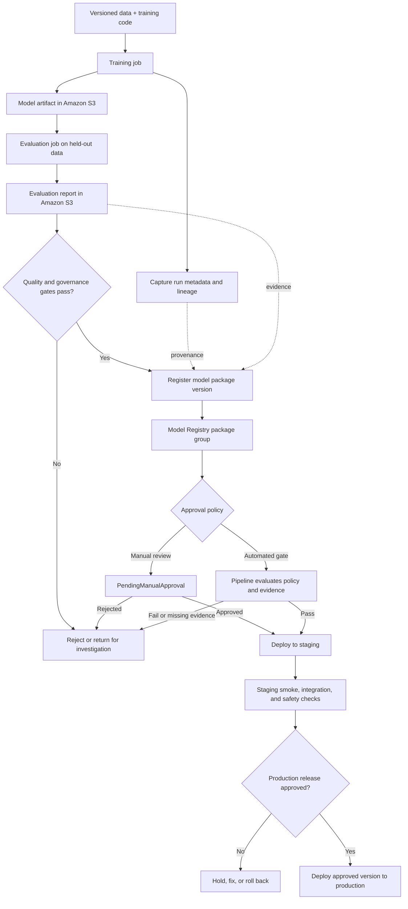
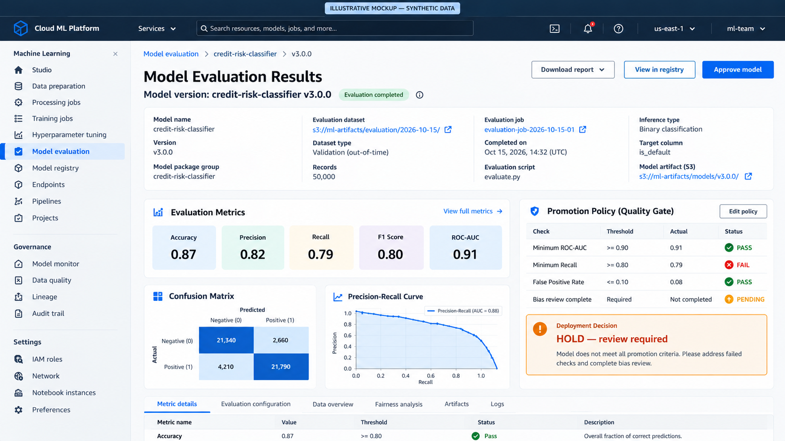
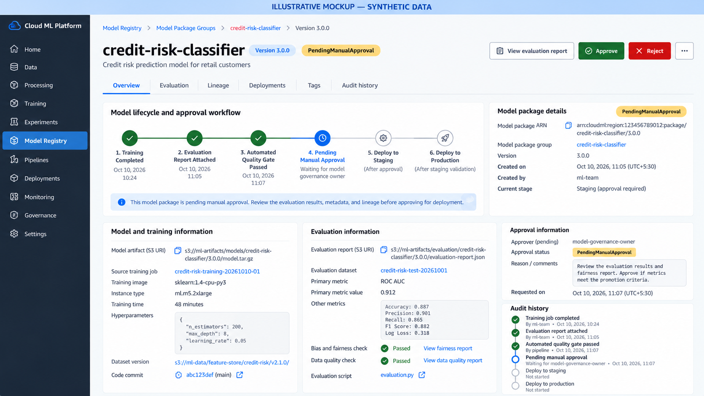

# Model Evaluation, Registry, and Approval on Amazon SageMaker AI

A training job finishing successfully only tells us that the job ran to completion. It does not tell us whether the model is useful, safe for its intended purpose, reproducible, or ready for production.

This chapter connects three distinct parts of the lifecycle: **evaluation** establishes whether a candidate meets agreed requirements; **Model Registry** records the candidate and its metadata as a versioned asset; and **approval and promotion** control whether that version can move toward deployment. These steps are related, but they are not the same operation.

## 1. Model lifecycle: from training to controlled promotion



*This is a recommended control flow, not behavior automatically guaranteed by registration. Teams must implement the evaluation conditions, approval rules, and deployment automation.*

## 2. Evaluation: turn model quality into a release decision

Evaluate on data that was not used to fit the model. Depending on the workflow, use validation data for model selection and a held-out test set for final assessment. Keep data splits, preprocessing, and evaluation code consistent with the intended deployment population.

| Problem type | Example metrics | Questions before promotion |
|---|---|---|
| Binary classification | Precision, recall, F1, ROC-AUC, PR-AUC, confusion matrix, calibration | What are the costs of false positives and false negatives? Is the class balance representative? |
| Multiclass classification | Per-class precision/recall/F1, macro and weighted averages, confusion matrix | Does the aggregate score hide poor performance for an important class? |
| Regression | MAE, RMSE, R², residual analysis | How large are errors in business units? Are errors concentrated in a particular segment? |
| Ranking or retrieval | Precision/recall at K, NDCG, MRR, task-specific relevance measures | Does the metric match how users judge results? |

Do not use a single metric as a universal approval rule. Agree on thresholds with product and risk owners before reviewing the candidate. Where relevant, include subgroup performance, calibration, robustness, privacy, explainability, and operational constraints.

**Evaluation report contract:** store a machine-readable report alongside a human-readable summary. Record the dataset identifier and version, evaluation-code revision, metric definitions, measured values, thresholds, timestamp, and pass/fail result. A deployment gate should read this report or a pipeline property derived from it—not depend on an unrecorded notebook review.

For metric definitions, link to the handbook's existing classification, regression, and model-validation notes once their repository paths are confirmed. I have intentionally not guessed those paths here; keep this chapter focused on how evaluation evidence becomes a release decision.

## 3. SageMaker Model Registry terminology

SageMaker AI Model Registry organizes registered models into **model package groups**, with each registered model package representing a version. The group is the logical family of versions for a use case; each version is an individual candidate. See the [official Model Registry concepts](https://docs.aws.amazon.com/sagemaker/latest/dg/model-registry-models.html).

| Term | Meaning | Important distinction |
|---|---|---|
| **Model package group** | A named collection of related registered model versions | Not the model file or a running endpoint |
| **Model package / model version** | A versioned registry record for a candidate, with references and metadata | Not, by itself, a running deployment |
| **Model artifact** | Serialized model files, commonly stored in Amazon S3 | Not the registry approval record |
| **Evaluation report** | Evidence about performance on a defined dataset using defined metrics | Does not block deployment unless a gate consumes it |
| **Approval status** | State used to represent whether a version is pending review, approved, or rejected | Does not create a deployment pipeline by itself |
| **Lineage and metadata** | Records connecting data, jobs, code, artifacts, and downstream use | Not a substitute for retaining datasets, code revisions, and reports |
| **Deployed model and endpoint** | Serving configuration and hosting resources used for inference | Separate resources that can be created from a registered version |

A registered version can carry metrics, evaluation report references, inference image details, lineage, tags, and approval state. Choose metadata that makes the candidate understandable to the next engineer, reviewer, auditor, or incident responder.


*Figure 1. Model package group and version list. Illustrative console-style mockup with synthetic values, not a live AWS screenshot.*

## 4. Approval states and controlled promotion

Common Model Registry approval states are:

- **`PendingManualApproval`** — registered and awaiting an authorized decision.
- **`Approved`** — approved for use by the team's deployment process.
- **`Rejected`** — not approved for promotion.

Treat approval as a governance decision backed by evidence. A candidate can have a strong aggregate score and still fail a required recall threshold, fairness assessment, security review, or latency budget. `Approved` does not mean the model is suitable for every endpoint or workload.

### Example approval flow

1. Training produces a model artifact and records the job, data version, code revision, and configuration.
2. Evaluation runs on the agreed dataset and writes a machine-readable report to S3.
3. A quality gate checks mandatory metrics and governance conditions. If a threshold fails, stop promotion and preserve the report.
4. Register a model package version with metadata; use `PendingManualApproval` when human review is required.
5. The reviewer checks the report, lineage, known limitations, and release checklist.
6. An authorized reviewer marks the version `Approved` or `Rejected`.
7. A configured pipeline or CI/CD integration deploys the **specific approved version** to staging.
8. Staging checks run before production release. Keep a known-good rollback target according to the release plan.



*Figure 2. Example evaluation report with a failed threshold and a hold decision. Values are synthetic; the illustration shows why one good metric is not sufficient.*



*Figure 3. Approval review showing evaluation evidence, provenance, audit history, and a pending decision. Illustrative mockup, not an actual AWS console capture.*


### Example: a machine-readable evaluation gate

Keep the report format stable so a pipeline can evaluate it without scraping notebook output. This small JSON example is illustrative; the metric names and thresholds must be chosen for the use case.

```json
{
  "model_package_group": "credit-risk-classifier",
  "candidate_version": "candidate-2026-10-17-01",
  "dataset_version": "s3://ml-evaluation-data/credit-risk/v12/",
  "code_revision": "git:4d91a2e",
  "metrics": {
    "recall": 0.91,
    "precision": 0.84,
    "roc_auc": 0.93
  },
  "thresholds": {
    "recall_min": 0.90,
    "precision_min": 0.80,
    "roc_auc_min": 0.90
  },
  "gate_result": "PASS"
}
```

A pipeline should validate that the report exists, parses, contains every required metric, and refers to the expected dataset and candidate. It should fail closed when a field is missing or malformed. The example's `gate_result` is evidence only if a trusted pipeline computes and writes it; do not accept a manually edited pass flag as proof.

```python
from typing import Any

REQUIRED_THRESHOLDS = {
    "recall": ("recall_min", lambda value, limit: value >= limit),
    "precision": ("precision_min", lambda value, limit: value >= limit),
    "roc_auc": ("roc_auc_min", lambda value, limit: value >= limit),
}


def evaluate_gate(report: dict[str, Any]) -> tuple[bool, list[str]]:
    """Return (passed, reasons); missing or invalid evidence fails closed."""
    metrics = report.get("metrics")
    thresholds = report.get("thresholds")
    if not isinstance(metrics, dict) or not isinstance(thresholds, dict):
        return False, ["metrics and thresholds must be objects"]

    failures: list[str] = []
    for metric_name, (threshold_name, compare) in REQUIRED_THRESHOLDS.items():
        value = metrics.get(metric_name)
        limit = thresholds.get(threshold_name)
        if not isinstance(value, (int, float)) or not isinstance(limit, (int, float)):
            failures.append(f"Missing or invalid {metric_name}/{threshold_name}")
        elif not compare(value, limit):
            failures.append(f"{metric_name}={value} does not meet {limit}")

    return not failures, failures
```

This function demonstrates the gate logic only. A production pipeline must also authenticate the report's origin, verify candidate and dataset identifiers, persist the decision and reasons, and connect the result to a deployment workflow. It is not a substitute for AWS IAM, Model Registry APIs, or pipeline orchestration.

### Manual versus automated approval

| Approach | Good fit | Safeguard |
|---|---|---|
| Manual approval | High-impact models, regulated decisions, early adoption | Define reviewer role, evidence, rationale, and response time |
| Automated quality gate | Repeatable low-risk releases with objective criteria | Fail closed on missing reports or metrics; version thresholds and log decisions |
| Hybrid | Automated checks plus accountable sign-off | Automate deterministic checks; reserve human review for risk or policy exceptions |

SageMaker supports approval updates through the console or API. A status change can trigger deployment when an appropriate EventBridge rule, pipeline, or CI/CD integration is configured. **Changing a status alone does not universally deploy a model.** See [Update the approval status of a model](https://docs.aws.amazon.com/sagemaker/latest/dg/model-registry-approve.html).

## 5. Keep artifact, registry record, and deployment separate

1. **Amazon S3 model artifact:** Which serialized files did training produce?
2. **Model Registry package version:** Which candidate is this, what evidence and metadata are attached, and is it approved?
3. **Deployed model and endpoint resources:** Which artifact, inference container, configuration, and hosting capacity are currently serving predictions?

The registry does not replace artifact storage; the artifact is not a governance record; and an endpoint is not a version-control system. Record the exact package version and artifact URI used by each deployment so the running service can be traced back to training and evaluation evidence.

## 6. What to record before promotion

- [ ] **Identity:** model name, package group, package version/ARN, owner, intended use, and timestamp.
- [ ] **Data provenance:** training/validation/test dataset identifiers and versions, source locations, split strategy, and exclusions.
- [ ] **Code provenance:** immutable repository commit or release tag for training, preprocessing, and evaluation.
- [ ] **Runtime configuration:** framework and container image URI/digest where available, dependency versions, hyperparameters, instance configuration, and relevant environment settings.
- [ ] **Artifact:** exact S3 URI, encryption/access controls, and retention policy.
- [ ] **Evaluation evidence:** report URI, dataset version, metric definitions, values, thresholds, and gate result.
- [ ] **Risk review:** subgroup/fairness results where applicable, limitations, privacy/security checks, and intended-use constraints.
- [ ] **Operational readiness:** latency/throughput expectations, resource estimate, monitoring plan, alert thresholds, rollback plan, and dependency checks.
- [ ] **Approval:** decision, reviewer or policy identity, timestamp, rationale, exceptions, and follow-up actions.
- [ ] **Promotion target:** staging/production environment, deployment configuration, and exact package version to deploy.
- [ ] **Reproducibility:** links to training and evaluation jobs, logs, dataset manifest, and lineage records.

If a required item is missing, block promotion or document a formally authorized exception. Do not silently treat missing evidence as a pass.

## 7. Reproducibility and auditability

A version number is necessary, but it is not enough to reproduce a model. Results can change when data contents, preprocessing, dependencies, container images, hardware, random seeds, or configuration change. Capture material inputs and retain resulting artifacts and reports under appropriate access and retention controls.

- Prefer immutable dataset manifests or versioned prefixes over ambiguous names such as `latest.csv`.
- Record code commits and pinned dependency/container versions.
- Store evaluation reports and gate results as durable artifacts.
- Use tags and metadata consistently across jobs, package versions, and deployments.
- Keep the approval decision and rationale in an auditable record.
- Deploy a specific approved version, not whichever version happens to be newest.
- Make rollback and withdrawal of a bad candidate explicit.
- Restrict who can approve models and who can change production deployments.

For automated workflows, a useful rule is: **no evaluation report, no promotion**. Missing metrics, failed checks, or unreadable reports should fail the gate rather than be interpreted as a pass.

## 8. Related handbook notes

- **SageMaker AI Platform Overview:** `01-sagemaker-ai-platform-overview.md` — platform resources and lifecycle vocabulary.
- **Training, Processing, and Tuning Workflows:** `02-training-processing-and-tuning-workflows.md` — job configuration, outputs, and tuning.
- **Data Quality and Feature Engineering on AWS:** [Data quality and feature engineering](../01-aws-data-architecture/03-data-quality-and-feature-engineering-on-aws.md).
- **Generic ML metrics and validation:** add links to the existing classification metrics, regression metrics, and model-validation notes after confirming their repository paths. Avoid publishing placeholder or guessed relative links.

## Further reading

- [SageMaker Model Registry: models, versions, and groups](https://docs.aws.amazon.com/sagemaker/latest/dg/model-registry-models.html)
- [Update model approval status](https://docs.aws.amazon.com/sagemaker/latest/dg/model-registry-approve.html)
- [Register a model version](https://docs.aws.amazon.com/sagemaker/latest/dg/model-registry-version.html)
- [Run a SageMaker Pipeline](https://docs.aws.amazon.com/sagemaker/latest/dg/run-pipeline.html)
- [SageMaker Model Registry and CI/CD](https://docs.aws.amazon.com/sagemaker/latest/dg/model-registry.html)

---

> **Enterprise AI Engineering Handbook**
>
> *Building Production-Grade Enterprise AI Systems — One Chapter at a Time.*
