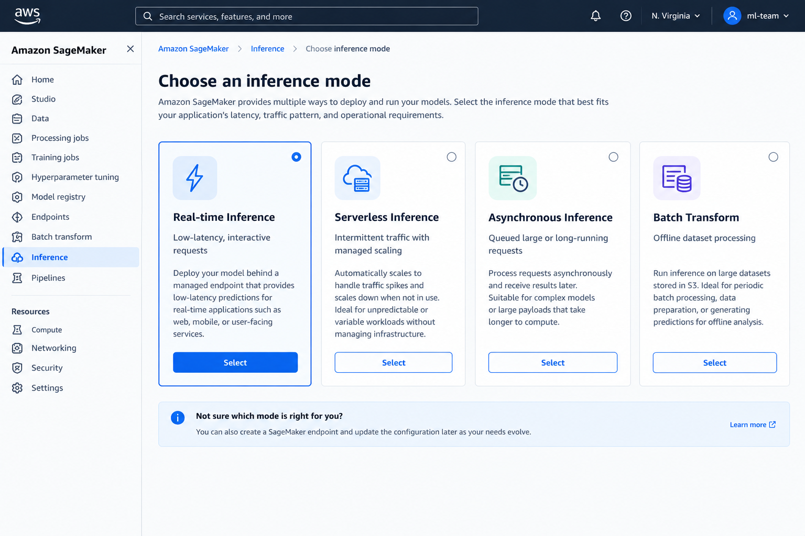
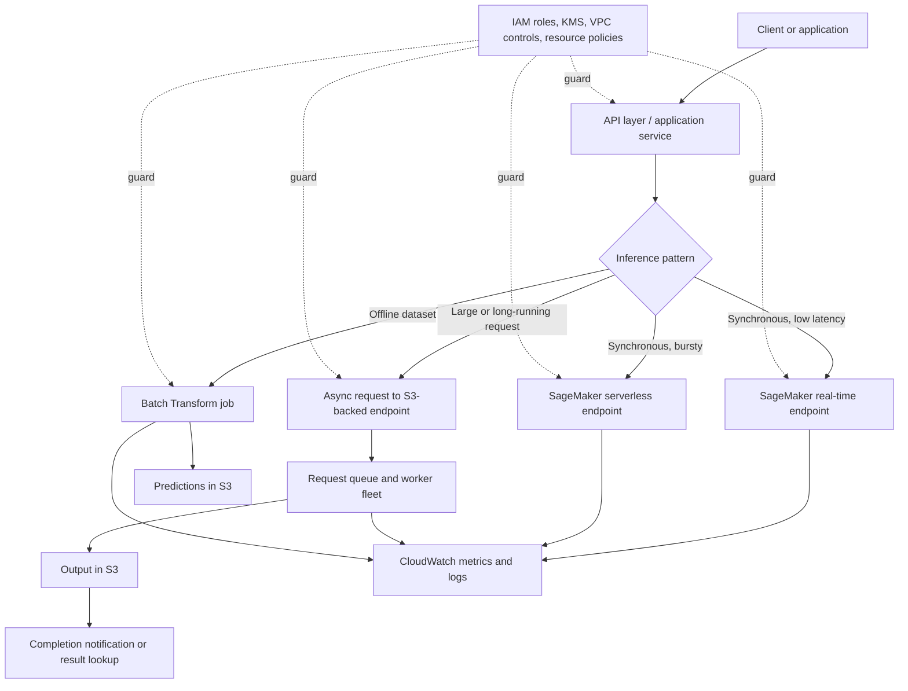
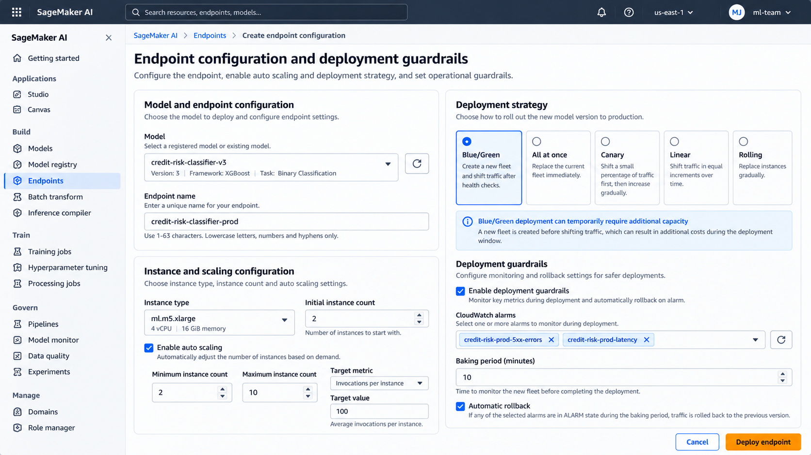

# Model Inference and Deployment Options on AWS

> **Updated edition:** clarified service limits, feature compatibility, and which deployment modes support SageMaker deployment guardrails.

Training produces a model artifact; inference turns that artifact into a capability an application can use. The deployment decision is not simply “which endpoint is fastest?” It is a trade-off among response time, payload size, traffic shape, startup behavior, operational control, and cost.

This chapter focuses on choosing and operating the serving path. It does not repeat model evaluation or registry concepts; those determine which model version is eligible to deploy.

## 1. Choose the inference mode

| Option | Good fit | Request and latency pattern | Capacity and cost considerations |
|---|---|---|---|
| **Real-time endpoint** | Interactive APIs, online scoring, sustained traffic | Synchronous request/response; low and predictable latency | Provisioned instances stay available; use autoscaling for variable load |
| **Serverless inference** | Infrequent, bursty, or unpredictable traffic | Synchronous request/response; cold starts may affect latency | Pay for request compute rather than idle endpoint instances; check memory, payload and concurrency limits |
| **Asynchronous inference** | Large payloads, long-running predictions, queue-based workflows | Submit a request and retrieve the result later; not an immediate response | Queueing and output storage; can scale to zero when idle; design for eventual completion |
| **Batch Transform** | Nightly scoring, backfills, bulk enrichment, offline evaluation | Submit a dataset/job and collect output when the job finishes | Job-based compute; no persistent inference endpoint required |

As described in AWS's inference-options guide, the commonly documented limits are up to **25 MB** and 60 seconds for standard real-time responses (up to 8 minutes for streaming responses), up to **4 MB** and 60 seconds for Serverless Inference, and up to **1 GB** and one hour for Asynchronous Inference. Batch Transform is designed for offline datasets and can run for much longer. AWS documentation pages can express limits differently depending on the API and feature context; treat these as orientation, then verify the current [inference options](https://docs.aws.amazon.com/sagemaker/latest/dg/deploy-model-options.html) and [supported-feature matrix](https://docs.aws.amazon.com/sagemaker/latest/dg/model-deploy-feature-matrix.html) for your exact deployment.



*Figure 1. Illustrative console-style mockup comparing inference choices. Synthetic UI; not a live AWS screenshot.*

### A practical decision sequence

1. **Must the caller receive the prediction in the same request?** If not, consider Batch Transform for a dataset available upfront, or Asynchronous Inference for request-by-request work that can complete later.
2. **For synchronous calls, is traffic steady and latency-sensitive?** Start with Real-time Inference.
3. **Is traffic intermittent and can the application tolerate cold starts?** Evaluate Serverless Inference. If cold-start latency is unacceptable, use a provisioned endpoint or another architecture.
4. **Check payload and processing limits.** Large files and long inference jobs usually point to Asynchronous Inference or Batch Transform.
5. **Load-test the candidate.** Measure p50/p95/p99 latency, throughput, throttles, cold starts, queue delay and cost per useful prediction using realistic payloads.

Do not choose Serverless solely because traffic is low, or Real-time solely because it is familiar. Model load time, memory footprint, concurrency, latency targets and regional/service constraints can change the answer.

## 2. Deployment architecture



*Architecture pattern, not an automatically provisioned deployment. Configure each service integration and security boundary explicitly.*

## 3. Endpoint configuration, scaling and rollouts

For real-time or asynchronous hosting, the deployment normally involves a model definition (inference image plus model artifact and execution role), an endpoint configuration (production variant, instance type/count, and relevant inference settings), and an endpoint. Serverless uses serverless configuration rather than a provisioned instance fleet. Batch Transform uses a transform job and does not require a persistent endpoint.

### Scaling and capacity

- Start from measured CPU/GPU and memory needs, model load time, throughput and tail latency—not only average request rate.
- For provisioned endpoints, configure autoscaling around a meaningful metric such as invocations per instance, and set minimum/maximum capacity based on latency and cost objectives.
- Scale-out is not instantaneous. Keep enough warm capacity for traffic bursts and understand how the model’s initialization time affects recovery.
- For Serverless, verify memory, concurrency and cold-start behavior. For Async, monitor queue depth and time-to-completion as well as endpoint metrics.
- For Batch Transform, size the job for dataset volume, input split strategy, runtime and completion deadline.

### Rollout and rollback



*Figure 2. Illustrative endpoint configuration mockup showing scaling and rollout safeguards; not a live AWS screenshot.*

Use the least risky rollout that fits the service’s availability and capacity constraints. In SageMaker, **all-at-once, canary and linear are traffic-shifting modes within blue/green deployment**; rolling deployment is a separate strategy. Shadow testing is another technique for comparing a candidate without using its responses for customer traffic.

SageMaker deployment guardrails and automatic rollback apply to **real-time and asynchronous endpoints**, subject to documented feature exclusions. They do not apply to Serverless Inference or Batch Transform in the same way. For example, rolling deployments have additional exclusions, including serverless endpoints and multi-variant endpoints. Check the [deployment guardrails guide](https://docs.aws.amazon.com/sagemaker/latest/dg/deployment-guardrails.html) and [exclusions](https://docs.aws.amazon.com/sagemaker/latest/dg/deployment-guardrails-exclusions.html) before choosing a rollout. Keep a known-good configuration/model version, define CloudWatch alarm thresholds before release, and verify rollback behavior in a non-production environment. Blue/green deployments can temporarily run both fleets, increasing deployment-window cost.

### Feature compatibility matters

Do not assume every hosting mode supports every SageMaker feature. The current feature matrix distinguishes support for GPU instances, VPC and PrivateLink connectivity, data capture/Model Monitor, scale-to-zero, shadow testing and deployment guardrails. In particular, Serverless Inference has a narrower platform feature set than real-time hosting; the feature matrix currently lists no VPC support, PrivateLink support, GPU support, or built-in data capture/Model Monitor support for serverless. If one of these is a hard requirement, validate the matrix before committing to the design.

## 4. Application integration: timeout and retry discipline

Keep the application’s deadline consistent with the chosen inference mode. For synchronous inference, budget time for network transit, serialization, model execution and any downstream work. A client timeout shorter than expected model latency causes failures even if the model eventually finishes. For asynchronous requests, return a request identifier and expose a status/result path rather than holding an HTTP connection open.

Example using `boto3` for a JSON real-time endpoint:

```python
import json
import boto3
from botocore.config import Config
from botocore.exceptions import BotoCoreError, ClientError

runtime = boto3.client(
    "sagemaker-runtime",
    region_name="us-east-1",
    config=Config(
        connect_timeout=3,
        read_timeout=70,       # Set from measured model latency + network budget
        retries={"max_attempts": 2, "mode": "standard"},
    ),
)

def predict(endpoint_name: str, features: dict) -> dict:
    try:
        response = runtime.invoke_endpoint(
            EndpointName=endpoint_name,
            ContentType="application/json",
            Accept="application/json",
            Body=json.dumps(features).encode("utf-8"),
        )
        return json.loads(response["Body"].read())
    except (BotoCoreError, ClientError) as exc:
        # Log request context and a correlation ID in the application layer.
        # Avoid logging credentials or sensitive feature values.
        raise RuntimeError("Model inference request failed") from exc
```

This is a minimal client example, not a complete production wrapper. Match `Body` to the model’s expected input contract and parse its actual output format. `read_timeout` is a client-side limit, not a way to extend the service’s own inference limit.

**Retries need care.** Retry only transient failures, cap attempts, use exponential backoff with jitter, and respect an overall deadline. A timeout does not prove that the service never processed the request; duplicate attempts can increase load and cost. For async submissions, use an application request ID and deduplication strategy where duplicate work matters. Do not retry validation errors, authorization failures or other permanent 4xx errors blindly.

## 5. Security, networking and observability

- **IAM:** use a least-privilege application role that can invoke only the intended endpoint or resource. Keep model execution roles separate from application roles.
- **Network:** use VPC configuration and private connectivity where required by the threat model. Confirm routing, DNS, security groups, endpoint access and any required VPC endpoints. VPC attachment does not by itself make every dependency private.
- **Data protection:** encrypt model artifacts and async input/output in S3 with appropriate KMS policies; apply bucket policies, retention and lifecycle rules. Avoid sensitive payloads in logs.
- **API boundary:** authenticate and authorize callers at the application/API layer. Do not expose AWS credentials in a browser or mobile client.
- **Observability:** collect CloudWatch endpoint latency, invocation volume, errors, throttles, resource utilization and scaling events. Define alarms against service objectives, not arbitrary defaults. For async, add queue age/depth and completion/failure rates; for batch, track job status, duration, input/output counts and failed records. Built-in data capture and Model Monitor support depends on inference mode; for unsupported modes, implement an explicit capture/monitoring path if required.
- **Model behavior:** infrastructure health is not model quality. Monitor input drift, prediction distributions and delayed ground-truth quality with a suitable monitoring design.
- **Operations:** define dashboards, alarms, runbooks, request correlation IDs, log retention and an escalation owner before production launch.

## 6. SageMaker hosting or Amazon Bedrock?

| Choose SageMaker AI hosting when… | Choose Amazon Bedrock when… |
|---|---|
| You need to host a trained custom model or control the inference container and serving configuration | You want to invoke a supported managed foundation model through a managed API |
| You need control over instance family, scaling, model packaging or specialized serving | You prefer not to provision and operate model-serving infrastructure |
| Your lifecycle includes custom training, artifacts and versioned endpoint deployment | Your application primarily needs managed FM inference, with supported customization options as required |

These services are not strict substitutes. SageMaker AI can host custom models and supports a broad ML lifecycle. Bedrock provides managed access to supported foundation models and related generative-AI capabilities. Compare model availability, customization needs, throughput/latency, data controls, regional availability, pricing and operational responsibilities for the specific workload. A RAG application may call Bedrock for generation while using a separate retrieval layer; a custom classifier may fit SageMaker hosting better.

## 7. Deployment checklist and cleanup

Before release:

- [ ] Inference mode meets payload, latency, runtime and traffic requirements.
- [ ] Load test covers realistic concurrency and tail latency.
- [ ] Endpoint capacity and autoscaling bounds are defined.
- [ ] IAM, VPC, encryption and logging controls are reviewed.
- [ ] Timeouts, retries, throttling behavior and error responses are tested.
- [ ] CloudWatch alarms, rollout guardrails, rollback target and runbook are ready.
- [ ] The deployed model version and endpoint configuration are recorded.
- [ ] Cost and data-retention expectations are understood.

**Cleanup:** delete temporary endpoints when testing is complete, then remove endpoint configurations and model resources that are no longer referenced. Remove temporary S3 input/output data only after checking retention and audit requirements. Batch Transform jobs stop after completion, but their output data and logs may remain. Review CloudWatch log groups, alarms, autoscaling policies, S3 objects and any VPC/network resources created specifically for the test. Do not delete shared resources or a production rollback target as part of generic cleanup.

Useful CLI starting point (replace names carefully and check dependencies first). These commands remove the serving resources, not all associated data, logs, alarms or network resources:

```bash
aws sagemaker delete-endpoint --endpoint-name "$ENDPOINT"
# After the endpoint is deleted and no longer references the config:
aws sagemaker delete-endpoint-config --endpoint-config-name "$ENDPOINT_CONFIG"
# Delete the model only when no endpoint/config or other workflow needs it:
aws sagemaker delete-model --model-name "$MODEL"
```

## Further reading

- [Inference options in SageMaker AI](https://docs.aws.amazon.com/sagemaker/latest/dg/deploy-model-options.html)
- [Supported inference features and compatibility matrix](https://docs.aws.amazon.com/sagemaker/latest/dg/model-deploy-feature-matrix.html)
- [Deployment guardrail exclusions](https://docs.aws.amazon.com/sagemaker/latest/dg/deployment-guardrails-exclusions.html)
- [Deployment guardrails](https://docs.aws.amazon.com/sagemaker/latest/dg/deployment-guardrails.html)
- [SageMaker hosting FAQs](https://docs.aws.amazon.com/sagemaker/latest/dg/hosting-faqs.html)
- [Amazon Bedrock or SageMaker AI? — AWS Decision Guide](https://docs.aws.amazon.com/decision-guides/latest/decision-guides/bedrock-or-sagemaker.html)

---

> **Enterprise AI Engineering Handbook**
>
> *Building Production-Grade Enterprise AI Systems — One Chapter at a Time.*
