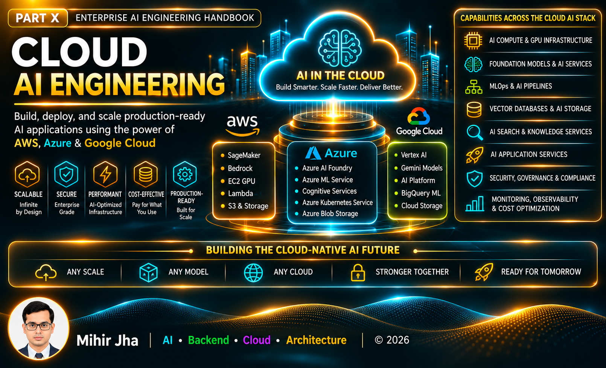
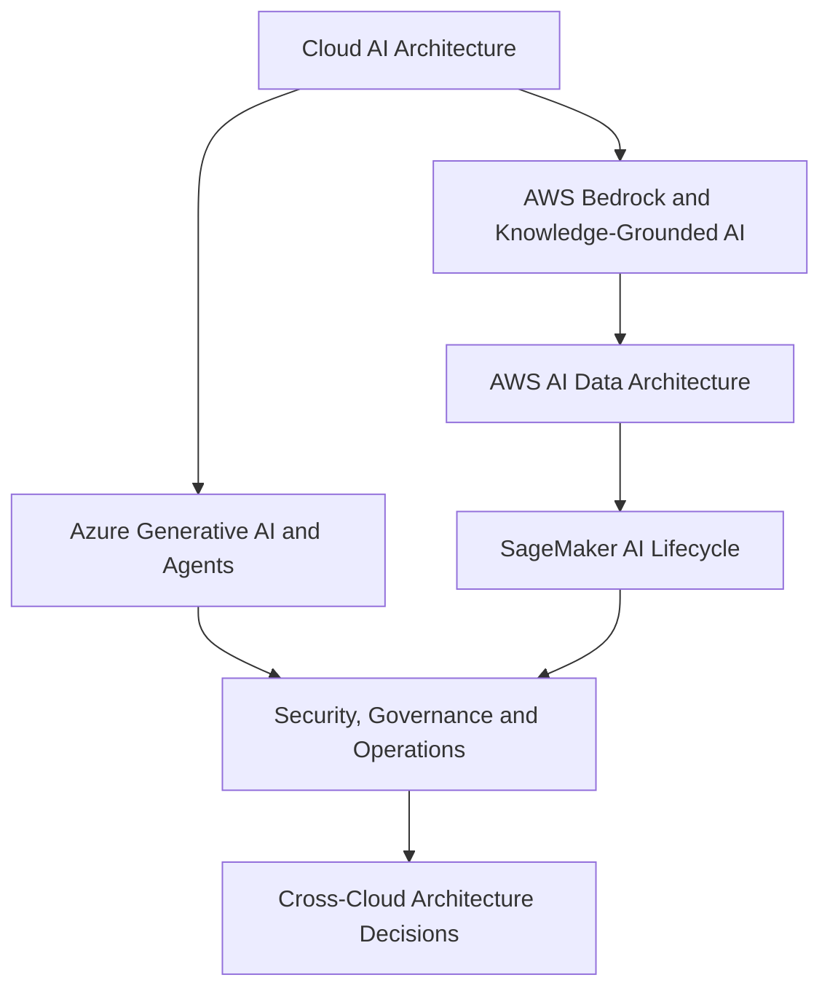

# Part X — Cloud AI Engineering



> Learn how to integrate managed AI services into production cloud architectures across Microsoft Azure and AWS.

## Overview

Cloud AI Engineering is about more than selecting a model and calling an API. Production systems need data pipelines, application integration, identity and access controls, retrieval, orchestration, evaluation, monitoring, deployment strategies, and cost management.

This Part brings together two cloud engineering tracks:

- **Azure AI Engineering** — generative AI applications, Microsoft Foundry, agent tools, MCP integration, workflow orchestration, and multi-agent architecture.
- **AWS AI Engineering** — Amazon Bedrock, knowledge-grounded generation, agents and guardrails, AI data architecture, and SageMaker AI model workflows.

The goal is to understand how services fit into end-to-end systems, where their responsibilities begin and end, and which operational concerns must be addressed before production.

```text
Business use case
       ↓
Cloud service selection
       ↓
Data and knowledge architecture
       ↓
Model access, generative AI, or ML workflows
       ↓
Application integration and orchestration
       ↓
Evaluation, security, and governance
       ↓
Deployment, monitoring, and cost management
```

## What you will learn

By working through this Part, you will learn to:

- Select cloud AI services based on workload and operational requirements.
- Build generative AI applications and agent workflows on Azure and AWS.
- Integrate tools, MCP servers, workflows, and enterprise systems.
- Design retrieval-grounded applications using cloud knowledge and RAG capabilities.
- Prepare data through storage, ingestion, transformation, quality checks, and feature engineering.
- Understand model processing, training, tuning, evaluation, registration, and inference.
- Apply identity, authorisation, responsible AI, guardrails, and data-protection controls.
- Plan for reliability, observability, scalability, and cost.
- Compare cloud architectures by their responsibilities and trade-offs—not just their service names.

## Learning path

Follow either cloud track independently, or study both to compare their service boundaries, identity models, integration approaches, and operational responsibilities.



## 01 — Azure AI Engineering

This track explores Azure generative AI applications and agent-based systems built with Microsoft Foundry and related Azure capabilities.

### 1.1 — Generative AI

| Chapter | Focus | Status |
|---|---|:---:|
| [01. Azure AI Architecture and Model Lifecycle](01-azure-ai/generative-ai/01-azure-ai-architecture-and-model-lifecycle.md) | Map Azure AI capabilities to application architecture and model lifecycle concerns. | 📘 |
| [02. Building Generative AI Applications with Python](01-azure-ai/generative-ai/02-building-generative-ai-applications-with-python.md) | Build generative AI application workflows using Python. | 📘 |
| [03. Tool Calling, Grounding, and RAG](01-azure-ai/generative-ai/03-tool-calling-grounding-and-rag.md) | Combine tool calling and retrieval-grounded generation. | 📘 |
| [04. Generative AI Optimization and Evaluation](01-azure-ai/generative-ai/04-generative-ai-optimization-and-evaluation.md) | Evaluate application behaviour and improve quality and efficiency. | 📘 |
| [05. Responsible AI and Production Safety](01-azure-ai/generative-ai/05-responsible-ai-and-production-safety.md) | Address responsible AI and safety requirements before production. | 📘 |

### 1.2 — AI Agents

Move from individual agent capabilities to integration, orchestration, and multi-agent communication.

| Chapter | Focus | Status |
|---|---|:---:|
| [01. Anatomy of an Azure AI Agent](01-azure-ai/ai-agents/01-anatomy-of-an-azure-ai-agent.md) | Understand agent autonomy and how agents differ from request-response applications. | 📘 |
| [02. Integrating Custom Tools into AI Agents](01-azure-ai/ai-agents/02-integrating-custom-tools-into-ai-agents.md) | Extend agents with application-specific tools and controlled actions. | 📘 |
| [03. Integrating Agents with MCP Servers](01-azure-ai/ai-agents/03-integrating-agents-with-mcp-servers.md) | Connect agents to capabilities exposed through MCP servers. | 📘 |
| [04. Ground Agents with Foundry IQ](01-azure-ai/ai-agents/04-ground-agents-with-foundry-iq.md) | Ground agent responses in enterprise knowledge sources. | 📘 |
| [05. Orchestrating AI Agents with Microsoft Foundry Workflows](01-azure-ai/ai-agents/05-orchestrating-ai-agents-with-microsoft-foundry-workflows.md) | Coordinate agent tasks through workflow-oriented orchestration. | 📘 |
| [06. AI Agents with Agent Framework](01-azure-ai/ai-agents/06-ai-agents-with-agent-framework.md) | Explore agent development using an agent framework. | 📘 |
| [07. Multi-Agent Systems Architecture](01-azure-ai/ai-agents/07-multi-agent-systems-architecture.md) | Understand architectures for cooperating agents. | 📘 |
| [08. Agent-to-Agent Communication Architecture](01-azure-ai/ai-agents/08-agent-to-agent-communication-architecture.md) | Examine communication boundaries and interaction patterns between agents. | 📘 |
| [09. Publishing Agents to Microsoft 365](01-azure-ai/ai-agents/09-publishing-agents-to-microsoft-365.md) | Explore publishing and integrating agents into Microsoft 365 experiences. | 📘 |

**Azure progression:** generative AI applications → tools and grounding → agent integration → workflow orchestration → multi-agent interaction → enterprise integration.

## 02 — AWS AI Engineering

The AWS track connects foundation-model applications with data preparation, machine learning workflows, and deployment patterns.

### 2.1 — Data Architecture

AI workloads depend on data that is accessible, governed, and fit for purpose. These chapters cover the foundations for AI and machine learning data pipelines.

| Chapter | Focus | Status |
|---|---|:---:|
| [01. Data Storage and Ingestion for AI](02-aws-ai/data-architecture/01-data-storage-and-ingestion-for-ai.md) | Compare storage choices and explore ingestion, cataloguing, and access-control patterns. | 📘 |
| [02. AWS ETL and Distributed Processing](02-aws-ai/data-architecture/02-aws-etl-and-distributed-processing.md) | Understand ETL and distributed processing workflows using AWS data services. | 📘 |
| [03. Data Quality and Feature Engineering on AWS](02-aws-ai/data-architecture/03-data-quality-and-feature-engineering-on-aws.md) | Explore data validation, processing, and feature engineering for ML workloads. | 📘 |

```text
Operational and external data
          ↓
       Ingestion
          ↓
   Storage and catalog
          ↓
   Transformation / ETL
          ↓
  Data quality and validation
          ↓
Features, retrieval, or training
          ↓
      AI / ML workload
```

### 2.2 — SageMaker AI Architecture

Follow the machine learning lifecycle from platform orientation through processing, training, and tuning to evaluation, registration, and inference.

| Chapter | Focus | Status |
|---|---|:---:|
| [01. SageMaker AI Platform Overview](02-aws-ai/sagemaker-ai-architecture/01-sagemaker-ai-platform-overview.md) | Understand the platform and its role across the ML lifecycle. | 📘 |
| [02. Training, Processing, and Tuning Workflows](02-aws-ai/sagemaker-ai-architecture/02-training-processing-and-tuning-workflows.md) | Explore training jobs, processing jobs, and hyperparameter tuning. | 📘 |
| [03. Model Evaluation, Registry, and Approval](02-aws-ai/sagemaker-ai-architecture/03-model-evaluation-registry-and-approval.md) | Understand evaluation, versioning, registry, and approval workflows. | 📘 |
| [04. Model Inference and Deployment Options](02-aws-ai/sagemaker-ai-architecture/04-model-inference-and-deployment-options.md) | Compare inference and deployment options for different workloads. | 📘 |

```text
Data preparation
      ↓
Processing and feature engineering
      ↓
Training and tuning
      ↓
Evaluation
      ↓
Model registry and approval
      ↓
Inference deployment
      ↓
Monitoring and iteration
```

### 2.3 — Bedrock AI Architecture

Explore model access, knowledge-grounded generation, agent execution, guardrails, and evaluation with Amazon Bedrock.

| Chapter | Focus | Status |
|---|---|:---:|
| [01. Bedrock Platform and Model Access](02-aws-ai/bedrock-ai-architecture/01-bedrock-platform-and-model-access.md) | Understand Amazon Bedrock and foundation-model access patterns. | 📘 |
| [02. Bedrock Knowledge Bases and AWS RAG](02-aws-ai/bedrock-ai-architecture/02-bedrock-knowledge-bases-and-aws-rag.md) | Explore knowledge-grounded generation and RAG architecture on AWS. | 📘 |
| [03. Bedrock Agents, Guardrails, and Evaluation](02-aws-ai/bedrock-ai-architecture/03-bedrock-agents-guardrails-and-evaluation.md) | Study agent execution, tool integration, permissions, guardrails, and evaluation. | 📘 |

**Bedrock application flow:** application request → model access → prompt, retrieval, or agent logic → tool integration → guardrails and evaluation → response.

## 03 — Cross-Cloud Architecture Thinking

Azure and AWS offer different managed services and integration models, but production AI systems must solve many of the same architectural problems. Compare responsibilities and system boundaries rather than assuming similarly named services behave identically.

| Architecture concern | Questions to ask |
|---|---|
| Model access | How are models selected, invoked, governed, and isolated from application code? |
| Knowledge and retrieval | Where does source data live, how is it indexed, and how are responses grounded? |
| Agent execution | Which component plans tasks, calls tools, maintains state, and controls side effects? |
| Data engineering | How are data ingested, transformed, validated, catalogued, and made available? |
| Model lifecycle | How are training, evaluation, approval, deployment, and rollback managed? |
| Security | How are identities, permissions, secrets, private data, and tool execution controlled? |
| Operations | How are quality, latency, failures, usage, and cost measured? |
| Governance | How are safety, auditability, and human approvals incorporated? |

### Production AI readiness checklist

- [ ] Workload requirements and service-selection rationale are clear.
- [ ] Data classification, access permissions, and lifecycle controls are defined.
- [ ] Applications and tools use authentication and least-privilege authorisation.
- [ ] Evaluation covers quality, grounding, safety, and task completion.
- [ ] Timeouts, retries, rate limits, and failure handling are designed.
- [ ] Logs, metrics, traces, and cost are visible to operators.
- [ ] Sensitive or consequential actions have appropriate human approval.
- [ ] Deployment, versioning, rollback, and operational ownership are defined.

## Cloud AI engineering lifecycle

Treat cloud AI as an iterative engineering lifecycle, not a one-time model integration.

```text
Discover requirements
        ↓
Select services and architecture
        ↓
Prepare data and knowledge
        ↓
Build application or model workflow
        ↓
Integrate tools and enterprise systems
        ↓
Evaluate quality and safety
        ↓
Secure and govern
        ↓
Deploy and observe
        ↓
Optimise and improve
```

Evaluation results, operational telemetry, user feedback, and cost measurements should inform changes to prompts, retrieval, tools, data pipelines, model choices, and deployment configuration.

## Chapter Navigation

**Current Part:** Part X — Cloud AI Engineering

Use the Azure and AWS chapter tables above to navigate directly to each topic.

## Start learning

Choose a track based on your immediate goal:

- **Azure generative AI applications:** Begin with [Azure AI Architecture and Model Lifecycle](01-azure-ai/generative-ai/01-azure-ai-architecture-and-model-lifecycle.md), then continue with Python application development and tool calling.
- **Azure agents:** Begin with [Anatomy of an Azure AI Agent](01-azure-ai/ai-agents/01-anatomy-of-an-azure-ai-agent.md), then follow the tools, MCP, grounding, and orchestration chapters.
- **AWS generative AI applications:** Begin with [Bedrock Platform and Model Access](02-aws-ai/bedrock-ai-architecture/01-bedrock-platform-and-model-access.md), then continue to Knowledge Bases and agents.
- **AWS AI data:** Start with [Data Storage and Ingestion for AI](02-aws-ai/data-architecture/01-data-storage-and-ingestion-for-ai.md), followed by ETL and data quality.
- **AWS model operations:** Start with [SageMaker AI Platform Overview](02-aws-ai/sagemaker-ai-architecture/01-sagemaker-ai-platform-overview.md), then follow training, evaluation, and inference.

---

> **Enterprise AI Engineering Handbook**
>
> *Building Production-Grade Enterprise AI Systems — One Chapter at a Time.*

---
