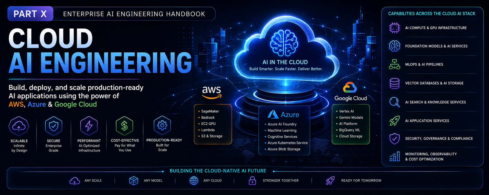
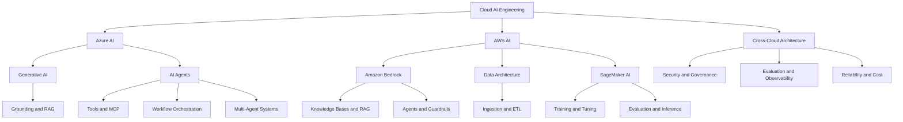

# Part X — Cloud AI Engineering



> Learn how to design, integrate, deploy, secure, and operate production AI systems using managed AI services and cloud-native architecture across Microsoft Azure and AWS Cloud included as the broader multi-cloud context.

---

## 📖 Overview

Cloud AI Engineering connects AI capabilities with the engineering practices needed to run them reliably in real applications. It covers more than choosing a model or calling an API: production systems also require data pipelines, identity and access controls, retrieval, orchestration, evaluation, monitoring, deployment strategies, and cost management.

This part of the handbook follows two active cloud learning tracks:

- **Azure AI Engineering** — generative AI applications, Microsoft Foundry, agent tools, MCP integration, workflow orchestration, and multi-agent architecture.
- **AWS AI Engineering** — Amazon Bedrock, knowledge-grounded generation, agents and guardrails, AI data architecture, and SageMaker AI model workflows.

The goal is to understand how individual cloud services fit into an end-to-end architecture, why one service or pattern may be preferable to another, and which operational requirements must be addressed before production deployment.

### Cloud AI Engineering at a glance

```text
Business Use Case
       ↓
Cloud AI Service Selection
       ↓
Data and Knowledge Architecture
       ↓
Model Access / Generative AI / ML Workflows
       ↓
Application Integration and Orchestration
       ↓
Evaluation, Security, and Governance
       ↓
Deployment, Monitoring, and Cost Management
```

This section is designed for backend and software engineers, cloud engineers, AI engineers, solution architects, and enterprise architects who need to connect cloud AI services to real production systems.

---

## 🎯 Learning Outcomes

After working through this section, you should be able to:

- Explain the role of managed AI services within a cloud-native architecture.
- Compare cloud AI service capabilities against workload and operational requirements.
- Design generative AI applications and agent-based workflows on Azure and AWS.
- Integrate agent tools, MCP servers, workflows, and external enterprise systems.
- Design retrieval-grounded applications using cloud knowledge and RAG capabilities.
- Plan AI data storage, ingestion, transformation, data quality, and feature engineering.
- Understand model training, processing, tuning, evaluation, registry, and inference workflows.
- Apply identity, authorization, responsible AI, guardrails, and data-protection controls.
- Identify production requirements for reliability, observability, scalability, and cost management.
- Make architecture decisions based on trade-offs rather than selecting services in isolation.

---

## 🛣️ Recommended Learning Path

The learning path moves from application and agent architecture into data and model lifecycle engineering.

```text
Cloud AI Architecture Fundamentals
              ↓
Azure Generative AI and AI Agents
              ↓
AWS Bedrock and Knowledge-Grounded AI
              ↓
AI Data Architecture and Preparation
              ↓
Model Training, Evaluation, and Deployment
              ↓
Security, Governance, and Production Operations
              ↓
Multi-Cloud Architecture Decisions
```

You can follow the Azure or AWS track independently. For a broader architecture perspective, study the corresponding patterns across both platforms and compare their service boundaries, identity models, integration approaches, and operational responsibilities.

---

# ☁️ 01 — Azure AI Engineering

This track explores Azure AI application architecture, generative AI engineering, and agentic systems built with Microsoft Foundry and related Azure capabilities.

## 1.1 — Generative AI

These chapters cover Azure AI architecture, application development, grounded generation, optimization, evaluation, and production safety.

| Chapter | Focus | Status |
|---|---|:---:|
| [01. Azure AI Architecture and Model Lifecycle](01-azure-ai/generative-ai/01-azure-ai-architecture-and-model-lifecycle.md) | Map Azure AI capabilities to application architecture and model lifecycle concerns. | 📘 |
| [02. Building Generative AI Applications with Python](01-azure-ai/generative-ai/02-building-generative-ai-applications-with-python.md) | Build generative AI application workflows using Python. | 📘 |
| [03. Tool Calling, Grounding, and RAG](01-azure-ai/generative-ai/03-tool-calling-grounding-and-rag.md) | Combine tool calling and retrieval-grounded generation in application flows. | 📘 |
| [04. Generative AI Optimization and Evaluation](01-azure-ai/generative-ai/04-generative-ai-optimization-and-evaluation.md) | Evaluate application behavior and identify opportunities to improve quality and efficiency. | 📘 |
| [05. Responsible AI and Production Safety](01-azure-ai/generative-ai/05-responsible-ai-and-production-safety.md) | Address responsible AI and safety requirements before production use. | 📘 |


## 1.2 — AI Agents

This section progresses from agent capabilities to integration, orchestration, and multi-agent communication.

| Chapter | Focus | Status |
|---|---|:---:|
| [01. Autonomy of an Azure AI Agent](01-azure-ai/ai-agents/01-autonomy-of-an-azure-ai-agent.md) | Understand agent autonomy and how an agent differs from a conventional request-response application. | 📘 |
| [02. Integrating Custom Tools into AI Agents](01-azure-ai/ai-agents/02-integrating-custom-tools-into-ai-agents.md) | Extend agents with application-specific tools and controlled actions. | 📘 |
| [03. Integrating Agents with MCP Servers](01-azure-ai/ai-agents/03-integrating-agents-with-mcp-servers.md) | Connect agents to tools and capabilities exposed through MCP servers. | 📘 |
| [04. Ground Agents with Foundry IQ](01-azure-ai/ai-agents/04-ground-agents-with-foundry-iq.md) | Ground agent responses in enterprise knowledge sources. | 📘 |
| [05. Orchestrating AI Agents with Microsoft Foundry Workflows](01-azure-ai/ai-agents/05-orchestrating-ai-agents-with-microsoft-foundry-workflows.md) | Coordinate agent tasks through workflow-oriented orchestration. | 📘 |
| [06. AI Agents with Agent Framework](01-azure-ai/ai-agents/06-ai-agents-with-agent-framework.md) | Explore agent development using an agent framework. | 📘 |
| [07. Multi-Agent Systems Architecture](01-azure-ai/ai-agents/07-multi-agent-systems-architecture.md) | Understand architectural patterns for multiple cooperating agents. | 📘 |
| [08. Agent-to-Agent Communication Architecture](01-azure-ai/ai-agents/08-agent-to-agent-communication-architecture.md) | Examine communication boundaries and interaction patterns between agents. | 📘 |
| [09. Publishing Agents to Microsoft 365](01-azure-ai/ai-agents/09-publishing-agents-to-microsoft-365.md) | Consider publishing and integrating agents into Microsoft 365 experiences. | 📘 |


### Azure architecture progression

```text
Generative AI Application
          ↓
Model and Prompt Integration
          ↓
Tool Calling and Grounding
          ↓
Agent Tools and MCP
          ↓
Workflow Orchestration
          ↓
Multi-Agent Interaction
          ↓
Evaluation and Responsible AI
          ↓
Enterprise Integration
```

---

# 🟧 02 — AWS AI Engineering

The AWS track covers Amazon Bedrock, AI data architecture, and SageMaker AI. Together, these areas help connect foundation-model applications with data preparation, machine learning workflows, and deployment patterns.

## 2.1 — Data Architecture

AI applications depend on data that is accessible, well-governed, fit for purpose, and prepared for the workload. These chapters focus on data foundations for AI and machine learning.

| Chapter | Focus | Status |
|---|---|:---:|
| [01. Data Storage and Ingestion for AI](02-aws-ai/data-architecture/01-data-storage-and-ingestion-for-ai.md) | Compare storage choices and explore batch, streaming, ingestion, cataloguing, and access-control patterns. | 📘 |
| [02. AWS ETL and Distributed Processing](02-aws-ai/data-architecture/02-aws-etl-and-distributed-processing.md) | Understand ETL and distributed processing workflows using AWS data services. | 📘 |
| [03. Data Quality and Feature Engineering on AWS](02-aws-ai/data-architecture/03-data-quality-and-feature-engineering-on-aws.md) | Explore data validation, processing, and feature engineering for ML workloads. | 📘 |

### AI data preparation flow

```text
Operational and External Data
             ↓
       Ingestion Layer
             ↓
     Storage and Catalog
             ↓
 Transformation / ETL
             ↓
 Data Quality and Validation
             ↓
 Features / Retrieval / Training
             ↓
     AI or ML Workload
```

## 2.2 — SageMaker AI Architecture

This section follows the model lifecycle from platform orientation through training and tuning to evaluation, registration, and inference.

| Chapter | Focus | Status |
|---|---|:---:|
| [01. SageMaker AI Platform Overview](02-aws-ai/sagemaker-ai-architecture/01-sagemaker-ai-platform-overview.md) | Understand the platform and its role across the machine learning lifecycle. | 📘 |
| [02. Training, Processing, and Tuning Workflows](02-aws-ai/sagemaker-ai-architecture/02-training-processing-and-tuning-workflows.md) | Explore training jobs, processing jobs, and hyperparameter tuning. | 📘 |
| [03. Model Evaluation, Registry, and Approval](02-aws-ai/sagemaker-ai-architecture/03-model-evaluation-registry-and-approval.md) | Understand model evaluation, versioning, registry, and approval workflows. | 📘 |
| [04. Model Inference and Deployment Options](02-aws-ai/sagemaker-ai-architecture/04-model-inference-and-deployment-options.md) | Compare inference and deployment options for different workload requirements. | 📘 |

### Machine learning lifecycle

```text
Data Preparation
       ↓
Processing and Feature Engineering
       ↓
Training and Tuning
       ↓
Evaluation
       ↓
Model Registry and Approval
       ↓
Inference Deployment
       ↓
Monitoring and Iteration
```

## 2.3 — Bedrock AI Architecture

This section focuses on model access, knowledge-grounded generation, agents, guardrails, and evaluation.

| Chapter | Focus | Status |
|---|---|:---:|
| [01. Bedrock Platform and Model Access](02-aws-ai/bedrock-ai-architecture/01-bedrock-platform-and-model-access.md) | Understand Amazon Bedrock and its foundation-model access patterns. | 📘 |
| [02. Bedrock Knowledge Bases and AWS RAG](02-aws-ai/bedrock-ai-architecture/02-bedrock-knowledge-bases-and-aws-rag.md) | Explore knowledge-grounded generation and RAG architecture on AWS. | 📘 |
| [03. Bedrock Agents, Guardrails, and Evaluation](02-aws-ai/bedrock-ai-architecture/03-bedrock-agents-guardrails-and-evaluation.md) | Study agent execution, tool integration, permissions, guardrails, and evaluation. | 📘 |

### Bedrock application flow

```text
Application Request
        ↓
Amazon Bedrock Model Access
        ↓
Prompt / Knowledge Retrieval / Agent Logic
        ↓
Tool or Enterprise-System Integration
        ↓
Guardrails and Evaluation
        ↓
Application Response
```

---

# 🧭 03 — Cross-Cloud Architecture Thinking

Azure and AWS expose different managed services and integration models, but production AI systems must solve many of the same architectural problems. Use the chapters to compare the responsibilities and boundaries of each service rather than assuming that similarly named services behave identically.

| Architecture concern | Questions to ask |
|---|---|
| Model access | How are models selected, invoked, governed, and isolated from application code? |
| Knowledge and retrieval | Where does source data live, how is it indexed, and how are retrieved results grounded in responses? |
| Agent execution | Which component plans tasks, calls tools, maintains state, and controls side effects? |
| Data engineering | How are data ingested, transformed, validated, catalogued, and made available to AI workloads? |
| Model lifecycle | How are training, evaluation, approval, deployment, and rollback managed? |
| Security | How are identities, permissions, secrets, private data, and tool execution controlled? |
| Operations | How are quality, latency, failures, token or compute usage, and cost measured? |
| Governance | How are safety requirements, evaluations, auditability, and human approvals incorporated? |

## Production AI architecture checklist

Before considering a cloud AI solution production-ready, review these areas:

- [ ] Clear workload requirements and service-selection rationale.
- [ ] Data classification, access permissions, and lifecycle controls.
- [ ] Authentication and least-privilege authorization for applications and tools.
- [ ] Evaluation criteria for quality, grounding, safety, and task completion.
- [ ] Timeouts, retries, rate limits, and failure-handling behavior.
- [ ] Logging, metrics, tracing, and cost visibility.
- [ ] Human approval for sensitive or consequential actions where appropriate.
- [ ] Deployment, versioning, rollback, and operational ownership.

---

# 🧩 Cloud AI Capability Map



---

# 🔄 Cloud AI Engineering Lifecycle

A useful way to reason about cloud AI work is to treat it as an engineering lifecycle rather than a one-time model integration.

```text
Discover Requirements
        ↓
Select Services and Architecture
        ↓
Prepare Data and Knowledge
        ↓
Build Application or Model Workflow
        ↓
Integrate Tools and Enterprise Systems
        ↓
Evaluate Quality and Safety
        ↓
Secure and Govern
        ↓
Deploy and Observe
        ↓
Optimize and Improve
```

The lifecycle is iterative. Evaluation results, operational telemetry, user feedback, and cost measurements should inform changes to prompts, retrieval, tools, data pipelines, model choices, and deployment configuration.

---


# 📚 What This Section Establishes

By working through the Azure and AWS chapters, you will build a practical understanding of how managed AI services fit into enterprise software architecture.

```text
Cloud Service Selection
        ↓
Generative AI and Agent Applications
        ↓
Knowledge Grounding and RAG
        ↓
Data Engineering and Preparation
        ↓
Model Lifecycle and Inference
        ↓
Security, Evaluation, and Governance
        ↓
Production Deployment and Operations
```

The emphasis throughout is on architecture decisions, system boundaries, implementation patterns, operational trade-offs, and the controls required to move from a working demonstration to a maintainable production system.

---

# 🔗 Chapter Navigation

**Current Part:** Part X — Cloud AI Engineering

Use the Azure and AWS chapter tables above to navigate directly to each topic.

---

# 🚀 Start Learning

Choose a starting point based on your immediate goal:

- **Building Azure generative ai applications:** begin with [Azure AI Architecture and Model Lifecycle](01-azure-ai-architecture-and-model-lifecycle.md), then follow the Building Generative AI Applications with Python, tool calling  chapters.
- **Building Azure agents:** begin with [Autonomy of an Azure AI Agent](01-azure-ai/ai-agents/01-autonomy-of-an-azure-ai-agent.md), then follow the tools, MCP, grounding, and orchestration chapters.
- **Building AWS generative AI applications:** begin with [Bedrock Platform and Model Access](02-aws-ai/bedrock-ai-architecture/01-bedrock-platform-and-model-access.md), then continue to Knowledge Bases and agents.
- **Preparing AWS AI data:** start with [Data Storage and Ingestion for AI](02-aws-ai/data-architecture/01-data-storage-and-ingestion-for-ai.md), followed by ETL and data quality.
- **Understanding AWS model operations:** start with [SageMaker AI Platform Overview](02-aws-ai/sagemaker-ai-architecture/01-sagemaker-ai-platform-overview.md), then follow training, evaluation, and inference.

> **Enterprise AI Engineering Handbook**
>
> *Building Production-Grade Enterprise AI Systems — One Chapter at a Time.*
