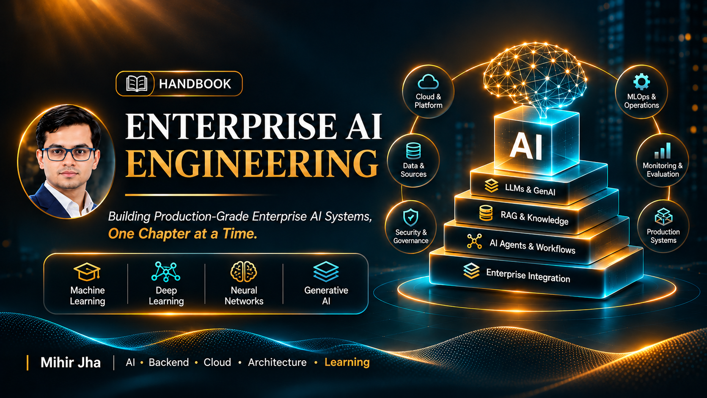
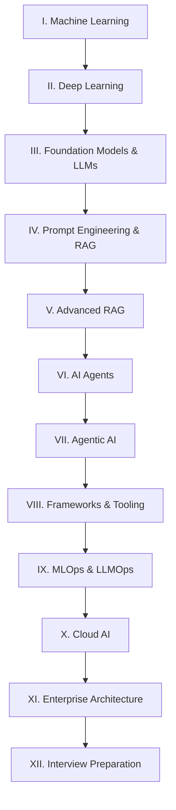

# Enterprise AI Engineering Handbook

  

> **Learn the models. Engineer the systems. Build for production.**
>
> A practical handbook for software engineers and architects moving from AI concepts to reliable, scalable enterprise AI systems.

---

## Welcome

There is no shortage of material explaining what an LLM is or how to send it a prompt. The harder questions begin when you need to turn that capability into a system people can depend on.

How should information be retrieved? Where do agents fit? How do you control access to tools and data? What needs to be monitored? How do you keep latency, reliability, and cost under control?

This handbook explores those questions from an engineering perspective.

It starts with Machine Learning and Deep Learning, moves into Foundation Models and Generative AI, and then follows the path toward retrieval, agents, frameworks, operations, cloud infrastructure, and enterprise architecture. The aim is to connect the underlying concepts with the design decisions involved in building real systems.

## Who will find it useful?

The handbook is written primarily for people who build or design software systems:

- Backend and full-stack engineers, including Java and Spring Boot developers
- Cloud, DevOps, and platform engineers
- Software and solution architects
- AI and Machine Learning engineers
- Technical leads and engineering managers

You do not have to start at Part I. If you already understand the fundamentals, jump to the area that matches the problem you're working on and use the earlier parts as reference.

---

## Explore the handbook

The twelve parts are grouped below by the kind of engineering problem they address.

### 1. Understand the models

Start with the foundations behind modern AI: how models learn, how neural networks work, and how today's language models are built.

#### [Part I — Machine Learning](https://enterpriseai.handbook.mihirkjha.com/01-machine-learning/)

The core concepts behind learning from data.

*Topics:* supervised and unsupervised learning, regression, classification, clustering, feature engineering, dimensionality reduction, model evaluation, validation, and production ML.

#### [Part II — Deep Learning](https://enterpriseai.handbook.mihirkjha.com/02-deep-learning/)

How neural networks learn, and how deep learning architectures are trained and applied.

*Topics:* neural networks, training and optimization, TensorFlow, Keras, PyTorch, computer vision, CNNs, sequence models, Transformers, generative models, reinforcement learning, and production systems.

#### [Part III — Foundation Models, Large Language Models & Generative AI](https://enterpriseai.handbook.mihirkjha.com/03-generative-ai/)

The evolution from language modeling and Transformers to modern Foundation Models and LLM engineering.

*Topics:* embeddings, GPT and BERT, Hugging Face, data preparation, fine-tuning, SFT, PEFT, LoRA, QLoRA, quantization, generation, evaluation, and alignment.

### 2. Build LLM-powered applications

Move beyond the model itself. Learn how to guide its behavior and connect it to relevant, trustworthy information.

#### [Part IV — Prompt Engineering & RAG Fundamentals](https://enterpriseai.handbook.mihirkjha.com/04-retrieval-augmented-generation/)

Design prompts and build the foundations of Retrieval-Augmented Generation.

*Topics:* prompt patterns, structured outputs, function and tool calling, embeddings, semantic search, document processing, chunking, vector databases, retrieval pipelines, RAG evaluation, and application deployment with Gradio and Flask.

#### [Part V — Advanced Retrieval-Augmented Generation](https://enterpriseai.handbook.mihirkjha.com/05-advanced-retrieval-augmented-generation/)

Explore the retrieval strategies and system design choices behind enterprise RAG.

*Topics:* hybrid and multi-stage retrieval, query rewriting, reranking, LlamaIndex, vector indexes, Graph RAG, SQL RAG, multimodal and agentic retrieval, context engineering, evaluation, observability, optimization, testing, and production architecture.

### 3. Design agents and orchestrate work

Move from individual model interactions to agents that use tools, manage tasks, and work together.

#### [Part VI — AI Agents](https://enterpriseai.handbook.mihirkjha.com/06-ai-agents/)

The engineering foundations of an individual AI agent.

*Topics:* agent architecture and runtime, planning, task decomposition, reasoning, memory, tool use, authorization, privacy, sandboxing, guardrails, resilience, deployment, evaluation, and observability.

#### [Part VII — Agentic AI & Multi-Agent Systems](https://enterpriseai.handbook.mihirkjha.com/07-agentic-ai/)

Patterns for coordinating agents and building workflows that handle more complex tasks.

*Topics:* orchestration, supervisor and hierarchical patterns, collaboration and swarms, human-in-the-loop workflows, durable execution, evaluation, Agentic RAG, communication protocols, MCP and A2A architecture, and enterprise agent platforms.

#### [Part VIII — AI Engineering Frameworks & Tooling](https://enterpriseai.handbook.mihirkjha.com/08-ai-engineering-frameworks/)

Put the concepts into practice with the frameworks, SDKs, and protocols used to build AI applications.

*Topics:* LangChain, LangGraph, MCP engineering, LlamaIndex, Semantic Kernel, CrewAI, AutoGen/AG2, BeeAI, DSPy, Haystack, OpenAI and Anthropic SDKs, Google GenAI SDK, and framework comparisons.

### 4. Run and scale AI in the enterprise

A working prototype is only the beginning. These parts focus on the operational, infrastructure, and architectural concerns that emerge at production scale.

#### [Part IX — MLOps, LLMOps & AIOps](https://enterpriseai.handbook.mihirkjha.com/09-mlops/)

**Status: Coming soon**

The practices and platforms used to ship, operate, monitor, and govern AI systems.

*Planned topics:* experiment tracking, model registries, CI/CD, feature stores, prompt management, model serving, evaluation, monitoring, guardrails, continuous training, and AI governance.

#### [Part X — Cloud AI Engineering](https://enterpriseai.handbook.mihirkjha.com/10-cloud-ai-engineering/)

Cloud platforms and infrastructure for modern AI workloads.

*Topics:* AWS AI, Azure AI, Google Cloud AI, GPU computing, serverless AI, cloud-native infrastructure, enterprise AI platforms, and multi-cloud architecture.

#### [Part XI — Enterprise AI Architecture & Design Patterns](https://enterpriseai.handbook.mihirkjha.com/11-enterprise-ai-architecture/)

Bring models, data, applications, and infrastructure together into secure and resilient enterprise systems.

**Status: Coming soon**

*Planned topics:* AI architecture patterns, system design, distributed and event-driven systems, security, reliability, observability, infrastructure, and enterprise design patterns.

#### [Part XII — Interview Preparation](https://enterpriseai.handbook.mihirkjha.com/12-interview-preparation/)

Prepare to discuss, design, and explain AI systems with confidence.

**Status: Coming soon**

*Planned topics:* AI interview questions, system design, architecture discussions, coding exercises, and behavioral interviews.

---

## Where should you start?

If you're new to AI engineering, the sequence below gives you a solid progression. If you're already an experienced software or cloud engineer, you can enter at the point most relevant to your work.

This is a suggested route, not a prerequisite chain. For example, a backend engineer building a knowledge assistant may want to begin with Part IV, while an engineer exploring autonomous workflows may start with Parts VI and VII.

## What you'll find in the chapters

The handbook aims to go beyond definitions and isolated demos. Depending on the topic, chapters use:

- Explanations of core concepts, architecture, and engineering trade-offs
- Diagrams that make components and data flows easier to follow
- Practical code examples and implementation workflows
- Enterprise use cases and production considerations
- Common failure patterns and engineering best practices
- Review questions, references, and further reading

The format is adapted to the subject rather than forcing every topic into the same template.

---

## About the author

### Mihir Jha

**Software Architect | Enterprise AI Engineer | Cloud-Native & Multi-Cloud Solutions**

I'm interested in the engineering work that turns AI capabilities into dependable software: backend integration, cloud-native architecture, retrieval systems, LLM applications, and agent-based workflows.

This handbook is an ongoing effort to organise those ideas into a practical resource. If you spot an error, have a useful suggestion, or want to contribute, your feedback is welcome.

## Connect

- **Handbook:** [Enterprise AI Engineering Handbook](https://enterpriseai.handbook.mihirkjha.com/)
- **Blog:** [Enterprise AI Engineering Blog](https://enterpriseai.blog.mihirkjha.com/)
- **Medium:** [Read my Medium stories](https://medium.com/@mihir.iiest)
- **GitHub:** [MihirKJha](https://github.com/MihirKJha)
- **LinkedIn:** [Mihir Jha](https://www.linkedin.com/in/mihirkrjha/)
- **Newsletter:** [Enterprise AI Engineering](https://www.linkedin.com/newsletters/enterprise-ai-engineering-7479222208079319041/)
- **Topmate:** [1:1 Consultations on Topmate](https://topmate.io/mihir_jha)

---

If you find the handbook useful, consider giving the repository a ⭐ or sharing it with another engineer.

> **Enterprise AI Engineering Handbook**
>
> *Building Production-Grade Enterprise AI Systems — One Chapter at a Time.*

---
